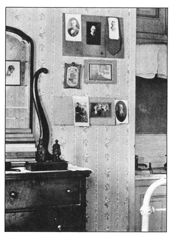
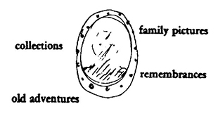

<section class="pattern-plate" aria-labelledby="t-things-from-your-life">
<a href="/patterns">A Pattern Language</a> · <a href="/patterns#construction">Construction</a> · Pattern 253 · p. 1164 · *
<h1 class="pattern-title" id="t-things-from-your-life">Things From Your Life</h1><figure class="pattern-figure pl-figure"></figure><nav class="pattern-links" aria-label="Connections"><h2>Linked from</h2><ul><li><a href="/patterns/a-room-of-ones-own">141 A Room Of One’s Own</a></li><li><a href="/patterns/waist-high-shelf">201 Waist-High Shelf</a></li><li><a href="/patterns/soft-tile-and-brick">248 Soft Tile And Brick</a></li><li><a href="/patterns/ornament">249 Ornament</a></li></ul></nav></section><article class="pattern-text" aria-label="The text of Things From Your Life">
1165… lastly, when you have taken care of everything, and you start living in the places you have made, you may wonder what kinds of things to pin up on the walls.

◆ ◆ ◆

<strong>“Decor” and the conception of “interior design” have spread so widely, that very often people forget their instinct for the things they really want to keep around them.</strong>

There are two ways of looking at this simple fact. We may look at it from the point of view of the person who owns the space, and from the point of view of the people who come to it. From the owner’s point of view, it is obvious that the things around you should be the things which mean most to you, which have the power to play a part in the continuous process of selftransformation, which is your life. That much is clear.

But this function has been eroded, gradually, in modern times because people have begun to look outward, to others, and over their shoulders, at the people who are coming to visit them, and have replaced their natural instinctive decorations with the things which they believe will please and impress their visitors. This is the motive behind all the interior design and decor in the women’s magazines. And designers play on these anxieties by making total designs, telling people they have no right to move anything, paint the walls, or add a plant, because they are not party to the mysteries of Good Design.

But the irony is, that the visitors who come into a room don’t want this nonsense any more than the people who live there. It is far more fascinating to come into a room which is the living expression of a person, or a group of people, so that you can see their lives, their histories, their inclinations, displayed in manifest form around the walls, in the furniture, on the shelves. Beside such experience—and it is as ordinary as the grass—the artificial scene-making of “modern decor” is totally bankrupt.

Jung describes the room that was his study, how he filled the stone walls with paintings that he made each day directly on 1166the stones—mandalas, dream images, preoccupations—and he tells us that the room came gradually to be a living thing to him—the outward counterpart to his unconscious.

Examples we know: A motel run by a Frenchman, mementos of the Resistance all around the lounge, the letter from Charles de Gaulle. An outdoor market on the highway, where the proprietor has mounted his collection of old bottles all over the walls; hundreds of bottles, all shapes and colors; some of them are down for cleaning; there is an especially beautiful one up at the counter by the cash register. An anarchist runs the hot dog stand, he plasters the walls with literature, proclamations, manifestoes against the State.

A hunting glove, a blind man’s cane, the collar of a favorite dog, a panel of pressed flowers from the time when we were children, oval pictures of grandma, a candlestick, the dust from a volcano carefully kept in a bottle, a picture from the news of prison convicts at Attica in charge of the prison, not knowing that they were about to die, an old photo, the wind blowing in the grass and a church steeple in the distance, spiked sea shells with the hum of the sea still in them.

Therefore:

<strong>Do not be tricked into believing that modern decor must be slick or psychedelic, or “natural” or “modem art,” or “plants” or anything else that current taste-makers claim. It is most beautiful when it comes straight from your life—the things you care for, the things that tell your story.</strong>

<figure class="pl-figure"></figure>
◆ ◆ ◆
</article>

Christopher Alexander, Sara Ishikawa and Murray Silverstein, with Max Jacobson, Ingrid Fiksdahl-King and Shlomo Angel, <cite>A Pattern Language</cite> (Oxford University Press, 1977), pattern 253, pp. 1164–1166. Text and illustrations from the <a href="https://github.com/natureoforder/sources">Nature of Order sources</a> reading edition, transcribed from the 1977 printing; report errors on <a href="https://github.com/natureoforder/alexander-wiki/issues">GitHub</a>.

<a href="/patterns/pools-of-light">← 252 Pools Of Light</a> · <a href="/patterns">All 253 patterns</a>

