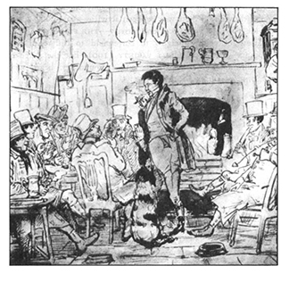
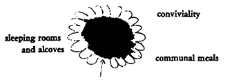

<section class="pattern-plate" aria-labelledby="t-travelers-inn">
<a href="/patterns">A Pattern Language</a> · <a href="/patterns#towns">Towns</a> · Pattern 91 · p. 448 · *
<h1 class="pattern-title" id="t-travelers-inn">Traveler’s Inn</h1><figure class="pattern-figure pl-figure"></figure><nav class="pattern-links" aria-label="Connections"><h2>Links to</h2><ul><li><a href="/patterns/magic-of-the-city">10 Magic Of The City</a></li><li><a href="/patterns/activity-nodes">30 Activity Nodes</a></li><li><a href="/patterns/promenade">31 Promenade</a></li><li><a href="/patterns/night-life">33 Night Life</a></li><li><a href="/patterns/work-community">41 Work Community</a></li><li><a href="/patterns/dancing-in-the-street">63 Dancing In The Street</a></li><li><a href="/patterns/beer-hall">90 Beer Hall</a></li><li><a href="/patterns/sleeping-in-public">94 Sleeping In Public</a></li><li><a href="/patterns/building-complex">95 Building Complex</a></li><li><a href="/patterns/common-areas-at-the-heart">129 Common Areas At The Heart</a></li><li><a href="/patterns/communal-eating">147 Communal Eating</a></li><li><a href="/patterns/communal-sleeping">186 Communal Sleeping</a></li></ul><h2>Linked from</h2><ul><li><a href="/patterns/night-life">33 Night Life</a></li><li><a href="/patterns/childrens-home">86 Children’s Home</a></li><li><a href="/patterns/reception-welcomes-you">149 Reception Welcomes You</a></li></ul></nav></section><article class="pattern-text" aria-label="The text of Traveler’s Inn">
449… any town or city has visitors and travelers passing through, and these visitors will naturally tend to congregate around the centers of activity—<a class="pl-ref" href="/patterns/magic-of-the-city">MAGIC OF THE CITY (10)</a>, <a class="pl-ref" href="/patterns/activity-nodes">ACTIVITY NODES (30)</a>, <a class="pl-ref" href="/patterns/promenade">PROMENADE (31)</a>, <a class="pl-ref" href="/patterns/night-life">NIGHT LIFE (33)</a>, <a class="pl-ref" href="/patterns/work-community">WORK COMMUNITY (41)</a>. This pattern shows how the hotels which cater to these visitors can most effectively help to sustain the life of these centers.

◆ ◆ ◆

<strong>A man who stays the night in a strange place is still a member of the human community, and still needs company. There is no reason why he should creep into a hole, and watch TV alone, the way he does in a roadside motel.</strong>

At all times, except our own, the inn was a wonderful place, where strangers met for a night, to eat, and drink, play cards, tell stories, and experience extraordinary adventures. But in a modern motel every ounce of this adventure has been lost. The motel owner assumes that strangers are afraid of one another, so he caters to their fear by making each room utterly self-contained and self-sufficient.

But behind the fear, there is a deep need: the need for company—for stories, and adventures, and encounters. It is the business of an inn to create an atmosphere where people can experience and satisfy this need. The most extreme version is the Indian pilgrim’s inn, or the Persian caravanserai. There people eat, and meet, and sleep, and talk, and smoke, and drink in one great space, protected from danger by their mutual company, and given entertainment by one another’s escapades and stories.

The inspiration for this pattern came from Gita Shah’s description of the Indian pilgrim’s inn, in <em>The Timeless Way of Building:</em>

In India, there are many of these inns. There is a courtyard where the people meet, and a place to one side of the courtyard where they eat, and also on this side there is the person who looks after the Inn, and on the other three sides of the courtyard there are the rooms—in front of the rooms is an arcade, maybe one step up from the 450courtyard, and about ten feet deep, with another step leading into the rooms. During the evening everyone meets in the courtyard, and they talk and eat together—it is very special—and then at night they all sleep in the arcade, so they are all sleeping together, round the courtyard.

And of course, the size is crucial. The atmosphere comes mainly from the fact that the people who run the place themselves live there and treat the entire inn as their household. A family can’t handle more than 30 rooms.

Therefore:

<strong>Make the traveler’s inn a place where travelers can take rooms for the night, but where—unlike most hotels and motels—the inn draws all its energy from the community of travelers that are there any given evening. The scale is small—30 or 40 guests to an inn; meals are offered communally; there is even a large space ringed round with beds in alcoves.</strong>

<figure class="pl-figure"></figure>
◆ ◆ ◆

The heart of the conviviality is the central area, where everyone can meet and talk and dance and drink—<a class="pl-ref" href="/patterns/common-areas-at-the-heart">COMMON AREAS AT THE HEART (129)</a>, <a class="pl-ref" href="/patterns/dancing-in-the-street">DANCING IN THE STREET (65)</a>, and <a class="pl-ref" href="/patterns/beer-hall">BEER HALL (90)</a>. Provide the opportunity for communal eating, not a restaurant, but common food around a common table—<a class="pl-ref" href="/patterns/communal-eating">COMMUNAL EATING (147)</a>; and, over and above the individual rooms there are at least some areas where people can lie down and sleep in public unafraid—<a class="pl-ref" href="/patterns/sleeping-in-public">SLEEPING IN PUBLIC (94)</a>, <a class="pl-ref" href="/patterns/communal-sleeping">COMMUNAL SLEEPING (186)</a>. For the overall shape of the inn, its gardens, parking, and surroundings, begin with <a class="pl-ref" href="/patterns/building-complex">BUILDING COMPLEX(95)</a>….
</article>

Christopher Alexander, Sara Ishikawa and Murray Silverstein, with Max Jacobson, Ingrid Fiksdahl-King and Shlomo Angel, <cite>A Pattern Language</cite> (Oxford University Press, 1977), pattern 91, pp. 448–450. Text and illustrations from the <a href="https://github.com/natureoforder/sources">Nature of Order sources</a> reading edition, transcribed from the 1977 printing; report errors on <a href="https://github.com/natureoforder/alexander-wiki/issues">GitHub</a>.

<a href="/patterns/beer-hall">← 90 Beer Hall</a> · <a href="/patterns">All 253 patterns</a> · <a href="/patterns/bus-stop">92 Bus Stop →</a>

