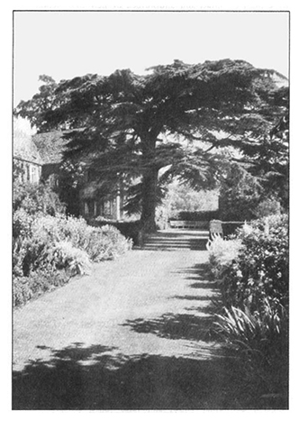
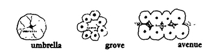

<section class="pattern-plate" aria-labelledby="t-tree-places">
<a href="/patterns">A Pattern Language</a> · <a href="/patterns#buildings">Buildings</a> · Pattern 171 · p. 797 · **
<h1 class="pattern-title" id="t-tree-places">Tree Places</h1><figure class="pattern-figure pl-figure"></figure><nav class="pattern-links" aria-label="Connections"><h2>Links to</h2><ul><li><a href="/patterns/site-repair">104 Site Repair</a></li><li><a href="/patterns/outdoor-room">163 Outdoor Room</a></li><li><a href="/patterns/fruit-trees">170 Fruit Trees</a></li><li><a href="/patterns/trellised-walk">174 Trellised Walk</a></li><li><a href="/patterns/garden-seat">176 Garden Seat</a></li><li><a href="/patterns/seat-spots">241 Seat Spots</a></li><li><a href="/patterns/sitting-wall">243 Sitting Wall</a></li></ul><h2>Linked from</h2><ul><li><a href="/patterns/sacred-sites">24 Sacred Sites</a></li><li><a href="/patterns/holy-ground">66 Holy Ground</a></li><li><a href="/patterns/number-of-stories">96 Number Of Stories</a></li><li><a href="/patterns/small-parking-lots">103 Small Parking Lots</a></li><li><a href="/patterns/site-repair">104 Site Repair</a></li><li><a href="/patterns/positive-outdoor-space">106 Positive Outdoor Space</a></li><li><a href="/patterns/paths-and-goals">120 Paths And Goals</a></li><li><a href="/patterns/something-roughly-in-the-middle">126 Something Roughly In The Middle</a></li><li><a href="/patterns/connection-to-the-earth">168 Connection To The Earth</a></li><li><a href="/patterns/fruit-trees">170 Fruit Trees</a></li><li><a href="/patterns/garden-growing-wild">172 Garden Growing Wild</a></li><li><a href="/patterns/trellised-walk">174 Trellised Walk</a></li></ul></nav></section><article class="pattern-text" aria-label="The text of Tree Places">
798… trees are precious. Keep them. Leave them intact. If you have followed <a class="pl-ref" href="/patterns/site-repair">SITE REPAIR (104)</a>, you have already taken care to leave the trees intact and undisturbed by new construction; you may have planted <a class="pl-ref" href="/patterns/fruit-trees">FRUIT TREES (170)</a>; and you may perhaps also have other additional trees in mind. This pattern reemphasizes the importance of leaving trees intact, and shows you how to plant them, and care for them, and use them, in such a way that the spaces which they form are useful as extensions of the building.

◆ ◆ ◆

<strong>When trees are planted or pruned without regard for the special places they can create, they are as good as dead for the people who need them.</strong>

Trees have a very deep and crucial meaning to human beings. The significance of old trees is archetypal; in our dreams very often they stand for the wholeness of personality: “Since … psychic growth cannot be brought about by a conscious effort of will power, but happens involuntarily and naturally, it is in dreams frequently symbolized by the tree, whose slow, powerful involuntary growth fulfills a definite pattern.” (M. L. von Franz, “The process of individuation,” in C. G. Jung, <em>Man and his Symbols</em>, New York: Doubleday, 1964, pp. 161, 163–64.)

There is even indication that trees, along with houses and other people, constitute one of the three most basic parts of the human environment. The House-Tree-Person Technique, developed by Psychologist John Buck, takes the drawings a person makes of each of these three “wholes” as a basis for projective tests. The mere fact that trees are considered as full of meaning, as houses and people, is, alone, a very powerful indication of their importance (V. J. Bieliauskas, <em>The H-T-P Research Review</em>, 1965 Edition, Western Psychological Services, Los Angeles, California, 1965; and Isaac Jolles, <em>Catalog for the Qualitative Interpretation of the House-Tree-Person</em>, Los Angeles, California: Western Psychological Services, 1964, pp. 75–97).

799But for the most part, the trees that are being planted and transplanted in cities and suburbs today do not satisfy people’s craving for trees. They will never come to provide a sense of beauty and peace, because they are being set down and built around <em>without regard for the f laces they create</em>.

The trees that people love create special social places: places to be in, and pass through, places you can dream about, and places you can draw. Trees have the potential to create various kinds of social places: an <em>umbrella</em>—where a single, low-sprawling tree like an oak defines an outdoor room; a <em>fair</em>—where two trees form a gateway; a <em>grove</em>—where several trees cluster together; a <em>square</em>—where they enclose an open space; and an <em>avenue</em>—where a double row of trees, their crowns touching, line a path or street. It is only when a tree’s potential to form places is realized that the real presence and meaning of the tree is felt.

The trees that are being set down nowadays have nothing of this character—they are in tubs on parking lots and along streets, in specially “landscaped areas” that you can see but cannot get to. They do not form places in any sense of the word—-and so they mean nothing to people.

Now, there is a great danger that a person who has read this argument so far, may misinterpret it to mean that trees should be “used” instrumentally for the good of people. And there is, unfortunately, a strong tendency in cities today to do just that—to treat trees instrumentally, as means to our own pleasure.

But our argument says just the opposite. Trees in a city, round a building, in a park, or in a garden are not in the forest. They need attention. As soon as we decide to have trees in a city, we must recognize that the tree becomes a different sort of ecological being. For instance, in a forest, trees grow in positions favorable to them: their density, sunlight, wind, moisture are all chosen by the process of selection. But in a city, a tree grows where it is planted, and it will not survive unless it is most carefully tended—pruned, watched, cared for when its bark gets pierced …

But now we come to a very subtle interaction. The trees will not get tended unless the places where they grow are liked and used by people. If they are randomly planted in some garden or in the shrubbery of some park, they are not near enough to 800people to make people aware of them; and this in turn makes it unlikely that they will get the care they need.

So, finally, we see the nature of the complex interactive symbiosis between trees and people.

1.First, people need trees—for the reasons given.

2.But when people plant trees, the trees need care (unlike the forest trees).

3.The trees won’t get the care they need unless they are in places people like.

4.And this in turn requires that the trees form social spaces.

5.Once the trees form social spaces, they are able to grow naturally.

So we see, by a curious twist of circumstances, trees in cities can only grow well, and in a fashion true to their own nature, when they cooperate with people and help to form spaces which the people need.

Therefore:

<strong>If you are planting trees, plant them according to their nature, to form enclosures, avenues, squares, groves, and single spreading trees toward the middle of open spaces. And shape the nearby buildings in response to trees, so that the trees themselves, and the trees and buildings together, form places which people can use.</strong>

<figure class="pl-figure"></figure>
Make the trees form “rooms” and spaces, avenues, and squares, and groves, by placing trellises between the trees, and walks, and seats under the trees themselves—<a class="pl-ref" href="/patterns/outdoor-room">OUTDOOR ROOM (163)</a>, <a class="pl-ref" href="/patterns/trellised-walk">TRELLISED WALK (174)</a>, <a class="pl-ref" href="/patterns/garden-seat">GARDEN SEAT (176)</a>, <a class="pl-ref" href="/patterns/seat-spots">SEAT SPOTS (241)</a>. One of the nicest ways to make a place beside a tree is to build a low wall, which protects the roots and makes a seat—<a class="pl-ref" href="/patterns/sitting-wall">SITTING WALL (243)</a>….
</article>

Christopher Alexander, Sara Ishikawa and Murray Silverstein, with Max Jacobson, Ingrid Fiksdahl-King and Shlomo Angel, <cite>A Pattern Language</cite> (Oxford University Press, 1977), pattern 171, pp. 797–800. Text and illustrations from the <a href="https://github.com/natureoforder/sources">Nature of Order sources</a> reading edition, transcribed from the 1977 printing; report errors on <a href="https://github.com/natureoforder/alexander-wiki/issues">GitHub</a>.

<a href="/patterns/fruit-trees">← 170 Fruit Trees</a> · <a href="/patterns">All 253 patterns</a> · <a href="/patterns/garden-growing-wild">172 Garden Growing Wild →</a>

