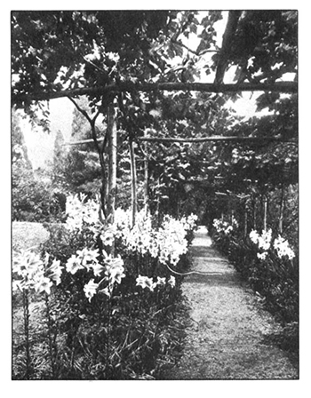
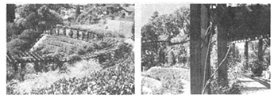
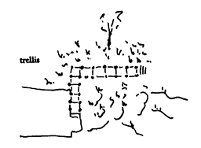

<section class="pattern-plate" aria-labelledby="t-trellised-walk">
<a href="/patterns">A Pattern Language</a> · <a href="/patterns#buildings">Buildings</a> · Pattern 174 · p. 809 · **
<h1 class="pattern-title" id="t-trellised-walk">Trellised Walk</h1><figure class="pattern-figure pl-figure"></figure><nav class="pattern-links" aria-label="Connections"><h2>Links to</h2><ul><li><a href="/patterns/positive-outdoor-space">106 Positive Outdoor Space</a></li><li><a href="/patterns/entrance-transition">112 Entrance Transition</a></li><li><a href="/patterns/paths-and-goals">120 Paths And Goals</a></li><li><a href="/patterns/path-shape">121 Path Shape</a></li><li><a href="/patterns/outdoor-room">163 Outdoor Room</a></li><li><a href="/patterns/fruit-trees">170 Fruit Trees</a></li><li><a href="/patterns/tree-places">171 Tree Places</a></li><li><a href="/patterns/greenhouse">175 Greenhouse</a></li><li><a href="/patterns/column-place">226 Column Place</a></li><li><a href="/patterns/filtered-light">238 Filtered Light</a></li><li><a href="/patterns/climbing-plants">246 Climbing Plants</a></li><li><a href="/patterns/paving-with-cracks-between-the-stones">247 Paving With Cracks Between The Stones</a></li></ul><h2>Linked from</h2><ul><li><a href="/patterns/still-water">71 Still Water</a></li><li><a href="/patterns/positive-outdoor-space">106 Positive Outdoor Space</a></li><li><a href="/patterns/entrance-transition">112 Entrance Transition</a></li><li><a href="/patterns/activity-pockets">124 Activity Pockets</a></li><li><a href="/patterns/sunny-place">161 Sunny Place</a></li><li><a href="/patterns/outdoor-room">163 Outdoor Room</a></li><li><a href="/patterns/connection-to-the-earth">168 Connection To The Earth</a></li><li><a href="/patterns/tree-places">171 Tree Places</a></li><li><a href="/patterns/garden-wall">173 Garden Wall</a></li><li><a href="/patterns/column-place">226 Column Place</a></li><li><a href="/patterns/seat-spots">241 Seat Spots</a></li><li><a href="/patterns/canvas-roofs">244 Canvas Roofs</a></li><li><a href="/patterns/climbing-plants">246 Climbing Plants</a></li></ul></nav></section><article class="pattern-text" aria-label="The text of Trellised Walk">
810… suppose the main spots of the garden have been defined—<a class="pl-ref" href="/patterns/outdoor-room">OUTDOOR ROOM (163)</a>, <a class="pl-ref" href="/patterns/tree-places">TREE PLACES (171)</a>, <a class="pl-ref" href="/patterns/greenhouse">GREENHOUSE (175)</a>, <a class="pl-ref" href="/patterns/fruit-trees">FRUIT TREES (170)</a>. Now, where there is a special need to emphasize a path—<a class="pl-ref" href="/patterns/paths-and-goals">PATHS AND GOALS (120)</a>—or, even more important, where the edges between two parts of a garden need to be marked without making a wall, an open trellised walk which can enclose space, is required. Above all, these trellised walks help to form the <a class="pl-ref" href="/patterns/positive-outdoor-space">POSITIVE OUTDOOR SPACES (106)</a> in a garden or a park; and may perhaps help to form an <a class="pl-ref" href="/patterns/entrance-transition">ENTRANCE TRANSITION (112)</a>.

◆ ◆ ◆

<strong>Trellised walks have their own special beauty. They are so unique, so different from other ways of shaping a path, that they are almost archetypal.</strong>

IN <a class="pl-ref" href="/patterns/path-shape">PATH SHAPE (121)</a>, we have described the need for outdoor paths to have a shape, like rooms. In <a class="pl-ref" href="/patterns/positive-outdoor-space">positive outdoor space (106)</a>, we have explained the need for larger outdoor areas to have positive shape. A trellised walk does both. It makes it possible to implement both these patterns at the same time—simply and elegantly. But it does it in such a fundamental way that we have decided to treat it as a separate pattern; and we shall try to define the places where a trellised structure over a path is appropriate.

1. Use it to emphasize the path it covers, and to set off one part of the path as a special section of a longer path in order to make it an especially nice and inviting place to walk.

<figure class="pl-figure"><figcaption><em>A trellis gives shape to an outdoor area</em>.</figcaption></figure>

811

<ol start="2" type="1">
<li>Since the trellised path creates enclosure around the spaces which it bounds, use it to create a virtual wall to define an outdoor space. For example, a trellised walk can form an enormous outdoor room by surrounding, or partially surrounding, a garden.</li>
</ol>

Therefore:

<strong>Where paths need special protection or where they need some intimacy, build a trellis over the path and plant it with climbing flowers. Use the trellis to help shape the outdoor spaces on cither side of it.</strong>

<figure class="pl-figure"></figure>
◆ ◆ ◆

Think about the columns that support the trellis as themselves capable of creating places—seats, bird feeders—<a class="pl-ref" href="/patterns/column-place">COLUMN PLACES (226)</a>. Pave the path with loosely set stones—<a class="pl-ref" href="/patterns/paving-with-cracks-between-the-stones">PAVING WITH CRACKS BETWEEN THE STONES (247)</a>. Use climbing plants and a fine trellis work to create the special quality of soft, filtered light underneath the trellis—<a class="pl-ref" href="/patterns/filtered-light">FILTERED LIGHT (238)</a>, <a class="pl-ref" href="/patterns/climbing-plants">CLIMBING PLANTS (246)</a>….
</article>

Christopher Alexander, Sara Ishikawa and Murray Silverstein, with Max Jacobson, Ingrid Fiksdahl-King and Shlomo Angel, <cite>A Pattern Language</cite> (Oxford University Press, 1977), pattern 174, pp. 809–811. Text and illustrations from the <a href="https://github.com/natureoforder/sources">Nature of Order sources</a> reading edition, transcribed from the 1977 printing; report errors on <a href="https://github.com/natureoforder/alexander-wiki/issues">GitHub</a>.

<a href="/patterns/garden-wall">← 173 Garden Wall</a> · <a href="/patterns">All 253 patterns</a> · <a href="/patterns/greenhouse">175 Greenhouse →</a>

