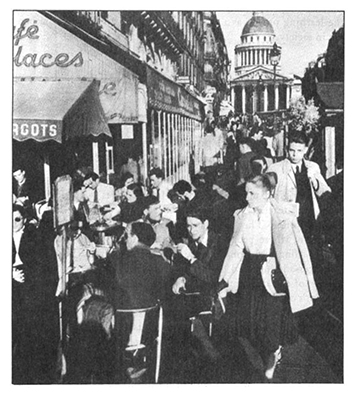
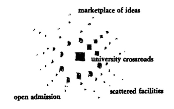

<section class="pattern-plate" aria-labelledby="t-university-as-a-marketplace">
<a href="/patterns">A Pattern Language</a> · <a href="/patterns#towns">Towns</a> · Pattern 43 · p. 231
<h1 class="pattern-title" id="t-university-as-a-marketplace">University As A Marketplace</h1><figure class="pattern-figure pl-figure"></figure><nav class="pattern-links" aria-label="Connections"><h2>Links to</h2><ul><li><a href="/patterns/network-of-learning">18 Network Of Learning</a></li><li><a href="/patterns/promenade">31 Promenade</a></li><li><a href="/patterns/master-and-apprentices">83 Master And Apprentices</a></li><li><a href="/patterns/building-complex">95 Building Complex</a></li><li><a href="/patterns/pedestrian-street">100 Pedestrian Street</a></li><li><a href="/patterns/arcades">119 Arcades</a></li><li><a href="/patterns/open-stairs">158 Open Stairs</a></li></ul><h2>Linked from</h2><ul><li><a href="/patterns/activity-nodes">30 Activity Nodes</a></li><li><a href="/patterns/old-people-everywhere">40 Old People Everywhere</a></li><li><a href="/patterns/necklace-of-community-projects">45 Necklace Of Community Projects</a></li><li><a href="/patterns/children-in-the-city">57 Children In The City</a></li><li><a href="/patterns/small-services-without-red-tape">81 Small Services Without Red Tape</a></li><li><a href="/patterns/pedestrian-street">100 Pedestrian Street</a></li><li><a href="/patterns/small-meeting-rooms">151 Small Meeting Rooms</a></li><li><a href="/patterns/opening-to-the-street">165 Opening To The Street</a></li></ul></nav></section><article class="pattern-text" aria-label="The text of University As A Marketplace">
232… the <a class="pl-ref" href="/patterns/network-of-learning">network of learning (18)</a> has established the importance of a whole society devoted to the learning process with decentralized opportunities for learning. The network of learning can be greatly helped by building a university, which treats the learning process as a normal part of adult life, for all the people in society.

◆ ◆ ◆

<strong>Concentrated, cloistered universities, with closed admission policies and rigid procedures which dictate who may teach a course, kill opportunities for learning.</strong>

The original universities in the middle ages were simply collections of teachers who attracted students because they had something to offer. They were marketplaces of ideas, located all over the town, where people could shop around for the kinds of ideas and learning which made sense to them. By contrast, the isolated and over-administered university of today kills the variety and intensity of the different ideas at the university and also limits the student’s opportunity to shop for ideas.

To re-create this kind of academic freedom and the opportunity for exchange and growth of ideas two things are needed.

First, the social and physical environment must provide a setting which encourages rather than discourages individuality and freedom of thought. Second, the environment must provide a setting which encourages the student to see for himself which ideas make sense—a setting which gives him the maximum opportunity and exposure to a great variety of ideas, so that he can make up his mind for himself.

The image which most clearly describes this kind of setting is the image of the traditional marketplace, where hundreds of tiny stalls, each one developing some specialty and unique flavor which can attract people by its genuine quality, are so arranged that a potential buyer can circulate freely, and examine the wares before he buys.

233What would it mean to fashion the university after this model?

1. <em>Anyone can take a course</em>. To begin with, in a university marketplace there are no admission procedures. Anyone, at any age, may come forward and seek to take a class. In effect, the “course catalog” of the university is published and circulated at large, in the newspapers and on radio, and posted in public places throughout the region.

2. <em>Anyone can give a course</em>. Similarly, in a university marketplace, anyone can come forward and offer a course. There is no hard and fast distinction between teachers and the rest of the citizenry. If people come forward to take the course, then it is established. There will certainly be groups of teachers banding together and offering interrelated classes; and teachers may set prerequisites and regulate enrollment however they see fit. But, like a true marketplace, the students create the demand. If over a period of time no one comes forward to take a professor’s course, then he must change his offering or find another way to make a living.

Many courses, once they are organized, can meet in homes and meeting rooms all across the town. But some will need more space or special equipment, and all the classes will need access to libraries and various other communal facilities. The university marketplace, then, needs a physical structure to support its social structure.

Certainly, a marketplace could never have the form of an isolated campus. Rather it would tend to be open and public, woven through the city, perhaps with one or two streets where university facilities are concentrated.

In an early version of this pattern, written expressly for the University of Oregon in Eugene, we described in detail the physical setting which we believe complements the marketplace of ideas. We advised:

Make the university a collection of small buildings, situated along pedestrian paths, each containing one or two educational projects. Make all the horizontal circulation among these projects, in the public domain, at ground floor. This means that all projects open directly to a pedestrian path, and that the upper floors of buildings are connected directly to the ground, by stairs and entrances. Connect all the pedestrian paths, so that, like a marketplace, they form one major pedestrian system, with many entrances and openings off it. The 234overall result of this pattern, is that the environment becomes a collection of relatively low buildings, opening off a major system of pedestrian paths, each building containing a series of entrances and staircases, at about 50 foot intervals.

We still believe that this image of the university, as a marketplace scattered through the town, is correct. Most of these details are given by other patterns, in this book: <a class="pl-ref" href="/patterns/building-complex">building complex (95)</a>, PEDESTRIAN STREET (lOO), <a class="pl-ref" href="/patterns/arcades">ARCADES (119)</a>, and <a class="pl-ref" href="/patterns/open-stairs">OPEN STAIRS (158)</a>.

Finally, how should a university marketplace be administered? We don’t know. Certainly a voucher system where everyone has equal access to payment vouchers seems sensible. And some technique for balancing payment to class size is required, so teachers are not simply paid according to how many students they enroll. Furthermore, some kind of evaluation technique is needed, so that reliable information on courses and teachers filters out to the towns people.

There are several experiments going forward in higher education today which may help to solve these administrative questions. The Open University of England, the various “free” universities, such as Heliotrope in San Francisco, the 20 branches of the University Without Walls all over the United States, the university extension programs, which gear their courses entirely to working people—they are all examples of institutions experimenting with different aspects of the marketplace idea.

Therefore:

<strong>Establish the university as a marketplace of higher education. As a social conception this means that the university is open to people of all ages, on a full-time, part-time, or course by course basis. Anyone can offer a class. Anyone can take a class. Physically, the university marketplace has a central crossroads where its main buildings and offices are, and the meeting rooms and labs ripple out from this crossroads—at first concentrated in small buildings along pedestrian streets and then gradually becoming more dispersed and mixed with the town.</strong>

235

<figure class="pl-figure"></figure>
◆ ◆ ◆

Give the university a <a class="pl-ref" href="/patterns/promenade">promenade (31)</a>&gt; at its central crossroads; and around the crossroads cluster the buildings along streets—building complex (95), <a class="pl-ref" href="/patterns/pedestrian-street">pedestrian street (100)</a>. Give this central area access to quiet greens—quiet backs (59); and a normal distribution of housing—housing in between (48); <strong>as</strong> for the classes, wherever possible let them follow the model of <a class="pl-ref" href="/patterns/master-and-apprentices">MASTER AND APPRENTICES (83)</a>….
</article>

Christopher Alexander, Sara Ishikawa and Murray Silverstein, with Max Jacobson, Ingrid Fiksdahl-King and Shlomo Angel, <cite>A Pattern Language</cite> (Oxford University Press, 1977), pattern 43, pp. 231–235. Text and illustrations from the <a href="https://github.com/natureoforder/sources">Nature of Order sources</a> reading edition, transcribed from the 1977 printing; report errors on <a href="https://github.com/natureoforder/alexander-wiki/issues">GitHub</a>.

<a href="/patterns/industrial-ribbon">← 42 Industrial Ribbon</a> · <a href="/patterns">All 253 patterns</a> · <a href="/patterns/local-town-hall">44 Local Town Hall →</a>

