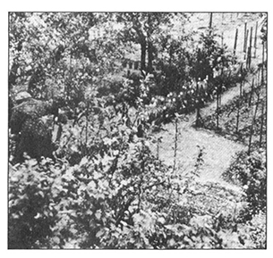
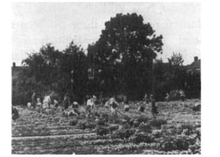
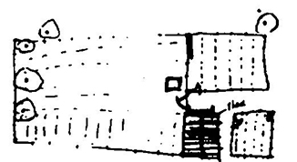

<section class="pattern-plate" aria-labelledby="t-vegetable-garden">
<a href="/patterns">A Pattern Language</a> · <a href="/patterns#buildings">Buildings</a> · Pattern 177 · p. 818 · *
<h1 class="pattern-title" id="t-vegetable-garden">Vegetable Garden</h1><figure class="pattern-figure pl-figure"></figure><nav class="pattern-links" aria-label="Connections"><h2>Links to</h2><ul><li><a href="/patterns/common-land">67 Common Land</a></li><li><a href="/patterns/fruit-trees">170 Fruit Trees</a></li><li><a href="/patterns/compost">178 Compost</a></li></ul><h2>Linked from</h2><ul><li><a href="/patterns/housing-hill">39 Housing Hill</a></li><li><a href="/patterns/old-people-everywhere">40 Old People Everywhere</a></li><li><a href="/patterns/health-center">47 Health Center</a></li><li><a href="/patterns/common-land">67 Common Land</a></li><li><a href="/patterns/roof-garden">118 Roof Garden</a></li><li><a href="/patterns/connection-to-the-earth">168 Connection To The Earth</a></li><li><a href="/patterns/terraced-slope">169 Terraced Slope</a></li><li><a href="/patterns/greenhouse">175 Greenhouse</a></li><li><a href="/patterns/compost">178 Compost</a></li></ul></nav></section><article class="pattern-text" aria-label="The text of Vegetable Garden">
819… we have one pattern, already, which brings out the useful character of gardens—both public and private ones—<a class="pl-ref" href="/patterns/fruit-trees">FRUIT TREES (170)</a>; we supplement this with a smaller, but as important aspect of the garden—one which every public and private garden should contain: enhance common land—<a class="pl-ref" href="/patterns/common-land">COMMON LAND (67)</a> and private gardens—HALF-HIDDEN GARDEN (hi) with a patch where people can grow vegetables.

◆ ◆ ◆

<strong>In a healthy town every family can grow vegetables for itself. The time is past to think of this as a hobby for enthusiasts; it is a fundamental part of human life.</strong>

Vegetables are the most basic foods. If we compare dairy products, vegetables and fruits, meats, and synthetic foods, the vegetables play the most essential role. As a class, they are the only ones which are by themselves wholly able to support human life. And, in an ecologically balanced world, it seems almost certain that man will have to work out some balanced relationship with vegetables for his daily food. (See, for example, F. Lappe, <em>Diet for a Small Planet</em>, New York: Ballantine, 1971.)

Since the industrial revolution, there has been a growing tendency for people to rely on impersonal producers for their vegetables; however, in a world where vegetables are central and where self-sufficiency increases, it becomes as natural for families to have their own vegetables as their own air.

The amount of land it takes to grow the vegetables for a household is surprisingly small. It takes about one-tenth of an acre to grow an adequate year round supply of vegetables for a family of four. And apparently vegetables give a higher “nutrient return” for fixed quantities of energy—sun, labor—than any other food. This means that every house or house cluster can create its own supply of vegetables, and that every household which does not have its own private land attached to it should have a portion of a <em>common vegetable garden</em> close at hand.

Beside this fundamental need for vegetable gardens in cities, 820there is a subtler need. Parks, street trees, and manicured lawns do very little to establish the connection between us and the land. They teach us nothing of its productivity, nothing of its capacities. Many people who are born, raised, and live out their lives in cities simply do not know where the food they eat comes from or what a living garden is like. Their only connection with the productivity of the land comes from packaged tomatoes on the supermarket shelf. But contact with the land and its growing process is not simply a quaint nicety from the past that we can let go of casually. More likely, it is a basic part of the process of organic security. Deep down, there must be some sense of insecurity in city dwellers who depend entirely upon the supermarkets for their produce.

Community gardens needn’t be expensive propositions either. When Santa Barbara residents decided to start a downtown garden back in May, 1970, they used their ingenuity. A vacant downtown lot was acquired (at a cost of one dollar for 6 months), and the city provided free water and a tractor with operator for two days. Compost was no problem. The group got leaves from the park department, hard sludge from the local sanitation district, and horse manure from a nearby riding club. Tools and seeds were donated. (“Community Gardens,” Bob Rodale, <em>San Francisco Chronicle</em>, May 31, 1972, p. 16.)

<figure class="pl-figure"><figcaption><em>School garden in Amsterdam, worked by the children</em>.</figcaption></figure>

Therefore:

<strong>Set aside one piece of land either in the private garden or on common land as a vegetable garden. About one-tenth 821of an acre is needed for each family of four. Make sore the vegetable garden is in a sunny place and central to all the households it serves. Fence it in and build a small storage shed for gardening tools beside it.</strong>

<figure class="pl-figure"></figure>
◆ ◆ ◆

To fertilize the vegetables, use the natural compost which is generated by the house and the neighborhood—<a class="pl-ref" href="/patterns/compost">COMPOST (178)</a>; and if possible, try to use water from the sinks and drains to irrigate the soil—bathing room (144)….
</article>

Christopher Alexander, Sara Ishikawa and Murray Silverstein, with Max Jacobson, Ingrid Fiksdahl-King and Shlomo Angel, <cite>A Pattern Language</cite> (Oxford University Press, 1977), pattern 177, pp. 818–821. Text and illustrations from the <a href="https://github.com/natureoforder/sources">Nature of Order sources</a> reading edition, transcribed from the 1977 printing; report errors on <a href="https://github.com/natureoforder/alexander-wiki/issues">GitHub</a>.

<a href="/patterns/garden-seat">← 176 Garden Seat</a> · <a href="/patterns">All 253 patterns</a> · <a href="/patterns/compost">178 Compost →</a>

