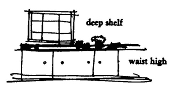

<section class="pattern-plate" aria-labelledby="t-waist-high-shelf">
<a href="/patterns">A Pattern Language</a> · <a href="/patterns#buildings">Buildings</a> · Pattern 201 · p. 922
<h1 class="pattern-title" id="t-waist-high-shelf">Waist-High Shelf</h1><nav class="pattern-links" aria-label="Connections"><h2>Links to</h2><ul><li><a href="/patterns/open-shelves">200 Open Shelves</a></li><li><a href="/patterns/things-from-your-life">253 Things From Your Life</a></li></ul><h2>Linked from</h2><ul><li><a href="/patterns/entrance-room">130 Entrance Room</a></li><li><a href="/patterns/farmhouse-kitchen">139 Farmhouse Kitchen</a></li><li><a href="/patterns/greenhouse">175 Greenhouse</a></li><li><a href="/patterns/eating-atmosphere">182 Eating Atmosphere</a></li><li><a href="/patterns/workspace-enclosure">183 Workspace Enclosure</a></li><li><a href="/patterns/dressing-rooms">189 Dressing Rooms</a></li><li><a href="/patterns/corner-doors">196 Corner Doors</a></li><li><a href="/patterns/thick-walls">197 Thick Walls</a></li><li><a href="/patterns/open-shelves">200 Open Shelves</a></li><li><a href="/patterns/low-sill">222 Low Sill</a></li></ul></nav></section><article class="pattern-text" aria-label="The text of Waist-High Shelf">
… anywhere where there are open shelves, and around any room which tends to accumulate potted plants, books, plates, bits of paper, boxes, beautiful vases, and little things you have picked up along your travels, there is a need for space where these things can lie undisturbed, without making the room a mess—THICK WALLS (l97), <a class="pl-ref" href="/patterns/open-shelves">OPEN SHELVES (200)</a>.

◆ ◆ ◆

<strong>In every house and every workplace there is a daily “traffic” of the objects which are handled most. Unless such things are immediately at hand, the flow of life is awkward, full of mistakes; things are forgotten, misplaced.</strong>

The essence of this problem lies in the phrase “at hand.” This is literally true and needs to be interpreted as such. When a person reaches for something, his hands are roughly at waist height. When there are surfaces here and there, around the rooms and passages and doors, which are at waist height, they become natural places to leave things and later pick them up. Pocket change, pictures, open books, an apple, a package, a newspaper, the day’s mail, a reminder note: these things are at hand on a waist high shelf. When there are no such surfaces, then things either get put away and are then forgotten and lost, or they are in the way and must continually be cleared aside.

Furthermore, the things that tend to collect on waist high shelves become a natural, evolving kind of display of the most ordinary things—the things that are most immediately a part of one’s life. And since for each person these things will vary, the waist high shelf helps a room become unique and personal, effortlessly.

Therefore:

<strong>Build waist-high shelves around at least a part of the 923main rooms where people live and work. Make them long, 9 to 15 inches deep, with shelves or cupboard underneath. Interrupt the shelf for seats, windows, and doors.</strong>

<figure class="pl-figure"></figure>
◆ ◆ ◆

Build the shelf right into the structure of the building—THICKENING THE OUTER WALL (21l). It is a good place to put your personal treasures—<a class="pl-ref" href="/patterns/things-from-your-life">THINGS FROM YOUR LIFE (253)</a>….
</article>

Christopher Alexander, Sara Ishikawa and Murray Silverstein, with Max Jacobson, Ingrid Fiksdahl-King and Shlomo Angel, <cite>A Pattern Language</cite> (Oxford University Press, 1977), pattern 201, pp. 922–923. Text and illustrations from the <a href="https://github.com/natureoforder/sources">Nature of Order sources</a> reading edition, transcribed from the 1977 printing; report errors on <a href="https://github.com/natureoforder/alexander-wiki/issues">GitHub</a>.

<a href="/patterns/open-shelves">← 200 Open Shelves</a> · <a href="/patterns">All 253 patterns</a> · <a href="/patterns/built-in-seats">202 Built-In Seats →</a>

