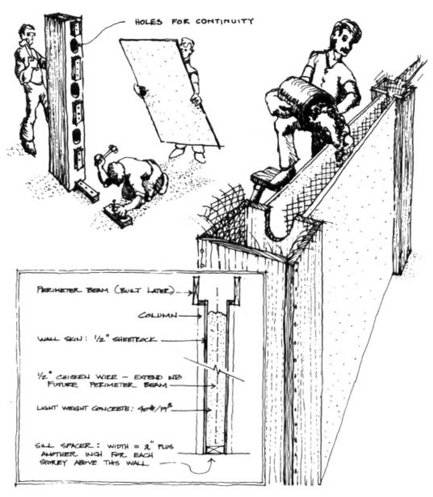
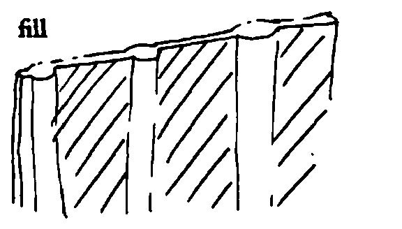

<section class="pattern-plate" aria-labelledby="t-wall-membrane">
<a href="/patterns">A Pattern Language</a> · <a href="/patterns#construction">Construction</a> · Pattern 218 · p. 1023 · *
<h1 class="pattern-title" id="t-wall-membrane">Wall Membrane</h1><nav class="pattern-links" aria-label="Connections"><h2>Links to</h2><ul><li><a href="/patterns/efficient-structure">206 Efficient Structure</a></li><li><a href="/patterns/good-materials">207 Good Materials</a></li><li><a href="/patterns/gradual-stiffening">208 Gradual Stiffening</a></li><li><a href="/patterns/final-column-distribution">213 Final Column Distribution</a></li><li><a href="/patterns/box-columns">216 Box Columns</a></li><li><a href="/patterns/lapped-outside-walls">234 Lapped Outside Walls</a></li><li><a href="/patterns/soft-inside-walls">235 Soft Inside Walls</a></li><li><a href="/patterns/soft-tile-and-brick">248 Soft Tile And Brick</a></li></ul><h2>Linked from</h2><ul><li><a href="/patterns/the-shape-of-indoor-space">191 The Shape Of Indoor Space</a></li><li><a href="/patterns/efficient-structure">206 Efficient Structure</a></li><li><a href="/patterns/gradual-stiffening">208 Gradual Stiffening</a></li><li><a href="/patterns/final-column-distribution">213 Final Column Distribution</a></li><li><a href="/patterns/perimeter-beams">217 Perimeter Beams</a></li><li><a href="/patterns/frames-as-thickened-edges">225 Frames As Thickened Edges</a></li><li><a href="/patterns/radiant-heat">230 Radiant Heat</a></li><li><a href="/patterns/lapped-outside-walls">234 Lapped Outside Walls</a></li><li><a href="/patterns/soft-inside-walls">235 Soft Inside Walls</a></li><li><a href="/patterns/solid-doors-with-glass">237 Solid Doors With Glass</a></li><li><a href="/patterns/ornament">249 Ornament</a></li></ul></nav></section><article class="pattern-text" aria-label="The text of Wall Membrane">
… according to <a class="pl-ref" href="/patterns/efficient-structure">EFFICIENT STRUCTURE (206)</a> and <a class="pl-ref" href="/patterns/final-column-distribution">FINAL COLUMN DISTRIBUTION (213)</a>, the wall is a compressive loadbearing membrane, “stretched” between adjacent columns and continuous with them, the columns themselves placed at frequent intervals to act as stiffeners. The intervals vary from floor to floor, according to column height; and the wall thickness (membrane thickness) varies in a similar fashion. If the column stiffeners are already in place according to <a class="pl-ref" href="/patterns/box-columns">BOX COLUMN (216)</a>, this pattern describes the way to stretch the membrane from column to column to form the walls.

◆ ◆ ◆

<strong>In organic construction the walls must take their share of the loads. They must work continuously with the structure on all four of their sides; and act to resist shear and bending, and take loads in compression.</strong>

When walls are working like this, they are essentially structural membranes; they are continuous in two dimensions; together with stiffeners and columns they resist loads in compression; and they create a continuous rigid connection between columns, beams, and floors, both above and below, to help resist shear and bending.

By contrast, curtain walls and walls which are essentially “infill,” do not act as membranes. They may function as walls in other respects—they insulate, enclose, they define space—but they do not contribute to the overall structural solidity of the building. They let the frame do all the work; structurally they are wasted, [For the details of the argument that every part of the structure must cooperate to take loads, see <a class="pl-ref" href="/patterns/efficient-structure">EFFICIENT STRUCTURE (206)</a>.]

A membrane, on the other hand, makes the wall an integral thing, working with the structure around it. How should we build such a wall membrane ?

1024

<figure class="pl-figure"><figcaption><em>A version of an interior wall membrane which uses gyfsum board as skin, and ultra-lightweight concrete for the fill</em>.</figcaption></figure>

<a class="pl-ref" href="/patterns/good-materials">GOOD MATERIALS (207)</a> tells us that we should use hand cuttable, nailable, ecologically sound materials, which one can work with home tools, with the emphasis on earthen fill materials and sheet materials.

<a class="pl-ref" href="/patterns/gradual-stiffening">GRADUAL STIFFENING (208)</a> tells us that the process of building should be such that one can start with a flimsy structure and stiffen it during the course of construction, as materials are put in place, so that the process can be smooth and continuous.

1025An example of such a wall that we have built and tested uses gypboard for the inner skin, ship-lapped wooden boards for the outer skin and ultra-lightweight concrete for the fill. The wall is built by fixing nailing blocks to the sides of columns. We nail the skin to the nailing blocks, put chickenwire into the cavity to reinforce the concrete against shrinkage, and then pour the lightweight concrete into the cavity. The wall needs to be braced during pouring, and you can’t pour more than two or three feet at a time: the pressure gets too great. The last pour fills the perimeter beam and the top of the wall, and so makes them integral. The drawing opposite shows one way that we have made this particular kind of wall membrane.

This wall is solid (about the density of wood), has good acoustic and thermal properties, can easily be built to conform to free and irregular plans, and can be nailed into. And because of its stiffeners, the wall is very strong for its thickness.

Other versions of this pattern: (1) The skin can be formed from hollow structural tiles or concrete blocks, with a concrete or earthen fill. (2) The exterior skin might be brick, the interior skin plywood or gyp board. In either case the columns would have to be hollow tile, or concrete pipe, or other masonry box columns. (3) The skin might be formed with wire mesh, gradually filled with concrete and rubble, and succeed on the outside, with plaster on the inside. The columns in this case can be built in the same way—out of a wire mesh tube filled with rubble and concrete. (4) It may also be possible to use gypboard for both skins, inside and out. The gypboard on the outer side could then be covered with building paper, lath, and stucco.

Therefore:

<strong>Build the wall as a membrane which connects the columns and door frames and windows frames and is, at least in part, continuous with them. To build the wall, first put up an inner and an outer membrane, which can function as a finished surface; then pour the fill into the wall.</strong>

1026

<figure class="pl-figure"></figure>
◆ ◆ ◆

Remember that in a stiffened wall, the membranes can be much thinner than you might expect, because the stiffeners prevent buckling. In some cases they can be as thin as two inches in a one story building, three inches at the bottom of a two-story building and so on—see <a class="pl-ref" href="/patterns/final-column-distribution">FINAL COLUMN DISTRIBUTION (213)</a>.

Membranes can be made from hollow tile, lightweight concrete block, plywood, gypboard, wood planks, or any other sheet type material which would make a nice surface, which is easy to nail into, comfortable to touch, and so on. If the inner sheet is gypsum board, it can be finished with a skim coat of plaster—<a class="pl-ref" href="/patterns/soft-inside-walls">SOFT INSIDE WALLS (235)</a>. The outer sheet can be made of 1 inch boards, tongue and grooved; or exterior grade plywood; or exterior board hung with tile, shingles, or plastered—<a class="pl-ref" href="/patterns/lapped-outside-walls">LAPPED OUTSIDE WALLS (234)</a>. It is also possible to build the outer skin of brick or tile: in this case, columns must be of the same material—<a class="pl-ref" href="/patterns/soft-tile-and-brick">SOFT TILE AND BRICK (248)</a> ….
</article>

Christopher Alexander, Sara Ishikawa and Murray Silverstein, with Max Jacobson, Ingrid Fiksdahl-King and Shlomo Angel, <cite>A Pattern Language</cite> (Oxford University Press, 1977), pattern 218, pp. 1023–1026. Text and illustrations from the <a href="https://github.com/natureoforder/sources">Nature of Order sources</a> reading edition, transcribed from the 1977 printing; report errors on <a href="https://github.com/natureoforder/alexander-wiki/issues">GitHub</a>.

<a href="/patterns/perimeter-beams">← 217 Perimeter Beams</a> · <a href="/patterns">All 253 patterns</a> · <a href="/patterns/floor-ceiling-vaults">219 Floor-Ceiling Vaults →</a>

