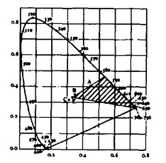
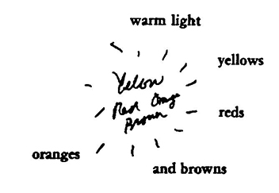

<section class="pattern-plate" aria-labelledby="t-warm-colors">
<a href="/patterns">A Pattern Language</a> · <a href="/patterns#construction">Construction</a> · Pattern 250 · p. 1153 · **
<h1 class="pattern-title" id="t-warm-colors">Warm Colors</h1><nav class="pattern-links" aria-label="Connections"><h2>Links to</h2><ul><li><a href="/patterns/good-materials">207 Good Materials</a></li><li><a href="/patterns/floor-surface">233 Floor Surface</a></li><li><a href="/patterns/soft-inside-walls">235 Soft Inside Walls</a></li><li><a href="/patterns/half-inch-trim">240 Half-Inch Trim</a></li><li><a href="/patterns/canvas-roofs">244 Canvas Roofs</a></li><li><a href="/patterns/soft-tile-and-brick">248 Soft Tile And Brick</a></li><li><a href="/patterns/ornament">249 Ornament</a></li><li><a href="/patterns/pools-of-light">252 Pools Of Light</a></li></ul><h2>Linked from</h2><ul><li><a href="/patterns/tapestry-of-light-and-dark">135 Tapestry Of Light And Dark</a></li><li><a href="/patterns/eating-atmosphere">182 Eating Atmosphere</a></li><li><a href="/patterns/sunny-counter">199 Sunny Counter</a></li><li><a href="/patterns/floor-surface">233 Floor Surface</a></li><li><a href="/patterns/filtered-light">238 Filtered Light</a></li><li><a href="/patterns/half-inch-trim">240 Half-Inch Trim</a></li><li><a href="/patterns/canvas-roofs">244 Canvas Roofs</a></li><li><a href="/patterns/soft-tile-and-brick">248 Soft Tile And Brick</a></li><li><a href="/patterns/ornament">249 Ornament</a></li><li><a href="/patterns/pools-of-light">252 Pools Of Light</a></li></ul></nav></section><article class="pattern-text" aria-label="The text of Warm Colors">
… this pattern helps to create and generate the right kind of <a class="pl-ref" href="/patterns/good-materials">GOOD MATERIALS (207)</a>, <a class="pl-ref" href="/patterns/floor-surface">FLOOR SURFACE (233)</a>, <a class="pl-ref" href="/patterns/soft-inside-walls">SOFT INSIDE WALLS (235)</a>. Where possible leave the materials in their natural state. Just add enough color for decoration, and to make the light inside alive and warm.

◆ ◆ ◆

<strong>The greens and greys of hospitals and office corridors are depressing and cold. Natural wood, sunlight, bright colors are warm. In some way, the warmth of the colors in a room makes a great deal of difference between comfort and discomfort.</strong>

But just what are warm colors and cold colors? In a very simple minded sense, red and yellow and orange and brown are warm; blue and green and grey are cold. But, obviously, it is not true that rooms with red and yellow feel good; while rooms with blue and grey feel cold. There is some superficial truth to this simple statement: it is true that reds and browns and yellows <em>helf</em> to make rooms comfortable; but it is also true that white and blue and green can all make people comfortable too. After all, the sky is blue, and grass is green. Obviously, we feel comfortable out in the green grass of a meadow, under the blue sky.

The explanation is simple and fascinating. It is not the color of the things, the surfaces, which make a place warm or cold, <em>but the color of the light</em>. What exactly does this mean? We can estimate the color of the light at a particular point in space by holding a perfectly white surface there. If the light is warm, this surface will be slightly tinted toward the yellow-red. If the light is cold, this surface will be slightly tinted toward the blue-green. This tinting will be very slight: indeed, on a small white surface it may be so hard to see that you need a spectrometer to do it.

1154But when you realize that everything in that space is lightly tinted—people’s faces, hands, shirts, dresses, food, paper, everything—it is not so hard to see that this can have a huge effect on the emotional quality that people experience there.

Now, the color of the light in a space does not depend in any simple way on the color of the surface. It depends on a complex interaction between the color of the light sources and the way this light then bounces on and off the many surfaces. In a meadow, on a spring day, the sunlight bouncing off the green grass is still warm light—that is, in the yellowish reddish range. The light in a hospital corridor, lit by fluorescent tubes, bouncing off green walls is cold light—in the green-blue range. In a room with lots of natural light, the overall light is warm. In a room whose windows face onto a grey building across the street, the light may be cold, unless there is a very strong concentration of yellow and red fabrics.

If you are in any doubt about the objective character of the light in the room and you don’t have a spectrometer, all you need to do is to try to use color film. If the light is warm and the film is properly exposed, white walls will come out slightly pink. If the light is cold, white walls will come out slightly blue.

So, in order to make a room comfortable, you must use a collection of colors which together with the sources of light and the reflecting surfaces outside the room, combine to make the reflected light which exists in the middle of the room warm, that is, toward the yellow-red. Yellow and red colors will always do it. Blues and greens and whites will only do it in the proper places, balanced with other colors, and when the light sources are helping.

To complete the discussion we now make the concept of warm light precise in terms of chromaticity. Consider the light falling on any given surface in the middle of the room. This light contains a variety of different wavelengths. Its character is specified, exactly, by some distribution of spectral energies p(λ), which gives the relative proportions of different wavelengths present in this light.

We know that any light whatsoever—in short, any p(λ)—can be plotted as a single point on the color triangle—more formally known as the two-dimensional chromaticity diagram—by means of the standard color matching functions given in Gunter Wyszecki 1155and W. S. Stiles, <em>Color Science</em>, New York, 1967, pp. 228–317. The coordinates of a plot in this color triangle define the <em>chromaticity</em> of any given energy distribution.

<figure class="pl-figure"><figcaption><em>Chromaticity diagram</em>.</figcaption></figure>

We may now identify a region on the chromaticity diagram which we shall call the <em>warm region</em>. It is shown hatched on the drawing.

This hatched area is based on a number of empirical results. For example, we know that people have a clear subjective impression of the relative warmth, or coldness, of different spaces. See, for instance, Committee on Colorimetry of the Optical Society of America, <em>The Science of Color</em>, New York, 1953, p. 168. One study which attempts to identify the objective correlates of perceived “warmth” is S. M. Newhall, “Warmth and Coolness of Colors,” <em>Psychological Record</em>, 4, 1941, pp. 198–212. This study revealed a maximum for “wannest” judgments at dominant wave-length 610 millimicrons, which is in the middle of the orange range. And individual observer stability in such judgments is high. Thus, one study gives reliability coefficients of 0.95 for warmth and 0.82 for coolness—N. Collins, “The Appropriateness of Certain Color Combinations in Advertising,” M. A. thesis, Columbia University, New York, 1924.

Finally, it is vital to remember that this pattern requires only that the <em>light</em>—the total light in the middle of a room, coming from sunlight, artificial lights, reflections from walls, reflections from outside, from carpets—the total <em>light</em>, lies in that part of the color triangle we call “warm.” It does not require that any individual color surfaces in the room should be red or orange or 1156yellow—only that the combined effect of all the surfaces and lights together, creates light in the middle of the room which lies in the warm part of the color triangle.

Therefore:

<strong>Choose surface colors which, together with the color of the natural light, reflected light, and artificial lights, create a warm light in the rooms.</strong>

<figure class="pl-figure"></figure>
◆ ◆ ◆

This means that yellows, reds, and oranges will often be needed to pick out trim and lampshades and occasional details—<a class="pl-ref" href="/patterns/half-inch-trim">HALF-INCH TRIM (240)</a>, <a class="pl-ref" href="/patterns/ornament">ORNAMENT (249)</a>, <a class="pl-ref" href="/patterns/pools-of-light">POOLS OF LIGHT (252)</a>. Colored <a class="pl-ref" href="/patterns/canvas-roofs">CANVAS ROOFS (244)</a> and <a class="pl-ref" href="/patterns/soft-tile-and-brick">SOFT TILE AND BRICK (248)</a> also help to make warm colored light. Blues and greens and greys are much harder to use; especially on the north side where the light is cold and grey, but they can always be used for ornament, where they help to set off the warmer colors—<a class="pl-ref" href="/patterns/ornament">ORNAMENT (249)</a>….
</article>

Christopher Alexander, Sara Ishikawa and Murray Silverstein, with Max Jacobson, Ingrid Fiksdahl-King and Shlomo Angel, <cite>A Pattern Language</cite> (Oxford University Press, 1977), pattern 250, pp. 1153–1156. Text and illustrations from the <a href="https://github.com/natureoforder/sources">Nature of Order sources</a> reading edition, transcribed from the 1977 printing; report errors on <a href="https://github.com/natureoforder/alexander-wiki/issues">GitHub</a>.

<a href="/patterns/ornament">← 249 Ornament</a> · <a href="/patterns">All 253 patterns</a> · <a href="/patterns/different-chairs">251 Different Chairs →</a>

