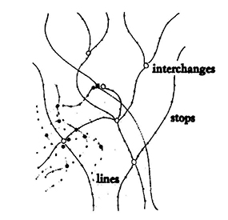

<section class="pattern-plate" aria-labelledby="t-web-of-public-transportation">
<a href="/patterns">A Pattern Language</a> · <a href="/patterns#towns">Towns</a> · Pattern 16 · p. 92 · *
<h1 class="pattern-title" id="t-web-of-public-transportation">Web Of Public Transportation</h1><nav class="pattern-links" aria-label="Connections"><h2>Links to</h2><ul><li><a href="/patterns/city-country-fingers">3 City Country Fingers</a></li><li><a href="/patterns/local-transport-areas">11 Local Transport Areas</a></li><li><a href="/patterns/mini-buses">20 Mini-Buses</a></li></ul><h2>Linked from</h2><ul><li><a href="/patterns/city-country-fingers">3 City Country Fingers</a></li><li><a href="/patterns/magic-of-the-city">10 Magic Of The City</a></li><li><a href="/patterns/neighborhood-boundary">15 Neighborhood Boundary</a></li><li><a href="/patterns/ring-roads">17 Ring Roads</a></li><li><a href="/patterns/mini-buses">20 Mini-Buses</a></li><li><a href="/patterns/nine-per-cent-parking">22 Nine Per Cent Parking</a></li><li><a href="/patterns/interchange">34 Interchange</a></li></ul></nav></section><article class="pattern-text" aria-label="The text of Web Of Public Transportation">
… the city, as defined by <a class="pl-ref" href="/patterns/city-country-fingers">CITY COUNTRY FINGERS (3)</a>, spreads out in ribbon fashion, throughout the countryside, and is broken into <a class="pl-ref" href="/patterns/local-transport-areas">LOCAL TRANSPORT AREAS (11)</a>. To connect the transport areas, and to maintain the flow of people and goods along the fingers of the cities, it is now necessary to create a web of public tranportation.

◆ ◆ ◆

<strong>The system of public transportation—the entire web of airplanes, helicopters, hovercraft, trains, boats, ferries, buses, taxis, mini-trains, carts, ski-lifts, moving sidewalks—can only work if all the parts arc “’ell connected. But they usually aren’t, because the different agencies in charge of various forms of public transportation have no incentives to connect to one another.</strong>

Here, in brief, is the general public transportation problem. A city contains a great number of places, distributed rather evenly across a two-dimensional sheet. The trips people want to make are typically between two points at random in this sheet. No one linear system (like a train system), can give direct connections between the vast possible number of point pairs in the city.

It is therefore only possible for systems of public transportation to work, if there are rich connections between a great variety of <em>different</em> systems. But these connections are not workable, unless they are genuine fast, short, connections. The waiting time for a connection must be short. And the walking distance between the two connecting systems must be very short.

This much is obvious; and everyone who has thought about public transportation recognizes its importance. However, obvious though it is, it is extremely hard to implement.

93There are two practical difficulties, both of which stem from the fact that different kinds of public transportation are usually in the hands of different agencies who are reluctant to cooperate. They are reluctant to cooperate, partly because they are actually in competition, and partly just because cooperation makes life harder for them,

This is particularly true along commuting corridors. Trains, buses, mini-buses, rapid transit, ferries, and maybe even planes and helicopters compete for the same passenger market along these corridors. When each mode is operated by an independent agency there is no particular incentive to provide feeder services to the more inflexible modes. Many services are even reluctant to provide good feeder connections to rapid transit, trains, and ferries, because their commuter lines are their most lucrative lines. Similarly, in many cities of the developing world, minibuses and <em>collectiflos</em> provide public transportation along the main commuting corridors, pulling passengers away from buses. This leaves the mainlines served by small vehicles, while almost empty buses reach the peripheral lines, usually because the public bus company is required to serve these areas, even at a loss.

The solution to the web of public transportation, then, hinges on the possibility of solving the coordination problem of the different systems. This is the nut of the matter. We shall now propose a way of solving it. The traditional way of looking at public transportation assumes that lines are primary and that the interchanges needed to connect the lines to one another are secondary. We propose the opposite: namely, that interchanges are primary and that the transport lines are secondary elements which connect the interchanges.

Imagine the following organization: each interchange is run by the community that uses it. The community appoints an interchange chief for every interchange, and gives him a budget, and a directive on service. The interchange chief coordinates the service at his interchange; he charters service from any number of transport companies—the companies, themselves, are in free competition with one another to create service.

In this scheme, responsibility for public transportation shifts from lines to interchanges. The interchanges are responsible for connecting themselves to each other, and the community which 94uses the interchange decides what kinds of service they want to have passing through it. It is then up to the interchange chief to persuade these transport modes to pass through it.

Slowly, a service connecting interchanges will build up. One example which closely follows our model, and shows that this model is capable of producing a higher level of service than any centralized agency can produce, is the famous Swiss Railway System.

The Swiss railway system … is the densest network in the world. At great cost and with great trouble, it has been made to serve the needs of the smallest localities and most remote valleys, not as a paying proposition but because such was the will of the people. It is the outcome of fierce political struggles. In the 19th century, the “democratic railway movement” brought the small Swiss communities into conflict with the big towns, which had plans for centralisation….And if we compare the Swiss system with the French which, with admirable geometrical regularity, is entirely centered on Paris so that the prosperities or the decline, the life or death of whole regions has depended on tlie quality of the link with the capital, we see the difference between a centralised state and a federal alliance. The railway map is the easiest to read at a glance, but let us now superimpose on it another showing economic activity and the movement of population. The distribution of industrial activity all over Switzerland, even in the outlying areas, accounts for the strength and stability of the social structure of the country and prevented those horrible 19th century concentrations of industry, with their slums and rootless proletariat. (Colin Ward, “The Organization of Anarchy,” in <em>Patterns of Anarchy</em>, by Leonard I. Krimerman and Lewis Perry, New York, 1966.)

Therefore:

<strong>Treat interchanges as primary and transportation lines as secondary. Create incentives so that all the different modes of public transportation—airplanes, helicopters, ferries, boats, trains, rapid transit, buses, mini-buses, skilifts, escalators, travelators, elevators—plan their lines to connect the interchanges, with the hope that gradually many different lines, of many different types, will meet at every interchange.</strong>

<strong>Give the local communities control over their interchanges so that they can implement the pattern by giving 95contracts only to those transportation companies which arc willing to serve these interchanges.</strong>

<figure class="pl-figure"></figure>
◆ ◆ ◆

Keep all the various lines that converge on a single interchange, and their parking, within 600 feet, 80 that people can transfer on foot—INTEllCHANGE (34). It is essential that the major stations be served by a good feeder system, 80 people are not forced to use private can at all—<a class="pl-ref" href="/patterns/mini-buses">MINI-BUSES (20)</a>….
</article>

Christopher Alexander, Sara Ishikawa and Murray Silverstein, with Max Jacobson, Ingrid Fiksdahl-King and Shlomo Angel, <cite>A Pattern Language</cite> (Oxford University Press, 1977), pattern 16, pp. 92–95. Text and illustrations from the <a href="https://github.com/natureoforder/sources">Nature of Order sources</a> reading edition, transcribed from the 1977 printing; report errors on <a href="https://github.com/natureoforder/alexander-wiki/issues">GitHub</a>.

<a href="/patterns/neighborhood-boundary">← 15 Neighborhood Boundary</a> · <a href="/patterns">All 253 patterns</a> · <a href="/patterns/ring-roads">17 Ring Roads →</a>

