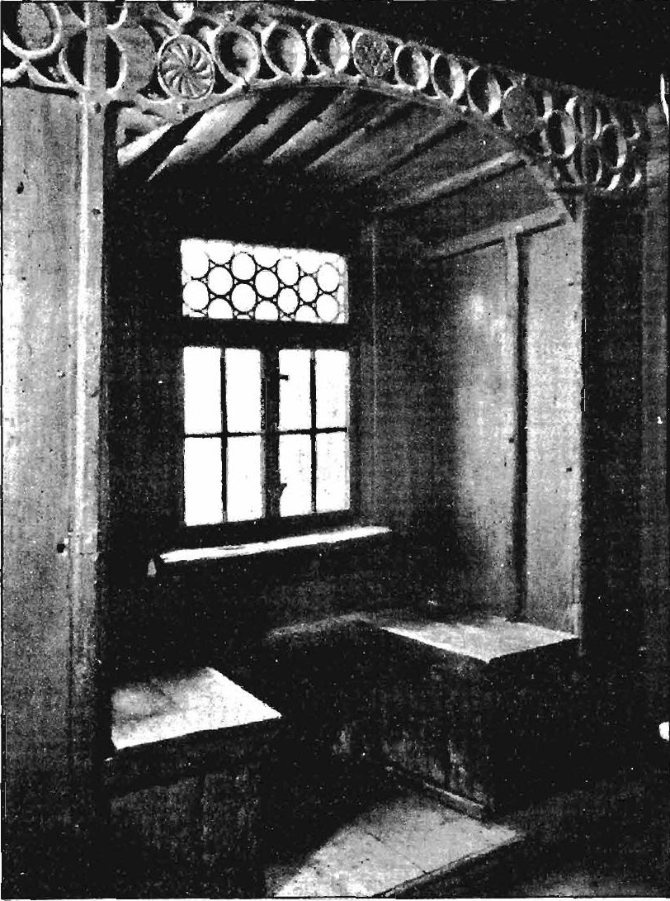
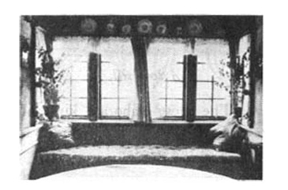
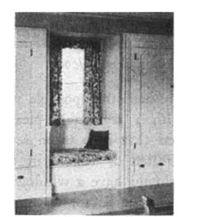
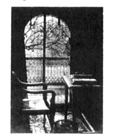
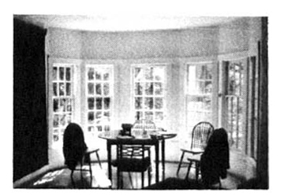
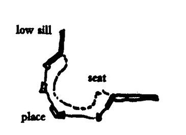

<section class="pattern-plate" aria-labelledby="window-place">

<a href="/patterns">A Pattern Language</a> · Pattern 180 · p. 833 · **

<h1 class="pattern-title" id="window-place">Window Place</h1>
<figure class="pattern-figure">

<figcaption>Opening photograph, <cite>A Pattern Language</cite>, p. 833.</figcaption>
</figure>
</section>
<section class="pattern-commentary" aria-labelledby="reading-window-place">
<h2 id="reading-window-place">A seat in the light</h2>

Look at the two benches in the photograph. From either bench you can look out of the window, talk to the person opposite, or turn back toward the room. The recess has enough depth to give those three activities a place of their own.

On page 834 the authors describe a familiar predicament. You settle into the most comfortable chair in a room and find yourself looking longingly at the light on the far wall. Over by the window, there’s nowhere to sit. The pattern asks how the chair and the light might find each other.

The sketches on pages 835–836 range from a chair at a low sill to an alcove with glass on three sides. Seen together they suggest a question to ask of any window: where, exactly, would someone settle?

<h3>Try it where you are</h3>

Pull a chair up to a window you like. Can you settle in with a book, look outside, and still feel part of the room? See what changes when you turn the chair sideways. If another person joins you, try sitting opposite each other.

</section>

<!-- GENERATED: full text below is rebuilt by scripts/build_patterns.py; edit above this line -->

<section class="pattern-plate">
The full pattern · p. 833
<nav class="pattern-links" aria-label="Connections"><h2>Links to</h2><ul><li><a href="/patterns/entrance-room">130 Entrance Room</a></li><li><a href="/patterns/zen-view">134 Zen View</a></li><li><a href="/patterns/light-on-two-sides-of-every-room">159 Light On Two Sides Of Every Room</a></li><li><a href="/patterns/street-windows">164 Street Windows</a></li><li><a href="/patterns/alcoves">179 Alcoves</a></li><li><a href="/patterns/built-in-seats">202 Built-In Seats</a></li><li><a href="/patterns/natural-doors-and-windows">221 Natural Doors And Windows</a></li><li><a href="/patterns/low-sill">222 Low Sill</a></li><li><a href="/patterns/deep-reveals">223 Deep Reveals</a></li><li><a href="/patterns/dormer-windows">231 Dormer Windows</a></li></ul><h2>Linked from</h2><ul><li><a href="/patterns/house-for-one-person">78 House For One Person</a></li><li><a href="/patterns/zen-view">134 Zen View</a></li><li><a href="/patterns/tapestry-of-light-and-dark">135 Tapestry Of Light And Dark</a></li><li><a href="/patterns/sleeping-to-the-east">138 Sleeping To The East</a></li><li><a href="/patterns/reception-welcomes-you">149 Reception Welcomes You</a></li><li><a href="/patterns/light-on-two-sides-of-every-room">159 Light On Two Sides Of Every Room</a></li><li><a href="/patterns/street-windows">164 Street Windows</a></li><li><a href="/patterns/greenhouse">175 Greenhouse</a></li><li><a href="/patterns/compost">178 Compost</a></li><li><a href="/patterns/alcoves">179 Alcoves</a></li><li><a href="/patterns/the-fire">181 The Fire</a></li><li><a href="/patterns/sitting-circle">185 Sitting Circle</a></li><li><a href="/patterns/communal-sleeping">186 Communal Sleeping</a></li><li><a href="/patterns/thick-walls">197 Thick Walls</a></li><li><a href="/patterns/built-in-seats">202 Built-In Seats</a></li><li><a href="/patterns/floor-and-ceiling-layout">210 Floor And Ceiling Layout</a></li><li><a href="/patterns/thickening-the-outer-walls">211 Thickening The Outer Walls</a></li><li><a href="/patterns/low-sill">222 Low Sill</a></li><li><a href="/patterns/dormer-windows">231 Dormer Windows</a></li><li><a href="/patterns/canvas-roofs">244 Canvas Roofs</a></li></ul></nav></section><article class="pattern-text" aria-label="The text of Window Place">
834… this pattern helps complete the arrangement of the windows given by <a class="pl-ref" href="/patterns/entrance-room">ENTRANCE ROOM (130)</a>, <a class="pl-ref" href="/patterns/zen-view">ZEN VIEW (134)</a>, <a class="pl-ref" href="/patterns/light-on-two-sides-of-every-room">LIGHT ON TWO SIDES OF EVERY ROOM (159)</a>, <a class="pl-ref" href="/patterns/street-windows">STREET WINDOWS (164)</a>. According to the pattern, at least one of the windows in each room needs to be shaped in such a way as to increase its usefulness as a space.

◆ ◆ ◆

<strong>Everybody loves window seats, bay windows, and big windows with low sills and comfortable chairs drawn up to them.</strong>

It is easy to think of these kinds of places as luxuries, which can no longer be built, and which we are no longer lucky enough to be able to afford.

In fact, the matter is more urgent. These kinds of windows which create “places” next to them are not simply luxuries; they are <em>necessary</em>. A room which does not have a place like this seldom allows you to feel fully comfortable or perfectly at ease. Indeed, a room without a window place may keep you in a state of perpetual unresolved conflict and tension—slight, perhaps, but definite.

This conflict takes the following form. If the room contains no window which is a “place,” a person in the room will be torn between two forces:

1. He wants to sit down and be comfortable.

2. He is drawn toward the light.

Obviously, if the comfortable places—those places in the room where you most want to sit—are away from the windows, there is no way of overcoming this conflict. You see, then, that our love for window “places” is not a luxury but an organic intuition, based on the natural desire a person has to let the forces he experiences run free. A room where you feel truly comfortable will always contain some kind of window place.

Now, of course, it is hard to give an exact definition of a 835“place.” Essentially a “place” is a partly enclosed, distinctly identifiable spot within a room. All of the following can function as “places” in this sense: bay windows, window seats, a low window sill where there is an obvious position for a comfortable armchair, and deep alcoves with windows all around them. To make the concept of a window place more precise, here are some examples of each of these types, together with discussion of the critical features which make each one of them work.

<em>A bay window</em>. A shallow bulge at one end of a room, with windows wrapped around it. It works as a window place because of the greater intensity of light, the views through the side windows, and the fact that you can pull chairs or a sofa up into the bay.

<figure class="pl-figure"><figcaption><em>A bay window</em>.</figcaption></figure>

A window seat. More modest. A niche, just deep enough for the seat. It works best for one person, sitting parallel to the window, back to the window frame, or for two people facing each other in this position.

<figure class="pl-figure"><figcaption><em>A window seat</em>.</figcaption></figure>

836<em>A low sill</em>. The most modest of all. The right sill height for a window place, with a comfortable chair, is very low: 12 to 14. inches. The feeling of enclosure comes from the armchair—best of all, one with a high back and sides.

<figure class="pl-figure"><figcaption><em>A low sill</em>.</figcaption></figure>

<em>A glazed alcove</em>. The most elaborate kind of window place: almost like a gazebo or a conservatory, windows all around it, a small room, almost part of the garden.

<figure class="pl-figure"><figcaption><em>A glazed alcove</em>.</figcaption></figure>

And, of course, there are other possible versions too. In principle, any window with a reasonably pleasant view can be a window place, provided that it is taken seriously as a space, a volume, not merely treated as a hole in the wall. Any room that people use often should have a window place. And window places should even be considered for waiting rooms or as special places along the length of hallways.

837Therefore:

In every room where you spend any length of time during the day, make at least one window into a “window place.”

<figure class="pl-figure"></figure>
◆ ◆ ◆

Make it low and self-contained if there is room for that—<a class="pl-ref" href="/patterns/alcoves">ALCOVES (179)</a>; keep the sill low—<a class="pl-ref" href="/patterns/low-sill">LOW SILL (222)</a>; put in the exact positions of frames, and mullions, and seats after the window place is framed, according to the view outside—<a class="pl-ref" href="/patterns/built-in-seats">BUILT-IN SEATS (202)</a>, <a class="pl-ref" href="/patterns/natural-doors-and-windows">NATURAL DOORS AND WINDOWS (221)</a>. And set the window deep into the wall to soften light around the edges—<a class="pl-ref" href="/patterns/deep-reveals">DEEP REVEALS (223)</a>. Under a sloping roof, use <a class="pl-ref" href="/patterns/dormer-windows">dormer windows (231)</a> to make this pattern….
</article>

Christopher Alexander, Sara Ishikawa and Murray Silverstein, with Max Jacobson, Ingrid Fiksdahl-King and Shlomo Angel, <cite>A Pattern Language</cite> (Oxford University Press, 1977), pattern 180, pp. 833–837. Text and illustrations from the <a href="https://github.com/natureoforder/sources">Nature of Order sources</a> reading edition, transcribed from the 1977 printing; report errors on <a href="https://github.com/natureoforder/alexander-wiki/issues">GitHub</a>.

<a href="/patterns/alcoves">← 179 Alcoves</a> · <a href="/patterns">All 253 patterns</a> · <a href="/patterns/the-fire">181 The Fire →</a>

