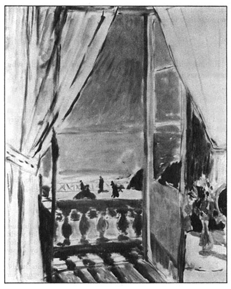
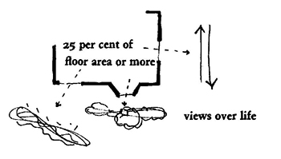

<section class="pattern-plate" aria-labelledby="t-windows-overlooking-life">
<a href="/patterns">A Pattern Language</a> · <a href="/patterns#buildings">Buildings</a> · Pattern 192 · p. 889 · *
<h1 class="pattern-title" id="t-windows-overlooking-life">Windows Overlooking Life</h1><figure class="pattern-figure pl-figure"></figure><nav class="pattern-links" aria-label="Connections"><h2>Links to</h2><ul><li><a href="/patterns/light-on-two-sides-of-every-room">159 Light On Two Sides Of Every Room</a></li><li><a href="/patterns/ceiling-height-variety">190 Ceiling Height Variety</a></li><li><a href="/patterns/the-shape-of-indoor-space">191 The Shape Of Indoor Space</a></li><li><a href="/patterns/natural-doors-and-windows">221 Natural Doors And Windows</a></li><li><a href="/patterns/low-sill">222 Low Sill</a></li><li><a href="/patterns/deep-reveals">223 Deep Reveals</a></li><li><a href="/patterns/small-panes">239 Small Panes</a></li></ul><h2>Linked from</h2><ul><li><a href="/patterns/wings-of-light">107 Wings Of Light</a></li><li><a href="/patterns/half-private-office">152 Half-Private Office</a></li><li><a href="/patterns/home-workshop">157 Home Workshop</a></li><li><a href="/patterns/light-on-two-sides-of-every-room">159 Light On Two Sides Of Every Room</a></li><li><a href="/patterns/workspace-enclosure">183 Workspace Enclosure</a></li><li><a href="/patterns/dressing-rooms">189 Dressing Rooms</a></li><li><a href="/patterns/sunny-counter">199 Sunny Counter</a></li><li><a href="/patterns/natural-doors-and-windows">221 Natural Doors And Windows</a></li><li><a href="/patterns/low-sill">222 Low Sill</a></li><li><a href="/patterns/dormer-windows">231 Dormer Windows</a></li><li><a href="/patterns/windows-which-open-wide">236 Windows Which Open Wide</a></li></ul></nav></section><article class="pattern-text" aria-label="The text of Windows Overlooking Life">
890… this pattern helps to complete the earlier patterns which give each room its shape: <a class="pl-ref" href="/patterns/light-on-two-sides-of-every-room">LIGHT ON TWO SIDES OF EVERY ROOM (159)</a>, <a class="pl-ref" href="/patterns/ceiling-height-variety">CEILING HEIGHT VARIETY (190)</a>, and <a class="pl-ref" href="/patterns/the-shape-of-indoor-space">THE SHAPE OF INDOOR SPACE (191)</a>. Once these patterns are clear, this pattern helps to place the windows rather more precisely in the walls. It defines just how many windows there should be, how far apart, and what their total area should be.

◆ ◆ ◆

<strong>Rooms without a view are prisons for the people who have to stay in them.</strong>

When people are in a place for any length of time they need to be able to refresh themselves by looking at a world different from the one they are in, and with enough of its own variety and life to provide refreshment.

Amos Rapoport gives written descriptions of three windowless seminar rooms at the University of California. The descriptions—by teachers and students of English who were asked to write descriptions of the rooms as part of a writing exercise—are heavily negative, even though they were not asked to be, and in many cases refer directly to the windowless, boxed-in, or isolated-from-the-world character of the rooms.

Here are two examples:

Room 5646 is an unpleasant room in which to attend class because in it one feels detached and isolated from the rest of the world under the buzzing fluorescent lights and the high sound-proofed ceilings, amid the sinks, cabinets, and pipes, surrounded by empty space.

The large and almost empty, windowless room with its sturdy, enclosing, and barren grey walls inspired neither disgust nor liking; one might easily have forgotten how trapped one was. (Amos Rapoport, “Some Consumer Comments on a Designed Environment,” <em>Arena—The Architectural Association Journal</em>, January 1967, pp. 176–78.)

Brian Wells, studying office workers’ choice of working positions, found that 81 per cent of all subjects chose positions next to 891a window. (<em>Office Design: A Study of Environment</em>, Peter Manning, ed., Pilkington Research Unit, Department of Building Science, University of Liverpool, 1965, pp. 118–21.) Many of the subjects gave “daylight” rather than “view” as a reason for their choice. But it is shown elsewhere in the same report that subjects who are far from windows grossly overestimate the amount of daylight they receive as compared with artificial light (<em>Office Design</em> p. 58). This suggests that people want to be near windows for other reasons over and above the daylight. Our conjecture that it is the view which is critical is given more weight by the fact that people are less interested in sitting near windows which open onto light wells, which admit daylight, but present no view.

And Thomas Markus presents evidence which shows clearly that office workers prefer windows with meaningful views—views of city life, nature—as against views which also take in large areas, but contain uninteresting and less meaningful elements. (Thomas A. Markus, “The Function of Windows: A Reappraisal,” <em>Building Science</em>, 2, 1967, pp. 97–121; see especially p. 109.)

Assume then that people do need to be able to look out of windows, at some world different from their immediate surroundings. We now give very rough figures for the total area of the windows in a room. The area of window needed will depend to a large extent on climate, latitude, and the amount of reflecting surfaces around the outside of the building. However, it is fairly reasonable to believe that the floor/window ratio, though different in different regions, may be more or less constant within any given region.

We suggest, therefore, that you go round the town where you live, and choose half a dozen rooms in which you really like the light. In each case, measure the window area as a percentage of the floor area; then take the average of the different percentages.

In our part of the world—Berkeley, California—we find that rooms are most pleasant when they have about 25 per cent window—sometimes as much as 50 per cent—(that is, 25-50 square feet of window for every 100 square feet of floor). But we repeat, obviously this figure will vary enormously from one part of the world to another. Imagine: Rabat, Timbuctoo, Antarctica, Northern Norway, Italy, Brazilian jungle….

892Therefore

<strong>In each room, place the windows in such a way that their total area conforms roughly to the appropriate figures for your region (25 per cent or more of floor area, in the San Francisco Bay Area), and place them in positions which give the best possible views out over life: activities in streets, quiet gardens, anything different from the indoor scene.</strong>

<figure class="pl-figure"></figure>
◆ ◆ ◆

Fine tune the exact positions of the windows at the time that you build them—<a class="pl-ref" href="/patterns/natural-doors-and-windows">NATURAL DOORS AND WINDOWS (221)</a>; break the area of each window into <a class="pl-ref" href="/patterns/small-panes">SMALL PANES (239)</a>; give each window a very <a class="pl-ref" href="/patterns/low-sill">LOW SILL (222)</a> to improve the view and <a class="pl-ref" href="/patterns/deep-reveals">DEEP REVEALS (223)</a> to make the light as soft as possible inside….
</article>

Christopher Alexander, Sara Ishikawa and Murray Silverstein, with Max Jacobson, Ingrid Fiksdahl-King and Shlomo Angel, <cite>A Pattern Language</cite> (Oxford University Press, 1977), pattern 192, pp. 889–892. Text and illustrations from the <a href="https://github.com/natureoforder/sources">Nature of Order sources</a> reading edition, transcribed from the 1977 printing; report errors on <a href="https://github.com/natureoforder/alexander-wiki/issues">GitHub</a>.

<a href="/patterns/the-shape-of-indoor-space">← 191 The Shape Of Indoor Space</a> · <a href="/patterns">All 253 patterns</a> · <a href="/patterns/half-open-wall">193 Half-Open Wall →</a>

