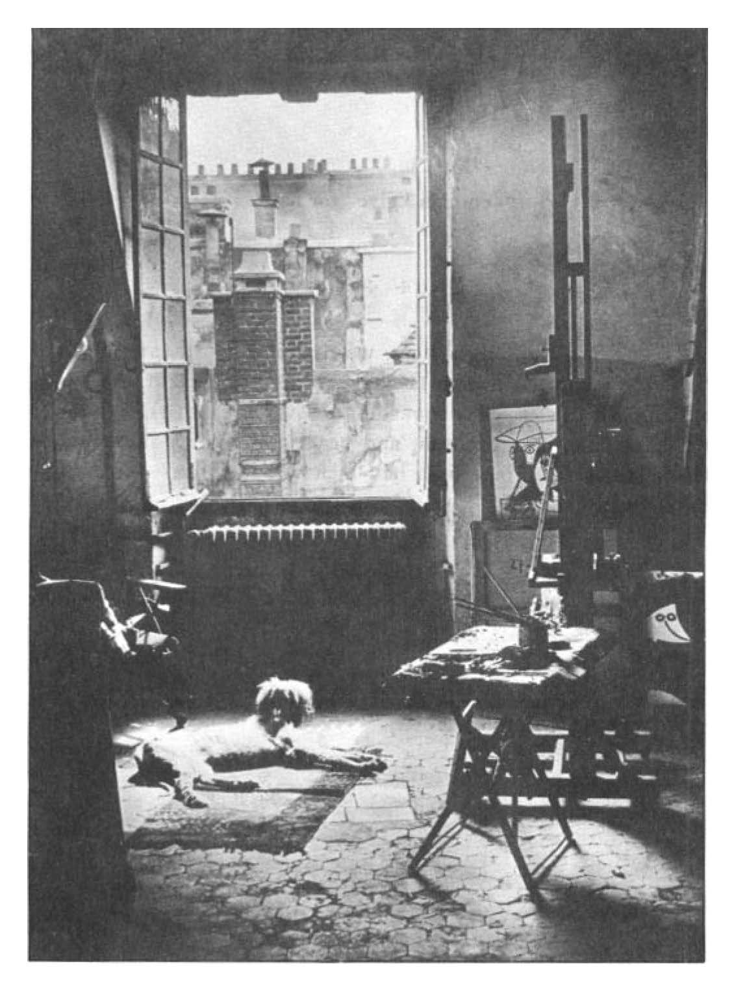
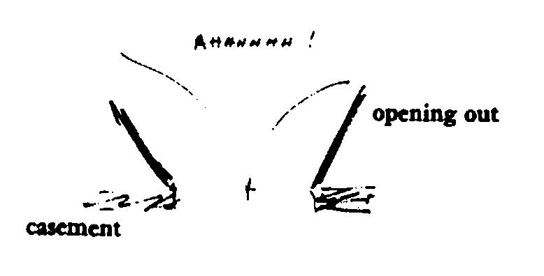

<section class="pattern-plate" aria-labelledby="t-windows-which-open-wide">
<a href="/patterns">A Pattern Language</a> · <a href="/patterns#construction">Construction</a> · Pattern 236 · p. 1100 · *
<h1 class="pattern-title" id="t-windows-which-open-wide">Windows Which Open Wide</h1><figure class="pattern-figure pl-figure"></figure><nav class="pattern-links" aria-label="Connections"><h2>Links to</h2><ul><li><a href="/patterns/windows-overlooking-life">192 Windows Overlooking Life</a></li><li><a href="/patterns/small-panes">239 Small Panes</a></li></ul><h2>Linked from</h2><ul><li><a href="/patterns/indoor-sunlight">128 Indoor Sunlight</a></li><li><a href="/patterns/street-windows">164 Street Windows</a></li><li><a href="/patterns/low-sill">222 Low Sill</a></li><li><a href="/patterns/frames-as-thickened-edges">225 Frames As Thickened Edges</a></li><li><a href="/patterns/dormer-windows">231 Dormer Windows</a></li><li><a href="/patterns/roof-caps">232 Roof Caps</a></li><li><a href="/patterns/small-panes">239 Small Panes</a></li></ul></nav></section><article class="pattern-text" aria-label="The text of Windows Which Open Wide">
1101… this pattern helps to complete WINDOW PLACE (l80), <a class="pl-ref" href="/patterns/windows-overlooking-life">WINDOWS OVERLOOKING LIFE (192)</a>, and NATURAL DOORS AND WINDOWS (22l).

◆ ◆ ◆

<strong>Many buildings nowadays have no opening windows at all; and many of the opening windows that people do build, don’t do the job that opening windows ought to do.</strong>

It is becoming the rule in modem design to seal up windows and create “perfect” indoor climates with mechanical air conditioning systems. This is crazy.

A window is your connection to the outside. It is a source of fresh air; a simple way of changing the temperature, quickly, when the room gets too hot or too cold; a place to hang out and smell the air and trees and flowers and the weather; and a hole through which people can talk to each other.

What is the best kind of window?

Double-hung windows cannot be fully opened—only half of the total window area can ever be opened at once. And they often get stuck—sometimes because they have been painted, sometimes because their concealed operating system of cords, counter-weights, and pulleys gets broken; it becomes such an effort to open them that no one bothers.

Sliding windows have much of the same problem—only part of the window area can be open, since one panel goes behind another; and they often get stuck too.

The side hung casement is easy to open and close. It gives the greatest range of openings, and so creates the greatest degree of control over air and temperature; and it makes an opening which is large enough to put your head and shoulders through. It is the easiest window to climb in and out of too.

The old time French windows are a stunning example of this pattern. They are narrow, full length upstairs windows, which swing out onto a tiny balcony, large enough only to contain the open windows. When you open them you fill the frame, and can stand drinking in the air: they put you intensely close to the outside—yet 1102in a perfectly urban sense, as much in Paris or Madrid as in the open countryside.

Therefore:

<strong>Decide which of the windows will be opening windows. Pick those which are easy to get to, and choose the ones which open onto flowers you want to smell, paths where yon might want to talk, and natural breezes. Then put in side-hung casements that open outward. Here and there, go all the way and build full French windows.</strong>

<figure class="pl-figure"></figure>
◆ ◆ ◆

Complete the subframe of the casement with <a class="pl-ref" href="/patterns/small-panes">SMALL PANES (239)</a>….
</article>

Christopher Alexander, Sara Ishikawa and Murray Silverstein, with Max Jacobson, Ingrid Fiksdahl-King and Shlomo Angel, <cite>A Pattern Language</cite> (Oxford University Press, 1977), pattern 236, pp. 1100–1102. Text and illustrations from the <a href="https://github.com/natureoforder/sources">Nature of Order sources</a> reading edition, transcribed from the 1977 printing; report errors on <a href="https://github.com/natureoforder/alexander-wiki/issues">GitHub</a>.

<a href="/patterns/soft-inside-walls">← 235 Soft Inside Walls</a> · <a href="/patterns">All 253 patterns</a> · <a href="/patterns/solid-doors-with-glass">237 Solid Doors With Glass →</a>

