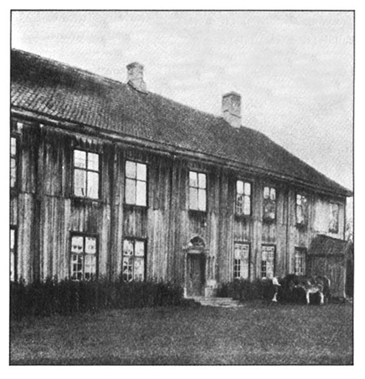
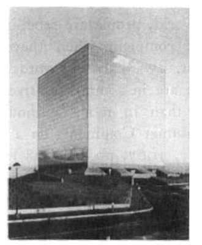
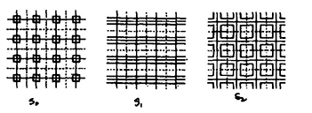
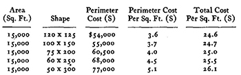
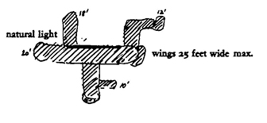

<section class="pattern-plate" aria-labelledby="t-wings-of-light">
<a href="/patterns">A Pattern Language</a> · <a href="/patterns#buildings">Buildings</a> · Pattern 107 · p. 524 · **
<h1 class="pattern-title" id="t-wings-of-light">Wings Of Light</h1><figure class="pattern-figure pl-figure"></figure><nav class="pattern-links" aria-label="Connections"><h2>Links to</h2><ul><li><a href="/patterns/the-family">75 The Family</a></li><li><a href="/patterns/house-for-a-small-family">76 House For A Small Family</a></li><li><a href="/patterns/house-for-a-couple">77 House For A Couple</a></li><li><a href="/patterns/house-for-one-person">78 House For One Person</a></li><li><a href="/patterns/self-governing-workshops-and-offices">80 Self-Governing Workshops And Offices</a></li><li><a href="/patterns/office-connections">82 Office Connections</a></li><li><a href="/patterns/master-and-apprentices">83 Master And Apprentices</a></li><li><a href="/patterns/individually-owned-shops">87 Individually Owned Shops</a></li><li><a href="/patterns/south-facing-outdoors">105 South Facing Outdoors</a></li><li><a href="/patterns/positive-outdoor-space">106 Positive Outdoor Space</a></li><li><a href="/patterns/connected-buildings">108 Connected Buildings</a></li><li><a href="/patterns/cascade-of-roofs">116 Cascade Of Roofs</a></li><li><a href="/patterns/arcades">119 Arcades</a></li><li><a href="/patterns/short-passages">132 Short Passages</a></li><li><a href="/patterns/light-on-two-sides-of-every-room">159 Light On Two Sides Of Every Room</a></li><li><a href="/patterns/windows-overlooking-life">192 Windows Overlooking Life</a></li><li><a href="/patterns/structure-follows-social-spaces">205 Structure Follows Social Spaces</a></li><li><a href="/patterns/deep-reveals">223 Deep Reveals</a></li><li><a href="/patterns/small-panes">239 Small Panes</a></li></ul><h2>Linked from</h2><ul><li><a href="/patterns/building-complex">95 Building Complex</a></li><li><a href="/patterns/small-parking-lots">103 Small Parking Lots</a></li><li><a href="/patterns/site-repair">104 Site Repair</a></li><li><a href="/patterns/south-facing-outdoors">105 South Facing Outdoors</a></li><li><a href="/patterns/positive-outdoor-space">106 Positive Outdoor Space</a></li><li><a href="/patterns/connected-buildings">108 Connected Buildings</a></li><li><a href="/patterns/long-thin-house">109 Long Thin House</a></li><li><a href="/patterns/main-entrance">110 Main Entrance</a></li><li><a href="/patterns/cascade-of-roofs">116 Cascade Of Roofs</a></li><li><a href="/patterns/sheltering-roof">117 Sheltering Roof</a></li><li><a href="/patterns/roof-garden">118 Roof Garden</a></li><li><a href="/patterns/paths-and-goals">120 Paths And Goals</a></li><li><a href="/patterns/building-fronts">122 Building Fronts</a></li><li><a href="/patterns/intimacy-gradient">127 Intimacy Gradient</a></li><li><a href="/patterns/light-on-two-sides-of-every-room">159 Light On Two Sides Of Every Room</a></li><li><a href="/patterns/building-edge">160 Building Edge</a></li></ul></nav></section><article class="pattern-text" aria-label="The text of Wings Of Light">
525… at this stage, you have a rough position (or the building or buildings on the site from <a class="pl-ref" href="/patterns/south-facing-outdoors">SOUTH FACING OUTDOORS (105)</a> and <a class="pl-ref" href="/patterns/positive-outdoor-space">POSITIVE OUTDOOR SPACE (106)</a>. Before you lay out the interior of the building in detail, it is necessary to define the shapes of roofs and buildings in rather more detail. To do this, go back to the decisions you have already made about the basic social components of the building. In some cases, you will have made these decisions according to the individual case; in other cases you may have used the fundamental social patterns to define the basic entities—<a class="pl-ref" href="/patterns/the-family">THE FAMILY (75)</a>, <a class="pl-ref" href="/patterns/house-for-a-small-family">HOUSE FOR A SMALL FAMILY (76)</a>, <a class="pl-ref" href="/patterns/house-for-a-couple">HOUSE FOR A COUPLE (77)</a>, <a class="pl-ref" href="/patterns/house-for-one-person">HOUSE FOR ONE PERSON (78)</a>, <a class="pl-ref" href="/patterns/self-governing-workshops-and-offices">SELF-GOVERNING WORKSHOPS AND OFFICES (80)</a>, SMALL SERVICES WITHOUT RED TAPE (8l), <a class="pl-ref" href="/patterns/office-connections">OFFICE CONNECTIONS (82)</a>, <a class="pl-ref" href="/patterns/master-and-apprentices">MASTER AND APPRENTICES (83)</a>, <a class="pl-ref" href="/patterns/individually-owned-shops">INDIVIDUALLY OWNED SHOPS (87)</a>. Now it is time to start giving the building a more definite shape based on these social groupings. Start by realizing that the building needn’t be a massive hulk, but may be broken into wings.

◆ ◆ ◆

<strong>Modem buildings are often shaped with no concern for natural light—they depend almost entirely on artificial light But buildings which displace natural light as the major source of illumination are not fit places to spend the day.</strong>

<figure class="pl-figure"><figcaption><em>A monster building—no concern for daylight inside</em>.</figcaption></figure>

526This simple statement, if taken seriously, will make a revolution in the shape of buildings. At present, people take for granted that it is possible to use indoor space which is lit by artificial light; and buildings therefore take on all kinds of shapes and depths.

If we treat the presence of natural light as an <em>essential</em>—not optional—feature of indoor space, then no building could ever be more than 20—25 feet deep, since no point in a building which is more, than about 12 or 15 feet from a window, can get good natural light.

Later on, in <a class="pl-ref" href="/patterns/light-on-two-sides-of-every-room">LIGHT ON TWO SIDES (159)</a>, we shall argue, even more sharply, that every room where people can feel comfortable must have not merely one window, but two, on different sides. This adds even further structure to the building shape; it requires not only that the building be no more than 25 feet deep, but also that its outer walls are continually broken up by corners and reentrant corners to give every room two outside walls.

The present pattern, which requires that buildings be made up of long and narrow wings, lays the groundwork for the later pattern. Unless the building is first conceived as being made of long, thin wings, there is no possible way of introducing <a class="pl-ref" href="/patterns/light-on-two-sides-of-every-room">LIGHT ON TWO SIDES (159)</a>, in its complete form, later in the process. Therefore, we first build up the argument for this pattern, based on the human requirements for natural light, and later, in <a class="pl-ref" href="/patterns/light-on-two-sides-of-every-room">LIGHT ON TWO SIDES (159)</a>, we shall be concerned with the organization of windows within a particular room.

There are two reasons for believing that people must have buildings lit essentially by sun.

First, all over the world, people are rebelling against windowless buildings; people complain when they have to work in places without daylight. By analyzing words they use, Rapoport has shown that people are in a more positive frame of mind in rooms with windows than in rooms without windows. (Amos Rapoport, “Some Consumer Comments on a Designed Environment,” <em>Arena</em>, January, 1967, pp. 176–78.) Edward Hall tells the story of a man who worked in a windowless office for some time, all the time saying that it was “just fine, just fine,” and then abruptly quit. Hall says, “The issue was so deep, and so serious, that this man could not even bear to discuss it, since just discussing it would have opened the floodgates.”

527Second, there is a growing body of evidence which suggests that man actually <em>needs</em> daylight, since the cycle of daylight somehow plays a vital role in the maintenance of the body’s circadian rhythms, and that the change of light during the day, though apparently variable, is in this sense a fundamental constant by which the human body maintains its relationship to the environment. (See, for instance, R. G. Hopkinson, <em>Architectural Physics: Lighting</em>, Department of Scientific &amp; Industrial Research, Building Research Station, HMSO, London, 1963, pp. 116–17.) If this is true, then too much artificial light actually creates a rift between a person and his surroundings and upsets the human physiology.

Many people will agree with these arguments. Indeed, the arguments merely express precisely what all of us know already: that it is much more pleasant to be in a building lit by daylight than in one which is not. But the trouble is that many of the buildings which are built without daylight are built that way because of density. They are built compact, in the belief that it is necessary to sacrifice daylight in order to reach high densities.

Lionel March and Leslie Martin have made a major contribution to this discussion. (Leslie Martin and Lionel March, <em>Land Use and Built Form</em>, Cambridge Research, Cambridge University, April 1966.) Using the ratio of built floor area to total site area as a measure of density and the semi-depth of the building as a measure of daylight conditions, they have compared three different arrangements of building and open space, which they call S0, S1, and S2.

<figure class="pl-figure"><figcaption><em>Three building types</em>.</figcaption></figure>

Of the three arrangements, S2, in which buildings surround the outdoors with thin wings, gives the best daylight conditions 528for a fixed density. It also gives the highest density for a fixed level of daylight.

There is another criticism that is often leveled against this pattern. Since it tends to create buildings which are narrow and rambling, it increases the perimeter of buildings and therefore raises building cost substantially. How big is the difference? The following figures are taken from a cost analysis of standard office buildings used by Skidmore Owings and Merrill, in the program BOP (Building Optimization). These figures illustrate costs for a typical floor of an office building and are based on costs of 21 dollars per square foot for the structure, floors, finishes, mechanical, and so on, not including exterior wall, and a cost of no dollars per running foot for the perimeter wall. (Costs are for 1969.)

<figure class="pl-figure"><figcaption><em>The extra perimeter adds little to budding costs</em>.</figcaption></figure>

We see then, that at least in this one case, the cost of the extra perimeter adds very little to the cost of the building. The narrowest building costs only 6 per cent more than the squarest. We believe this case is fairly typical and that the cost savings to be achieved by square and compact building forms have been greatly exaggerated.

Now, assuming that this pattern is compatible with the problems of density and perimeter cost, we must decide how wide a building can be, and still be essentially lit by the sun.

We assume, first of all, that no point in the building should have less than 20 lumens per square foot of illumination. This is the level found in a typical corridor and is just below the level required for reading. We assume, second, that a place will only seem “naturally” lit, if more than 50 per cent of its light comes from the sky: that is, even the points furthest from the windows must be getting at least 10 lumens per square foot of their illumination from the sky.

529Let us now look at a room analyzed in detail by Hopkinson and Kay. The room, a classroom, is 18 feet deep, 24 feet wide, with a window all along one side starting three feet above the floor. Walls have a reflectance of 40 per cent—a fairly typical value. With a standard sky, the desks 15 feet from the window are just getting 10 lumens per square foot from the sky—our minimum. Yet this is a rather well lit room. R. G. Hopkinson and J. G. Kay, <em>The Lighting of Buildings</em>, New York: Praeger, 1969, p. 108).

It is hard to imagine then, that many rooms more than 15 feet deep will meet our standards. Indeed, many patterns in this book will tend to reduce the window area—<a class="pl-ref" href="/patterns/windows-overlooking-life">WINDOWS OVERLOOKING LIFE (192)</a>, NATURAL DOORS AND WINDOWS (22l), <a class="pl-ref" href="/patterns/deep-reveals">DEEP REVEALS (223)</a>, <a class="pl-ref" href="/patterns/small-panes">SMALL PANES (239)</a>, so that in many cases rooms should be no more than 12 feet deep—more only if the walls are very light or the ceilings very high. We conclude, therefore, that a building wing that is truly a “wing of light” must be about 25 feet wide—never wider than 30 feet—with the interior rooms “one deep” along the wing. When buildings are wider than this, artificial light, of necessity, takes over.

A building which simply has to be wide—a large hall for example—can have the proper level of natural light if there are extra clerestory windows in the roof.

Therefore:

<strong>Arrange each building so that it breaks down into wings which correspond, approximately, to the most important natural social groups within the building. Make each wing long and as narrow as you can—never more than 25 feet wide.</strong>

<figure class="pl-figure"></figure>
530

◆ ◆ ◆

Use the wings to form outdoor areas which have a definite shape, like courts and rooms—<a class="pl-ref" href="/patterns/positive-outdoor-space">POSITIVE OUTDOOR SPACE (106)</a>; connect the wings, whenever possible, to the existing buildings round about so that the building takes its place within a long and rambling continuous fabric—<a class="pl-ref" href="/patterns/connected-buildings">CONNECTED BUILDINGS (108)</a>. When you get further down and start defining individual rooms, make use of the daylight which the wings provide by giving each room <a class="pl-ref" href="/patterns/light-on-two-sides-of-every-room">LIGHT ON TWO SIDES (159)</a>.

Give each wing its own roof in such a way that all the wings together form a great cascade of roofs—<a class="pl-ref" href="/patterns/cascade-of-roofs">CASCADE OF ROOFS (116)</a>; if the wing contains various houses, or workgroups, or a sequence of major rooms, build access to these rooms and groups of rooms from one side, from an arcade, or gallery, not from a central corridor—<a class="pl-ref" href="/patterns/arcades">ARCADES (119)</a>, <a class="pl-ref" href="/patterns/short-passages">SHORT PASSAGES (132)</a>. For the load bearing structure of the wings, begin with <a class="pl-ref" href="/patterns/structure-follows-social-spaces">STRUCTURE FOLLOWS SOCIAL SPACES (205)</a>….
</article>

Christopher Alexander, Sara Ishikawa and Murray Silverstein, with Max Jacobson, Ingrid Fiksdahl-King and Shlomo Angel, <cite>A Pattern Language</cite> (Oxford University Press, 1977), pattern 107, pp. 524–530. Text and illustrations from the <a href="https://github.com/natureoforder/sources">Nature of Order sources</a> reading edition, transcribed from the 1977 printing; report errors on <a href="https://github.com/natureoforder/alexander-wiki/issues">GitHub</a>.

<a href="/patterns/positive-outdoor-space">← 106 Positive Outdoor Space</a> · <a href="/patterns">All 253 patterns</a> · <a href="/patterns/connected-buildings">108 Connected Buildings →</a>

