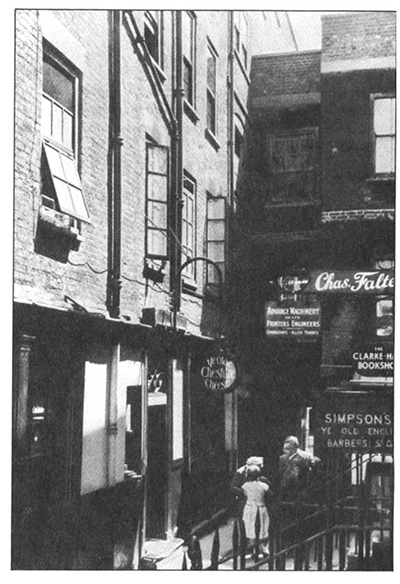
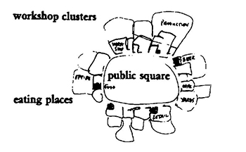

<section class="pattern-plate" aria-labelledby="t-work-community">
<a href="/patterns">A Pattern Language</a> · <a href="/patterns#towns">Towns</a> · Pattern 41 · p. 222 · **
<h1 class="pattern-title" id="t-work-community">Work Community</h1><figure class="pattern-figure pl-figure"></figure><nav class="pattern-links" aria-label="Connections"><h2>Links to</h2><ul><li><a href="/patterns/scattered-work">9 Scattered Work</a></li><li><a href="/patterns/neighborhood-boundary">15 Neighborhood Boundary</a></li><li><a href="/patterns/men-and-women">27 Men And Women</a></li><li><a href="/patterns/activity-nodes">30 Activity Nodes</a></li><li><a href="/patterns/accessible-green">60 Accessible Green</a></li><li><a href="/patterns/self-governing-workshops-and-offices">80 Self-Governing Workshops And Offices</a></li><li><a href="/patterns/food-stands">93 Food Stands</a></li><li><a href="/patterns/communal-eating">147 Communal Eating</a></li></ul><h2>Linked from</h2><ul><li><a href="/patterns/scattered-work">9 Scattered Work</a></li><li><a href="/patterns/subculture-boundary">13 Subculture Boundary</a></li><li><a href="/patterns/identifiable-neighborhood">14 Identifiable Neighborhood</a></li><li><a href="/patterns/neighborhood-boundary">15 Neighborhood Boundary</a></li><li><a href="/patterns/life-cycle">26 Life Cycle</a></li><li><a href="/patterns/activity-nodes">30 Activity Nodes</a></li><li><a href="/patterns/interchange">34 Interchange</a></li><li><a href="/patterns/household-mix">35 Household Mix</a></li><li><a href="/patterns/old-people-everywhere">40 Old People Everywhere</a></li><li><a href="/patterns/housing-in-between">48 Housing In Between</a></li><li><a href="/patterns/looped-local-roads">49 Looped Local Roads</a></li><li><a href="/patterns/children-in-the-city">57 Children In The City</a></li><li><a href="/patterns/accessible-green">60 Accessible Green</a></li><li><a href="/patterns/small-public-squares">61 Small Public Squares</a></li><li><a href="/patterns/common-land">67 Common Land</a></li><li><a href="/patterns/still-water">71 Still Water</a></li><li><a href="/patterns/small-services-without-red-tape">81 Small Services Without Red Tape</a></li><li><a href="/patterns/office-connections">82 Office Connections</a></li><li><a href="/patterns/travelers-inn">91 Traveler’s Inn</a></li><li><a href="/patterns/small-parking-lots">103 Small Parking Lots</a></li><li><a href="/patterns/half-hidden-garden">111 Half-Hidden Garden</a></li><li><a href="/patterns/sunny-place">161 Sunny Place</a></li><li><a href="/patterns/greenhouse">175 Greenhouse</a></li></ul></nav></section><article class="pattern-text" aria-label="The text of Work Community">
223… according to the pattern <a class="pl-ref" href="/patterns/scattered-work">scattered work (9)</a>, work is entirely decentralized and woven in and out of housing areas. The effect of scattered work—can be increased piecemeal, by building individual work communities, one by one, in the boundaries between the neighborhoods; these work communities will then help to form the boundaries—subculture boundary (13), <a class="pl-ref" href="/patterns/neighborhood-boundary">neighborhood boundary (15)</a>—and above all in the boundaries, they will help to form <a class="pl-ref" href="/patterns/activity-nodes">activity nodes (30)</a>.

◆ ◆ ◆

<strong>If you spend eight hours of your day at work, and eight hours at home, there is no reason why your workplace should be any less of a community than your home.</strong>

When someone tells you where he "lives," he is always talking about his house or the neighborhood his house is in. It sounds harmless enough. But think what it really means. Why should the people of our culture choose to use the word "live," which, on the face of it applies to every moment of our waking lives, and apply it only to a special portion of our lives—that part associated with our families and houses. The implication is straightforward. The people of our culture believe that they are less alive when they are working than when they are at home; and we make this distinction subtly clear, by choosing to keep the word "live" only for those places in our lives where we are not working. Anyone who uses the phrase "where do you live" in its everyday sense, accepts as his own the widespread cultural awareness of the fact that no one really "lives" at his place of work—there is no song or music there, no love, no food—that he is not alive while working, not living, only toiling away, and being dead.

As soon as we understand this situation it leads at once to outrage. Why should we accept a world in which eight hours of the day are "dead"; why shall we not create a world in which our work is as much part of life, as much alive, as anything we do at home with our family and with our friends?

This problem is discussed in other patterns—<a class="pl-ref" href="/patterns/scattered-work">SCATTERED WORK (9)</a>, <a class="pl-ref" href="/patterns/self-governing-workshops-and-offices">SELF-GOVERNING WORKSHOPS AND OFFICES (80)</a>. Here we 224focus on the implications which this problem has for the physical and social nature of the <em>area</em> in which a workplace sits. If a person spends eight hours a day working in a certain area, and the nature of his work, its social character, and its location, are all chosen to make sure that he is living, not merely earning money, then it is certainly essential that the area immediately around his place of work be a <em>community</em>, just like a neighborhood but oriented to the pace and rhythms of work, instead of the rhythms of the family.

For workplaces to function as communities, five relationships arc critical:

1. <em>Workplaces must not be too scattered</em>, <em>nor too agglomerated, but clustered in groups of about 5</em>.

We know from <a class="pl-ref" href="/patterns/scattered-work">scattered work (9)</a> that workplaces should be decentralized, but they should not be so scattered that a single workplace is isolated from others. On the other hand, they should not be so agglomerated that a single workplace is lost in a sea of others. The workplaces should therefore be grouped to form strongly identifiable communities. The communities need to be small enough so that one can know most of the people working in them, at least by sight—and big enough to support as many amenities for the workers as possible—lunch counters, local sports, shops, and so on. We guess the right size may be between 8 and 20 establishments.

2. <em>The workplace community contains a mix of manual jobs, desk jobs, craft jobs, selling, and so forth</em>.

Most people today work in areas which are specialized: medical buildings, car repair, advertising, warehousing, financial, etc. This kind of segregation leads to isolation from other types of work and other types of people, leading in turn to less concern, respect, and understanding of them. We believe that a world where people are socially responsible can only come about where there is a value intrinsic to every job, where there is dignity associated with all work. This can hardly come about when we are so segregated from people who do different kinds of work from us.

3. <em>There is a common piece of land within the work community, which ties the individual workshops and offices together</em>.

A shared street does a little to tie individual houses and places together; but a shared piece of common land does a great deal 225more. If the workplaces are grouped around a common courtyard where people can sit, play volleyball, eat lunches, it will help the contact and community among the workers.

4. <em>The work community is interlaced with the larger community in which it is located</em>.

A work community, though forming a core community by itself, cannot work well in complete isolation from the surrounding community. This is already discussed to some extent in <a class="pl-ref" href="/patterns/scattered-work">scattered work (9)</a> and <a class="pl-ref" href="/patterns/men-and-women">men and women (27)</a>. In addition, both work community and residential community can gain by sharing facilities and services—restaurants, cafes, libraries. Thus it makes sense for the work community to be open to the larger community with shops and cafes at the seam between them.

5. <em>Finally, it is necessary that the common land, or courtyards, exist at two distinct and separate levels</em>. On the one hand, the courtyards for common table tennis, volleyball, need half-a-dozen workgroups around them at the most—more would swamp them. On the other hand, the lunch counters and laundries and barbershops need more like 20 or 30 workgroups to survive. For this reason the work community needs two levels of clustering.

Therefore:

<strong>Build or encourage the formation of work communities—each one a collection of smaller clusters of workplaces which have their own courtyards, gathered round a larger common square or common courtyard which contains shops and lunch counters. The total work community should have no more than 10 or 20 workplaces in it</strong>

<figure class="pl-figure"></figure>
◆ ◆ ◆

226Make the square at the heart of the community a public square with public paths coming through it—small public squares (61); either in this square, or in some attached space, place opportunities for sports—local sports (72); make sure that the entire community is always within three minutes’ walk of an <a class="pl-ref" href="/patterns/accessible-green">accessible green (60)</a>; lay out the individual smaller courtyards in such a way that people naturally gather there—court-yards which live (115); keep the workshops small—selfgoverning workshops and offices (80); encourage communal cooking and eating over and beyond the lunch counters—street CAFE (88), <a class="pl-ref" href="/patterns/food-stands">FOOD STANDS (93)</a>, <a class="pl-ref" href="/patterns/communal-eating">COMMUNAL EATING (147)</a>….
</article>

Christopher Alexander, Sara Ishikawa and Murray Silverstein, with Max Jacobson, Ingrid Fiksdahl-King and Shlomo Angel, <cite>A Pattern Language</cite> (Oxford University Press, 1977), pattern 41, pp. 222–226. Text and illustrations from the <a href="https://github.com/natureoforder/sources">Nature of Order sources</a> reading edition, transcribed from the 1977 printing; report errors on <a href="https://github.com/natureoforder/alexander-wiki/issues">GitHub</a>.

<a href="/patterns/old-people-everywhere">← 40 Old People Everywhere</a> · <a href="/patterns">All 253 patterns</a> · <a href="/patterns/industrial-ribbon">42 Industrial Ribbon →</a>

