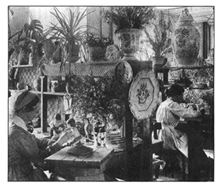
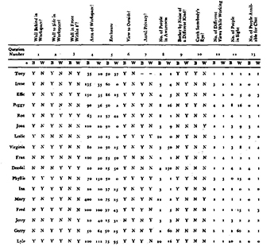
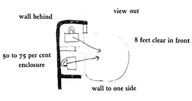

<section class="pattern-plate" aria-labelledby="t-workspace-enclosure">
<a href="/patterns">A Pattern Language</a> · <a href="/patterns#buildings">Buildings</a> · Pattern 183 · p. 846 · **
<h1 class="pattern-title" id="t-workspace-enclosure">Workspace Enclosure</h1><figure class="pattern-figure pl-figure"></figure><nav class="pattern-links" aria-label="Connections"><h2>Links to</h2><ul><li><a href="/patterns/flexible-office-space">146 Flexible Office Space</a></li><li><a href="/patterns/half-private-office">152 Half-Private Office</a></li><li><a href="/patterns/home-workshop">157 Home Workshop</a></li><li><a href="/patterns/alcoves">179 Alcoves</a></li><li><a href="/patterns/sitting-circle">185 Sitting Circle</a></li><li><a href="/patterns/the-shape-of-indoor-space">191 The Shape Of Indoor Space</a></li><li><a href="/patterns/windows-overlooking-life">192 Windows Overlooking Life</a></li><li><a href="/patterns/half-open-wall">193 Half-Open Wall</a></li><li><a href="/patterns/open-shelves">200 Open Shelves</a></li><li><a href="/patterns/waist-high-shelf">201 Waist-High Shelf</a></li><li><a href="/patterns/pools-of-light">252 Pools Of Light</a></li></ul><h2>Linked from</h2><ul><li><a href="/patterns/house-for-one-person">78 House For One Person</a></li><li><a href="/patterns/master-and-apprentices">83 Master And Apprentices</a></li><li><a href="/patterns/positive-outdoor-space">106 Positive Outdoor Space</a></li><li><a href="/patterns/indoor-sunlight">128 Indoor Sunlight</a></li><li><a href="/patterns/a-room-of-ones-own">141 A Room Of One’s Own</a></li><li><a href="/patterns/flexible-office-space">146 Flexible Office Space</a></li><li><a href="/patterns/small-work-groups">148 Small Work Groups</a></li><li><a href="/patterns/reception-welcomes-you">149 Reception Welcomes You</a></li><li><a href="/patterns/half-private-office">152 Half-Private Office</a></li><li><a href="/patterns/compost">178 Compost</a></li><li><a href="/patterns/half-open-wall">193 Half-Open Wall</a></li><li><a href="/patterns/closets-between-rooms">198 Closets Between Rooms</a></li><li><a href="/patterns/open-shelves">200 Open Shelves</a></li><li><a href="/patterns/pools-of-light">252 Pools Of Light</a></li></ul></nav></section><article class="pattern-text" aria-label="The text of Workspace Enclosure">
847… this pattern plays a vital role in helping to create an atmosphere in which people can work effectively. You can use it piecemeal to generate the larger patterns for workspace like <a class="pl-ref" href="/patterns/flexible-office-space">FLEXIBLE OFFICE SPACE (146)</a>, <a class="pl-ref" href="/patterns/half-private-office">HALF-PRIVATE OFFICE (152)</a>, and <a class="pl-ref" href="/patterns/home-workshop">HOME WORKSHOP (157)</a>. Or, of course, it can be used to help complete these larger patterns, if you have already built them into your design. Even in an alcove off the family commons—<a class="pl-ref" href="/patterns/alcoves">ALCOVES (179)</a>, you can make the workspace more suitable for work, by placing and shaping the enclosure immediately around it according to this pattern.

◆ ◆ ◆

<strong>People cannot work effectively if their workspace is too enclosed or too exposed. A good workspace strikes the balance.</strong>

In many offices, people are either completely enclosed and feel too isolated, or they are in a completely open area as in the office landscape and feel too exposed. It is hard for a person to work well at either of these two extremes—the problem is to find the right balance between the two.

To find the proper balance, we conducted a simple experiment. We first defined 13 variables, which we thought might influence a person’s sense of enclosure in his workspace.

These 13 variables are:

1. Presence or absence of a wall immediately behind you.

2. Presence or absence of a wall immediately beside you.

3. Amount of open space in front of you.

4. Area of the workspace.

5. Total amount of enclosure around the immediate workspace.

6. View to the outside.

7. Distance to nearest person.

8. Number of people you are aware of from your workplace.

9. Noise: level and type.

10. Presence or absence of a person facing you directly.

11. Number of different positions you can sit in.

848

<ol start="2" type="1">
<li>Number of people you can see from your workspace.</li>
</ol>

13. The number of people you can talk to without raising your voice.

We then formulated thirteen hypotheses which connect these variables with the comfort of the work space. The hypotheses are listed below. We interviewed 17 men and women who had all worked in several different offices. In the interview, we first asked each person to think of the very best workspace he (or she) had ever worked in and the very worst; and then asked him (or her) to make a sketch plan of both spaces. Then we asked questions to identify the value of each of these 13 variables in the “best” and “worst” workspaces. Thus, for instance, we might point to one of the sketches a person had drawn, and say “How far away was that wall” to establish the value of the third variable. The values of the variables for the 17 best and worst workspaces arc given in the following table.

On the basis of this table, we then calculated the probable significance of our hypotheses, according to the chi-squared test. Nine of the hypotheses appear to be significant according to the chi-squared test, and four are not. We now list the nine “significant” hypotheses, and with each one, in parentheses, we venture an explanation for its success.

1. You feel more comfortable in a workspace if there is a wall behind you. (If your back is exposed you feel vulnerable—you can never tell if someone is looking at you, or if someone is coming toward you from behind.) The data support this hypothesis at the 1 per cent level of significance.

2. You feel more comfortable in a workspace if there is a wall to one side. (If your workspace is open in front and on both sides, you feel too exposed. This is probably due to the fact that though it is possible to be vaguely aware of everything that goes on 180 degrees around you, you cannot feel in real control of such a wide angle without moving your head all the time. If you have a wall on one side, you only have to manage an angle of 90 degrees, which is much easier, so you feel more secure.) The data support this hypothesis at the 5 per cent level of significance.

3. There should be no blank wall closer than 8 feet in front of you. (As you work you want to occasionally look up and rest your eyes by focusing them on something farther away than the desk. If there is a blank wall closer than 8 feet your eyes will not change focus, and they get no relief. In this case you feel too enclosed.) The data support this’hypothesis at the 5 per cent level of significance.

849

<figure class="pl-figure"><figcaption><em>Values of the variables for each hypothesis</em>.</figcaption></figure>

4. Workspaces where you spend most of the day should be at least 60 square feet in area. (If your workspace is any smaller than 60 square feet you feel cramped and claustrophobic.) The data support this hypothesis at the 5 per cent level of significance.

5. Each workspace should be 50 to 75 per cent enclosed by walls or windows. (We guess that enclosure by windows creates about half the feeling of enclosure that solid walls have, so that a workspace which is surrounded half by wall and half by 850window is considered to have 75 per cent enclosure, while a workspace completely surrounded by a half-height wall and otherwise open, is considered to have 50 per cent enclosure.) The data support this hypothesis at the 1 per cent level of significance.

6. Every workspace should have a view to the outside. (If you do not have a view to the outside, you feel too enclosed and oppressed by the building, even if you are working in a large open office. SEE <a class="pl-ref" href="/patterns/windows-overlooking-life">WINDOWS OVERLOOKING LIFE (192)</a>. The data support this hypothesis at the O.l per cent level of significance.

7. No other person should work closer than 8 feet to your workspace. (You should be able to hold conversations either on the phone or in person with someone, without feeling as though someone else can hear every word you are saying. The noise level in an average office is 45 db. At 45 db people closer than 8 feet to you are virtually forced to overhear your conversations. From the <em>Handbook of Noise Measurement</em> by Peterson and Gross, Sixth Edition, West Concord, Mass.: General Radio Company, 1967.) The data support this hypothesis at the 5 per cent level of significance.

8. It is uncomfortable if you are not aware of at least two other persons while you work. On the other hand, you do not want to be aware of more than eight people. (If you are aware of more than eight people, you lose a sense of where you are in the whole organization. You feel like a cog in a huge machine. You are exposed to too many people. On the other hand, if you are not aware of anyone else around you, you feel isolated and as though no one cares about you or your work. In this case, you are too enclosed.) The data support this hypothesis at the 5 per cent level of significance.

9. You should not be able to hear noises very different from the kind of noise you make, from your workplace. (Your workplace should be sufficiently enclosed to cut out noises which are of a different kind from the ones you make. There is some evidence that one can concentrate on a task better if people around him are doing the same thing, not something else.) The data support this hypothesis at the 5 per cent level of significance.

Four of the hypotheses we tested were not supported to a statistically significant extent by the data. They are the following:

851

<ol start="10" type="1">
<li>No one should be sitting directly opposite you and facing you.</li>
</ol>

11. Workspaces should allow you to face in different directions.

12. From your workspace, you should be able to see at least two other persons; but no more than four.

13. There should be at least one other person close enough to talk to.

Therefore:

<strong>Give each workspace an area of at least 60 square feet. Build walls and windows round each workspace to such an extent that their total area (counting windows at one-half) is 50 to 75 per cent of the full enclosure that would be there if all four walls around the 60 square feet were solid. Let the front of the workspace be open for at least 8 feet in front, always into a larger space. Place the desk so that the person working at it has a view out, either to the front or to the side. If there are other people working nearby, arrange the enclosure so that the person has a sense of connection to two or three others; but never put more than eight workspaces within view or earshot of one another.</strong>

<figure class="pl-figure"></figure>
◆ ◆ ◆

852For the view, give each workspace a window to the outside—<a class="pl-ref" href="/patterns/windows-overlooking-life">WINDOWS OVERLOOKING LIFE (192)</a>; surround the space with thick walls which contain shelves and storage space—<a class="pl-ref" href="/patterns/half-open-wall">HALF-OPEN WALL (193)</a>, THICK WALLS (l97), <a class="pl-ref" href="/patterns/open-shelves">OPEN SHELVES (200)</a>, <a class="pl-ref" href="/patterns/waist-high-shelf">WAIST-HIGH SHELF (201)</a>; arrange a pool of incandescent light over the work table to set it off—<a class="pl-ref" href="/patterns/pools-of-light">POOLS OF LIGHT (252)</a>; and try to make a sitting place, next to the workspace, so that the pulse of work, and talk can happen easily throughout the day—<a class="pl-ref" href="/patterns/sitting-circle">SITTING CIRCLE (185)</a>. For details on the shape of the workspace, see <a class="pl-ref" href="/patterns/the-shape-of-indoor-space">the SHAPE OF INDOOR SPACE (191)</a>….
</article>

Christopher Alexander, Sara Ishikawa and Murray Silverstein, with Max Jacobson, Ingrid Fiksdahl-King and Shlomo Angel, <cite>A Pattern Language</cite> (Oxford University Press, 1977), pattern 183, pp. 846–852. Text and illustrations from the <a href="https://github.com/natureoforder/sources">Nature of Order sources</a> reading edition, transcribed from the 1977 printing; report errors on <a href="https://github.com/natureoforder/alexander-wiki/issues">GitHub</a>.

<a href="/patterns/eating-atmosphere">← 182 Eating Atmosphere</a> · <a href="/patterns">All 253 patterns</a> · <a href="/patterns/cooking-layout">184 Cooking Layout →</a>

