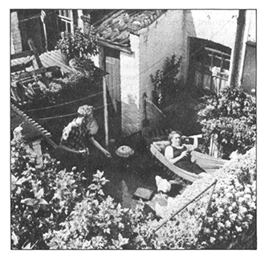
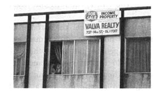
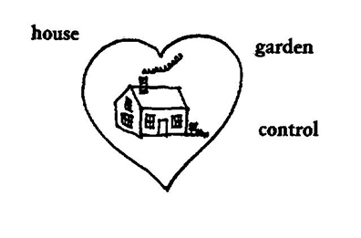

<section class="pattern-plate" aria-labelledby="t-your-own-home">
<a href="/patterns">A Pattern Language</a> · <a href="/patterns#towns">Towns</a> · Pattern 79 · p. 392 · **
<h1 class="pattern-title" id="t-your-own-home">Your Own Home</h1><figure class="pattern-figure pl-figure"></figure><nav class="pattern-links" aria-label="Connections"><h2>Links to</h2><ul><li><a href="/patterns/row-houses">38 Row Houses</a></li><li><a href="/patterns/housing-hill">39 Housing Hill</a></li><li><a href="/patterns/the-family">75 The Family</a></li><li><a href="/patterns/house-for-a-couple">77 House For A Couple</a></li><li><a href="/patterns/house-for-one-person">78 House For One Person</a></li><li><a href="/patterns/self-governing-workshops-and-offices">80 Self-Governing Workshops And Offices</a></li><li><a href="/patterns/small-services-without-red-tape">81 Small Services Without Red Tape</a></li><li><a href="/patterns/office-connections">82 Office Connections</a></li><li><a href="/patterns/master-and-apprentices">83 Master And Apprentices</a></li><li><a href="/patterns/teen-age-society">84 Teen-Age Society</a></li><li><a href="/patterns/shopfront-schools">85 Shopfront Schools</a></li><li><a href="/patterns/childrens-home">86 Children’s Home</a></li><li><a href="/patterns/building-complex">95 Building Complex</a></li></ul><h2>Linked from</h2><ul><li><a href="/patterns/life-cycle">26 Life Cycle</a></li><li><a href="/patterns/housing-hill">39 Housing Hill</a></li><li><a href="/patterns/animals">74 Animals</a></li><li><a href="/patterns/childrens-home">86 Children’s Home</a></li><li><a href="/patterns/half-hidden-garden">111 Half-Hidden Garden</a></li><li><a href="/patterns/rooms-to-rent">153 Rooms To Rent</a></li><li><a href="/patterns/home-workshop">157 Home Workshop</a></li></ul></nav></section><article class="pattern-text" aria-label="The text of Your Own Home">
393… according to <a class="pl-ref" href="/patterns/the-family">the family (75)</a>, each individual household should be a part of a larger family group household. Whether this is so, or not, each individual household, must also have a territory of its own which it controls completely—house for a small family (76), <a class="pl-ref" href="/patterns/house-for-a-couple">house for a couple (77)</a>, <a class="pl-ref" href="/patterns/house-for-one-person">house for one person (78)</a>; this pattern, which simply sets down the need for such a territory, helps especially to form higher density house clusters like <a class="pl-ref" href="/patterns/row-houses">row houses (38)</a>, <a class="pl-ref" href="/patterns/housing-hill">housing hill (39)</a>, which often do not have well-defined individual territories for the separate households.

◆ ◆ ◆

<strong>People cannot be genuinely comfortable and healthy in a house which is not theirs. All forms of rental—whether from private landlords or public housing agencies—work against the natural processes which allow people to form stable, self-healing communities.</strong>

<figure class="pl-figure"><figcaption><em>Income property</em>.</figcaption></figure>

… in the imperishable primal language of the human heart house means my house, your house, a man’s own house. The house is the winning throw of the dice which man has wrested from the uncanniness of universe; it is his defense against the chaos that threatens to invade him. Therefore his deeper wish is that it be his own house, that he not have to share with anyone other than his own family. (Martin Buber, <em>A Believing Humanism: Gleanings</em>, New York: Simon and Shuster, 1969, p. 93.)

This pattern is not intended as an argument in favor of “private 394property,” or the process of buying and selling land. Indeed, it is very clear that all those processes which encourage speculation in land, for the sake of profit, are unhealthy and destructive, because they invite people to treat houses as commodities, to build things for “resale,” and not in such a way as to fit their own needs.

And just as speculation and the profit motive make it impossible for people to adapt their houses to their own needs, so tenancy, rental, and landlords do the same. Rental areas are always the first to turn to slums. The mechanism is clear and well known. See, for example, George Sternlieb, <em>The Tenement Landlord</em> (Rutgers University Press, 1966). The landlord tries to keep his maintenance and repair costs as low as possible; the residents have no incentive to maintain and repair the homes—in fact, the opposite—since improvements add to the wealth of the landlord, and even justify higher rent. And so the typical piece of rental property degenerates over the years. Then landlords try to build new rental properties which are immune to neglect—gardens are replaced with concrete, carpets are replaced with lineoleum, and wooden surfaces by formica: it is an attempt to make the new units maintenance-free, and to stop the slums by force; but they turn out cold and sterile and again turn into slums, because nobody loves them.

People will only be able to feel comfortable in their houses, if they can change their houses to suit themselves, add on whatever they need, rearrange the garden as they like it; and, of course, they can only do this in circumstances where they are the legal owners of the house and land; and if, in high density multi-story housing, each apartment, like a house, has a well-defined volume, in which the owner can make changes as he likes.

This requires then, that every house is owned—in some fashion—by the people that live in it; it requires that every house, whether at ground level or in the air, has a well-defined volume within which the family is free to make whatever changes they want; and it requires a form of ownership which discourages speculation.

Several approaches have been put forward in recent years to solve the problem of providing each household with a “home.” 395At one extreme there are ideas like Habraken’s high density “support” system, where families buy pads on publicly owned superstructures and gradually develop their own homes. And at the other extreme there are the rural communes, where people have forsaken the city to create their own homes in the country. Even modified forms of rental can help the situation if they allow people to change their houses according to their needs and give people some financial stake in the process of maintenance. This helps, because renting is often a step along the way to home ownership; but unless tenants can somehow recover their investments in money and labor, the hopeless cycle of degeneration of rental property and the degeneration of the tenants’ financial capability will continue. (Cf. Rolf Goetze, “Urban Housing Rehabilitation,” in Turner and Fichter, eds., <em>The Freedom to Build</em>, New York: Macmillan, 1972.)

A common element in all these cases is the understanding that the successful development of a household’s “home” depends upon these features: Each household must possess a clearly defined site for both a house and an outdoor space, and the household must own this site in the sense that they are in full control of its development.

Therefore:

<strong>Do everything possible to make the traditional forms of rental impossible, indeed, illegal. Give every household its own home, with space enough for a garden. Keep the emphasis in the definition of ownership on control, not on financial ownership. Indeed, where it is possible to construct forms of ownership which give people control over their houses and gardens, but make financial speculation impossible, choose these forms above all others. In all cases give people the legal power, and the physical opportunity to modify and repair their own places. Pay attention to this rule especially, in the case of high density apartments: build the apartments in such a way that every individual apartment has a garden, or a terrace where vegetables will grow, and that even in this situation, each family 396can build, and change, and add on to their house as they wish.</strong>

<figure class="pl-figure"></figure>
◆ ◆ ◆

For the shape of the house, begin with <a class="pl-ref" href="/patterns/building-complex">building complex (95)</a>. For the shape of the lot, do not accept the common notion of a lot which has a narrow frontage and a great deal of depth. Instead, try to make every house lot roughly square, or even long along the street and shallow. All this is necessary to create the right relation between house and garden—half-hidden garden (111).

397<strong><em>the workgroups, including all kinds of workshops and offices and even children’s learning groups</em>;</strong>

<a class="pl-ref" href="/patterns/self-governing-workshops-and-offices">80. SELF-GOVERNING WORKSHOPS AND OFFICES</a>

<a class="pl-ref" href="/patterns/small-services-without-red-tape">81. SMALL SERVICES WITHOUT RED TAPE</a>

<a class="pl-ref" href="/patterns/office-connections">82. OFFICE CONNECTIONS</a>

<a class="pl-ref" href="/patterns/master-and-apprentices">83. MASTER AND APPRENTICES</a>

<a class="pl-ref" href="/patterns/teen-age-society">84. TEENAGE SOCIETY</a>

<a class="pl-ref" href="/patterns/shopfront-schools">85. SHOPFRONT SCHOOLS</a>

<a class="pl-ref" href="/patterns/childrens-home">86. children’s HOME</a>
</article>

Christopher Alexander, Sara Ishikawa and Murray Silverstein, with Max Jacobson, Ingrid Fiksdahl-King and Shlomo Angel, <cite>A Pattern Language</cite> (Oxford University Press, 1977), pattern 79, pp. 392–397. Text and illustrations from the <a href="https://github.com/natureoforder/sources">Nature of Order sources</a> reading edition, transcribed from the 1977 printing; report errors on <a href="https://github.com/natureoforder/alexander-wiki/issues">GitHub</a>.

<a href="/patterns/house-for-one-person">← 78 House For One Person</a> · <a href="/patterns">All 253 patterns</a> · <a href="/patterns/self-governing-workshops-and-offices">80 Self-Governing Workshops And Offices →</a>

