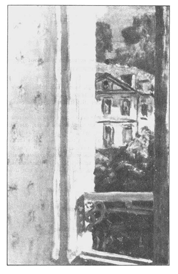
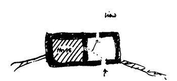
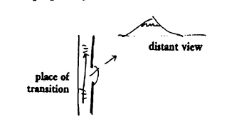

<section class="pattern-plate" aria-labelledby="t-zen-view">
<a href="/patterns">A Pattern Language</a> · <a href="/patterns#buildings">Buildings</a> · Pattern 134 · p. 641 · *
<h1 class="pattern-title" id="t-zen-view">Zen View</h1><figure class="pattern-figure pl-figure"></figure><nav class="pattern-links" aria-label="Connections"><h2>Links to</h2><ul><li><a href="/patterns/entrance-transition">112 Entrance Transition</a></li><li><a href="/patterns/paths-and-goals">120 Paths And Goals</a></li><li><a href="/patterns/entrance-room">130 Entrance Room</a></li><li><a href="/patterns/short-passages">132 Short Passages</a></li><li><a href="/patterns/staircase-as-a-stage">133 Staircase As A Stage</a></li><li><a href="/patterns/tapestry-of-light-and-dark">135 Tapestry Of Light And Dark</a></li><li><a href="/patterns/window-place">180 Window Place</a></li><li><a href="/patterns/natural-doors-and-windows">221 Natural Doors And Windows</a></li></ul><h2>Linked from</h2><ul><li><a href="/patterns/sacred-sites">24 Sacred Sites</a></li><li><a href="/patterns/high-places">62 High Places</a></li><li><a href="/patterns/entrance-transition">112 Entrance Transition</a></li><li><a href="/patterns/courtyards-which-live">115 Courtyards Which Live</a></li><li><a href="/patterns/something-roughly-in-the-middle">126 Something Roughly In The Middle</a></li><li><a href="/patterns/the-flow-through-rooms">131 The Flow Through Rooms</a></li><li><a href="/patterns/staircase-as-a-stage">133 Staircase As A Stage</a></li><li><a href="/patterns/tapestry-of-light-and-dark">135 Tapestry Of Light And Dark</a></li><li><a href="/patterns/sequence-of-sitting-spaces">142 Sequence Of Sitting Spaces</a></li><li><a href="/patterns/garden-wall">173 Garden Wall</a></li><li><a href="/patterns/window-place">180 Window Place</a></li><li><a href="/patterns/natural-doors-and-windows">221 Natural Doors And Windows</a></li><li><a href="/patterns/low-sill">222 Low Sill</a></li></ul></nav></section><article class="pattern-text" aria-label="The text of Zen View">
642… how should we make the most of a view? It turns out that the pattern which answers this question helps to govern not the rooms and windows in a building, but the places of transition. It helps to place and detail <a class="pl-ref" href="/patterns/entrance-transition">ENTRANCE TRANSITION (112)</a>, <a class="pl-ref" href="/patterns/entrance-room">ENTRANCE ROOM (130)</a>, <a class="pl-ref" href="/patterns/short-passages">SHORT PASSAGES (132)</a>, THE <a class="pl-ref" href="/patterns/staircase-as-a-stage">STAIRCASE AS A STAGE (133)</a>—and outside, <a class="pl-ref" href="/patterns/paths-and-goals">PATHS AND GOALS (120)</a>.

◆ ◆ ◆

<strong>The archetypal zen view occurs in a famous Japanese house, which gives this pattern its name.</strong>

A Buddhist monk lived high in the mountains, in a small stone house. Far, far in the distance was the ocean, visible and beautiful from the mountains. But it was not visible from the monk’s house itself, nor from the approach road to the house. However, in front of the house there stood a courtyard surrounded by a thick stone wall. As one came to the house, one passed through a gate into this court, and then diagonally across the court to the front door of the house. On the far side of the courtyard there was a slit in the wall, narrow and diagonal, cut through the thickness of the wall. As a person walked across the court, at one spot, where his position lined up with the slit in the wall, for an instant, he could see the ocean. And then he was past it once again, and went into the house.

<figure class="pl-figure"><figcaption><em>The monk’s house</em>.</figcaption></figure>

&gt;What is it that happens in this courtyard? The view of the distant sea is so restrained that it stays alive forever. Who, that 643has ever seen that view, can ever forget it? Its power will never fade. Even for the man who lives there, coming past that view day after day for fifty years, it will still be alive.

This is the essence of the problem with any view. It is a beautiful thing. One wants to enjoy it and drink it in every day. But the more open it is, the more obvious, the more it shouts, the sooner it will fade. Gradually it will become part of the building, like the wallpaper; and the intensity of its beauty will no longer be accessible to the people who live there.

Therefore:

<strong>If there is a beautiful view, don’t spoil it by building huge windows that gape incessantly at it Instead, put the windows which look onto the view at places of transition—along paths, in hallways, in entry ways, on stairs, between rooms.</strong>

<strong>If the view window is correctly placed, people will see a glimpse of the distant view as they come up to the window or pass it: but the view is never visible from the places where people stay.</strong>

<figure class="pl-figure"></figure>
◆ ◆ ◆

Put in the windows to complete the indirectness of the view—<a class="pl-ref" href="/patterns/natural-doors-and-windows">NATURAL DOORS AND WINDOWS (221)</a>; place them to help the <a class="pl-ref" href="/patterns/tapestry-of-light-and-dark">TAPESTRY OP LIGHT AND DARK (135)</a>} and build a seat from which a person can enjoy the view—<a class="pl-ref" href="/patterns/window-place">WINDOW PLACE (180)</a>. If the view must be visible from inside a room, make a special comer of the room which looks onto the view, so that the enjoyment of the view becomes a definite act in its own right….
</article>

Christopher Alexander, Sara Ishikawa and Murray Silverstein, with Max Jacobson, Ingrid Fiksdahl-King and Shlomo Angel, <cite>A Pattern Language</cite> (Oxford University Press, 1977), pattern 134, pp. 641–643. Text and illustrations from the <a href="https://github.com/natureoforder/sources">Nature of Order sources</a> reading edition, transcribed from the 1977 printing; report errors on <a href="https://github.com/natureoforder/alexander-wiki/issues">GitHub</a>.

<a href="/patterns/staircase-as-a-stage">← 133 Staircase As A Stage</a> · <a href="/patterns">All 253 patterns</a> · <a href="/patterns/tapestry-of-light-and-dark">135 Tapestry Of Light And Dark →</a>

