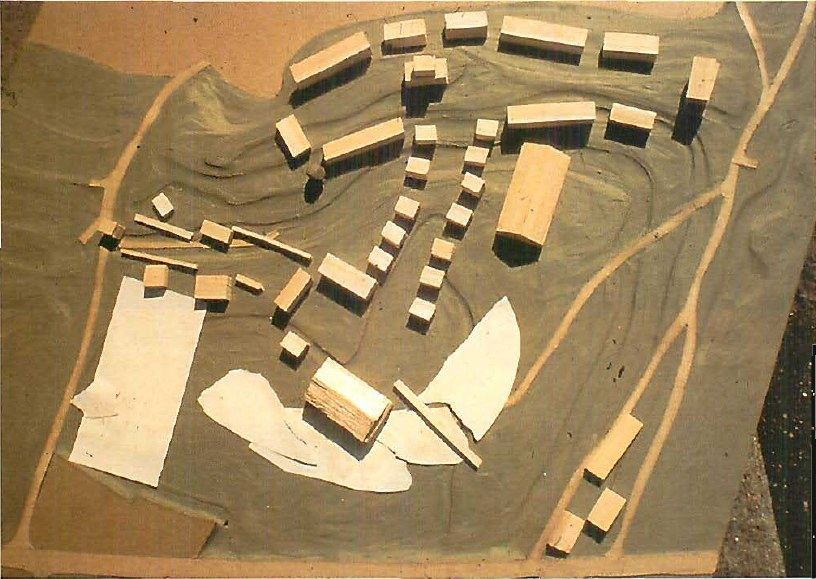
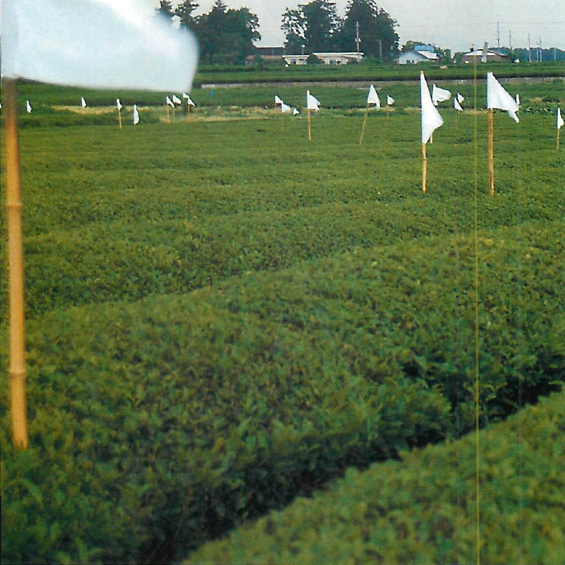

# Laying out the Eishin campus in Alexander’s words

<strong>Christopher Alexander · <cite>A Vision of a Living World</cite> (2005)</strong>

The school had worked out what places it needed. The tea fields in Iruma offered a ridge, a wet hollow, and a way of walking between them. In these selections Alexander describes trying to fit the two together. The section headings and image captions below are the wiki’s. The passages are Alexander’s, from *The Nature of Order*, Book Three, chapter 5, sections 7 and 7A, pp. 173–181. [Companion guide and exercise](eishin-campus.md)

## In the tea fields · p. 174

> Each time I went to Japan, I went out to the tea fields in Iruma, and walked and walked, just waiting, trying to see how the pattern language might best come to life there. Each time I sat there for hours, trying to understand the structure of the situation. Sometimes I sat there all day.
>
> The wholeness which existed on the land at the time we started (when the land had just been bought from the farmers) included the following five centers: Natural point of entering, Swamp, Flat spot, South ridge, Walk to the South ridge.

## Two systems of centers · p. 174

> *First*, there is the system of centers which is defined by the pattern language. These major centers are the building blocks of the new project. In the case of Eishin, they included, for instance, the entrance gate, the entrance street, the university center, the high-school homebase street, the main square, the back streets, the judo hall.
>
> *Second*, there is the system of centers which exists in the land. This system is created by the land forms, by the roads, by directions of access, by natural low spots, natural high spots and by existing trees.
>
> It must be emphasized that *both* systems of centers always exist at the time one starts a site plan. The first system is generic; it exists in our *minds* and in the day-to-day experience of the people who are going to have the new school. The second system exists in the *land*, on the particular site where the project is to be built. Each of the two systems of centers is real.

## Reversing the street · pp. 175–176

> After one of my visits to Japan, all of us in the Berkeley office spent several days playing with the 1:500 model. We had pieces of balsa wood cut roughly to the size and shape of typical buildings or building wings. We played with them on the model, constantly trying the same variations I have shown in the diagrams, trying to reconcile the centers of the pattern language with the five key centers on the site.
>
> Gradually one element emerged: the fact that the home base street might be more powerful as an approach *to* the university center, than as an entity approached *from* it. This was hard to see, because it implied reversing the main sequence of centers given by the language. But when we tried it, it was clear that the sequence of centers got much better from doing it. Playing confirmed it strongly. Now the sequence of centers in the language, which we had taken as fixed, was suddenly reversed. Previously we had them arranged in this order: entrance street — university center — home base street. Now we had *this* arrangement instead: entrance street — home base street — university center. This difference of organization seems simple but it dramatically affected the situation.
>
> A few days later we reached the second crucial breakthrough. All the time we had been imagining the university center as square in shape. It had appeared this way from the time of our earliest diagrams and we had continued to imagine it like this.<a href="#source-note-3" aria-label="Author’s note 3">3</a> But the problem was that the main center on the site “the most beautiful spot” was *not* square. It was the ridge along the south edge of the property. Suddenly we realized that the university center could actually *be* this ridge. The moment this second break in perception was made, the whole thing fell into place immediately. Goaded by frustration, and by the mental energy of the group situation, I suddenly placed all the bits of balsa wood into a new configuration. Everything was in its place. We had the rudiments of an idea.

*The 1:500 model, photographed after the reversal. The entrance is at left, the lake toward the front, and the ridge at the back. From p. 177.*

## Returning to the site · pp. 176–177

> Now, of course, I had to go back to the site to see if the site itself told the same story as the small model. I had a great deal of apprehension getting on the plane to fly to Japan to check it out. Would the site confirm this vision? Or would we have to start again?
>
> I got to Japan on November 1, 1982. It was clear at once that, in principle, the new idea of the site plan we had seen for the first time on the Berkeley model really did resolve the problems, and created a system of centers that was in harmony with the existing centers on the site.
>
> Later phases filled in details, and provided the structure of individual buildings, building locations, connections. But these all took place within the general framework of the layout that has been described. As we worked through these details, paths, streets, lake, bridge, and buildings — all of them — were laid out with flags so that we could judge their rightness or wrongness with our own eyes, and adjust them until they felt just right. I mean by this phrase *that the layout felt just right to a person walking about in the land.* To achieve this, we used two hundred flags — yellow, white, red — on six-foot bamboo poles to make the thing become real.

*Flags set out among the rows of tea. Detail of the field photograph on pp. 178–179.*

## From layout to construction · section 7A, p. 177

> The important thing is that all designs — building positions, siting, and volumes, and exterior spaces — were decided by what we had done in the land.

## Notes on the reading

<strong>Alexander’s note 3.</strong> The chapter endnote on p. 190 explains the earlier scheme. A square divided into four parts stood for the four departments. The team referred to it by the name of the Japanese character with this shape.

The book carries the street sequence across the page turn from 175 to 176. Here the two sequences read continuously, with their original emphasis. The model and field photographs are from the same chapter. For the difference the flags made to the drawn plan, compare the two drawings on p. 180. For the school’s interviews, turn to chapter 8, pp. 269–273.
