# Laying out a hamlet or a campus: Alexander's method at Eishin

<strong>Christopher Alexander · <cite>A Vision of a Living World</cite> (2005), ch. 5, sections 7–11, pp. 173–190</strong>

<aside class="wiki-ours">Our introduction
This is how Alexander lays out a larger project, a hamlet, a campus or a housing estate, before any single building is designed. He walks the land until its own centers are plain, sets them beside the centers the users' pattern language asks for, and moves rough balsa blocks on a 1:500 topographic model until the two fit; then he goes back to the land with two hundred flags on bamboo poles, stakes the buildings out, and closes the phase with a 1:200 model in modelling clay and manila-folder card, explaining why it must not be 1:100 or 1:500 and why the card must not be stiffer or thicker. The worked example is the Eishin campus near Tokyo (1982–85), laid out by Alexander with Hajo Neis, Ingrid King and others, on the land with the school's managing director Hisae Hosoi, followed by student housing for the University of Oregon. This is the full text of chapter 5, sections 7 to 11, with the notes they cite and the book's pictures; text and captions are Alexander's, checked against the page scans, with printed page numbers in small type (a shorter guide is <a href="eishin-campus.md">Laying out the Eishin campus</a>).
</aside>

## Contents

- [7. Laying out a very large building complex: the Eishin campus](#7-laying-out-a-very-large-building-complex-the-eishin-campus)
- [7A. Completion of design and construction on the Eishin campus](#7a-completion-of-design-and-construction-on-the-eishin-campus)
- [8. A secondary structure-enhancing process which further forms the shape of spaces and volumes](#8-a-secondary-structure-enhancing-process-which-further-forms-the-shape-of-spaces-and-volumes)
- [9. Emergence of building volumes in a more repetitive project](#9-emergence-of-building-volumes-in-a-more-repetitive-project)
- [10. The most vital step in any building process](#10-the-most-vital-step-in-any-building-process)
- [11. Remember that each building exists mainly to activate the land](#11-remember-that-each-building-exists-mainly-to-activate-the-land)
- [Notes](#notes)

## 7. Laying out a very large building complex: the Eishin campus

<small>p. 173</small>

I shall now show how the creation of the site and volume plan for the Eishin Campus in Japan followed a similar but more complex sequence of structure-preserving transformations. The process had two components.

*First system of centers: defined by the pattern language.* The first component was a pattern language worked out by our team after extensive interviews with teachers and students, and then approved by the school as a whole in a general assembly meeting. The pattern language defined, in generic terms, which new centers ought to exist in the new campus.<a href="#note-2" aria-label="Note 2">2</a> Here are five very important centers defined by our pattern language:

1. Entrance *The entrance to the inner precinct begins at the outer boundary. At a key point in the outer boundary, there is a gate. This leads to an entrance street.*
2. Yard *Where the entrance street meets the inner boundary, there is a second gate leading to a public yard.*
3. University center *Beyond the public yard and through a third gate is the essential center of the university.*
4. Homebase street *Leading out from the university center, was the high-school street of classrooms: the homebase street. The homebase street is a wide, lively, sunny street formed by the individual home room buildings where the high school students have their classes.*
5. The lake *Opening through gates on another side of the university center is a lawn. This lawn, especially for the use of college students, is surrounded by the college buildings and leads directly to the lake. The lake is a peaceful place to rest.*

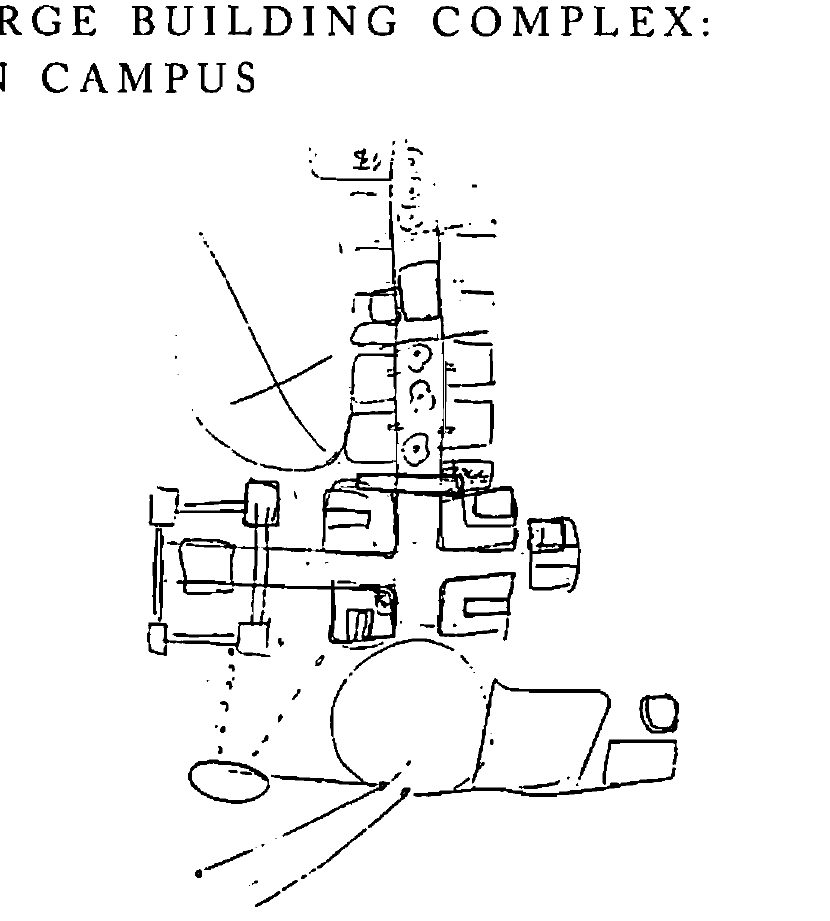

*One teacher's diagram showing the major centers defined by the pattern language. In diagrammatic form we see* entrance, yard, university center, homebase street, and lake. *The diagram shows how this teacher understood the way these main centers might fit together in an imaginary site plan.* · p. 173

*Second system of centers: defined by the land.* The second component of the process was a system of centers that existed in the *land* as it was before we started. This system of centers was defined by the site, *by the land itself.* In 1982, as soon as the pattern language had been approved by the faculty, we began the site plan. The site-planning work was done mainly on the site.

<small>p. 174</small>

Each time I went to Japan, I went out to the tea fields in Iruma, and walked and walked, just waiting, trying to see how the pattern language might best come to life there. Each time I sat there for hours, trying to understand the structure of the situation. Sometimes I sat there all day.

The wholeness which existed on the land at the time we started (when the land had just been bought from the farmers) included the following five centers: Natural point of entering, Swamp, Flat spot, South ridge, Walk to the South ridge.

1. Natural point of entering *One had a natural desire to enter the site on the southeast corner, and walk towards the northwest.*
2. Swamp and low point where ground water accumulated *The lake we were going to build had to be at the low point of the site, and we therefore knew its position from the contours.*
3. Natural flat spot *There was a natural spot, somewhere near the low point and the lake, where the main square might be.*
4. Ridge *The ridge was the most beautiful center of all. It was the place everyone went to most often, and loved most, because of the view of the distant hills, and the coolness of the breeze in summer, and an inspiring freedom one felt there.*
5. Walk to the south ridge *There was also — felt in the land — a natural walk from this low point towards the ridge, a walk from north to south, slightly uphill, and slightly curving. This was also inherent in the site, and could be felt by everyone.*

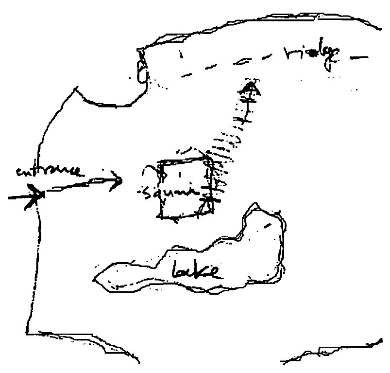

*Diagram of the five key centers on the site: Entrance, Lake, Square, Path, Ridge.* · p. 174

Repeated visits to the site by different members of our team, and by the various teachers of the school, strongly confirmed the reality of these centers. After a few weeks there was no doubt these were the most salient features of the site.

Thus there are two quite different systems of key centers.

*First*, there is the system of centers which is defined by the pattern language. These major centers are the building blocks of the new project. In the case of Eishin, they included, for instance, the entrance gate, the entrance street, the university center, the high-school homebase street, the main square, the back streets, the judo hall.

*Second*, there is the system of centers which exists in the land. This system is created by the land forms, by the roads, by directions of access, by natural low spots, natural high spots and by existing trees.

It must be emphasized that *both* systems of centers always exist at the time one starts a site plan. The first system is generic; it exists in our *minds* and in the day-to-day experience of the people who are going to have the new school. The second system exists in the *land*, on the particular *site* where the project is to be built. Each of the two systems of centers is real.

Together, when fused, they will govern the plan which has to be made. The process of site-planning is the process of, somehow, finding a way to make these two systems of centers become one — a way in which the system of centers defined by the pattern language can be placed, so that it enhances, preserves, and extends, the system of centers which is already in the land. In this specific case, and in general, the crux of the <small>p. 175</small> problem of making the site plan lies in the task of *reconciling* the two systems of centers — that means finding a new structure which unfolds from the existing wholeness, and which then *embodies* the centers of the pattern language within the system of centers that exist on the site.

Another way to put this is to say that in order to preserve the structure of the land, the new centers coming from the pattern language must be established in such a way that they fall naturally in places that coincide with, or enhance, the naturally occurring centers of the site.

In this particular instance it was *very* hard to find. There seemed to be no natural way of arranging the university center and home-base street, as we had them in the pattern language, in a fashion consistent with these five facts about the site. Indeed, only one part of the relation between pattern language and site was obvious; the lake, demanded by the pattern language, would have to be identified with the low point of the site, that is to say, the swamp. That was uncomplicated and straightforward. In all the plans we tried, the new lake appeared in the position of the swamp. But in other respects the mismatch was difficult. In many of the plans shown in these early diagrams (see for instance diagrams illustrated on page 176), the key centers are in positions different from the existing centers on the site. These diagrammatic site plans look internally coherent on *paper*, but would have violated the centers on the land and would thus have violated the integrity of the site itself.

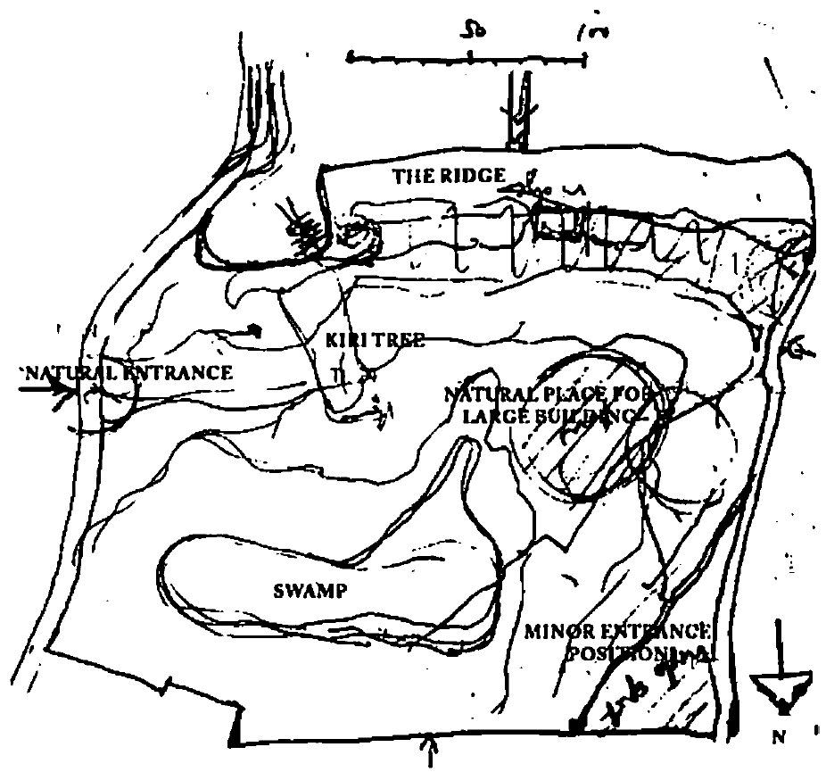

*Another view of the system of centers existing on the land before our design emerged: again the main entrance, the ridge, the swamp (which was to become the lake), are visible, together with a beautiful Kiri tree that formed an important place, and a natural spot for a minor entrance in the northwest corner, together with a natural place that later became the spot for the gymnasium.* · p. 175

Even after several months of work, we still did not know how to place the major centers of the pattern language in such a way as to preserve and enhance the existing centers on the site. Again and again I visited the site, trying to see how the centers of the language might be made to coincide with the real existing centers of the site. We couldn't solve it.

Finally, in Berkeley, we had a breakthrough. In order to think about the problem while away from Japan, we had made a series of topographic models of the site. We had one in our office in Japan, at a scale of 1:100. We had two in Berkeley, one at a scale of 1:200, the other at 1:500.

After one of my visits to Japan, all of us in the Berkeley office spent several days playing with the 1:500 model. We had pieces of balsa wood cut roughly to the size and shape of typical buildings or building wings. We played with them on the model, constantly trying the same variations I have shown in the diagrams, trying to reconcile the centers of the pattern language with the five key centers on the site.

Gradually one element emerged: the fact that the home base street might be more powerful as an approach *to* the university center, than as an entity approached *from* it. This was hard to see, because it implied reversing the main sequence of centers given by the language. But when we tried it, it was clear that the sequence of centers got much better from doing it. Playing confirmed it strongly. Now the sequence of centers in the language, which we had taken as fixed, was suddenly reversed. Previously we had them arranged in this order: entrance street — university center <small>p. 176</small> — home base street. Now we had *this* arrangement instead: entrance street — home base street — university center. This difference of organization seems simple but it dramatically affected the situation.

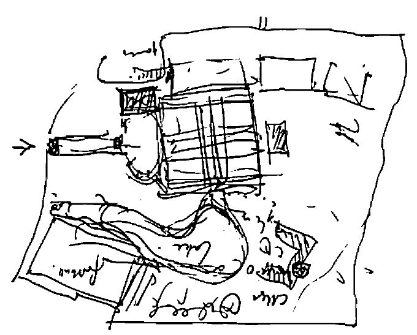

*The university center is the main thing* · p. 176

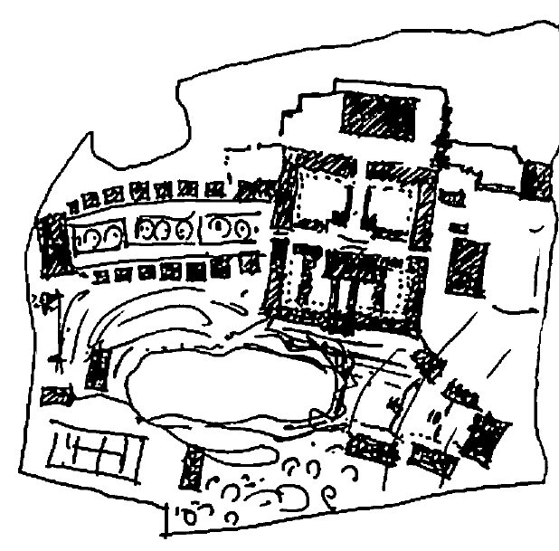

*High school homebase street leads to the university center* · p. 176

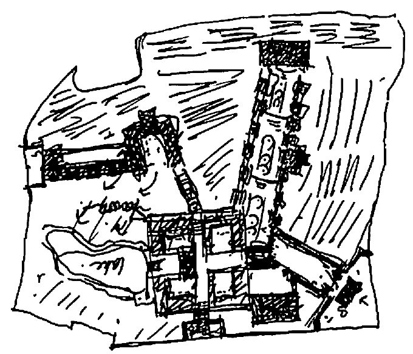

*University center leads to the highschool homebase street* · p. 176

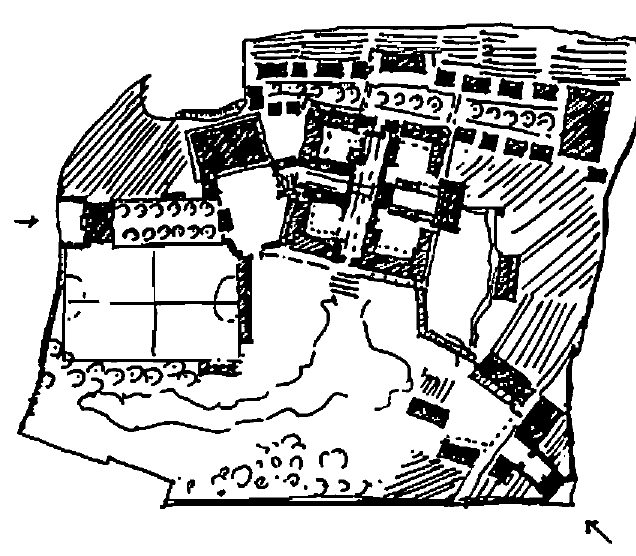

*Another arrangement* · p. 176

A few days later we reached the second crucial breakthrough. All the time we had been imagining the university center as square in shape. It had appeared this way from the time of our earliest diagrams and we had continued to imagine it like this.<a href="#note-3" aria-label="Note 3">3</a> But the problem was that the main center on the site "the most beautiful spot" was *not* square. It was the ridge along the south edge of the property. Suddenly we realized that the university center could actually *be* this ridge. The moment this second break in perception was made, the whole thing fell into place immediately. Goaded by frustration, and by the mental energy of the group situation, I suddenly placed all the bits of balsa wood into a new configuration. Everything was in its place. We had the rudiments of an idea.

The model with its precarious bits of balsa wood, just as it was, glued down, was kept for more than a year. It had subtle relationships, curves, lines, caused by the speed and freedom of the moment. They were very hard to draw, but they inspired us. After a few days, we were sure that, at least on the model, everything seemed fine.

Now, of course, I had to go back to the site to see if the site itself told the same story as the small model. I had a great deal of apprehension getting on the plane to fly to Japan to check it out. Would the site confirm this vision? Or would we have to start again?

I got to Japan on November 1, 1982. It was clear at once that, in principle, the new idea of the site plan we had seen for the first <small>p. 177</small> time on the Berkeley model really did resolve the problems, and created a system of centers that was in harmony with the existing centers on the site.

*The balsa wood model at 1:500, as it was after the breakthrough. The entrance to the campus is on the left; it leads to the main yard and great hall and lake, and then leads to the homebase street, and up to the university which lies on the ridge (at the top of the photo). The two systems of centers are finally reconciled.* · p. 177

Later phases filled in details, and provided the structure of individual buildings, building locations, connections. But these all took place within the general framework of the layout that has been described. As we worked through these details, paths, streets, lake, bridge, and buildings — all of them — were laid out with flags so that we could judge their rightness or wrongness with our own eyes, and adjust them until they felt just right. I mean by this phrase *that the layout felt just right to a person walking about in the land.* To achieve this, we used two hundred flags — yellow, white, red — on six-foot bamboo poles to make the thing become real. Remembering our flags at Eishin, and speaking about the impact the flags made on him, Hisae Hosoi, managing director of the school, told a journalist, many years later in halting, slowly considered language: "We could feel . . . the actual buildings . . . standing . . . there."<a href="#note-4" aria-label="Note 4">4</a>

<small>pp. 178–179</small>

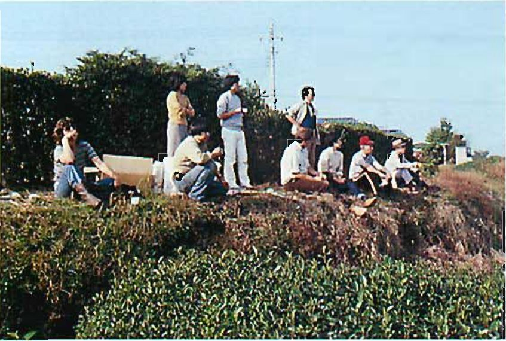

*Looking and working out where to place the flags* · p. 178

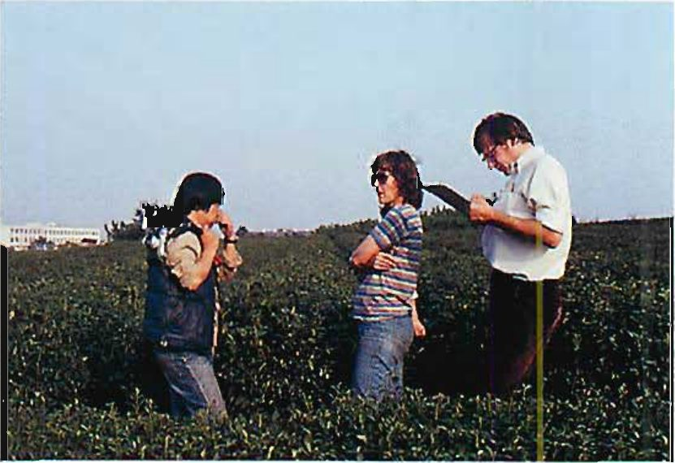

*More looking* · p. 178

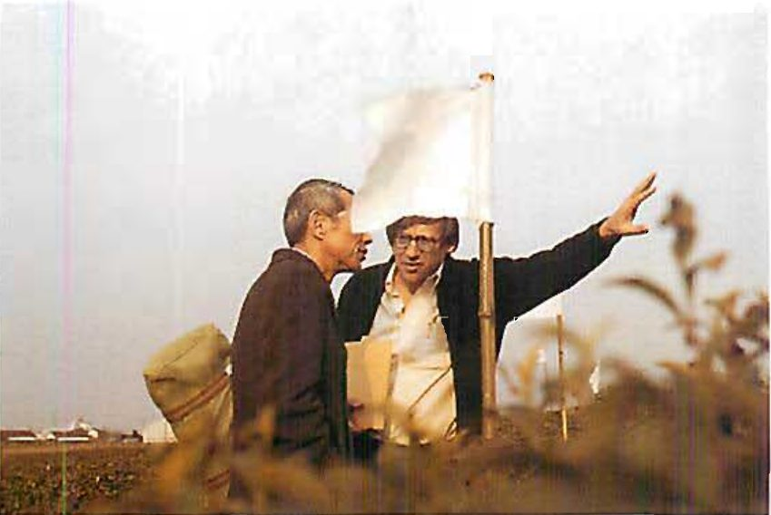

*Hosoi and Chris working out where to place the flags* · p. 179

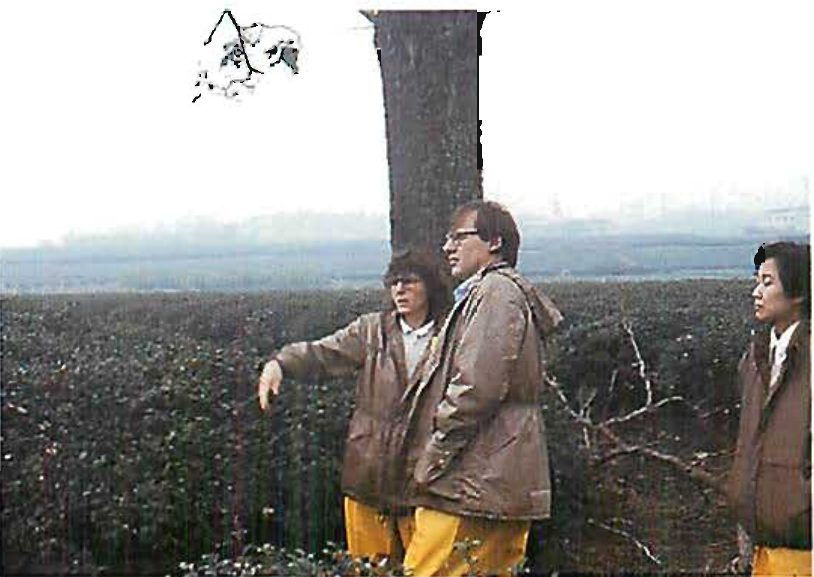

*Chris and Ingrid: more looking and working things out* · p. 179

<aside class="wiki-ours wiki-ours--note">Our note
"Chris" in these captions is Christopher Alexander. Ingrid is Ingrid King, named with him and Hajo Neis on the Emoto building on p. 172.
</aside>

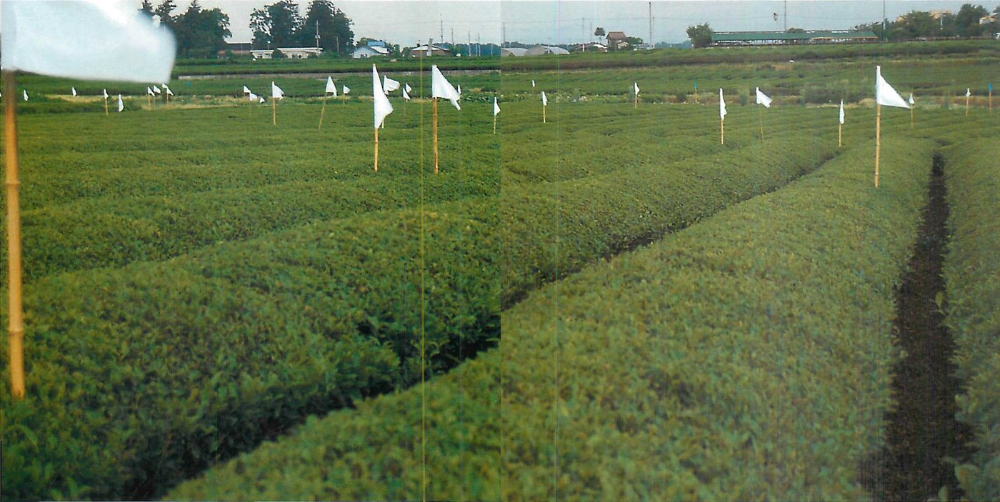

*"We could feel . . . the actual buildings . . . standing . . . there." Placing flags at the time when we were laying out the campus with the users. We used white and colored flags on six-foot bamboo poles.* · pp. 178–179

## 7A. Completion of design and construction on the Eishin campus

<small>p. 177</small>

From that point on, the process was straightforward.<a href="#note-5" aria-label="Note 5">5</a> The important thing is that all designs — building positions, siting, and volumes, and exterior spaces — were decided by what we had done in the land. The attitude of mind with which we approached design and construction, whether on small models, or bigger models, and the attitude we maintained throughout planning permission <small>p. 180</small> and preparation for construction, and construction itself, kept coming back to the central principle: that the purpose of our work was to create a set of buildings that formed spaces which were positive — and which nourished the land.

What we may claim to have done in that project is to create a complete system of positive space, which protects, and respects, and enhances the land in all its aspects, elevates it, makes it more alive than it would have been under most other forms of planning and design and management, perhaps even more alive than it was before, when it was covered by teabushes and small agricultural parcels.

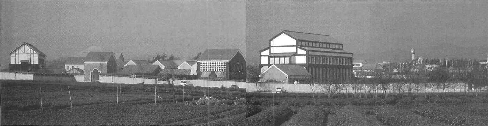

*The building volumes in the distance* · pp. 180–181

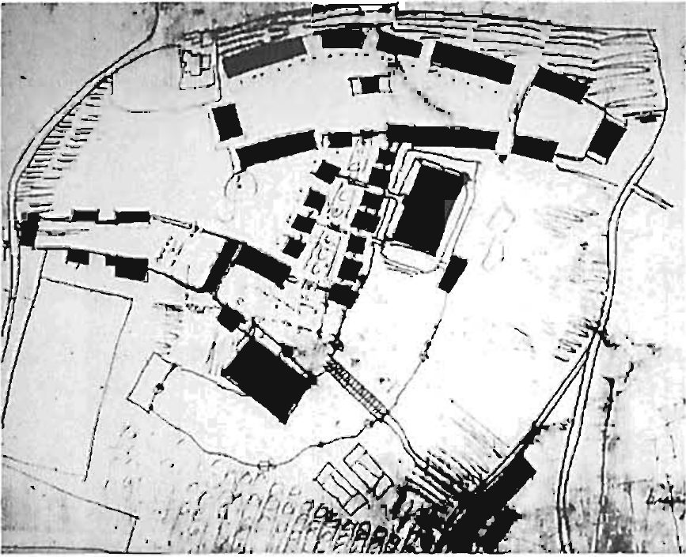

*A rough drawing made from the balsa wood model, and after initial visits to the site confirmed the validity of the overall configuration* · p. 180

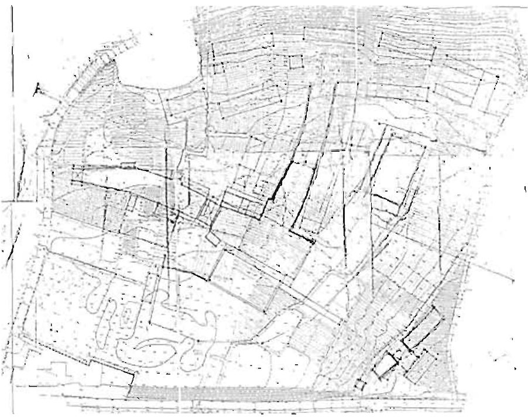

*Measured drawing made after detailed work on the site itself had been done with stakes. This drawing is a transcription of the position of the stakes* · p. 180

*It must be noted above that the final plan (right-hand drawing) based on placing stakes, is very different from the schematic plan (left drawing) which does not have the same reality.*

<small>p. 181</small>

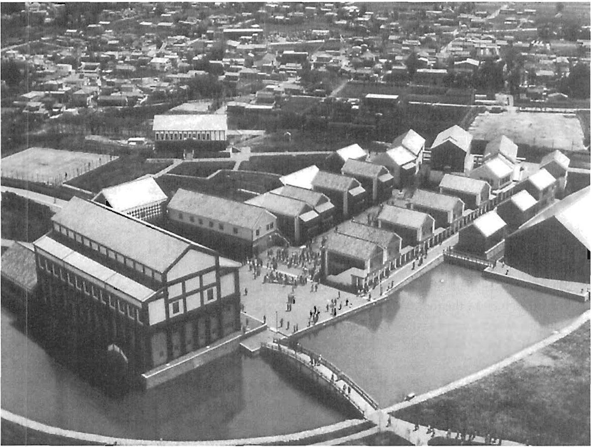

*The Eishin campus first stage, completed in 1985, Christopher Alexander with Hajo Neis and others. The atmosphere along the main street shown in the center of this picture may be seen in the photograph on page 39.* · p. 181

## 8. A secondary structure-enhancing process which further forms the shape of spaces and volumes

<small>p. 182</small>

More or less the same process which creates initial layout of buildings on the land also works, at a later stage, to turn a rough schematic plan into a detailed and orderly configuration of buildings.<a href="#note-6" aria-label="Note 6">6</a>

Here, as an example of this secondary process, I show two cases from the planning and construction of student housing for the University of Oregon. The project started with construction of the Agate complex, a group of apartments shown opposite and on page 186.

In all these examples what is being created is the *volume* pattern of the buildings and the land. Whether the pattern is urban or rural, the pattern of void and solid, the space and volumes of the built environment, is the fundamental thing which, at its own specific density, defines the texture of our environment. Always, without exception, every building task must be related to this pattern of void and solid, it must always make a contribution to it, it must always make a positive impact on the voids and on the solids so that the whole pattern, black and white, or void and solid, comes to life.

The stage of a living process which I have sketched in this chapter is marked, really, by the fact that when we are done with this phase, a whole project can be seen, in its essentials, in a small paper model made at a scale of 1:200 (metric) or 1/16th inch to the foot. What I have covered in this chapter may be viewed as that phase of work which culminates in the making of such a model at 1:200 scale.

My reference to the scale of this model is meant in earnest. The topography is in modelling clay — not merely layers of cardboard, because they are too crude. It is the feeling of slopes and land which is imperative. Nearby roads and buildings are on the model. The buildings are made in manila-folder material (a light buff-colored card, a little stiffer than paper). Trees are to be on the model, either as crumpled tissue paper, or rough scale bits of cow-parsley.

It may sound absurd for me to be so detailed and to insist on these details as I am doing. But many years of experience have shown me that this combination of scale, material, detail, and absence of detail, gives just what is needed for us to be able to say, "Now we have the volume and site just about right."

If the model is more detailed (1:100, say), it goes too far. If the model is smaller (1:500, say), we cannot judge the spaces, or slopes, or heights as sufficiently real. If the cardboard that is used is stiffer, it becomes more formal, harder to change. The kind of light card I have mentioned (manila-folder material) is easy to cut and paste. We can be uninhibited in doing surgery on it. If it is stiffer, more formal, like a presentation model, we will not freely cut, paste, glue, change to get it right. If the cardboard is thicker, it will be too crude, and will not feel like a real building at the 1:200 scale — and as a result, then, we cannot judge the actual feeling it produces. When we put our eye down, at base level and look at it, cruder cardboard will not give us a realistic impression of the way the volume of the real building might feel and we shall therefore be less skillful, less able to make accurate judgments about the volume, space, and their effects.

So the target of work, at this stage, is just such a paper model at 1:200, in which we establish the overall feeling of the buildings in the land, their impact on surrounding space, the meaning of the whole, its feeling as a volume. The space is either brought to life, or not. If not, beyond this stage, it is too late to get it right.<a href="#note-7" aria-label="Note 7">7</a>

<small>p. 183</small>

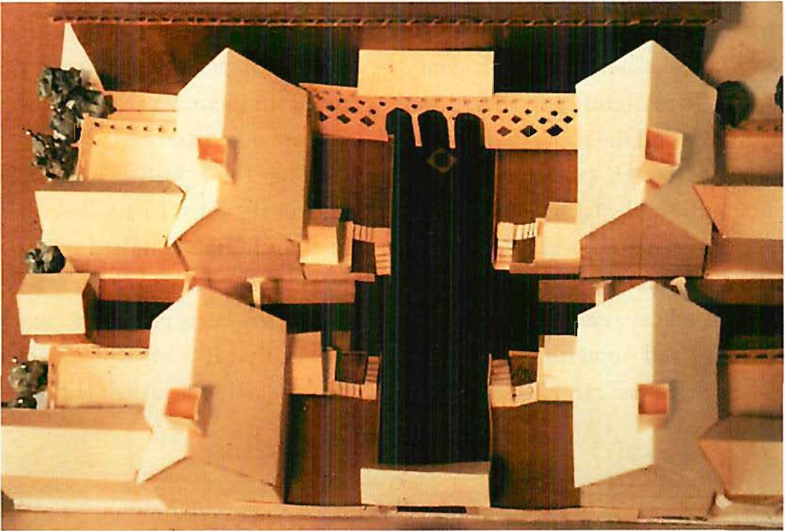

*Early in-progress model of the Agate project. This is a typical cardboard model at a scale of 1:200, which completes the space- and volume-forming phase of work described in this chapter.* · p. 183

In order to be clear about the practical meaning of volume and site design as a distinct stage in the unfolding of a building, it is helpful to have an operational definition of what you must have in hand by the end of this phase.

Essentially, it is:

1. *You have a complete staking out of the building, on the land, with all building edges and all important exterior centers.*
2. *You have a topographic model at 1:200 scale (1/16" to one foot), which shows the land, surrounding buildings, trees, roads and of course the contours of the land. We usually make the land of this model in modelling clay.*
3. *On the topographic model you have small paper models of the building volumes. These models are best made in a very light card, the kind of material manila folders are made from; trees and bushes are realistic and to scale.*

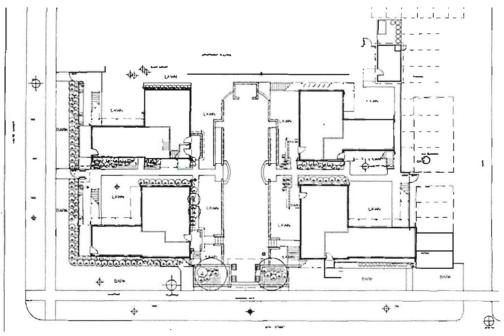

*The plan of the Agate project, showing the complex pattern of positive outdoor spaces which emerged* · p. 183

<small>p. 184</small>

The knowledge that is contained in these three elements is the knowledge which completes this phase.<a href="#note-8" aria-label="Note 8">8</a> It is significant that these small informal models and the phase of development they represent, though extremely simple, are entirely different from the "deliverables" normally considered appropriate for early stages of design in current architectural practice. The normal deliverables include a site plan and rough schematic drawings, and sometimes, preliminary drawings. Such items cannot adequately represent a solved problem. They do not contain enough information, and one cannot feel certain, from them, whether the life of the site has been preserved and extended.

The three deliverables mentioned here, made in the form I have described them, different from today's standard professional deliverables, give a reasonable guarantee that the life of the site has been preserved, that the solution is reliable, that it is intense, and that the building does intensify the city or the land.

## 9. Emergence of building volumes in a more repetitive project

Amazon village, a larger housing project of 300 apartments for graduate students, was to be the extension of the Agate student housing and was to occupy an area of about eleven acres on flat land near the university.

The initial plan showed us the existence of a pedestrian street, connecting two parking lots, with buildings lining the street, and less and less dense courtyards of buildings, forming a gradient away from the street. There is a latent gradient inherent in the site diagram. Further structure-preserving transformations make this gradient physically real, by height and intensity of buildings, and create small paths leading away from the main street, and create gardens — progressively more and more open as one moves away from the pedestrian street.

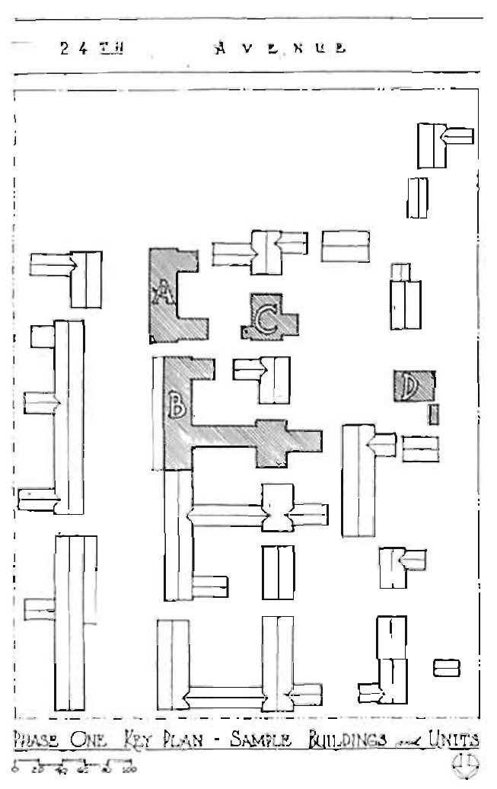

*Southwest portion of my Amazon village plan, showing overall arrangement generated by the fundamental process* · p. 184

Along the street the buildings are three stories high, there are arcades, and all the buildings are connected. Applying structure-preserving transformations to form the small paths, each path is made a series of lines, joining new centers, courtyards, and gardens.

The buildings near the spine are higher and longer, with arcades. The walkways going across form small pathways, not disruptive of the main spine. Each of these paths goes to lower density as one goes away from the spine, leaving a more tranquil atmosphere further away, and a more active atmosphere near to it. All this new structure not only preserves the structure of the land. Here we see how the structure-preserving process also begins to establish volumes and positions on the land, major space, major volumes.

Within the framework of this volumetric structure, detailed volumes and smaller spaces develop like twigs growing off branches, to form <small>p. 186</small> a further system of volume and space, also by preserving the structure and creating a positive space and volumetric texture on the land.

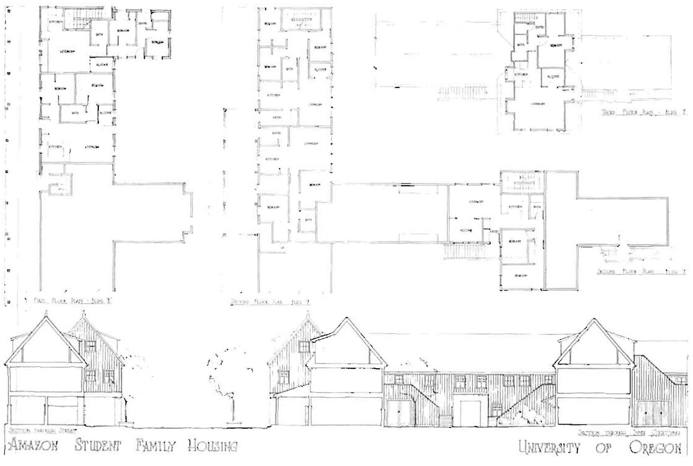

*The Amazon project, showing buildings and details as the fundamental process allowed us to define them* · p. 185

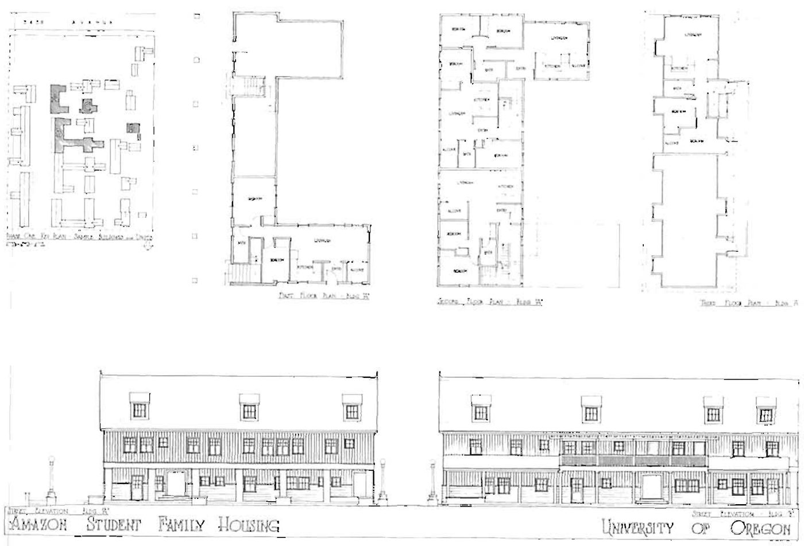

*The Amazon project, showing buildings and details as the fundamental process allowed us to define them* · p. 185

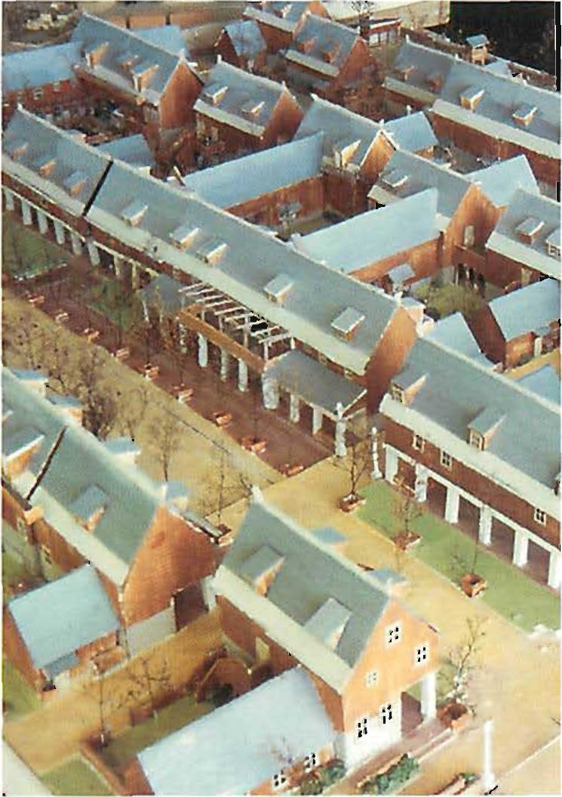

*Amazon village, a complex of 300 apartments for University of Oregon students, looking at the central pedestrian street and its arcades. Christopher Alexander, with Hajo Neis and others, 1992.* · p. 186

Here the architecture itself, the style of the volumes, the walkways, courtyards, building heights, building thicknesses, all develop by respecting and preserving and continuing the structure which is there, according to the fundamental process.

When combinations of the fundamental process are used to place and shape building volumes, the land always ends with a certain sort of pattern: a combination of nearly rectangular and rectangular volumes, not quite rectilinear in their placing, placed rather in relation to contours, flat places, slight lines of slope, positions of other buildings. Some of the volumes typically end up with roofs that create strong centers; the buildings surround and form courts and terraces and gardens as important as the building volumes, circulation realms, trees and pockets in the land honored by space, steps and terraces.

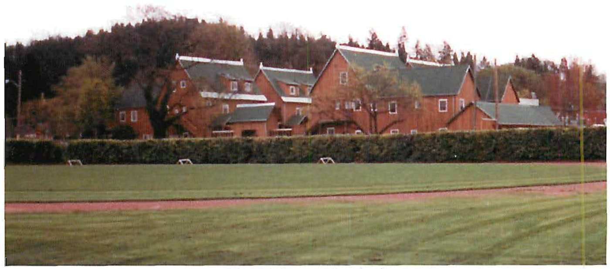

*Agate student housing, University of Oregon. Four apartment buildings, all similar in plan and form, but each one individually tailored to the site, position, sunlight, trees, roads and views. Christopher Alexander, Hajo Neis, James Maguire, Gary Black, David Edrington, Rob Thallon, Chuck Han, 1992.* · p. 186

Subject to these influences, the rectangles are hardly ever perfectly rectangular. Even the building volumes typically have odd excrescences sticking out from them added on, and, occasional departures from the perfect 90 degrees in their corners, all done so that the syncopated and more subtle structure can accommodate the fitness to the contour, to the positive <small>p. 188</small> space of neighborhood buildings, to the accidents of a rock, or of a great tree, or of a bridge.

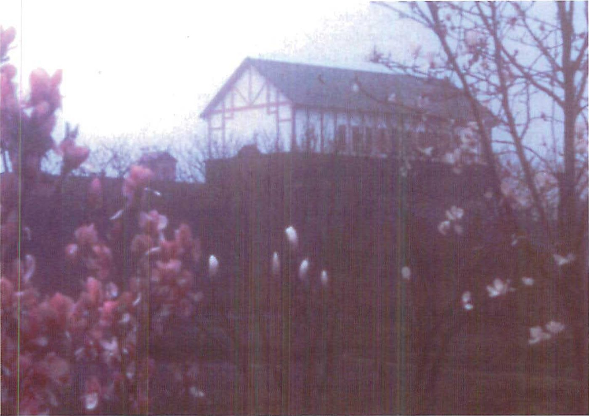

*Spring 1985, twilight. The judo hall when tulip trees and cherry blossoms first came into flower.* · p. 187

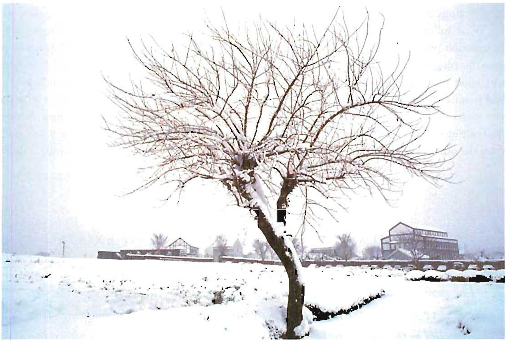

*Winter 1986, snow. The Eishin campus in the distance.* · p. 187

All this follows from the creation of positive centers, under the impact of the fundamental process. The pattern which results, though contemporary and of our time, will also, necessarily, resemble an ancient and universal one. It could as well be Chinese, or Italian, or Peruvian or African. This, more than anything else, belongs to the future, too, because it is the building/land/form which will arise whenever living processes really have occurred — in the language of pages 21–24, a class-one structure not a class-two structure. Once our obsession with structure-destroying modernity has subsided, and we have stopped blindly destroying valuable structure in cities and landscapes, we may, in a far-distant future, be able to create similar patterns in a new form, again and again, all over the Earth. And the Earth, with such building volumes on it, may then perpetually seem fresh and young.

## 10. The most vital step in any building process

Once this work on site and volume design is done, the essential feeling of the coming buildings — their contribution to the world, their structure-preserving character — has been established. It is the most vital single step in the emergence of a new building or a new group of buildings. If the volume is congruent with the wholeness which existed previously in the city or on the land, a profound feeling can often come from its congruence.

What follows, in later stages of design or construction process, must never be allowed to undo this congruence or damage it. If the feeling is genuine and does arise out of the site itself, then it must be thought of as an absolute which later stages of unfolding — detailed design and construction — must only strengthen, deepen. If, on the other hand, the volume that you have reached at this first crucial stage is in any sense inadequate, then you must fix it now. Any depth of feeling which exists in the thing will hinge on this volume and its placing on the land. You may try to tell yourself that you can fix it later, but you will not be able to. Later will be too late. The deep feeling can never be made essentially different later. If the disposition of volume and space has force in it — magic — now, then you have a chance of keeping it, and enlarging it by later actions of design. But a bad beginning of volume and space can never be set right later.

When it exists only in your mind's eye, or as a tiny cardboard model, your job is to make that feeling so intense that it captures the soul of that place, and fits harmoniously and with intense feeling into that piece of land.

## 11. Remember that each building exists mainly to activate the land

*The most crucial thing to understand throughout the volume-creating processes, is that* it is the land which matters. *The purpose of the buildings is to bring life to the land. The building volumes are the tools with which we undertake this task. This is a radical point of view. It puts the building in a humble* <small>p. 189</small> *position making it a tool, the clay from which we mold the space. But it is the land and its space, as they become activated by this clay, which really matter.*

*This drastic state of mind can produce the most beautiful results. Once, I was working with a group of students who were helping me to lay out houses for a new town near Sacramento. I lectured to them at length on this topic. I spoke about the fact that the building is not important, that the purpose of the building volume is only to shape and enliven the land. The total building mass — at that stage still amorphous, not yet formed — is like a long sausage of baker's dough, an undifferentiated volume of material for our use. We use it, distribute it, place it, entirely, and only, to bring life to the land, to revere the land.*<a href="#note-9" aria-label="Note 9">9</a>

*I managed, in that instance, to communicate this thought successfully (it is not always so easy). The students took it in. The next day their work was indeed beautiful. They showed me about thirty models of houses, made with the relation to the land in mind, where an entirely new level of feeling and subtlety had been reached. Not only the land and space formed by the buildings had become better. The building volumes themselves had become better. The student whose work was most beautiful showed me how every single thing he had done had been guided according to this rule. The land around his project was being improved, honored, and every particle of building volume was conceived, and placed, only to make some improvement, some quickening of life, some peaceful harmony, in the land. The buildings were only the shapers, the tools.*

*It is remarkable to realize that it is this uncompromising attitude of attention to the land which also makes the building* volumes *subtle and beautiful. That is truly surprising. The land itself, and our love for it, is enough to give the actual building volumes their shape. If they genuinely help the land, building volumes become more graceful as shapes, more serious, more differentiated.*

*Like a person who, in being helpful, becomes more graceful, more beautiful as a person, the building volumes become beautiful as they help the land.*

## Notes

<small>p. 190</small>

<aside class="wiki-ours wiki-ours--note">Our note
The chapter's notes 2 to 9, which these sections cite. Note 1 belongs to an earlier section of the chapter.
</aside>

2. Part of this pattern language is printed in Book 2, chapter 13 (page 363–64).

3. The university center, originally visualized as a square with four quadrants for the four departments, was often referred to as the tanoji center, 'ta' being the japanese character that appears as a square with four quadrants.

4. Hisae Hosoi speaking in the film Places for the Soul: The Architecture of Christopher Alexander. Director, Ruth Landy, Producer, Cinema Consultants, San Francisco, 1990.

5. There is a vital reason for the emphasis on the real site and on the use of small models. It is not an accident of technique, but an essential feature of an unfolding process. The essence of the unfolding operation is that it operates on the current state of the unfolding wholeness, and does that thing to it which goes furthest to increase its wholeness further. There is, in effect, a feedback process which allows the next step to be determined as a response to the current state of the wholeness. See Book 2, chapter 8.

6. This happened, of course, on the Eishin campus. Such details of this project are described, at considerable length in Christopher Alexander and Hajo Neis, Battle: The Story of a Historic Clash Between World-System A and World-System B (forthcoming).

7. In an evolving design, there is a fundamental problem. The normal evolution of a design (in an architect's office) consists of rough sketches of various kinds. But these sketches do not approximate the actual wholeness which they represent. In other words, the sketch of an idea, does not allow you to feel, or experience, or sense, the wholeness which is implied by that sketch. Since you cannot experience the wholeness, you cannot react to it, and effective feedback is impossible.

To solve this problem, it is necessary to do the work in a situation which resembles, as nearly as possible, the real situation of the project. That means, to start with, that a great deal of the design must be done on the actual site, using sticks, stakes, string, a bush, a rock, and so on, to show where the building is to be, how it sits in the land, what the open space next to it feels like, and so on.

8. It is also necessary — not merely desirable, <em>necessary</em> — to use models, continuously, and frequently, at every stage. We make rough models, which show, in general outline, what the wholeness is, that is developing. The models we use are intentionally rough. Not finished architect's models, but rough working models made of paper, plasticine, chewing gum, glue, little bits and pieces — sometimes a tube of glue, or a salt shaker, or an eraser, sometimes a bit of paint, pieces of tape, details quickly cut with a pair of scissors — all find their way into the model. The idea of the model is to give a rough sketch of the three-dimensional wholeness, as it will be — and sufficient in its range and structure so that you can examine it to see what is wrong with it, and also find out, by looking at it, what is the next step which will do the most to intensify the wholeness further.

What is at stake is just that positive volume of space and substance which appears in a 1:200 model, in light cardboard, on a topographic model.

9. This "sausage" of volume is typically about 20 feet wide, two stories high, and can be cut into segments of any length. We usually make up lengths from manila folder material, or balsa, often with pitched roof, if that is appropriate, and rapidly start to visualize the volume and space that can be created with this much material. Of course that makes sense for houses, apartments, offices. For other larger or small types of buildings, the building sausage and its section will be different and must be appropriately chosen. What matters is that its overall volume of dough is accurate and that its section makes sense on the average, so that placing the pieces of baker's dough does, when completed, give a feasible and workable site plan and volume plan.

