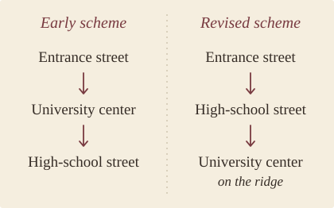

# Laying out the Eishin campus

Imagine walking up a street lined with the homerooms of a high school. Where should the street take you? At Eishin, the answer eventually became a ridge where the college would stand. Christopher Alexander and his colleagues spent months assuming you would make that walk in the other direction. Reversing it helped them lay out a campus in the tea fields of Iruma, Japan.

**[Read Alexander’s own account](eishin-campus-reading.md)**, with the two street sequences, the balsa model, and the flags in the tea fields.

## What the school wanted and what the land offered

Interviews with teachers and students gave the team a picture of school life. A street of homerooms would let the high-school classes share an outdoor place. The college needed a center of its own. There would be a public yard near the entrance, and a lake where people could rest. The school approved this pattern language at a general assembly. On page 173, a teacher’s sketch shows how these places might connect. It could have been drawn before anyone knew where the school would stand.[^1]

Now look at the sketch on the facing page. Walking the site, the team and teachers found a southeast approach, low wet ground, a nearby level spot, and a gently rising walk toward the southern ridge. People kept coming back to that ridge for the breeze and the view of distant hills. Placing the lake on the wet ground was easy. The rest of the school took longer.[^2]

## Two changes to the plan

In Berkeley the team tried pieces of balsa wood on a 1:500 model of the terrain. In the early schemes a visitor reached the university center first and went on to the high-school street. Try tracing that journey in the sketches on page 176. Then follow the street of homerooms *toward* the university. The street now gave the uphill walk a destination. A few days later the designers questioned another assumption. They had kept drawing the university center as a square. The ridge itself could be the center, with the buildings taking their places along it.[^3]

*An original schematic of the walking sequence, based on Alexander’s account on pp. 175–176. Read each column from top to bottom.*

> Would the site confirm this vision? Or would we have to start again?

Alexander asks these questions on his way back to Japan. He records arriving on November 1, 1982. Walking the site confirmed the broad arrangement. To locate the paths, outdoor spaces and buildings more closely, the team set out two hundred flags on bamboo poles. People from the school could walk through an opening, feel the width of a space, and ask for a flag to be moved. Compare the schematic layout with the later drawing recording the stakes on page 180. The small differences between the two drawings are decisions people made by standing there.[^4]

## Try it on a smaller site

This wiki exercise adapts the Eishin method for a shared courtyard or garden. Bring two or three people who use it, movable markers, and paper. Choose a modest question you could settle together, such as where a path should enter a gathering place.

1. **Describe the occasion.** Ask each person to recall an actual gathering. Where did people arrive from? Who wanted to stop at the edge? Agree on one relationship you want the arrangement to support.
2. **Walk before marking.** Have each person show the others a spot they keep returning to. Walk the approach to it. Mark the features that already make the spot work, such as a patch of shade or a sightline to the gate.
3. **Try two arrangements at full size.** Use the markers to give the place an edge and an entrance. Walk in from different directions. Move the opening or change which side the path approaches. Let everyone try both versions.
4. **Record the decision where you made it.** Sketch the arrangement you would keep. Add one sentence naming the observation that changed your minds. If people still disagree, record the two positions and what a return visit might reveal.

## Read the original account

Christopher Alexander, *The Nature of Order*, Book Three, *A Vision of a Living World* (2005), chapter 5, sections 7 and 7A, pp. 173–181. The two systems of centers are on pp. 173–175, the model and the reversal on pp. 175–177, and the site work, drawings and completed first stage on pp. 177–181. For the interviews that produced the school’s pattern language, read chapter 8, pp. 269–273. The original project site also shows the campus. [Eishin campus photographs](https://www.livingneighborhoods.org/ht-0/eishincampus.htm)

[^1]: Alexander, *A Vision of a Living World*, ch. 5, p. 173. A teacher drew the connections between the places the school wanted.

[^2]: *A Vision of a Living World*, ch. 5, pp. 174–175. Compare the diagram of the land with the teacher’s sketch on p. 173.

[^3]: *A Vision of a Living World*, ch. 5, pp. 175–177. The drawings on p. 176 show both directions of approach.

[^4]: *A Vision of a Living World*, ch. 5, pp. 176–180. The quotation is on p. 176. For walking the layout with members of the school, see ch. 8, pp. 272–273.
