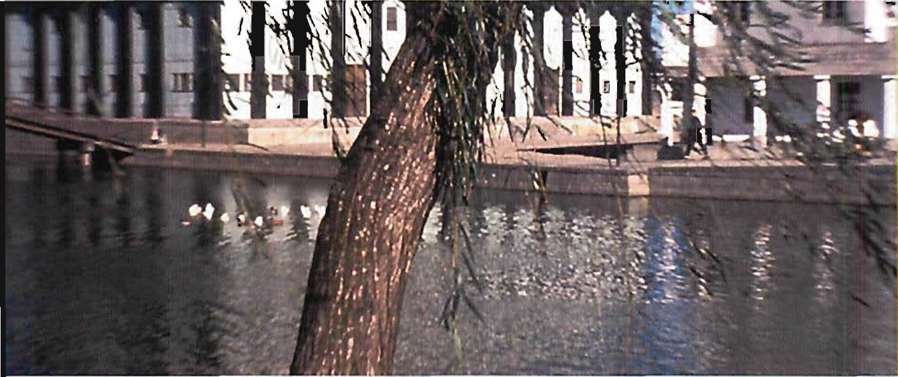
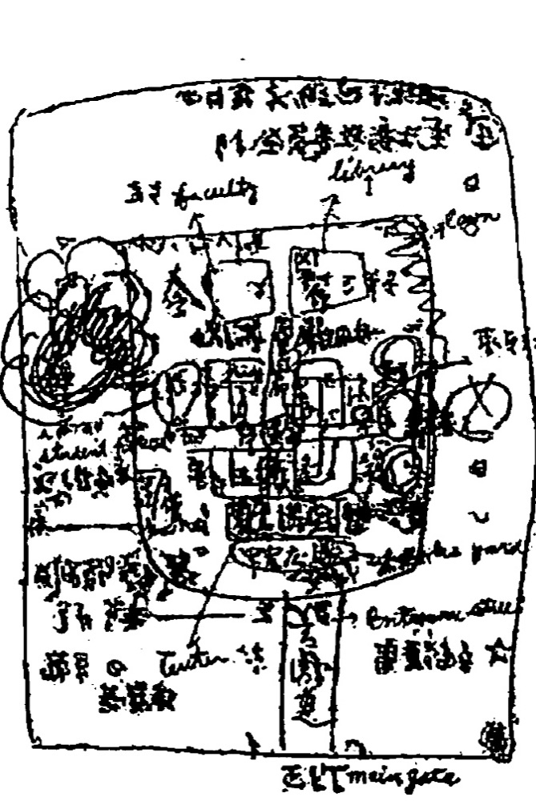
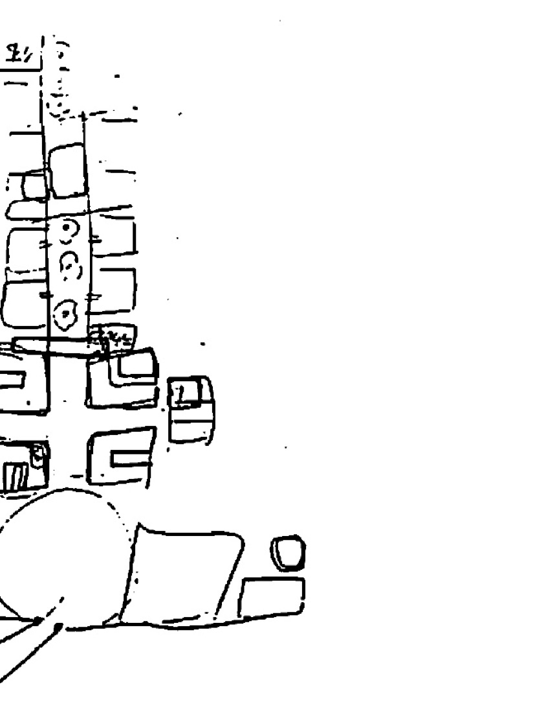
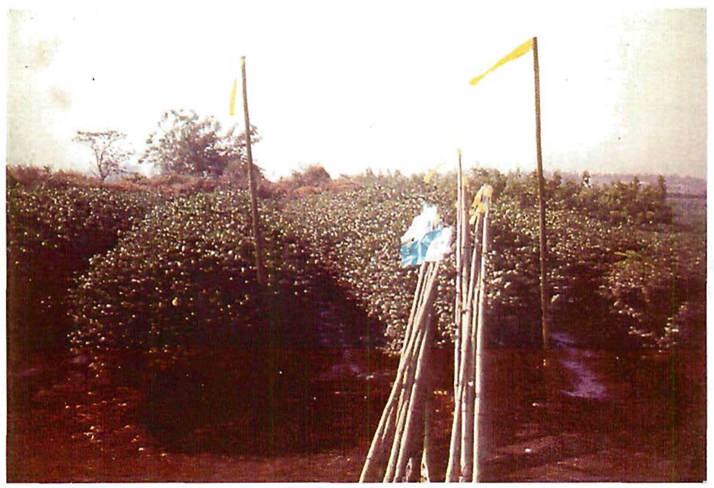
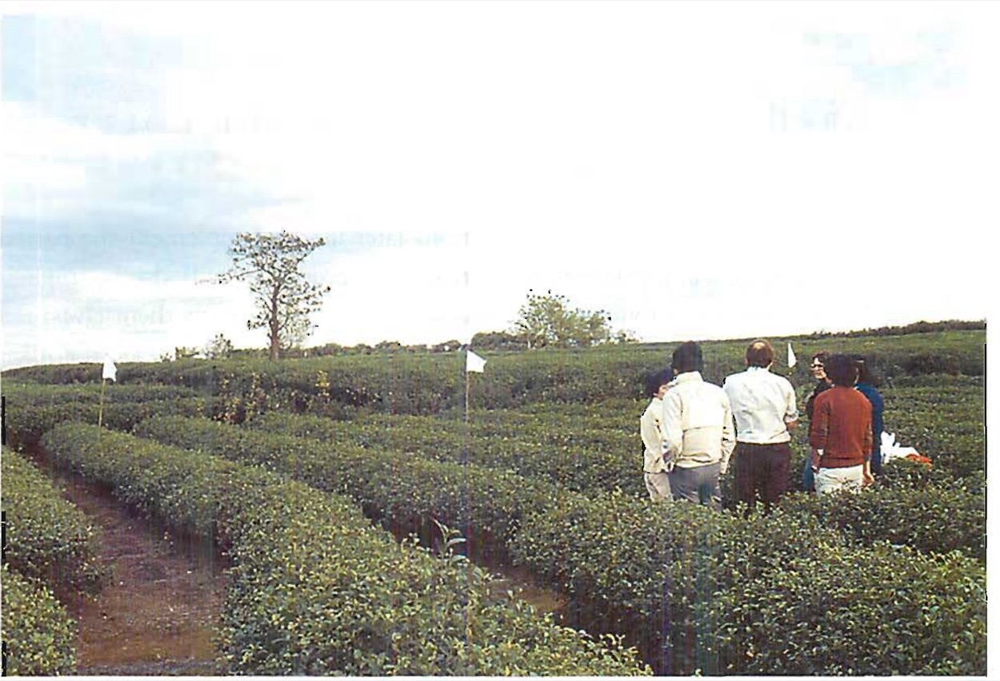

# Forming the Eishin pattern language and laying it out, in Alexander’s words

<strong>Christopher Alexander · <cite>A Vision of a Living World</cite> (2005)</strong>

**Our introduction.** Before anything was drawn for the Eishin campus near Tokyo, the school and the architects wrote down, in words, the place the school wanted: about two hundred statements, drawn out of teachers, students and administrators one person and one pattern at a time, argued over by a committee of about ten, and voted on by the whole community. Only then did they lay the campus out on the land, with a few hundred flags on bamboo poles in the tea fields and a big rough cardboard model that anyone could change. The passages below give that process in Alexander’s words, in the order the book gives it, for readers who want to do the same for a place of their own, such as a hamlet or a small neighbourhood. The campus was designed and built by Christopher Alexander with Hajo Neis and others (so the book’s caption to the first stage, p. 181); in this chapter Alexander speaks of “my colleagues and I”.

The passages are from *The Nature of Order*, Book Three, chapter 8, “People Forming a Collective Vision for Their Neighborhood”, pp. 259–273: the chapter’s opening note, parts of sections 3 to 5, and sections 7 to 10 in full. The Eishin account itself is sections 8 to 10, pp. 269–273. Section headings, our introduction and the notes at the end are the wiki’s; each figure carries the book’s own caption, quoted. For the next stage, fitting this language to the ridge and the hollow of the site with a balsa model, read [Laying out the Eishin campus in Alexander’s words](eishin-campus-reading.md) (chapter 5, pp. 174–177).

## A modest version: a few scribes for the rest · p. 259

The chapter opens with this note, printed in italics.

> Realism: What follows in this chapter may strike some as too idealistic. It is therefore important for me to emphasize the fact that although some of the descriptions of process in these pages seem to refer to an idealized process in which all the people of a community or neighborhood express their views, make their feelings felt, and add their insights to a collective vision, the case that is more interesting — because most realistic — is a different, more modest process. In this modest, and more down-to-earth version, a community of hundreds or even thousands may be represented by a small group of people — sometimes no more than a handful. These few people — perhaps leaders, planners, or members of the community with special concern — become scribes for a pattern language for the others. Provided that they keep the roots of this pattern language in the soil of everyday experience, it is possible for them to make something grounded, speaking the truth, and quite solid enough for their fellow creatures to ride upon. As you read the chapter, please be aware of this more everyday and more realistic model, as the thing which you can most easily practice and implement, while still aspiring to the ideal case if circumstance allows.

## One pattern at a time · p. 262

> Although interminable discussion about values, goals, and different points of view can unseat any social process if it is done in the wrong way — when the process is a disciplined process along the lines of the process described in Book 2, chapter 13, these problems rarely happen. The main point, I think, is that the fundamental process, when used correctly in the creation of a pattern language, allows people, one at a time and together, bit by bit, to focus on their communality, to sharpen it, make it precise. This can happen because the process allows people to establish just one pattern — one generic center — at a time. So the deep agreement which lies in people is given space, and comes to the surface. The wrangling and confusion which makes administrators so fearful, only follows from a wrong-headed approach to the process of building consensus.

## From what people say to a first list of patterns · p. 264

At a workshop of about fifty people in the Progresso neighborhood of Fort Lauderdale in 1996, Alexander wrote down their remarks on a notepad (pp. 262–264). He then turned them into patterns.

> Consider the following examples of generic patterns which were then pulled, one by one, from this list which members of the community had given of themselves and their concerns:
>
> 1. *Smaller houses (funded by low interest loans)*
> 2. *A thread of businesses and shops*
> 3. *Mixture of shops, businesses and houses close together*
> 4. *Many small improvements*
> 5. *Smaller parcels of land*
> 6. *Small projects*
> 7. *Children’s areas*
> 8. *Town houses near the south end*
>
> These ideas — only crudely formulated here — were the first eight items on a first list of patterns that were considered by the neighborhood. Each one would merit detailed discussion; and would no doubt change considerably when subjected to careful discussion. But, going through them one by one, and thus unfolding the generic patterns from the present awareness of the community — the agreed elements that could bring life to the community — then the subsequent unfolding would gradually improve the place.
>
> It was not hard to get these generic patterns from the discussion. And, as you can see, working at this level of detail, with discussion of geometric patterns one at a time, there is very little conflict; little argument to suggest that any of these patterns that are being brought forward, are objectively invalid.
>
> Within a few hours, we already had the beginnings of a broad agreement.

## Words, not a group drawing · p. 265

Section 5 sets this against the design charette, where a group draws together on one large sheet.

> What is still more serious, the *medium* does not work. A drawing is not a good medium for a process which requires serious and mature reflection, one item at a time. If, for example, it is true (as it was in Progresso, see pages 295 and 299) that people want smaller lots and smaller projects, this needs to be discussed as a *topic*. It needs to be thought through carefully, debated and considered, with pros and cons expressed. It is difficult or impossible for that to happen in the playful atmosphere of a charette communal drawing.

> In short, it is only when *generic* centers — patterns — are considered one by one, carefully, thought through, envisioned, that people can arrive at things which are then mutually satisfying, realistic — a genuine part of their vision of the world. And it is only then that they are likely to be shared. Although the pretty communal drawing of a charette creates the illusion that this might be happening, usually it is not *really* happening.

## Asking one person at a time · p. 268

Section 7, “The visionary process”, in full.

> To go towards true belonging, we must also consider the deeper process by which people may draw, from their own experience, the aspects of the environment — its necessary centers — that will genuinely contribute to deep feeling in the environment.
>
> If you ask me how to get the deepest stuff from people, the stuff which matters most, I would not have them meet all together, under conditions of imagined communality. I would rather talk quietly, to one person at a time, drawing from each individual his, her, their most important feelings, and their most authentic visions.
>
> If I were asking a person, for instance, to describe the best treatment for the fire-prone wilderness of Claremont Canyon near Berkeley, where hundreds of acres of farmland have turned to brush and forest in the last half century, I would ask that person, first, to imagine the most realistic conditions under which he might be in the canyon — depending on where his house is. Perhaps driving through, or walking, or sitting, or visiting.
>
> Then, once this was concrete and real, between us, I would ask him to close his eyes, “Imagine now, that you are doing this thing” — driving through, say, if that was this person’s choice — “What is it about the canyon that would raise the deepest feeling in you, as you make that drive. Imagine that you have just done it, you have driven through — and for some reason — it has had a profound effect on you, you feel completed, healed, illuminated. What was the canyon like, to make you feel like that?”
>
> “Close your eyes, close your eyes, keep them tightly closed, and imagine that drive through the canyon, and imagine coming out at the far end, with a feeling of peacefulness and illumination. What was it that made you feel like that? What aspect of the vegetation? What was the road like? Were the trees wild? Were they cut back? Was the brushland tamed? Just tell me what you see, with your eyes closed, that would put you in that state?”
>
> Talking like this to people, persistently asking them such things, until they tell you something true, working at it, working at it, until the thing they tell you is authentic. That is the way, one thing at a time, to get the real juice, the real stuff that will make the place alive.
>
> This kind of stuff, *if real*, is almost always universal. Once one reaches that level of depth, what is being said is then rarely idiosyncratic or private. It moves from that realm, enters a new realm of psychology, reality of feeling, becomes something which will raise a deep effect in *all* of us. At least, that is my experience.
>
> We see from this example how much hard work has to be done. I think *this* work has to be done by an architect. Or, if you like, an architect-psychiatrist. A person, anyway, who cares about people, who cares about the real forces flowing in people, the real visions which people have in them, who loves those visions, and who is then willing to write those visions down, step by step, one by one, in the form of a communal language which can be used and shared by everyone in that community.

## Eishin: a school that wanted a new way of living · p. 269

Section 8, “A collective vision achieved at Eishin”, in full from here to the cardboard model.

> To pursue this idea of reaching a collective vision about archetypal matters, in greater detail, I’ll go back to the example of the Eishin campus that my colleagues and I built in Japan. I want to describe the physical and social circumstances, while we were doing our work. Then, if you will, you can extrapolate from this example to the typical urban situation in your home town or in the city where you live. I hope you will see what I am driving at.
>
> The area of the campus we built is about 900 feet by 900 feet, roughly some nine city blocks. It was a small high school including a college extension to university education, and has some 1500 students. Originally the school had been located in Musashino Shi, near downtown Tokyo. Then in 1981, the school authorities decided to build themselves a new campus because they felt a need, as they explained it to me, for a new *culture*, that is, for a new way of living which they could share.
>
> I started out to describe, *with* them, what would be the essence of a life worth living on that campus. The process I am talking about here is that we created, with them, a unique pattern language for a particular neighborhood — a verbal statement, shared by the people of the neighborhood, that in effect catches hold of what the people in this community, and in their commonness, have in their hearts.

## Talking with 100–150 people · p. 269

> So how did we begin? What was the pattern language all about? We sat with people representative of that community — must have been 100–150 people in all, faculty, students, administrators — talking. At the time of our discussions they lived and worked in an urban school that was very much like a New York asphalt jungle: a cell-block approach to school architecture, with a big building in the middle, asphalt all around, and that’s it. In our discussions we started talking about what life might be like if, *instead*, it was a kind of a campus that people really wanted.
>
> They were not quick to answer these questions. It was hard for them. Sometimes I remember having to tease things out of people. They would say, “Well, what do you mean, What do we want? A school is a school. What am I supposed to tell you?” It was almost as if there was a reluctance to allow the private poetic vision that each person had within them to come out. Perhaps because it was embarrassing, or it was too soft-hearted or it was too dreamlike. I remember at one point, I noticed that I could see something in a particular person I was speaking to. It was one of those discussions: “Well, what is there to say, it’s a school isn’t it?” and so I patiently went into the thing with him and I said: “Look, try to forget about this school that you are in now, completely forget it, and just imagine a place which feels like the most wonderful place you have ever worked in. . . . and in which, for you as a teacher, it makes you happy everyday that you are there. *What is this place like?*” Still the answer came back, “I don’t know.” So I had to push a little further, and I said: “I really want to know, I want to know what is in your heart, and I’m not going to stop talking to you until you tell me.” And then “Look, if it’s too difficult just close your eyes — then just see it. Close your eyes and tell me what you see. Imagine that it is wonderful *in your own terms*: You didn’t know that it was there, and you suddenly came upon it, as if by accident. What is it that you found?” And then at some point the man I was talking to said: “Ohhh! You know, I imagine myself walking along a little stream between classes, I’m just thinking of my next class and preparing for it and so I imagine walking by this little bit of water and then sit down and have five minutes and then go into my next class.”

## A poem of two hundred statements · pp. 269–270

> Now, when I finally got *that* from him, when I finally got to that level, then that statement found its way into the pattern language we were making up. The idea of a place with water, where a teacher could wander between classes, was now part of the collective dream. It was included, finally, because we discovered, soon, that it spoke, too, for all the others — and they accepted that it was part of their communal dream. So altogether the pattern language for that campus is really like a poem of two hundred statements going from the very, very big things about this place all the way down to the little tiny ones about window sills and plants and so forth. It describes in almost poetic but concrete fashion what that world could be like.
>
> Remember now, all this was written before we had designed anything. At that time, we were still trying to imagine the new campus, in our minds.

*The book’s caption: “Water and trees: the lake we built for teachers, where they could walk and dream, as they had asked of us.” p. 270.*

## Why a picture made of words · p. 270

> The beauty of having a verbal picture like a pattern language is its elasticity. It is easy to take its elements apart. This comes about, above all, because the picture is drawn in words. A drawing is too monolithic; even when it contains separable elements, it is much harder to take its elements apart or to discuss them separately. But with a picture made of words, you can discuss the elements one by one, throw some out when they don’t work, improve them, work gradually to a proper understanding and agreement based on debate and refinement.

## A committee of ten, then a vote · p. 270

> We had a committee of faculty and students that was representing this process — a committee of about ten people. They used to meet with us discussing the pattern language as we gradually put it together. Finally, when there was a general agreement in the committee about an item, then that item would stay in; and if there were points that were debatable or arguable, there’d be some pretty ferocious discussions . . . until it got ironed out.
>
> That committee knew that they were ultimately going to go back to the full community to get the pattern language, as a whole, voted upon. So they were doing their best to represent what they felt was in everybody’s understanding. It didn’t take all that long. It took maybe three or four or five months, not a long time.

## We created: they created · p. 270

Section 9, in full.

> I must make it clear that the pattern language, though it came from the mouths and hearts of community members, *was created by us*. It was hard to create, an artistic and poetic task: but although it was we who wrote it, and put it together, it was *their* dreams, their hopes, and their aspirations and desires from which it was made. So when they saw it, they recognized it as being theirs. It *was* theirs. And that is what I mean by a collective vision.

## Asking people to draw it · p. 271

> So in the end we reached an overall pattern language — a statement of the community’s collective vision. To make it work, this statement had to be very *physical*. Even though it was all just words it really described what this campus was going to be like, to the point where after it had been created, discussed, hammered out and then finally voted upon and they said Yes. At that point I used to give this agreed-on pattern language to a particular student or teacher or somebody else in the community, and I’d say, just make me a drawing of what you think this campus is like now.
>
> We still have some of their drawings. Each person could visualize the whole community. Of course no two people visualized it exactly the same. Often they weren’t even *nearly* the same in detailed arrangement. But the drawings were all the same in the deeper sense that they all had the same broad structure. They all had the same main place where you came in, they had an entrance gate, and then a second entrance gate — because these were items in the pattern language. They all had a lake and a small stream because that was in the pattern language. They all had a street where the high school part was; they all had a kind of large elongated courtyard where the college buildings were arranged, because these were in the pattern language.

*The book’s caption: “One of the faculty of the Eishin campus made this sketch to show how, in his mind, the communal vision achieved in the pattern language might fit together on the ground. The coherence of the drawing, reflects the coherence already present in the verbal and poetic version.” p. 271.*

*The book’s caption: “Another sketch, made by another teacher.” p. 271.*

## What the language had already settled · p. 271

> So each person shared a level of communal understanding. In other words what was clear at that point were the main foci, the main buildings, overall density, juxtaposition, the nature of the buildings, how big were they, how were they related to each other, how people walked about. We knew for instance, at that point, that each classroom was essentially in a separate building (actually two classrooms per building, as we finally did it). So if people drew these things, they did so because they had already agreed that that was the way it ought to be.
>
> So this picture, purely verbal, not very long, not much more than about ten pages long, represented the community members’ collective belief about themselves, and about what they wanted that nine-block part of Tokyo to be. They knew then that it would support their life in the way that they understood it and wanted it. They felt then that it was worth going for.
>
> Later they thanked us for building a new way of life for them, because they knew that what they had in that collective vision, and in the actual campus as we built it for them later, was indeed a way of life, and it was their way of life, the way they wanted it.

## Laying it out on the ground with flags · p. 272

> It is hard work to get a picture like this. But once you have it, it clarifies everything, it becomes a driving force, and the future layout of buildings and development of the site becomes rather easy.
>
> In the Eishin project, once we all had our verbal picture, our collective vision, in the form of the pattern language, then we began to lay the campus out, bit by bit, on the ground. This involves a process which is quite different from the pattern language itself. You have a picture of the new community, you have a verbal picture of it, but of course it is quite another matter to fit that picture to the reality that is actually on the ground, step by step, bush by bush, there’s a tree here, there’s a beautiful view there, the wind blows a little bit too much over here and so on and so forth. So you are trying to set down this structure that you’ve understood in verbal terms — now you’re trying to set it down physically on the ground.
>
> What we did in fact, was to get a few hundred flags on six-foot poles, and then placed these flags, gradually, throughout the land until we had the structure of the public spaces: what I call (in chapter 3) the hulls of the neighborhood. When we were done it almost looked like a samurai army on the move. But these flags allowed us to grasp, collectively, where one walked, which public spaces were formed in which places. We — and all the members of the community who came there with us — could imagine the public land, feel it, and walk through it. The spaces formed by the flags created the public hull, the public living rooms of society, for that community, on those tea bushes in their nine-block area. That’s what we were doing with the flags.

*The book’s caption: “Flags in the fields of the site, as we prepared to use the pattern language to imagine and walk out the plan.” p. 272.*

## The public space first · p. 272

> I have come to believe in recent years that the public hull, the hull of public space, is probably best done by the builders with the help and cooperation of the individual families and businesses. But that is an act in itself, the creation of this public hull of space which is going to take the place of all those burnt-out parking lots and nowhere bits of street and asphalt and so forth that we have come to know as the open space in our modern cities. So we set that in place, too. Usually, it was the thing which we did first.

## The cardboard model · pp. 272–273

> We also made a big working model of the Eishin campus, in rough painted cardboard, at a scale of 1:100. It was about 10 feet square, and filled a whole room, yet it was quite rough so it could be changed and improved without harm. This model was there for everybody to use and work at. And we had this model in a room in the old school, where everybody could see it and look at it. Every day people used to come in and look at this thing. It made it possible to visualize the public hull, in physical substance, so that people could imagine how the individual buildings were going to help to form the public hull.

*The book’s caption: “Placing flags in the fields of the site where the Eishin campus was later built. This was the method used to make the plan from the pattern language.” p. 273.*

## The method in brief · p. 273

Section 10, “The vital need for a collective vision”, in full. The middle paragraph is in italics in the book.

> So the problem of collective vision remains: How do we get a vision of the city or of one of its neighborhoods which is a *true* vision, a true collective vision that is shared and held by everybody in the neighborhood?
>
> I believe I have given the answer. *Do it with the people, pulling the statements from their own lips. Make sure you ask each person, always, what is the deepest feeling you have about life, and what does* THAT *dictate. Go one pattern at a time, and when debate is needed, debate it, argue it out, one pattern at a time. Have someone — an architect, anyone trained like the staff members of the Center for Environmental Structure, who is not concerned to impose an egocentric image on the community — coordinating the work of pulling this language together so that it can be made coherent and useful — and, if possible, poetic.*
>
> Do all this with a careful awareness of deep morphology so that — as has been explained in chapters 11 and 13 of Book 2 — the system of patterns and sequences becomes *generative*, capable of conjuring up a whole geometric world when it is let loose.

## Notes on the reading

The passages are given in the book’s order. Between “One pattern at a time” and the Progresso list, the book describes the Fort Lauderdale workshop and gives Alexander’s notepad of the residents’ remarks verbatim (pp. 262–264). Between “Words, not a group drawing” and section 7, section 6 (pp. 266–268) describes the same one-pattern-at-a-time discussion with several thousand residents of Hazama, in the Chikusadai district of Nagoya, with a site plan the book credits to Christopher Alexander, Miyoko Tsutsui and Hiro Nakano, 1992. The chapter continues after section 10 with the archetypal character of such visions and the Bologna citizens’ movement of the 1970s (pp. 273–281).

The Eishin pattern language itself is discussed, with examples, in Book 2, *The Process of Creating Life*, chapter 13, which Alexander refers to in section 3. The next step on the site, reconciling this language with the land’s own centers, is in [Laying out the Eishin campus in Alexander’s words](eishin-campus-reading.md), with a [companion guide and exercise](eishin-campus.md). The authors’ own account of the campus, with photographs, is in the Living Neighborhoods edition: [Eishin campus](/living-neighborhoods/examples/eishin-campus).

The book’s cross-reference “see pages 295 and 299” in the passage on p. 265 is printed as it stands; the Progresso material is on pp. 262–264.
