# Building the Upham house: a small example of a living process

<strong>Christopher Alexander · <cite>The Process of Creating Life</cite> (2002), Appendix, pp. 571–632</strong>

<aside class="wiki-ours">Our introduction
This is the full text of the appendix to <em>The Nature of Order</em>, Book Two, where Alexander follows one house, built for Christopher and Stephanie Upham in Berkeley in 1990–92, through forty-four steps from choosing the site to painting the window frames. It matters for practical building because it shows the unfolding process with the costs, contracts, subcontractors and mistakes left in: balsa models instead of drawings, plywood column forms moved by eye before the concrete was poured, a fixed budget kept while the plan changed. Headings follow the book's numbered steps; text and captions are Alexander's, checked against the page scans, with printed page numbers in small type and his fifteen properties in small capitals.
</aside>

## Contents

- [1. A radical new process](#1-a-radical-new-process)
- [2. Finding a site](#2-finding-a-site)
- [3. First analysis of the site with rough twisted paper and balsa models](#3-first-analysis-of-the-site-with-rough-twisted-paper-and-balsa-models)
- [4. Full-size tests of volume and position on the site](#4-full-size-tests-of-volume-and-position-on-the-site)
- [5. A first sketch](#5-a-first-sketch)
- [6. Checking the neighbors' views](#6-checking-the-neighbors-views)
- [7. First emergence of an interior plan](#7-first-emergence-of-an-interior-plan)
- [8. Extension of the lot: the little plum tree](#8-extension-of-the-lot-the-little-plum-tree)
- [9. Deeper questions about the feeling of the plan](#9-deeper-questions-about-the-feeling-of-the-plan)
- [10. A deeper conception of the living room](#10-a-deeper-conception-of-the-living-room)
- [11. Laying the house out on the land](#11-laying-the-house-out-on-the-land)
- [12. Starting to get a general idea of construction](#12-starting-to-get-a-general-idea-of-construction)
- [13. Establishing rooms](#13-establishing-rooms)
- [14. Upstairs rooms](#14-upstairs-rooms)
- [15. Analysis of cost](#15-analysis-of-cost)
- [16. Concrete wall details](#16-concrete-wall-details)
- [17. Plasterwork experiments](#17-plasterwork-experiments)
- [18. Start of construction](#18-start-of-construction)
- [19. The retaining wall](#19-the-retaining-wall)
- [20. Management agreement that feeling must guide even the most technical aspects of construction](#20-management-agreement-that-feeling-must-guide-even-the-most-technical-aspects-of-construction)
- [21. Setting the main-floor level](#21-setting-the-main-floor-level)
- [22. Excavation](#22-excavation)
- [23. Fine-tuning the plan as we fixed forms for the foundation walls](#23-fine-tuning-the-plan-as-we-fixed-forms-for-the-foundation-walls)
- [24. The lily tiles](#24-the-lily-tiles)
- [25. Placing and fine-tuning first-floor rooms](#25-placing-and-fine-tuning-first-floor-rooms)
- [26. Making and placing the first-floor wall](#26-making-and-placing-the-first-floor-wall)
- [27. Fixing the living room: its door and fireplace and windows](#27-fixing-the-living-room-its-door-and-fireplace-and-windows)
- [28. Remaking other first-floor rooms](#28-remaking-other-first-floor-rooms)
- [29. Completing the first-floor structure](#29-completing-the-first-floor-structure)
- [30. Pouring and forming the garage](#30-pouring-and-forming-the-garage)
- [31. Getting the entrance path just right](#31-getting-the-entrance-path-just-right)
- [32. Remaking the upstairs rooms](#32-remaking-the-upstairs-rooms)
- [33. The master bed alcove](#33-the-master-bed-alcove)
- [34. The kitchen fireplace shape](#34-the-kitchen-fireplace-shape)
- [35. The kitchen floor](#35-the-kitchen-floor)
- [36. Plasterwork](#36-plasterwork)
- [37. Window openings and windows](#37-window-openings-and-windows)
- [38. Balustrades of the upstairs balconies and the concrete frieze](#38-balustrades-of-the-upstairs-balconies-and-the-concrete-frieze)
- [39. Front door steps](#39-front-door-steps)
- [40. Painting windows and exterior woodwork](#40-painting-windows-and-exterior-woodwork)
- [41. Flowers in the garden](#41-flowers-in-the-garden)
- [42. Use of the fundamental process](#42-use-of-the-fundamental-process)
- [43. Common sense: an overview of the process](#43-common-sense-an-overview-of-the-process)
- [44. End of the appendix on the Upham house](#44-end-of-the-appendix-on-the-upham-house)
- [Notes](#notes)

## 1. A radical new process

<small>p. 572</small>

Throughout Book 2, it has been my contention that when we design and build in such a way that what we build gets life, it is necessary to do things in a new way which respects the step-by-step unfolding of the field of centers. During the unfolding, each new center made at a certain time *t* is introduced and shaped in response to the wholeness that existed just before, at time *t-1*, and is then shaped according to its contribution to that wholeness. All this is accomplished by repeated application of structure-preserving transformations.

Although this may leave certain features of the professional architectural process intact, it also creates many revolutionary changes. To illustrate, this appendix contains one fully detailed practical example of the process, describing, in some detail, the making of a single house that I built in Berkeley for Christopher and Stephanie Upham during 1991 and 1992.<a href="#note-1" aria-label="Note 1">1</a> As we shall see, throughout this project the fundamental process and the fifteen transformations are used again and again and again, to get each new detail, as the whole unfolds.

This process is very different from the normally accepted process of architectural design and construction as it was in the 1990s.<a href="#note-2" aria-label="Note 2">2</a> To make the unfolding process possible, I was both architect and contractor for this house. The bank accepted the process, in spite of its innovative character. The submission of plans to the Berkeley building department was normal (however, see discussion on pages 604–05). The role of drawings was also very different from that in the normal professional process of today. Since the construction was indeed an unfolding process, we could not know how the house would turn out in detail, until it was finished. Although some drawings were made during the process — for permits, structural checking, and so on — all the participants knew that the drawings were merely a rough approximation of what was to become the finished building.

The house was carefully built to a fixed budget — according to contract — and came in *on* budget. The money was administered under a new kind of construction contract which I have developed with my colleagues over many years. This contract allows construction price to be guaranteed while unfolding is taking place, even though the design is not rigidly fixed ahead of time.<a href="#note-3" aria-label="Note 3">3</a> Thus the client does not have the financial uncertainty that such an open-ended project would create in a typical late 20th-century construction contract where many steps of the unfolding would be viewed as changes. Rather, in our contract the unfolding was a feasible process *within a fixed budget*, backed by the careful cost control necessary to make this possible. This was part of the agreement from the beginning.<a href="#note-4" aria-label="Note 4">4</a>

Our work was done by a small group of people including craftspeople, an architect, an engineer, apprentices and construction workers experienced in construction, an architect trained as an engineer, and people inexperienced in construction. The total calendar time spent was somewhat longer than usual. The fees were standard (though spent in smaller amounts over a longer period). The cost of construction management, fixed in advance as a percentage of the fixed construction budget, was also approximately standard (18%).<a href="#note-5" aria-label="Note 5">5</a> The Center for Environmental Structure (CES), the contracting body, is a non-profit organization, and it was part of the character of our agreement that every penny, except for the fixed fee, was to be spent on the building. CES had responsibility for allocating and reallocating the money dynamically, while design and construction were moving forward.

I am not proposing this example as a general model of all living process. Other processes will certainly need other new concepts to become living. Road building, land management, assignment of loans, zoning and planning, larger construction projects — all need different kinds of <small>p. 573</small> revision in order to include the features of living process. Each sphere of process needs different aspects of process to be changed.

However, the degree of difference this process has, compared with standard design and construction, illustrates the general proposition that *all* process is likely to need drastic change in order to achieve living process.

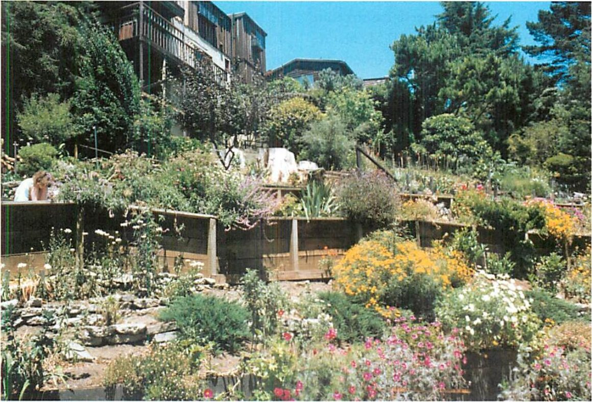

*The garden before the Uphams bought the land* · p. 573

## 2. Finding a site

The house was to be about 2500 square feet, a garage for two cars, terraces, small gardens, a main bedroom for Chris and Stephanie, one for Sasha (Stephanie's daughter), and a third spare room.

We searched for two years for the site. I encouraged Chris and Stephanie to find a site where they had, from the outset, a strong feeling of belonging to that place.

To find the right site, with my help, occasionally we drove to a possible site and discussed it. Several that we looked at were either unsuitable or unavailable. I want to emphasize that, in keeping with the fundamental process, we rejected several sites that others might have accepted (buildable, financially sound, etc.), because they did not generate a sufficiently deep feeling of "this is ours" in Chris and Stephanie. At last, one day I got a call: "Come and look at this one." I went to a small beautiful garden, covered in flowers. It was part of another lot and was to be cut off and sold. A beautiful place, but very small, almost too small.

However, because it had the right feeling, we began the effort to build a beautiful house there, in spite of the site difficulties.

## 3. First analysis of the site with rough twisted paper and balsa models

<small>p. 574</small>

From the site, I first derived the volume and position of the house.

What was needed to preserve the structure of that place, that bend in the road? My first reaction was that it was a shame to destroy the beautiful garden. I talked to the seller, expressing my concern. He said that it didn't matter because he was getting old and couldn't garden anymore. But I felt that to destroy this garden might endanger or destroy the neighborhood.

The garden sat in the concave curve of a quiet street. It had a key position in the neighborhood. I noticed that to place a house there in a structure-preserving way, one would have to find a way of shaping the house, placing it, so that the beauty of the garden and the way it nourished the street could be left intact.

The idea of this was clear. What was not clear was whether the necessary volume could be put on the site without harming the street. I told the Uphams: "It is a beautiful site. But I am not sure I can do a good job there. It is so tiny; by the time we have a workable volume there, it may not be possible to preserve the quality of the street or of the garden. Before you buy the land, let's check it, to see whether a beautiful house with the qualities you want is possible there."

To check the site, I made a small clay model at 1:200 scale (1/16th inch = 1 foot) — and began playing with bits of balsa wood on this model, to find out what harmonious volume would unfold from the site itself. In essence, the problem was to find out how 2000 square feet of building <small>p. 575</small> could be put on the site, while leaving the beauty of the garden and street intact.

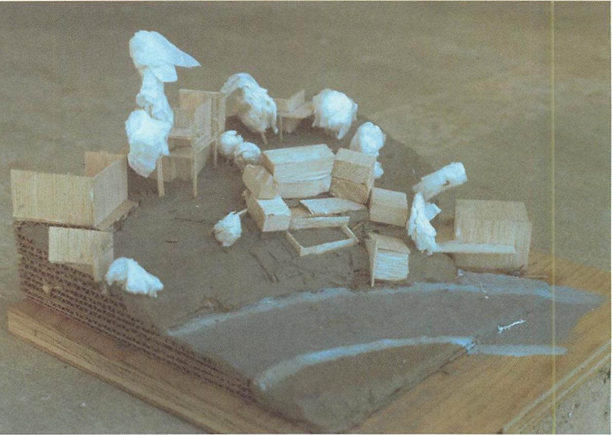

*Roughest sketch model in modeling clay and balsa wood* · p. 574

It turned out that it *was* possible. I was able to put the house rather snugly into the slope, not standing out, to preserve the structure of the land. The curve of the garden stayed as it was; the house and its curve preserved the system of centers formed by the garden and the curve of the street.

However, it quickly became clear that it would not be possible to build a two-car garage, without destroying the site. I had a talk with the Uphams about this. They said it was OK and that they would be satisfied with a one-car garage. With that difficulty out of the way, the overall volume of the house came, finally, as a rather awkward shape but the only relaxed and comfortable volume I could find, with its own proper centers, which made the site come to life and left positive space throughout the bowl of the site and towards the street.

To make this modeling process effective, the model was crude: bits of scrunched-up tissue paper, scraps of balsa. The roughness of the model was intentional, because it allowed me to play, move stuff around, see whether a harmonious arrangement of volume was possible. To find something good, I had to be able to play quickly, move fast, push things around. A carefully made model would have been disastrous because it would have slowed me down, constrained me by its cleanness. What was needed was a dynamic model in which I could tear things up, put them in, in which I could find out in a matter of minutes — even seconds when moving fast — whether something that preserved and extended the wholeness of that land and the surrounding buildings was truly possible.

## 4. Full-size tests of volume and position on the site

From the position and character of the house volume given by the small model, next, on the site itself and from the feelings we got by walking there, we got the detailed dimensions of the volume.

The next step of unfolding. With a general feeling for the overall idea of the volume from the model, we went back to the site to check it out in more detail. I stood with one of my apprentices placing stakes. The only thing we were trying to do at this stage was to get clear about any facts or fixed points that I felt we could rely on, as fixed aspects of the emerging design.

At the site, the existing terraces of flowers were more impressive than on the model. There was a clear sense of the main terrace as the focus, but it wasn't very wide. We placed stakes in such a way that this terrace seemed to become believable as a real and comfortable place.

Here we see the unfolding at work again. The terrace existed in our minds as a rough shape — a sized and positioned "thing" — but as we asked ourselves what detailed shape unfolded from this loose and general terrace idea, the shape developed and became more clear, thus creating positive space in the terrace. As a result of this, a kind of gentle bow appeared in the plan, where the terrace became slightly bigger and where the house bent toward the sun.

Another thing that became very clear as a further unfolding was the strong sense one had that it was best to enter the site at the west end, up stairs close to the neighbor's existing garden stairs. This was at the opposite end from the garage, and therefore seemed surprising — even illogical — but careful walks up and down the road in front of the house, looking at the flowers, seemed to confirm a strong feeling that it was indeed best to enter the site at the western end, up <small>p. 576</small> a similar small stair. It appeared that the structure of the site was preserved and extended by a stair at the left, far more than by a stair at the right. So I made the decision — which some might call irrational — of not placing the stair by the garage, but a rather long way away from it.

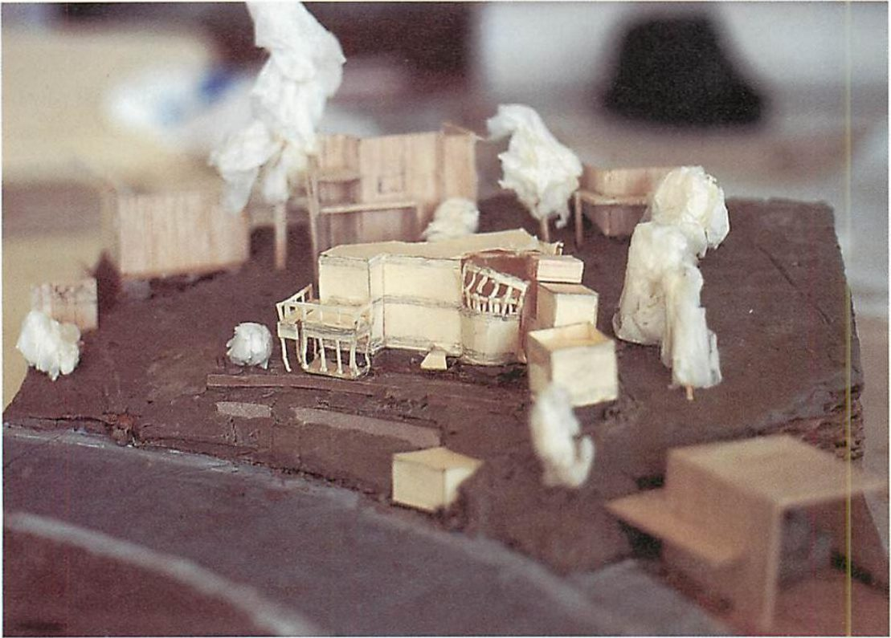

*Another rough, but more detailed, clay and balsa study model* · p. 576

One further thing. Since the main terrace was *very* narrow, we felt the building wall that we began to visualize above it couldn't be too much of a cliff, since it would overshadow the terrace and make it uncomfortable. Here the structure of the site, as it existed in my mind at that time, had to be extended by subtle detail to preserve the structure of the house and not to destroy it. So I began to see a balcony or porch upstairs, essentially reducing the impact of the house volume overshadowing the terrace. Here, as a result of the unfolding process, a strong center began developing, with gradients, and alternating repetition.

The small room down the hill, at the eastern (right) end of the house, already seemed like a real place — a very nice additional center of the house which formed the tail end of the house in its cascade — and again forming graded variation, and thus strengthening the main strong center of the house.

I had very little idea about the interior plan of the house at this stage: only a rough idea of the living room in the middle, the entrance at the western end, the main bedroom upstairs — and a vague notion of the kitchen at the eastern end in the narrow wing of the house. As I told the Uphams, the crucial thing at this stage was to get the volume of the house to the stage where it had a beautiful harmony with the site. We had that now, and were lucky to have it.

Our work on the site was then summarized in a further rough model. I want to stress the ordinariness, the *apparent* awkwardness and roughness, of this model, too. As finished, the house is beautifully situated and keeps the street alive. It genuinely responds to the wholeness of the site, makes what is there more alive. In order for the house to help the street and preserve the structure of the neighborhood, the positive space which has been formed on the main terrace, in front of the house, is the crucial ingredient. It <small>p. 577</small> is this positiveness which maintains the neighborhood, the street, the garden.

All this became possible because of the informality of the model, which allowed the unfolding process and the center-creating process to take place unimpeded: indeed, encouraged them. I should emphasize my strong belief that an attempt to define this house volume on drawings, or by drawing, would have failed. The complex three-dimensional reality of site, house volume, space, slope, just could not have been visualized from a drawing. It was the little blocks of balsa wood themselves, and the arrangements they made on the sloping clay, that led to the volume.

A house designed in drawings, or merely staked out on the site, would probably not have come as close to preserving the wholeness of the slope as we managed, because there would have been too little information there. It was the feedback from the many errors that became visible in the tiny model while I was making it — and which could then be corrected — that made the center-creating aspect of the fundamental process work.

## 5. A first sketch

From the position of the house on the site, as we had staked it out, I was able to get a first vision of its physical character, light, and windows.

At this stage, I summarized the feeling of the house in a little rough pencil sketch (shown here). This was the first drawing I had made of the building.

The process of making this sketch was another step in the unfolding. The volume as I had understood it so far from the balsa wood model was, as a whole, too rough, too higgledy-piggledy, not harmonious enough. In this sketch, I gathered together what was visible in the model and on the site into a single graceful sweep which simplified the structure and made a single building form consistent with the feeling of the street.

This step of the structure-preserving process resulted in a house that was kinder to the street, and more consistent with its structure than the many-volume building suggested by the balsa wood model. The cleaning-out process — vital to all structure-preserving — introduced simplicity and inner calm into the emerging whole. I was getting rid of dross.

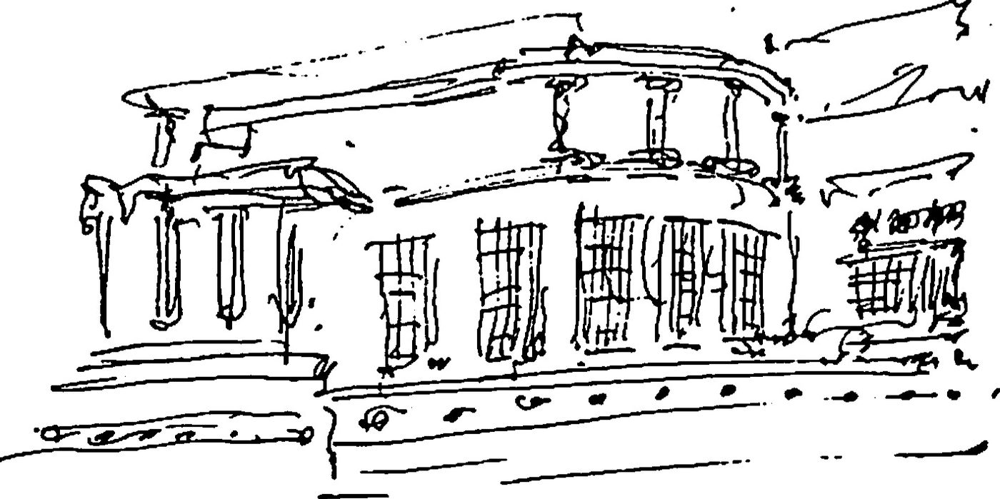

*First sketch of the house as seen from the street: this sketch adds a new overall simplicity to the lumpy awkwardness inevitable in the rough study models* · p. 577

<small>p. 578</small>

The sketch now had the essence of the coming building. It had the volume, the feeling of masonry, the balcony upstairs with columns, the curve looking out toward the sun. It showed the bow, generated as a response to the view, swelling towards the south — and the wall of the small terrace. The balcony upstairs, stepping back the front wall of the building, was necessary because the terrace was so narrow. It came into view in the unfolding before there was even a suggestion of an upstairs plan.

Although the final building (see pages 630–31) is in *detail* quite different from this sketch, in the broad morphological sweep of the whole, it is the same. This is typical of the fundamental process, which first creates broad structure that remains intact later, even when subsequent unfolding greatly changes details.

Within this step, preservation of the existing centers of the garden, and of the centers of the street and surrounding land, had been very important; and preservation of the site's wholeness took precedence over the program. Good shape has appeared in the building; roughness has appeared in the entrance path; and the terrace has been formed as a boundary.

## 6. Checking the neighbors' views

We now modified the volume to preserve further the structure of the neighbors' views.

To make sure of the volumes, we went back to the site and had someone stand with long vertical two-by-fours to show the top, roof edge, and so on as real positions. We then climbed up to the houses above us and went into their living rooms, onto their terraces, to check the views that would be left if the building stood where the two-by-fours were. We looked out from everybody's windows, decks, and gardens, all around.

We saw, from this experiment, that it would be best — for the neighbors' views and for ourselves — to tuck the house as far back *into* the hill as possible, and keep the height less than 11 feet off the ground slope at the back, and 19 feet off the ground at the front edge. These heights were recorded on a contour drawing. This insight was different from prevailing wisdom in the Berkeley hills, which would have told us to place the house on stilts, far forward on the site and up high, often as much as 25 or 30 feet off the ground for a two-story building. This "in-the-air" approach generates the cheapest foundations and is therefore common. Instead, we chose a more expensive foundation, digging deep into the hill, to preserve the hill, the garden, and the neighborhood's views.

To stay on budget, the expensive foundation had to be paid for later in the process with savings from other construction categories.

The impact of this step in the unfolding is to make the house long and narrow along the contour, thus introducing good shape and deep interlock into the volume of the building.

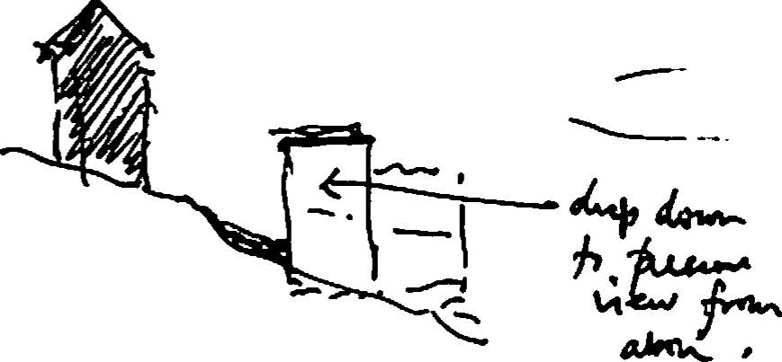

*Tucking the building down into the land, to maintain the neighbors' views* · p. 578

## 7. First emergence of an interior plan

<small>p. 579</small>

The first rough ideas of rooms and room placement emerged by going inward from the house volume, with the fundamental process.

In my first version of the house, the great curve, from the sketch, was a wonderful living room, full of light, in the middle of the house. The entrance was to one end (left on the accompanying plan sketch); other rooms were grouped around the right end, stepping downhill. The house would be entered from the northwest, and a stair would run up the back side of the house, to the second floor.

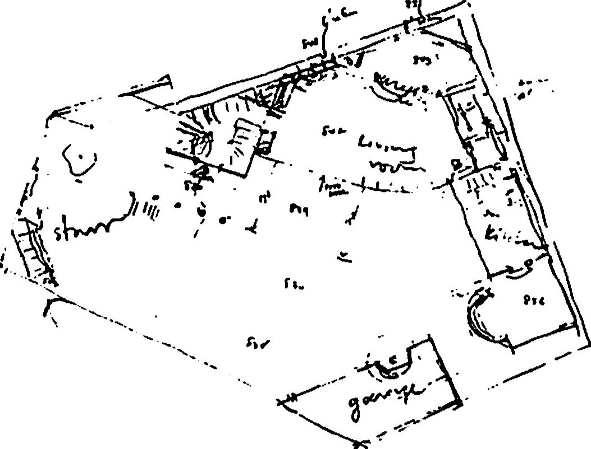

*First sketch of interior layout.* · p. 579

## 8. Extension of the lot: the little plum tree

We now undertook to preserve the structure of the land even more deeply by arranging for our clients to buy a bit of land which had a small plum tree whose presence had a profound emotional effect on the house.

In the conception of the house which had unfolded so far, the entrance, with a porch, was to be at the western end. With the plan in mind, I stood roughly on the site of the proposed porch at the western end of the house and noticed that as things stood, it was really too close to the lot boundary to be a nice entrance. In addition, the city had an ordinance which restricted the total area of the house to 40 percent of the site area. Given the very tiny site, and the configuration which was developing, this would have forced the house to be slightly too small.

Where I stood, just next to me was a little plum tree standing at the western end of the site — a beautiful spot, with a flat terrace, flowers, a couple of chairs. It had a magic and a pleasantness which would not really be present on the site without it. To make the house have life, the house *needed* that tree. I suggested to Chris and Stephanie that the small area with the plum tree to the west was needed to make this porch work, by giving it a spark of life and a bit more space.

The same point may be understood, too, in terms of unfolding. The site with the house as we had roughly located it and this tree together formed a complex. In this complex, the plum tree itself and the space which connected it to the house formed an essential center that was at that stage only *latent*. This latent center might simply be described as a potentially beautiful place to the west of the house, where house and plum tree together had the capacity to form a wonderful "thing," a center. But this center was nearly there; it almost existed already. In the unfolding of wholeness, this center had, therefore, to be preserved, cherished, extended. Without it, the site as we were experiencing it would have been lessened, damaged.

<small>p. 580</small>

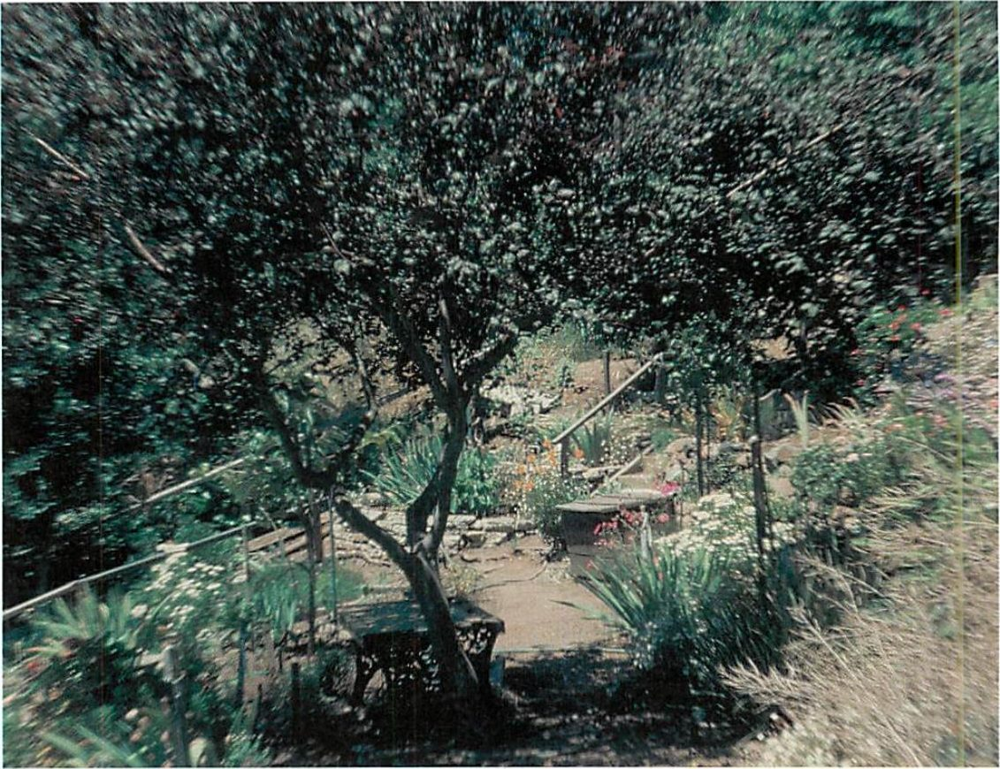

*The beautiful little plum tree* · p. 580

I suggested to Chris and Stephanie that we broach the difficult topic of adding this piece of land to the property in our next discussion with the sellers. At first they refused. I wrote them a letter explaining that without this piece of land, the size restrictions imposed by the lot area would make the necessary house almost unbuildable. We held discussions for several weeks. Finally, they agreed to sell. Even then, an extraordinary number of special legal measures were needed to make the lot adjustment possible.

It took three months of work to get this one little thing. Its only purpose, really, was to intensify the one existing center — the terrace — with another — the kitchen porch — and to use the center created by the existing plum tree to make this possible. In the course of doing it, various subtle steps had to be taken to make the boundaries just right within the restriction of the zoning ordinance — for example, a few feet too many and the sellers' original property would become illegal. We also positioned the boundary in such a way as to intensify the beauty of the sellers' garden, too, in that area, its terrace walls and bushes.

The parcel which was formed when we added the plum tree was odd in shape and caused some legal nuisance. But this nuisance was required if we were to follow the rule that the wholeness had to be obeyed and extended. This <small>p. 581</small> devotion to the wholeness, and the protection and weaving in of the plum tree, let the process of the house design and layout take an unusual path: It made everyone conscious of the wholeness, and breathed a special life into the process. The house itself also benefited enormously.

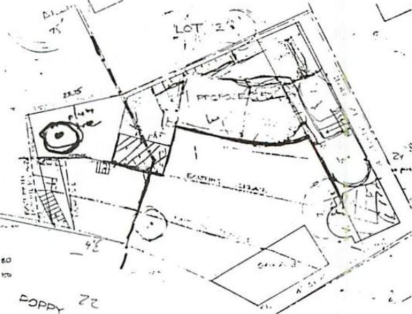

*Extension of the lot, to include the plum tree* · p. 580

The odd shape of the new lot is a perfect example of roughness coming into existence as a result of unfolding. The site, as originally drawn, was a regular five-sided figure. To intensify its wholeness, it had now become an irregular polygon, with a small piece stitched onto the larger shape. The roughness arose directly from the unfolding process.

## 9. Deeper questions about the feeling of the plan

I began to question the disposition of the major rooms within the house.

In the evolution of the plan so far, a certain pleasant feeling was emerging, more or less from careful attention to practical points, one by one: the preservation of the garden and the street, the volume of the house stepping back, the size of the terrace to make it comfortable, the beauty of the little plum tree.

But in the course of paying daily attention to feeling, one also sometimes has the experience of *wrong* feeling developing: The work does not always go right. Then one has to seize this intuition that the emerging form is wrong, stay with it, and change things at the right moment, to act upon the deep character of the form without drastic repercussion on cost.

That is what now happened in the evolution of the house interior. So far, what had followed from the volume and site, and from the location of the entrance at the left end, was a rough idea of the ground floor — the main entrance at the left, then the kitchen, then a big irregular living room in the middle, then a spare room or study at the far right end (visible in sketch on page 580).

As we got used to the site, I became uneasy about this arrangement since I knew the light in the living room might be murky, not beautiful, and the distance to walk from entrance to kitchen to living room seemed too cumbersome. I also had an uneasy sense that this layout did not arise naturally from the true nature of the Uphams' life, the character of their relationship, their feelings. In short, I had a dim sense that this house, as presently conceived, did not yet have enough that they would experience as profound feeling: It did not go to the heart of family life as they knew it.

I therefore suggested that they come and speak with me, privately, in my own house, over a few drinks, so we could discuss the uneasiness that I was feeling.

## 10. A deeper conception of the living room

The unfolding process now took a decisive turn. By reexamining the emotional configuration of the family's daily life, the fundamental process led us all to a new sense of the nature of the living room.

When Chris and Stephanie got to my house, I asked them to describe, in more detail, the main centers in the house, as they now imagined them. I pressed hard, and asked that they describe the key centers in the house again, as <small>p. 582</small> vividly as possible. During this discussion, Stephanie finally broke down in tears, because she described her family as not real enough. It seemed to me that her tears were a lament for what she had lost by being the owner of a very successful children's clothing factory. A vision of a small rosy room, with its fire and comfortable chairs tightly grouped around, slowly came into being. Perhaps it arose directly from her lament, a place of comfort where her wounds could be healed: simple, small, warm, and strongly formed by good shape and local symmetry. Embedded in the plan, at its core somewhere, we had begun to imagine an intense smaller center at the very heart — quite different in feeling from the large living room we had originally shown in the earlier plan. This new room was small, deeply embedded, intense, compact. It was the center of the center.

This deep-lying center also arose from structure-preserving transformations — in this instance, from the character of Stephanie Upham's feeling.

I have often found that the fifteen properties — in this case, the small nugget-like rosy center — often come in almost archetypal fashion, from close adherence to the deep feelings people really have. It was I, not she, who started the process that brought this to light. But it was *her* feeling, the reality of *her* family life, which made it true, made it a productive and essential part of the unfolding process.

## 11. Laying the house out on the land

Now we established the physical geometry of the house footprint in detail.

To get the layout of the ground floor more clear — getting the other ground-floor rooms in relation to this core — Gary Black (vice president of CES), Stephen Duff (one of my apprentices), the Uphams and I now staked out the whole ground floor of the house, room by room, on the land, as accurately as we could from what we then knew.

Afterward, working from these stakes, we constructed an exact plot of the house shape (shown in the drawing on this page). It was the first time we had seen an accurate picture of the house plan, based on detailed understanding of its relation to the land.

I want to stress the fact that the *stakes* came first, not the drawing. The drawing was made *from* the stakes. This is the opposite of the procedure architects more typically follow, by which they first draw a building on paper, and then use stakes on the land to indicate what they have drawn.

In the course of placing stakes, many points of the design became more clear: for instance, the profile of the front wall with the terrace as a thick boundary, and the position of the back retaining wall with the slope above it as another thick boundary made of strong centers.

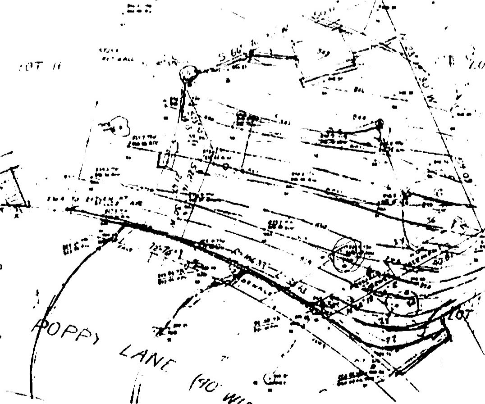

*First stakes marking the terrace, and the south face of the building volume* · p. 582

## 12. Starting to get a general idea of construction

<small>p. 583</small>

During this time, I began to ask myself what overall feeling of material and building construction we should aim for: I tried to derive the proper feeling from the feeling of the land.

In a conventional process, one might now have gone on to develop the plan in more detail. But the unfolding process has peculiar demands. Having the core idea of the ground floor clear — emotionally — I noticed that what was missing now, most strikingly from the whole, was a sense of how this house was to be *made*.

It followed, therefore, that the next most significant aspect of the whole which had to be made clear was its actual material and substance. This arose, at this moment, because the vision of the core room, so deeply felt by the Uphams, was very physical, very material, in nature. It felt solid, more like plaster or masonry than like wood. We could not therefore really go forward without having a more developed understanding of this material aspect of the whole.

So I put to our group the following question, as we worked: What is the house made of? Can we feel its essence, its substance? What are its materials? What is it, as one sees it from the outside, enters it, walks about in it? In more detail, what is its general construction method, what are its materials, even what is its overall color?

In these discussions, I concentrated, at this early stage, and sought to lead the discussion, only on the most global aspects of construction: the weight, the relative curviness or straightness. What is the density? What is the overall feeling of the real material thing going to be? What feeling was consistent with the site, and with the emerging whole?

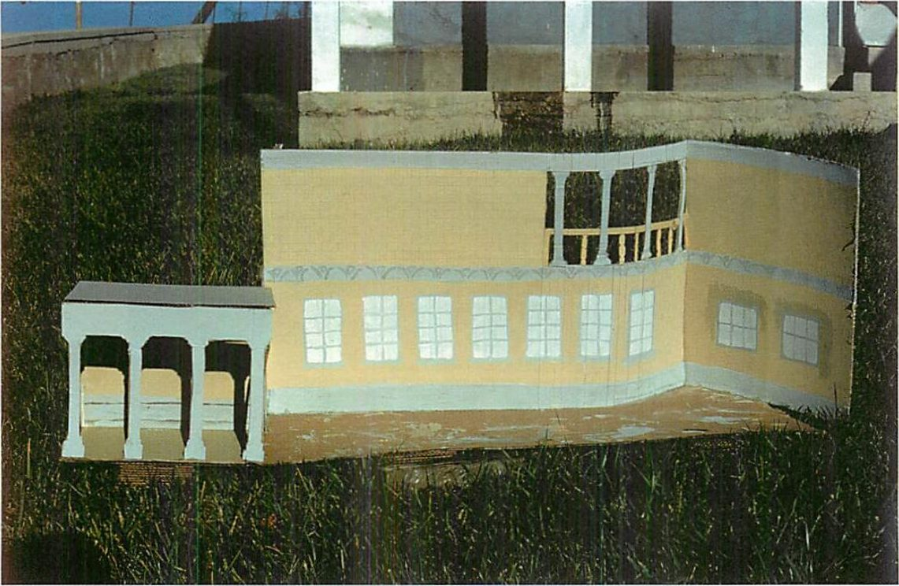

*First cardboard model to explore the possible forms of material, construction, and color which might be consistent with the emerging whole* · p. 583

<small>p. 584</small>

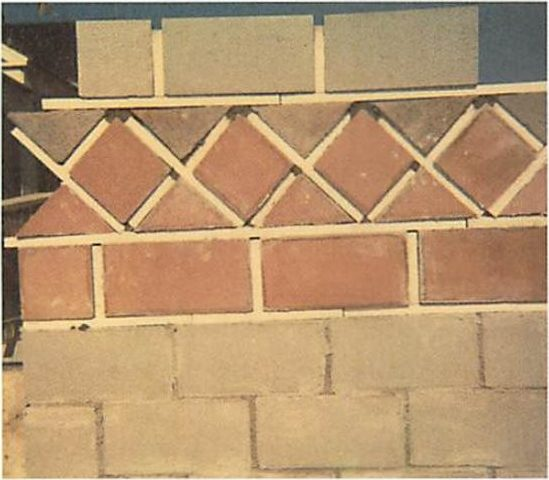

*Trying to imagine a texture of concrete block and plaster* · p. 584

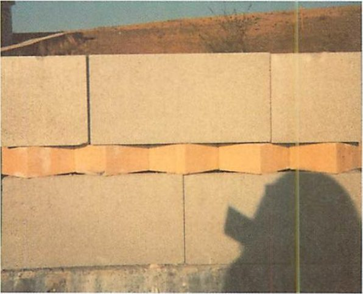

*Testing wall texture using blocks* · p. 584

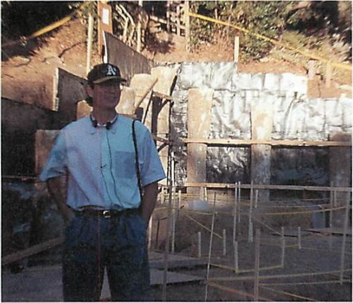

*Chris Upham on the site* · p. 584

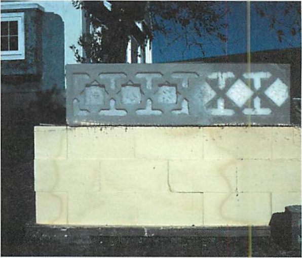

*First mockup of poured concrete shapes with cement plaster and styrofoam insets* · p. 584

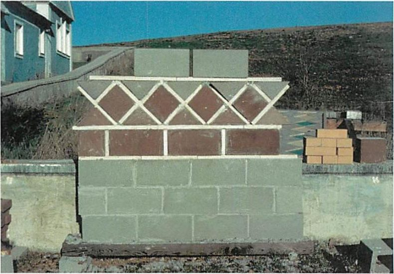

*Another experiment trying a combination of red pavers, white plaster strips, brick, concrete, and concrete block* · p. 584

<small>p. 585</small>

At this very early stage, we got the idea that the house would be made of concrete block. As a group, we began to see a balance of pale yellow washed over concrete block, with gray bands of ornament. The ornament on the blocks and poured concrete wall introduced levels of scale; the bands of ornament created alternating repetition. I was not sure yet whether these bands of ornament were poured or specially made block. To answer the question, I asked my apprentices to test some possible ornaments, likely colors, and different arrangements and mixes of these colors on what we now knew the rough volume of the house to be. And even at this early stage, I already started looking at the character of ornament in some detail. My apprentices and I started building possible blocks, poured-concrete blocks, and block and concrete walls in our construction yard. We made up some blocks which gave indications of a possible ornamented, but heavy structure. Some of these, with in-cut stars and crosses, were closer in feeling than others to the gestalt which was emerging from the unfolding process. The one that came closest was based on a Japanese ornamental concrete block. These details, even going to the actual ornamental shapes themselves and the sense of concrete, helped to fix the feeling of the house. The thickness of the concrete masonry introduced the possibility of boundaries at a smaller scale. We could judge, even now, that some of these ornaments had more business on the site than others, and this helped to establish the character of coming centers in the larger structure.

It should be borne in mind that at this stage we still did not yet know the room plan of the house in detail. But we were beginning to get a feeling for the building as a material structure.

## 13. Establishing rooms

The next centers to be established were the main downstairs rooms.

Having the substance of the house clear, the unfolding process naturally turned back to the plan because the plan relationships and centers forming the plan were now the *next* most important features which must emerge from the emerging wholeness: a wholeness which now consisted of an uncertain plan with a small compact living room at its core — within a structure made of concrete or masonry.

I had by now completely abandoned the overall plan which I had while I was first deciding the house volume. That first plan had its stair too far from the main center; its big living room had nothing to do with the vision of the small intense rose-painted room I had seen. Instead, given the core importance of the small compact living room, I now placed the stair towards the back of the footprint triangle — with an entrance room in front of it, thus making this entrance room the very center of the house and intensifying it as a strong center properly, making a gradient to the stair at the back. That left the main room to the right of the entrance room, also as a strong center, but small, as it had to be to catch the Uphams' feelings.

The next center which became clear was a rather large kitchen, with a big table to one side, where the Uphams were to eat. This living kitchen had not been clear at first, but now we got from our discussion with Stephanie a picture of a big hollow room, spare, quiet, not too decorated, where the family was to cook and eat. At this moment, this kitchen became clear in character — but not, at first, yet clear in its position. However, it was time now to fix positions.

Where to put the kitchen? East or west of the living room? After thinking about the sunshine in the kitchen, the little plum tree, and <small>p. 586</small> the approach to the house, we all together (the Uphams and my staff and I) decided to place the kitchen at the northwestern end where the porch had been on earlier sketches. Remaining rooms went to the southeastern end.

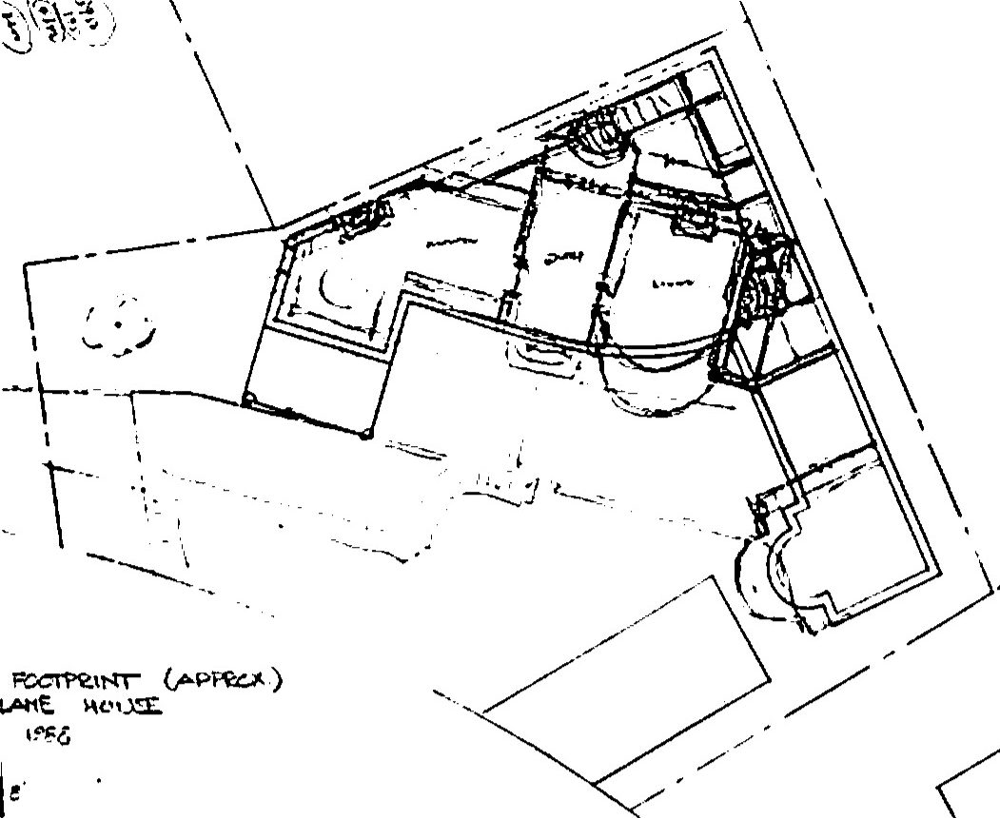

*First-floor plan sketch with its major centers worked out.* · p. 586

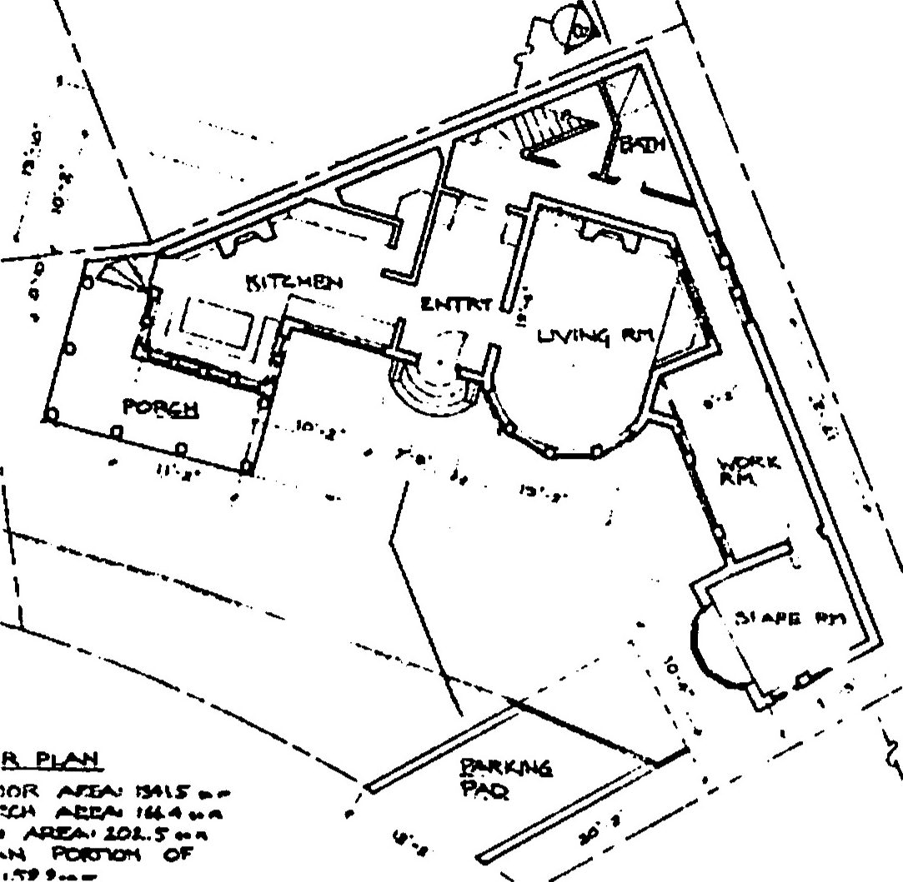

*As drawn for submission to the city of Berkeley for the building permit* · p. 586

The combination of kitchen, stair, and living room now effectively defined the new layout of the house within the given volume. We drew the plan and prepared a set of preliminary drawings ready for submission to the city of Berkeley.

## 14. Upstairs rooms

We also tried — unsuccessfully — to get the upstairs rooms as living centers.

I knew that it was too early to understand the upstairs rooms, since we were not yet standing on the second floor to judge them. However, we tried to get an upstairs layout, mainly to apply for a building permit and satisfy building requirements; it is shown here. Perhaps the most notable thing about this layout is the fact that by the time the construction process reached the upstairs, the drawn layout turned out to be entirely wrong and was then redone completely. Of all the upstairs rooms on this early plan, only one — the small bedroom at the southern end of the house — remained as it was.

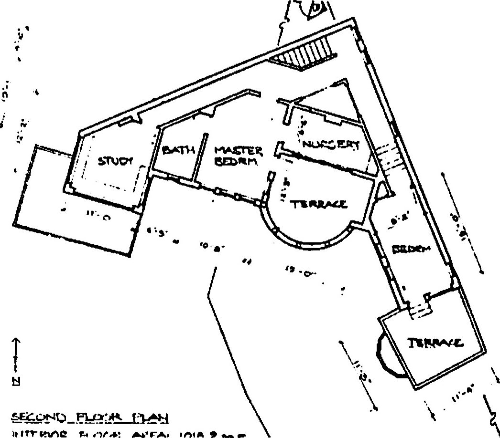

*Upstairs plan as drawn for building permit* · p. 586

<small>p. 587</small>

The wholeness which one needed to see in order to determine the rooms upstairs just was not yet visible, so it is not surprising that these judgments could not yet be made.

It is remarkable that the architect's belief in his own powers dies hard. No matter how many time I tell myself that perhaps, just this once, I can work out what has to be done in a building without being there, in the event I am always proved wrong, and it always turns out that the influences from nearby parts of the building and its environment which will determine and generate the plan, make a decisive impact not predictable at the time the building existed as a drawing (see page 610, below, where the second floor as it actually unfolded later, is shown in a plan view).

## 15. Analysis of cost

In preparation for settling the way that we were going to build the house — real details of construction — we had, some time earlier, begun a careful analysis of cost.

In the program-budgeting method I have used for years, we sit down, *before the building has been designed*, and make a plan of how to spend the money. That is — for a given amount of money, which is usually set at the beginning — we decide how much should be spent on walls, roof, foundations, terraces, exterior works, interior furnishing, and so on.

It is interesting to see how much of the picture of the finished building can be built up, merely by assigning numbers to the different operations and elements. For example, in the buildings I build we typically spend much more on construction of adjacent outdoor areas and spaces than is spent in other projects; we also spend more on the *structure* of the building than is spent in typical California buildings. From the very beginning, this has an effect on the architecture and on the whole way one sees the site.

In fact, one is able to visualize, judge, and modify the design, just from the numbers, even at this earliest stage when there is only a list of numbers on a piece of paper. *The list of numbers IS the earliest design.* It can already be visualized, experienced, from the point of view of the feeling it is likely to create.

In the case of the Upham house, our first cost picture of the building allocated rough numbers to foundations, walls, roof, windows, interior. This was an analysis made during early conceptual design. The problem with the first cost picture was that the overall cost was too high, and far more important, in proportion certain items seemed intuitively too low or too high, relative to one another, for the building that was imagined.

We then made a second educated guess about how costs ought to be apportioned, in the design, in order to make the overall feeling of the building sensible, and coherent. Here, for instance, we put high costs for windows (knowing that many large and beautiful windows were essential to the design). We put in expensive interior plaster work, also essential; and we put in masonry walls.

When we found out that these costs ran too high, we then had to decide how to keep things in proportion, keep the important things important (in terms of what was to be spent on them) and yet bring the whole cost picture to the level that the clients requested.

Some of the items we cut or raised in price, or lowered in price, may seem surprising by contemporary standards. We used more expensive flat roof membrane (since roof quality was essential in a flat roof building); we kept masonry construction on the first floor wall. We increased expenditure on outdoor items, but we removed a porch as inessential to the overall feeling. We kept terrazzo in the kitchen, but determined that <small>p. 588</small> it could be done by students, while the grinding of terrazzo could be done by Chris Upham, thus taking an expensive item, allowing it to keep its quality, but cutting its cost drastically.

On the other hand, we had cheap knotty-pine planks in the upstairs floor; kept wide cherry floorboards in the living room. Other things were reduced, too. Bathroom fixtures and toilets were kept low. The client agreed to paint the building interior and the exterior windows.

This judgment about the assignment of costs, what was reasonable, what created a good atmosphere, was based on the feeling which the whole had when one visualized the whole created by the budget amounts to be spent on different items.

## 16. Concrete wall details

Within the framework of a tightened cost picture, with percentage of 15 percent allocated to the main structural wall of the house, details of technique, shape, and figure began to emerge from the mockups of the wall construction elements.

Two things had been going ahead. As our cost picture was getting more detailed, we were starting to get bids from subcontractors on key items. We were also making progress on a number of items where the bid was not yet in or we didn't know how to perform the subcontract. Two examples were (1) the concrete front wall of the house and (2) the interior plasterwork. We were now sure that at least the lower floor of this building was to have concrete walls; but it had become clear, from the analysis of available money, that we could not afford to do the same upstairs — so we decided to use beautifully formed and poured concrete downstairs, and a cheaper, thick heavy concrete-like stucco over wood frame upstairs. I wanted the building to be something of permanent value — not like so much lightweight two-by-four frame construction, a temporary building which would be derelict after fifty years.

I began trying to imagine the concrete structure of the downstairs wall: columns, beams, openings, capitals. It was hard to visualize in detail. I tried sketching it, but couldn't get enough of a sense from the sketches; the problems were all three-dimensional, too hard to visualize in drawings. My apprentices made small models; but there wasn't enough detail in those models either, not enough to grasp.

Besides, the problem of cost of the formwork was looming as a huge problem. How could we build the complex shapes and articulation of columns, beams, capitals, frames — and not lose our shirts. How could we succeed in doing it within the budget.

I decided that the only way to get an idea of this thing was to build some full-size mockups in cardboard. Randy Schmidt (one of the main CES craftsmen on the job) and James Maguire (one of the CES construction managers) built a complete bay of the structure in cardboard, at full size. Interestingly, it was terrible at first, very crude. This is interesting because that first cardboard mockup exactly followed the drawings. It just showed us how far from a workable and desirable three-dimensional configuration the structure imagined in the first sketches had actually been.

It is worth noting that many of today's buildings which do not use such an unfolding process are doomed to just these kinds of mistakes, since in contemporary practice it is the drawn details which actually get *built*.

We made a second mockup, including a series of changes, looking at them while we did them. In heavy corrugated cardboard, this was very easy. The size of the columns, the offset of <small>p. 589</small> the columns in front of the panel, the degree to which the beam came out over the columns — these aspects all changed during our efforts to make the configuration more harmonious, more real, and to give it deeper feeling.

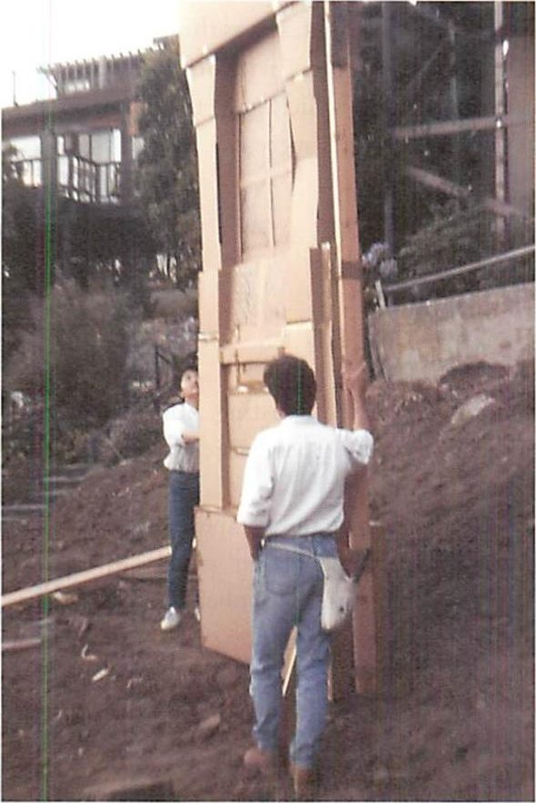

*Looking at the cardboard mockup on the site, to test its feeling in relation to the site* · p. 589

And how could a capital be made, to make sense within this system? This was very hard to imagine because it was so complex with regard to water exclusion and flashings. But in the full-size cardboard reality, we began to be able to imagine the physical arrangement the flashings would need to have.

In the end, after a few days' work, we got shapes which meant something. They had solidity and feeling in proportion and mass. As a result of the development of the full-size cardboard models, good shape had made its appearance in the column capitals; contrast, in the degree of offset between capital and shaft; alternating repetition, in the rhythm of columns and bay spacing; levels of scale, in the small details of reveal and depth in the modeling of the concrete surface.

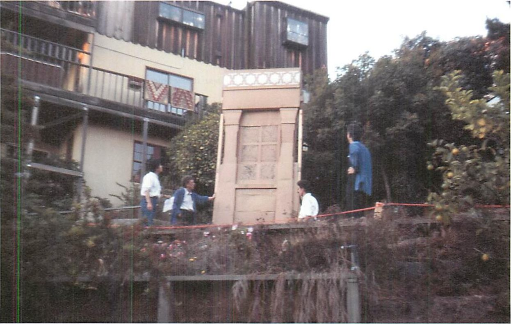

*Cardboard mockup of wall construction. This mockup was very detailed, full size, and allowed us to check the offset between one plane and another to the nearest half inch and quarter inch* · p. 589

<small>p. 590</small>

The columns, the bays, the thin column capitals, the panels above and below the windows — and, of course, the windows themselves and the reveals — all existed as substantial centers in their own right. It was this process, the instilling of the centers with life, in these construction details, which gave the whole process its energy — and its success.

## 17. Plasterwork experiments

Comparable details began to emerge for the interior plasterwork (details whose character was starting to be worked out now) even though the actual plaster was still not going to be built for several months.

Before I knew how to make the plasterwork surface inside the building, I knew we would need to cast the panels ourselves, but didn't yet know how to do it. We began experiments. Randy Schmidt started a number of plaster models, exploring the possibility of making flowers and other simple reliefs in plaster and trying the kind of casting techniques we might be able to use. What we were looking for was a treatment of detail in the plaster which would have a shimmering surface in the large, and be simple and touching in feeling: not-separateness and inner calm. We did the experiments by gluing cardboard and balsa wood surfaces, then casting from them, until surfaces began to appear which had a feeling of light in them.

By the end of these experiments with real casting plaster, the plaster panels emerged as flower-covered surfaces, embellished with leaves and latticework.

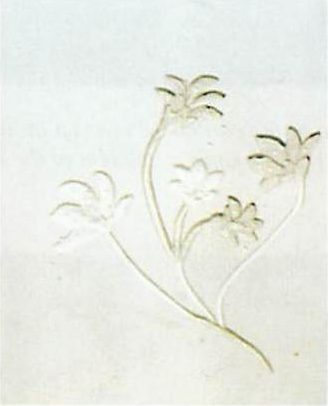

*Closeup of one type of floral ornament which we tried* · p. 590

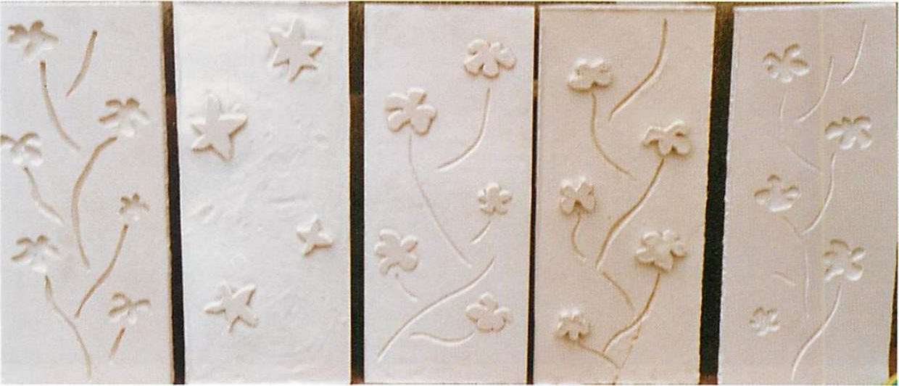

*Early experiments in trying to make beautiful, but inexpensive, plaster panels for the interior* · p. 590

## 18. Start of construction

<small>p. 591</small>

We started construction in October 1990.

The idea of the house, as far as we knew it at this stage, was encompassed by the model shown on this page. In these days of working drawings, it seems peculiar to say that what we knew, at that moment, was what is visible in this rough model and little more. But that is the truth. We understood the broad configuration, and we understood, at this early stage, approximately how we were going to make it. Not much more. That is the honest truth.

Uncomfortable as it may be to admit it, in this age of hundreds of detailed working drawings for a comparatively simple building, that just is so. But I want to insist that the existence of this limited and partial knowledge, not full knowledge, at any given stage of the unfolding, *is of the essence of the unfolding process.* In a true unfolding process, you know certain things at different stages, but what you know about what is going to happen more than a few steps ahead, is always rather limited. That is the essence of unfolding.

And that is necessary in order to allow the unfolding process to occur. Rough as it is, this model showed us what we truly *knew* at this stage, together with a few construction details. Everything else was still unknown, and had yet to be unfolded.

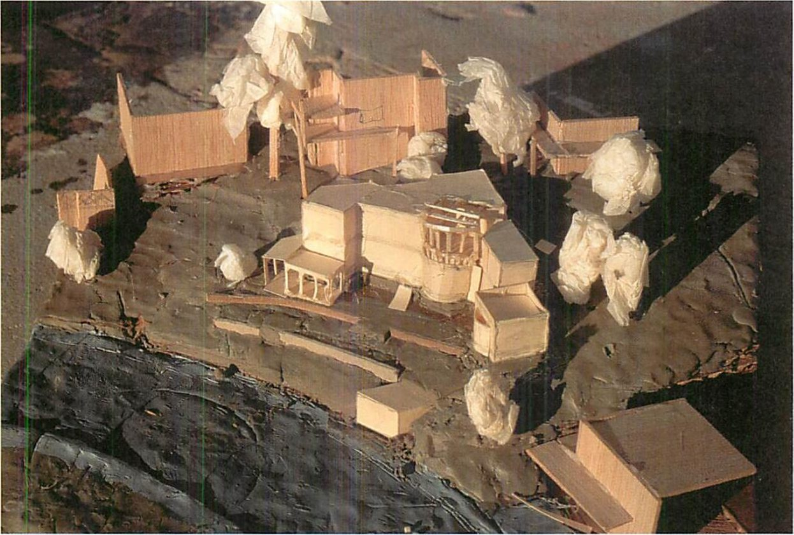

*Rough model of final conception, as we imagined it before we started to build* · p. 591

## 19. The retaining wall

<small>p. 592</small>

The most immediate problem we had to solve was the construction of the retaining wall to hold up the major hill behind the house.

In this building, the cost plan for the retaining wall and foundation was enormous: a subcontract of $90,000. We had already spent a lot of time getting ready for this subcontract to start, once again from the point of view of cost. Most bids for the work had been very high, on the order of $140,000. In our cost plan, we had allocated some $90,000, and not a penny more. To conform with the cost plan, we now began a search for a flexible method of doing the huge retaining and foundation job within the $90,000 budget.

While this work was getting prepared, we were making final changes in the way the piers would be drilled, to keep within the budget. There was a huge technical problem: the back of the retaining wall. How were we going to build it without massive formwork, and in such a way as to build a $140,000 retaining-wall system for about $90,000. The problem was that if we excavated the hill, it would need massive shoring to hold it up while the retaining wall was being formed and poured. This was aggravated by the prospects of rain, a wet hillside, and the weight of the existing house directly above, which might cause a cave-in.

With Stanley, our foundation subcontractor, we worked out an ingenious method which involved drilling long deep piers, reinforcing them, pouring them, excavating around them, and then filling in between with a poured retaining wall. The piers were big enough and close enough together to hold the hillside temporarily while the final wall was formed and placed between them. The photograph shows this technique, when the piers were half built and being excavated.

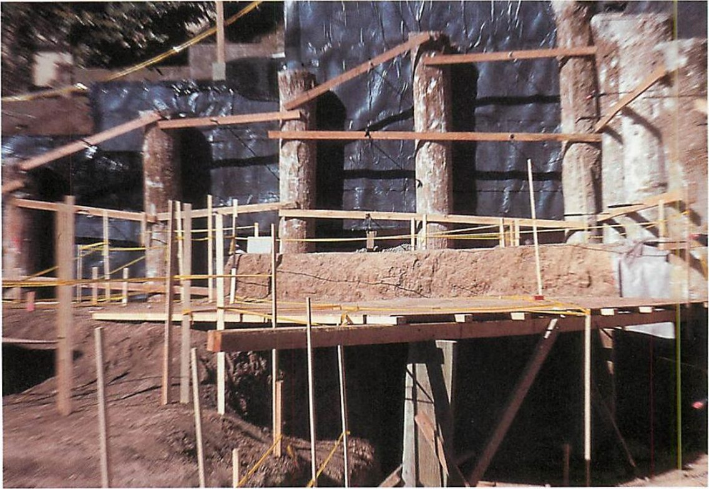

*The piers exposed after drilling and pouring, and ready for forming the foundation and retaining wall between the piers* · p. 592

## 20. Management agreement that feeling must guide even the most technical aspects of construction

<small>p. 593</small>

The need for flexible decision-making in the sequence of critical construction operations forced a highly flexible approach to construction management.

I had a talk with James Maguire who was then running the construction for CES. He told me about some problems he saw coming, including the position of underslab plumbing, the framing contract, setting the foundation boards, and a few others. In the course of discussion, I reminded him that he must be as relaxed as possible about the small details, which could always be solved one way or another — but that the big questions about the building, especially the most important open questions about coming major centers, must be kept open and flexible, with our minds constantly on them.

For example, the plan of the kitchen wasn't right yet. We didn't know if the room was OK or not. It had a strange shape on the drawing. If kitchen and living room weren't good, the house would be a failure. We therefore had to make sure that Stanley, the foundation subcontractor, was coordinated with our schedule. I wanted to have at least ten days of decision time set aside after he made his cut into the slope, so that we could stand on the real land, before he started drilling. Why? Because when he began to drill his front line of piers, that would essentially fix the front structural wall of the house.

If it was going to be necessary to make any changes in the shape or size of the two main rooms, that was the last time we would be able to do it, since it might turn out that we would have to modify the front line of drilling, or the front foundation form, to give the two main rooms a more beautiful shape.

This is a perfect example of how, within the fundamental process, feeling must enter even into major technical decisions.

## 21. Setting the main-floor level

The final position of the main-floor level came from a process done standing on the site.

On October 30, 1990, we set levels for the benching process. Walking on the site, standing on buckets, planks, judging the right height for different parts of the floor. After trying different dimensions the main-floor height was judged to be best at 24 inches above terrace height, instead of the 30 inches shown on the drawings.

This judgment was based, in part, on a straightforward combination of comfort and psychology. It simply *felt* most satisfactory. But this explanation does not fully explain the coherence which it created. To grasp it more fully, this "right floor height" that was finally chosen may also be understood as creation of a living center. It was the dimension which made the space between the terrace and the main-floor positive and comfortable. If you imagine the terrace as several steps below the floor there was, floating above the terrace, a slab of space, the same size and plan as the terrace and — depending on the decision that was to be made — either 30 inches or 24 inches thick. This slab of space hovering above the terrace, and connecting it to the main floor, had the potential to become a center, and was judged to be best, most life-supporting <small>p. 594</small> within the project as a whole, when the offset was 24 inches. At that dimension, the whole configuration created the most positive space and good shape. This could be assessed by the methods described in Book 1, chapters 8 and 9, according to the feeling of wholesomeness which it created in us, the observers.

You see how even this very simple decision — like nearly every other in the process — was based on experiment. It was the choice of that dimension which created the most profound sense of life, well-being, wholeness in us, the observers — and was experienced by all of us, jointly, in that way.

## 22. Excavation

A minor crisis. We had to keep the foundation subcontractor's methods consistent with the process of unfolding, not with his usual mode.

I went up to the site and found that Stanley, our foundation subcontractor, had dug far too much away from the back of rooms, in order to prepare for pouring the retaining wall foundation. He had — before he started — been specifically told not to do this, but did it anyway because he had a convenient piece of equipment up there, and wanted to use it as much as possible.

I insisted that he hadn't had the right, and that according to our contract it had been agreed that we would look at the ground-floor plan of the house (and perhaps modify it) while excavation was going on, so that we could check details of wall positions. Now he had made this impossible because the site was so deeply cut up that no one could walk about: there were 3- and 4-foot drops, and we couldn't even stand on any one level bit of ground to imagine floor levels and so feel the reality of kitchen, front entrance room, and living room.

It was a difficult situation. Several days of phone calls; some upset. Finally, I was able to persuade the contractor that his crew had violated our agreement. They built plywood platforms for us, very cheap temporary ones, over the areas they had cut in error. This accomplished, we were in a position to start the fine-tuning of the ground-floor plan.

## 23. Fine-tuning the plan as we fixed forms for the foundation walls

November 9. A number of major decisions were now made just before foundation forms were set and built.

*Kitchen fireplace position.* The kitchen fireplace position (as drawn) was terrible. It could not be built where it was shown on the drawing since, as now became clear, it would ruin both halves of the room and split them. It had to be moved back. We moved it back 18 inches. From this, an entirely different feeling. Now the fireplace didn't jut into the room; it was comfortable for the sitting area, and nice to look at from the doorway. We also moved it six inches to the north so it fit nicely between two of the massive piers in the retaining wall.

*Kitchen porch.* As it turned out, the porch on the south face of the kitchen (on the real site) was narrower than we thought by about nine inches. I felt it was too narrow now to be pleasant. We had the option of extending the retaining wall <small>p. 595</small> out to make the porch, or to abandon the porch altogether and make it a pathway. It wasn't a natural place to sit anyway, as it turned out. I decided to give up this porch altogether.

*Workroom floor level.* The offset from the workroom level to the main floor was 15 inches as cut. We made the workroom nine inches lower, and dealt with drainage problem and waterproofing problem at the French window.

*Spare room at the end.* The spare room was a beautiful place. I was sure Stephanie would end up using it for herself. Very nice, nestled down low in the site. To keep this nestled feeling, we left its level as it was cut.

*Stair coming down to the workroom.* This interior stair needed to be further back, away from the workroom, to create psychological space. We started down by the bathroom door, and put winders in the stair to make that possible.

*Living room bow.* Quite a surprise. The bow of the window was bigger than on the drawing. Don't know why. It was very splendid. Was going to get lots of light. Moved the center of gravity of the room toward the south where this splendid bow was. Left as is, though surprising. Serendipity.

*Living room door.* We moved the door of the living room back from the house front door, to make a more generous and sensible center in the living room, on the right as you go in. Now the main fireplace to the left as you walked in (as shown on the drawing, on the back wall) seemed silly. Too squashed. It was impossible, by the look of it, to get significant light in above the retaining wall. We proposed moving fireplace to the long wall of the living room.

*Main fireplace position.* I asked Randy if it would cause chaos if we moved the chimney <small>p. 596</small> away from its position on the back wall, as far as the upstairs was concerned. No, he said, it was just taking up valuable space now. So we did it.

*Line of doors.* Tried moving the door from entrance room to living room even further back in the entrance room. It didn't help, somehow made the room seem funny inside. By moving doors, the line-up between living room door and kitchen door was no longer quite as nice. So we didn't change it.

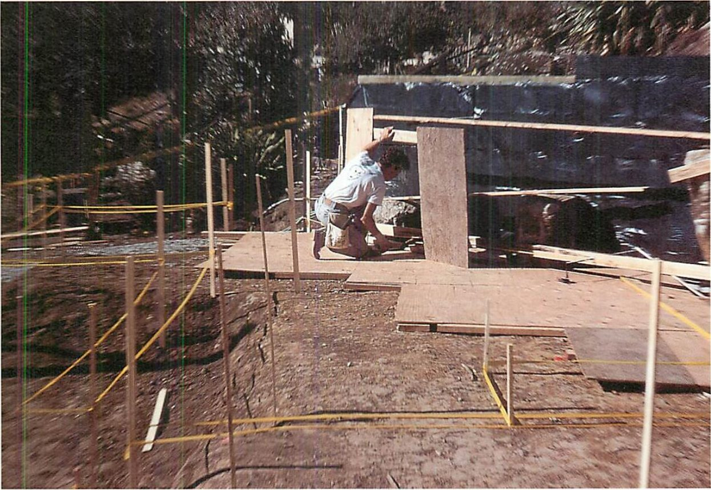

*We started to understand the position of the fireplace in the kitchen, and began making adjustments in its position. It was a situation where a foot in one direction or the other radically changed the feeling of connection between the kitchen and the big bay window eating area; and this fireplace was itself hampered in position by the back wall of the house, which was a major retaining wall that had to be built at the very start. Because the fireplace needed its own foundation, this position was critical very early on and had to be decided.* · p. 595

## 24. The lily tiles

There was a breathing space during the next few weeks. During this time, the building as it had developed so far now began allowing me to generate the character of certain ornaments.

While the work on the floorplan changes was going on, I started to think about other details that would affect the house. I had been enjoying the idea of making small tiles to put in the front foundation wall. The first sketches I made of these tiles were of a small black octagon, with a yellow, red, and lilac star on it. I sized it against a bit of real concrete, and then made a tile sample. It seemed rather crude. Then I started wondering if the form of the insert should be tall and delicate, not squat and hard like an octagon. When I had first seen the site, there had been several tall pink lilies growing there. They suggested lilies as ornaments which might decorate the lower part of the foundation: I started to <small>p. 597</small> imagine that the inserts might be lilies, also made of tile, but more realistic. The technical difficulty of making big clay lilies would have been formidable, but I pressed on anyway. I tried more mockups. Meanwhile, another version of the black octagon tile worked out better, with a delicate color, and began to feel right. I took it to the site to check its feeling.

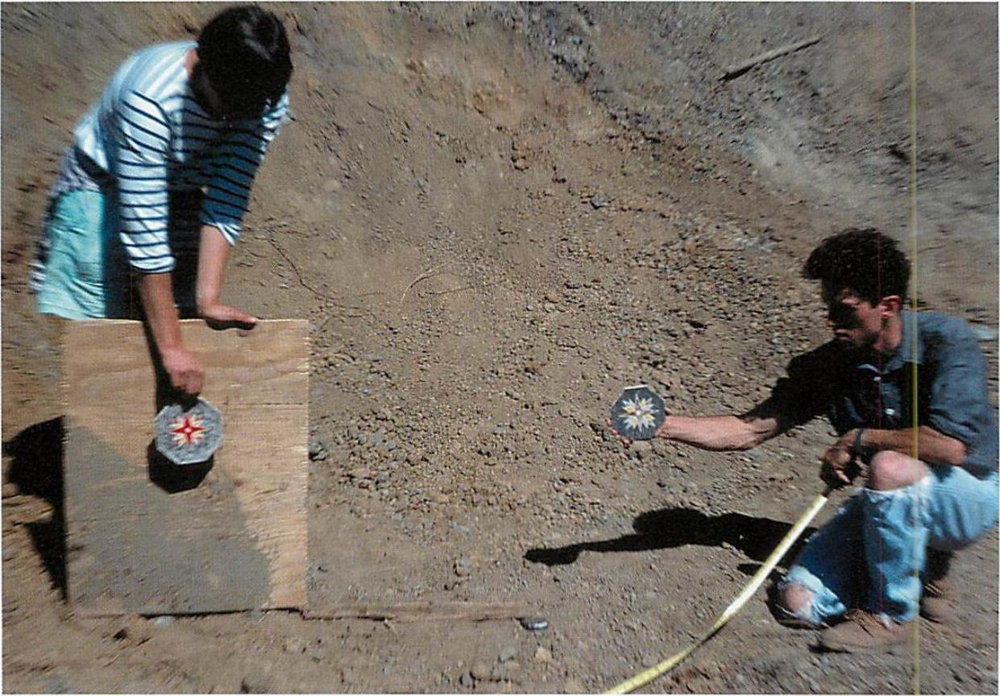

*Early experiments with an octagonal tile and a lily tile, to see which one fit better into the landscape and into the wholeness of the site* · p. 596

The tiny question, octagon with star or naturalistic lilies, as the ornaments for the front foundation wall was growing in importance. I was very much aware that the main rooms were not yet fixed: The spaces of living room and kitchen were crucial but not yet perfect at all. I had the odd, intuitive sense that getting clear about this small decorative tile — whether to go for the geometry of the octagon, or the organic character of the lily — would help establish the nature of the house and would then guide the evolution of larger questions about living room space and kitchen space.

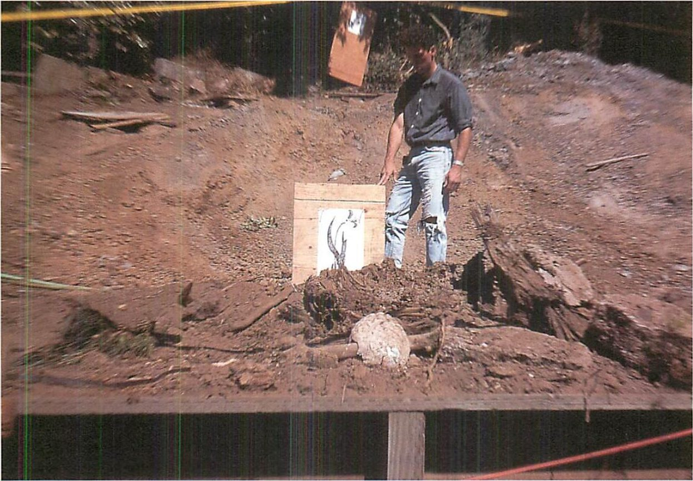

*Holding up a full-sized drawing of a lily, in the rough position on the site where it would occur, to see if it feels harmonious and fitting.* · p. 597

After a few weeks of reflection, the lily tiles were beginning to seem like the right thing to do, especially since the lilies themselves originated on that land. Randy and Lizabeth (my assistants) and I met on site to look at my first sketches of the lily tiles.<a href="#note-6" aria-label="Note 6">6</a> On site, the sketches were horrifying, too big, too gross. The big lily I <small>p. 598</small> had drawn on paper, about 18 inches high, did not in any sense feel harmonious with the land or with the house as we saw it or visualized its foundation. This feeling was clear, palpable. Also — a practical detail — we found out that the tiles couldn't be seen from the road — so whatever we put there would be seen only from close-to, from 10 or 15 feet from the house. Given that fact, the size of lily that felt natural was about seven inches high, not 18 inches as I had thought at first. We could feel, as we did experiments at four, five, seven, and nine inches, that the seven-inch lily was a natural continuation of what was there. All three of us saw this clearly and agreed.

*First painting of the final lily tile* · p. 597

On the other hand, the octagon I had already made did look beautiful. Color was vital to the place. One lily I drew on paper — a small watercolor — also looked very good. It was a red lily, green stem, sky-blue background. But after looking for a while, it seemed too sweet. Then we tried (one person held it up, while the others looked at it) a painting I had done of a red lily, with yellow spots, green leaves, blackish gray ground. This looked better.

We went back to my workshop and started making a three-dimensional lily in clay. The idea of a clay lily directly set in concrete which I had started with was not practical — I couldn't figure out how to attach so many pieces to the formwork. So I tried a small clay plaque, the size of the painting — only seven inches high, with the lily in relief within the plaque — and the idea that we could cast recesses in the concrete wall of the foundation to hold these plaques.

*Blossom tile: another early tile experiment* · p. 598

After looking at the first rough lily plaques tried by Randy and Lizabeth, I asked for the clay they were using and began a much more basic thing, in which negative and positive really worked (positive space). This meant rebuilding the whole lily design from scratch, as a low relief. It changed the design quite strongly. I played with the clay until its centers were more powerful (the leaves as centers, the space between leaves as centers, and the borders of the tile as centers). Then we made a plaster mold from the modeling clay, tried pulling a few clay tiles from the mold, and fired them. Meanwhile, a glazing sample began looking quite good, though a bit harsh compared with the subtle color of the octagon. I made many different color studies, on paper and with glazes, until the color of the tile began to feel right on the site. The one which had the deepest feeling was a striking color, with a red ground, purple surround, and yellow and orange glazes for the lily itself.

After a few days, we had eight of these lily tiles in a row and could see them on the site. We compared them with the octagon which I had still not given up completely. After thinking about it for six or seven days, I began to feel clearly that the lily was more true to the house than the octagon. The octagon was more elegant. But the lily had more of the real "original" feeling of the site.

From this, my knowledge of the emerging house took a huge jump. I saw the house changed. The unfolding had progressed not only in the emergence of this one detail, but in some subtle way that also changed feelings and qualities in the larger whole.

In effect, the size and color of the ornamental tiles unfolded from the size and character and spacing of the tile positions along the foundation wall.

<small>p. 599</small>

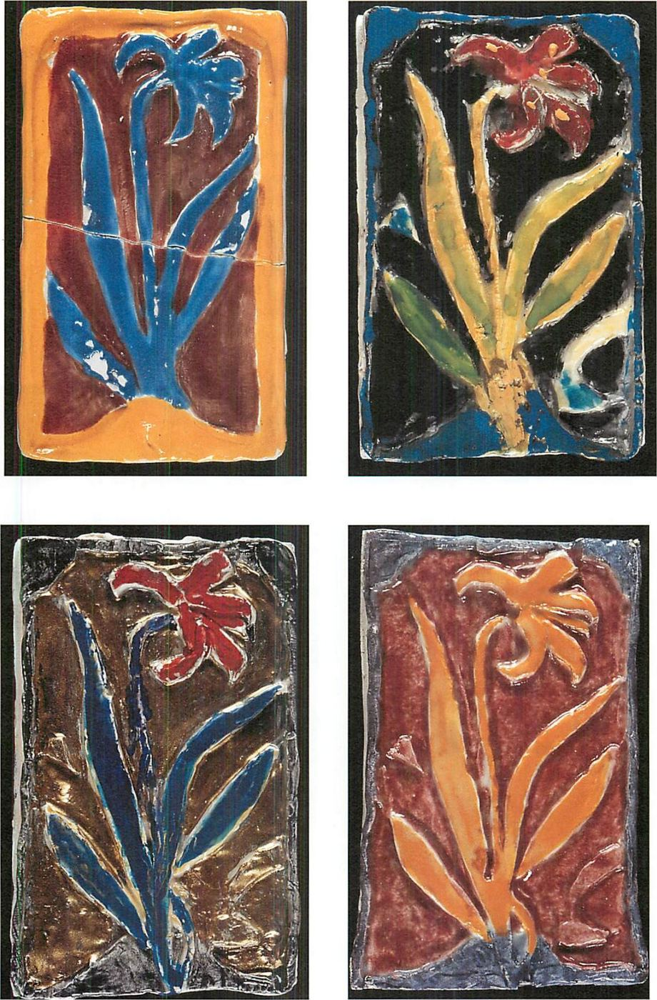

*Various hand-glazed lily tiles* · p. 599

## 25. Placing and fine-tuning first-floor rooms

<small>p. 600</small>

A month or two later, most of the foundations and slab were in. We could begin to visualize the house in earnest.

The essence of what we did now was to reform the rooms while standing on the newly poured slab, and give them their final shape according to what we experienced there.

Standing on the slab, we could see the wholeness, as it then was, of the ground floor of the house. We could sense, feel, the right way to divide this up into rooms. Even when they were roughly the same as the division we already had in mind on the drawings, we could now see *exactly* where to place each partition wall, because the space was real and each room could be felt — and then established — as a real center in its own right.

We laid the rooms out in chalk, on the slab. Several partitions moved a few inches. The main thing is that we did it in such a way as to make each room a beautiful and solid center in its own right, where we *felt* comfortable.

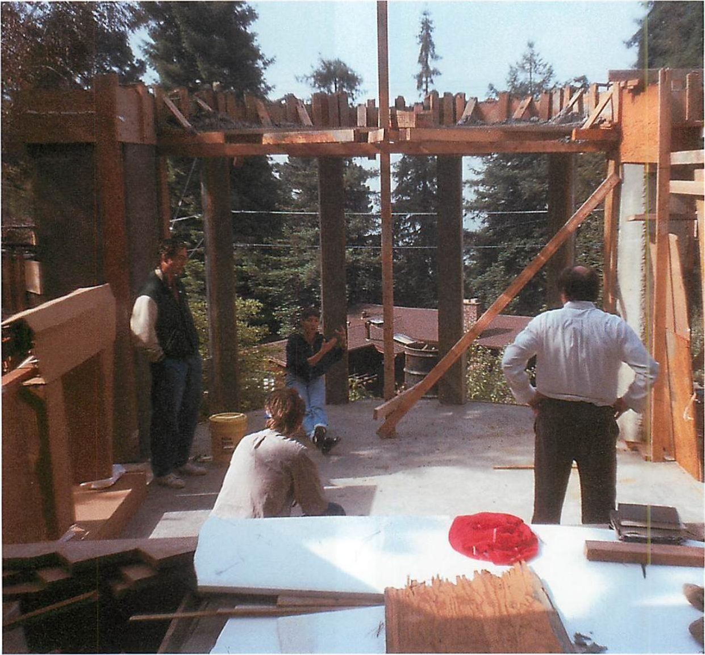

*Settling positions of columns, to form the bays and window openings of the living room bay window* · p. 600

## 26. Making and placing the first-floor wall

<small>p. 601</small>

From the new first-floor plan, with its rooms chalked out, we now went on to fix the columns and windows which would define the front wall of the house.

This front wall was the poured concrete wall which was going to determine the load-bearing structure and appearance of the house. We had already decided earlier (see pages 588–89) that the wall of the house was to consist of articulated columns, beams, panels, and windows within the panels.

The method we used to make the decisions was ingenious. We had worked it out so that we would use the actual plywood forms into which the column concrete would later be poured, as mock-up columns to play with during the decision-making stage.

I had asked Carl Lindberg, the man who did the major concrete work, to make the column forms in a way that each column form would be a loose, movable, plywood box roughly nine feet long, and about 12 by 12 inches. We had about fifteen of these boxes, ready-made. They were made so each contained offsets and flashings to form a waterproof joint where wall panels would later come into the column.

These column-form boxes were stacked on the slab. Each was stable enough, by itself, to be moved, carried, placed, and braced, wherever we wanted it.

The whole ground floor of the building thus had an amazingly simple and elegant way of being formed. To get the wall right, now that we had the final room divisions, we used the column <small>p. 602</small> forms themselves, moved the columns until we liked their positions (from both inside and outside) and then set and braced them accordingly.

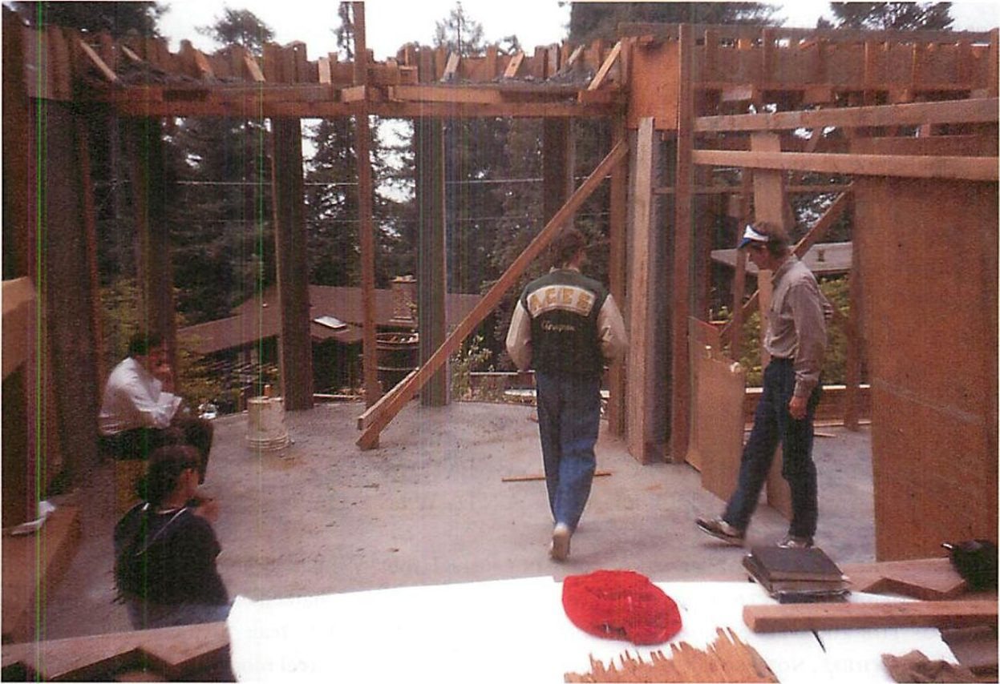

*Walking into the room, testing the position of the door, and trying to find out if the positive space of the bay window is large enough, when the door is in a certain position. We moved this door several times, and finally tuned it to within about two inches to get its best position.* · p. 601

---

Placing the columns, the most important thing was to recognize that the decisions about columns was, in effect, a decision about positions and sizes of windows.

Experience has taught me and all my crews that there is no foolproof way to decide window openings until one is standing in a room. In this house (given the column/beam construction) the rooms *could* not be there until the columns existed. But using the column forms as mockups gave us a way to break the vicious circle.

Each column form was a box. We had made these boxes, one for each column, and had them standing upright, but loose, on the slab. We had made them so they could be placed, moved, and adjusted, until the window openings were where we wanted them. Once we had them right, we connected them with horizontal 2 x 10's, which stabilized them, and could then be used as beam forms.

This was tremendously useful. It meant that we could stand in the main rooms of the house, adjust the column forms by eye, see how the windows had to be to make the room just right. Once we got it right, these forms were nailed in position, fixed, set with the horizontal members.

The steel was set, and within two or three days, the whole thing was ready to pour.

The design is such that the panels, corner panels, and the whole structure was prepared — and then poured — at the same time. When we were finished, and had the rooms just right, to our satisfaction, the position of panels and windows was quite different from the permission drawings we ourselves had made earlier. Not one room was the same.

We did one room at a time, placing the column-forms until the column positions and the shape and size of wall panels between the columns felt just right. We checked them from inside and outside until we were satisfied. Then we braced them, and tied them together with pairs of horizontal boards that would work as formwork for pouring concrete beams.

Thus we were able to move the columns around, by eye, using the column forms as if they were the columns themselves. When we were satisfied we stabilized them, and tied them together with beam forms. Then we placed the steel. Then poured the concrete. This technique allowed us to perform the unfolding just as it should be done. The larger configuration of the rooms created the context in which the exact position of the columns and column-bays as centers could be judged. The physical technique allowed it to be done, judged, and then set, without extra cost or time.

It was a nearly perfect embodiment of a natural unfolding process.

## 27. Fixing the living room: its door and fireplace and windows

During the process of placing column forms, the detailed centers which formed each of the first floor rooms came from what was there, not from the plan drawn on paper.

In order to get the first-floor centers right, we had to make very important decisions about the layout. We had a rough layout, obviously, in the floorplans chalked on the slab. But we had to make the centers real; that means we had to make them into real rooms, in three dimensions, with beautiful light.

We started with the living room, the most important room. In this room, the position of the <small>p. 603</small> fireplace, the detailed character of the big bay window, and the position of the door from the entry hall to the living room were most vital. The door from entry hall to kitchen also played a role. We needed to place the two doors so that they didn't exactly line up, but gave a nice partial view through. One wanted to be able to sense the kitchen from the living room, but not see into it directly. One also wanted to sense the fireplace of the living room as one entered the house: but still that fireplace and the big bay window had to be protected, so that once inside the living room it was a comfortable and cozy spot. That meant the living-room door had to be far enough back in the house so that the living room and its bay window area were protected, not uncomfortably exposed.

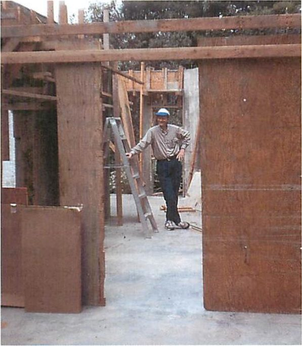

*Looking through the living-room door, towards the entrance room, to see what view of the front door is most comfortable* · p. 603

To get all this right, we made many experiments, using cardboard for mockups, and sitting <small>p. 604</small> around in a circle as if we were in the finished room. The fireplace (shown in the picture on page 603) is made of cardboard. We located that first, and gave it size and mass and dimension. Then we used cardboard walls to check and recheck the impact of the two door positions and the fireplace position, until we had them all just right.

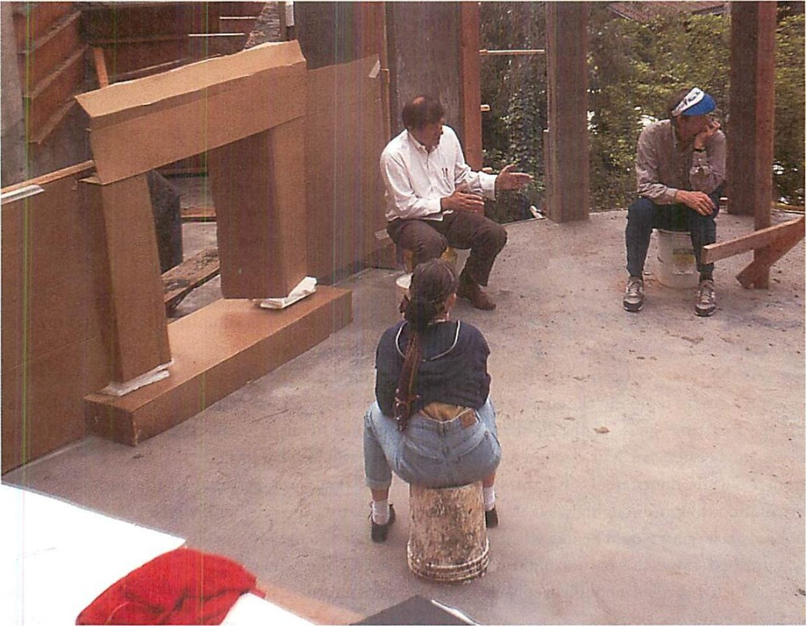

*Sitting in a circle to get the "feel" of the living room, and to find out exactly how to place the fireplace so that fireplace, bay window, and door are all comfortable* · p. 603

One of the rather surprising things which materialized from these experiments was the need for a row of small interior windows in the back wall of the living room, between the living room and the passage behind the living room.

Finally — and as it turned out, very significant in the finished room — we changed the five windows of the beautiful bay window. When we first tried placing the columns to make this window, using the assumption that all five parts were equal in size, we found that the window did not work so well. It did not have enough sense of focus. It was not, as much as I felt it could be, a living center. So, instead, I made the middle opening bigger than the others, then the openings next to the middle slightly smaller, and the openings on the outside smallest of all. We played with the proportions of the variation. Everyone checked it. It was much better. That is how we finally set the columns, and how the room is built.

## 28. Remaking other first-floor rooms

Once we had the light in the living room right, we went on to check the light in all the other first-floor rooms: entrance room, kitchen, and the two rooms at the eastern end of the house. The light coming into these rooms told us where, and how, and how big to make the windows in the front wall, and even made us modify plan, interior partitions, and boundaries of the major rooms.

Recall that we could not see the actual light as it would ultimately be in any of these cases. The ceilings of these rooms were not yet built, nor was the front wall complete. But, using the column forms to represent the columns, we could for the first time guess at the light that would come in, because we had enough information from real walls, floors, trees, sunlight, reflections, orientation, to sense roughly what the quality of light at each point would be like when the house was finished. It was this partial, but real information, which provided enough feedback to help us make good decisions.

The entrance room provides an example. We could now see that the light in the entrance room, if built as shown on the drawing, would have been catastrophic.

As usual, we started with a mockup that showed us what was on the drawings. In this case, using cardboard to close in walls, we could see that what was on the drawings was dank and awful. The room was unpleasant and far too dark. What was needed was obvious: a big window in the front wall, all around the door, so that the entrance room would be bathed in light.

But there was a difficult structural problem. On the design as submitted to the building department, we had placed a massive concrete moment-resisting frame in just that part of the exterior wall which formed the front of the entrance room. To make the entrance room light, we would have to take this away. But the shear resistance was essential to the building. It was just this one element which we originally intended to use for resistance to horizontal motion along the whole front of the house, especially critical there because this face of the house was mainly made of windows and openings. Something solid had to be there, somewhere. And to work, it had to be massive.

<small>p. 605</small>

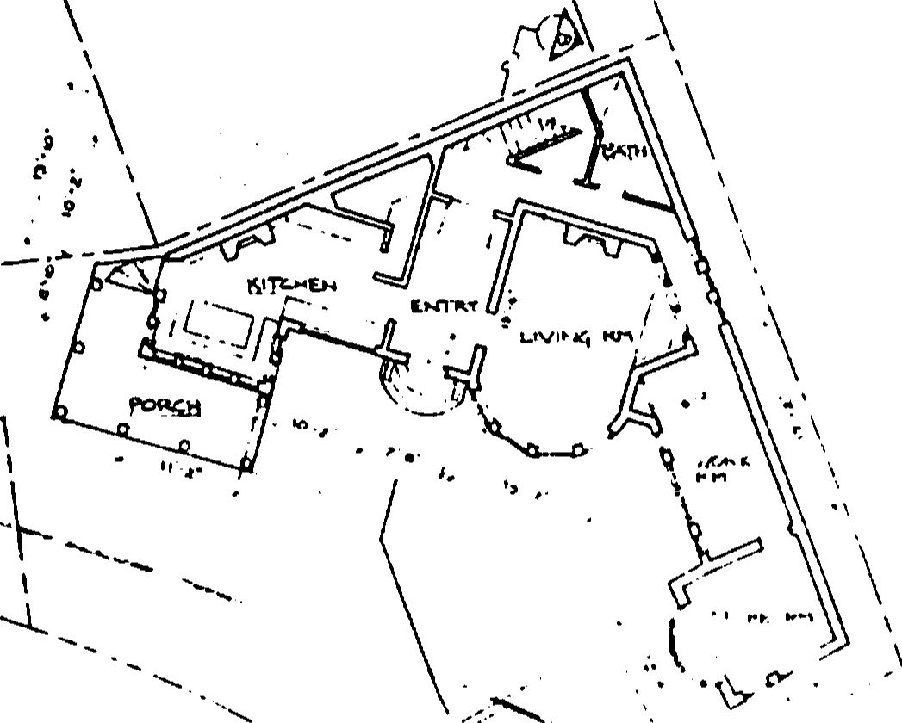

*First floor as drawn for submission to the city of Berkeley* · p. 605

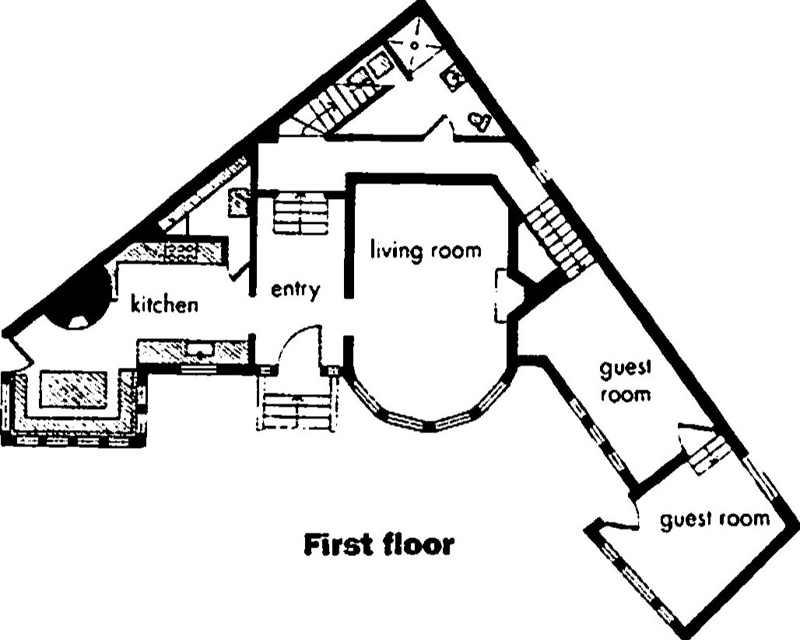

*First-floor plan as finally built* · p. 605

The anticipated forces were huge and could not easily be taken up elsewhere, since the whole front of the house had openings, doors and windows, all along its length. What to do?

Before trying to solve the problem we went on to the kitchen to see if there was any possible interaction which might help. In the drawings, we had the window above the kitchen counter huge and open. Standing in the room, this seemed far too big — almost grotesque. The kitchen needed containment, even a little darkness, to make the light spot in the big eating area at the western end of the room more attractive as the main center. So we set about sizing a much smaller window above the kitchen counter that would make the kitchen warmer, darker, and cozier and more contained.

So, suddenly, the solution of the shear problem fell into our hands. Since the kitchen window had to be smaller, we had room in the exterior wall for the extra columns and the very deep massive beam which the moment-resisting frame required, thus moving the shear-resisting element from entrance hall to kitchen. This needed some extra effort on computer runs, and a new drawing submitted to the building department, but we were able to solve it just nicely.

Things like this do not always happen. The shear-resistance problem caused by opening the entrance might not have been solved so easily. But then we would simply have done something else — some other drastic change — to make the entrance room come out right.

The big windows at the western end of the kitchen got modified too. We found out just what sill height was needed to create a sense of privacy. That was quite subtle. Also, we put in an extra window looking towards the front door, looking east. And we put a door leading out to the little plum tree.

The strange L-shape of the kitchen was complicated and needed a lot of work. We more or less got it right at this stage. It would finally be resolved, later, by the construction of the big cylindrical fireplace (see pages 612–13, below).

In the two rooms to the east, the plan changed completely.

The long thin room — Stephanie's workroom — had originally had a French window opening to the garden. This was absurd in practice. The room was too narrow. It needed to be contained. We replaced the French window with a bank of four windows that made the room feel usable, pleasant, and not too exposed.

And the last room, the square room which drops down, was also quite wrong. On the drawings, we had shown it with a bay window looking out over the garage. This bay window seemed to be overdoing it entirely. And besides, one really didn't want to orient quite like that. We replaced <small>p. 606</small> it with a simple wall with windows, making the room square. It is now one of the nicest rooms in the house. And from the side, in an insignificant corner, we put a narrow French window out to the terrace, to make up for the one we had removed from the long thin room.

Finally, the back of the entrance room also had to be adjusted. To make the room have a beautiful shape, the way it narrowed to a neck, and then a landing, before reaching the bottom of the main stairs, was — in reality — entirely different from what we had shown on the plans. We had simply not been able to grasp the impact of the three-dimensional intersection of stair, entrance, passage, and walls, coupled with the change in floor levels. Being three-dimensional, it *could* be grasped only in the actual situation.

Every one of the five main rooms on the first floor changed fundamentally during this process. The position of walls changed. The spacing of windows changed. The positions of doors to the outside, the position of doors to the inside, the relative integrity of different centers in different rooms, *all changed*. If we had built the rooms that were on the plans, the house would have been all right, but barely acceptable — perhaps acceptable within the terms of reference of contemporary modern architecture, because this has become the acceptable level of what people get — but not acceptable in the true sense of something working well and being comfortable and beautiful.

The life which is now visible in the finished house as we built it simply would not have been achievable if we had followed the drawings. It came about only because we could see what we were doing in the actual situation, respond to it, change it, and make it live.

## 29. Completing the first-floor structure

When these decisions had been made, work went ahead to fix and brace all the columns, form the beams, pour the concrete structure. The structure was then ready to receive the second-floor framing.

As we began the second floor framing, one could begin to see the entire exterior volume of the building. This made it possible for the first time to take in the building as a whole, and to pay attention to qualities which were needed to complete this whole.

## 30. Pouring and forming the garage

Suddenly one day I got a call from Carl Lindberg, asking me to come to the site. I went up; he was just forming the garage walls in the lower right-hand corner of the site.

He wanted to get it in fast, so the upper part wouldn't collapse: As he started forming, he realized there were several open questions, unresolved by whatever sketches existed at that moment.

In order to form the garage roof concrete work, Carl had to know the final level of the terrace which will be above the garage. We had never decided it. The big issue was that it felt uncomfortable if low — because if it was too far below the house, it would not be used or usable. On the other hand, if it was high, several feet of earth would be required above the roof, resulting in a huge weight on the garage roof slab. <small>p. 607</small> Or the garage could have a high ceiling, which would be very uncomfortable in feeling.

In addition, we had to check the appearance of the house from the southeastern end of the street. I had never done this before. It was vital that the structure of the garage plus terrace as seen from that end not be too high; otherwise, it would intrude on the house and look too huge and formidable.

We settled for a low ceiling in the garage, a thick slab to take a big weight, and several feet of earth on top, thus bringing the terrace to a nice position for the house.

Finally, we shaped columns and brackets, and flared entry walls, to make the entrance to the garage a strong center. Mockups to decide the shape of the concrete work. Cardboard cut-outs. The thing was heavy, very nice. Massive. Built after making the cardboard shapes.

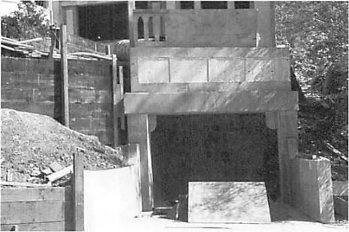

*Formwork on the massive concrete brackets which frame the garage* · p. 607

## 31. Getting the entrance path just right

The nagging problem with the entrance stairway still existed.

From the very beginning of the project, I had been wondering how to climb up the hill, from the left of the garage, to get to the front door. At an early stage of the project, I had assumed I knew how it went (from the left of the garage more or less straight to the front door), and had Randy place rough working mockup stairs in those positions, so that we could try walking up and down that path. It was never very comfortable. More recently, with the trench open for the gas and electric lines, Carl had built a rough stair going absolutely straight up to the left of the garage (photo page 608). This also was very unsatisfactory. It was far too steep, abrupt, and rather unpleasant.

Just before pouring the top retaining walls to form the terrace over the garage, we had to make a decision. None of the paths we had looked at seemed pleasant or graceful.

The one path which had always been pleasant — for everyone — was the forbidden one, which went on the neighbor's land at the left end of the lot. Recently, she had locked her gate because our crews going in and out disturbed her — quite reasonable. But still, if we wanted to sneak in by the most comfortable route, that was the way to go.

I had tried to prevent myself, and our men, from going that way, so that we could experience <small>p. 608</small> the real options and get a feeling from the actual process of walking which ones were most pleasant.

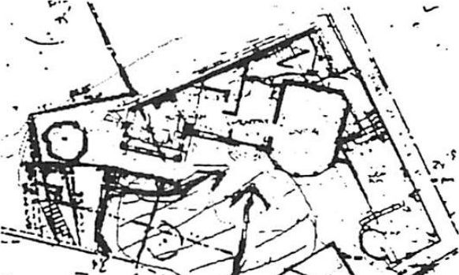

*Two paths from the garage to the front door: The right-hand one crosses and destroys the positive space: the left-hand one goes around it and leaves the positive space intact. The garage is visible lower right. Hatching shows positive space.* · p. 607

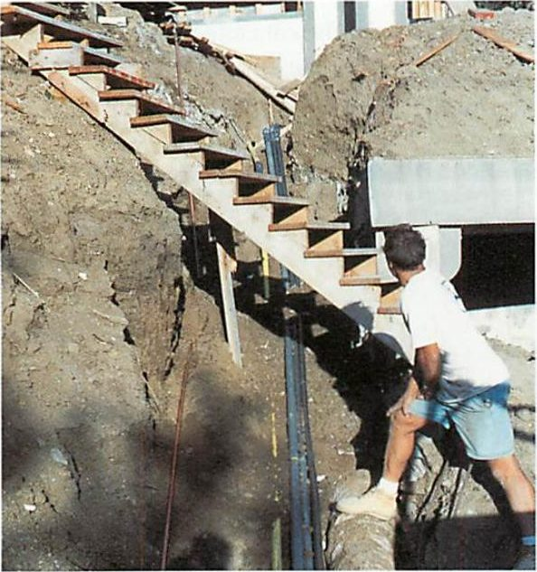

*As planned, and tested: entry at the right of the site, direct from the garage.* · p. 608

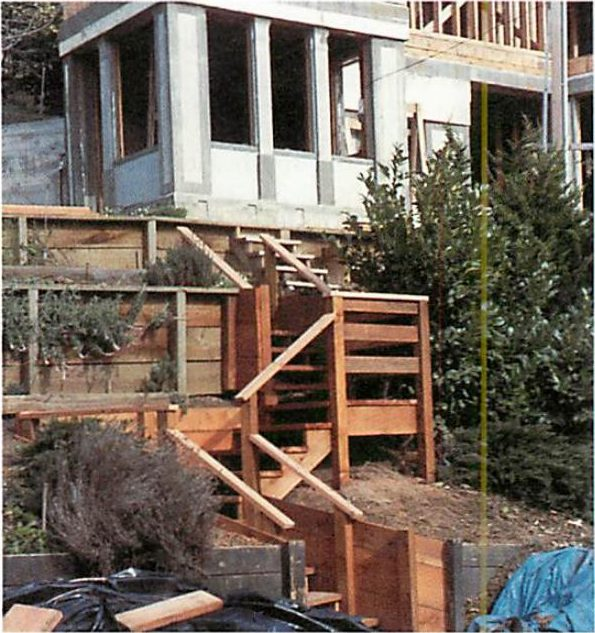

*As finally built: entry at the left-hand end of the site, then entering past the kitchen.* · p. 608

But now, faced with the need to make a decision, it was this path, over to the extreme left, which seemed the only one that had a really comfortable quality. We were able to try a second path, not on the neighbor's land, but along the property line. We tried it, made a few tests. When we were sure, I called Chris and talked it over with him and Stephanie. They were quite comfortable about it, too — to my surprise. As it turned out, the conventional idea that the entrance must be near the garage meant very little to them. So the problem was solved. Randy began to build the stair (see photo). The only thing that we had to overcome was our own assumption that there would be something wrong if the path did not go directly from the garage.

One might say that it was positive space which helped us to get this right. The space formed by the stairs going across the chasm near the garage was never positive. What we finally understood was equivalent to understanding that the only way to make this space positive was to treat it as a single inviolate lump of space, not to be cut by a stairway. The stairs then, instead, encircled the bushes and the main front part of the site, instead of crossing them, and so made the space and the system positive.

## 32. Remaking the upstairs rooms

We were now able to stand in the upstairs, with an open floor and exterior walls given by the rough framing operation.

Framing the upstairs was, in our contract, divided into two operations: rough framing, which was to go very fast and cheap, and finish framing, which was to be slow to allow for subtle adjustments to partitions, windows, and doors. We gave the finish-framing contract to James Maguire, one of our own most trusted people.

I had James construct rough mockups of the partitions, as shown on the plan, so that we could <small>p. 609</small> see them. Many aspects of the space which they created were surprising, even shocking. Because of the way the walls were placed, the whole upstairs seemed tiny — not right at all for such a large house — almost as if the Uphams weren't getting their money's worth — but in any case, definitely wrong in feeling.

Also, there was nothing really beautiful up there. Just a bunch of rooms. I decided to spend a few days letting the problem sink in.

The most crucial thing to get right was the beauty and shape of the main bedroom. I tried to imagine what would make this room beautiful, especially in relation to the terrace outside. I got a clear sense of its shape, with a big bed alcove and windows to the south and east. Then other things fell into place. The terrace had to be a little smaller, and the light on the terrace was amazingly harsh. We decided to extend the roof overhang, to give more shelter there and make the light softer. The space at the top of the stairs was given a more beautiful shape. I reshaped the end of the bedroom so that it formed an octagonal shape that made sense with the door from the stairs. The bathroom was placed in the leftover triangular space, at the top of the stairway.

Now that the main room was beautiful, with its own shape, and coming nicely off the passage from the top of the stairs — that was the thing which brought the upstairs into a good state (strong centers, good shape). I could now put a bed alcove opening off the main room. Chris's study was also in a totally different relation to the master bedroom, and to this alcove. And the bathroom was now in a totally different position.

It should be emphasized that, just like the downstairs, the arrangement of rooms on the second-floor level changed completely once we began looking at the real space in three dimensions. The main bedroom was entirely different. The bathroom was in a different place. The toilet <small>p. 610</small> was in a different place. The main terrace off the master bed alcove was different in character, and even the wall bounding it was moved. The bed alcove was entirely new. Chris's study was to be approached in a different fashion. The stairs and the stairwell and landing were all new. As a result of our work on the second floor, the plan had become totally different, in almost every single room layout, from the way it appears on the permit drawings — all except Sasha's room, which, being in a wing by itself, stayed more or less the same.

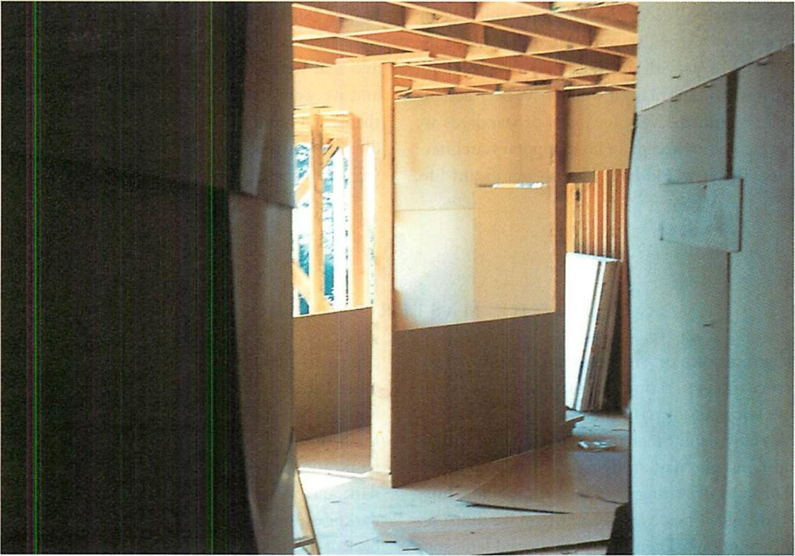

*The upstairs after rough framing, and before new decisions were made. The cardboard walls and mocked-up partitions showed us clearly just how bad it was.* · p. 609

Again, as with the first floor, if we had built what was on the plans it would have been acceptable, within the very low level of standards we have come to accept in contemporary architecture. But it would have had no significant life, because it would have contained no significant centers. They were not visible, or, I believe, even imaginable at the time we laid out the plans on paper.

On the left is the plan as drawn and as submitted to the building department. On the right is the plan as actually built. Almost nothing is similar.

*Upstairs plan as drawn for building permit* · p. 610

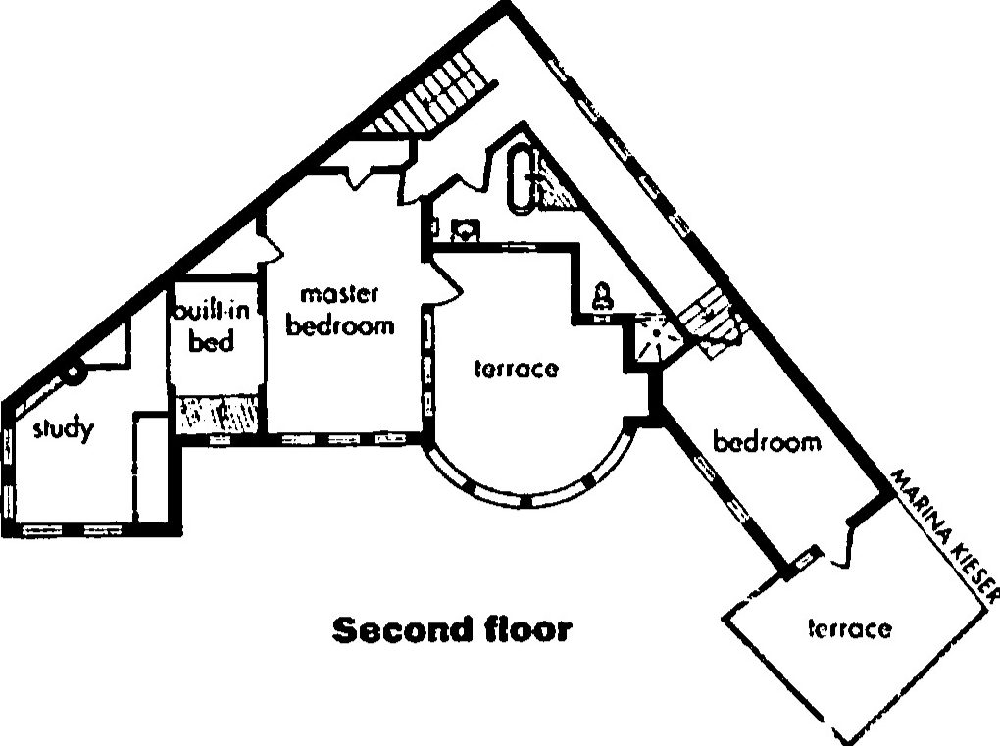

*Upstairs plan as finally built* · p. 610

The significant life which the house now has, as built, comes about entirely because we were free to feel the centers that were needed and that were latent in the emerging structure, and we were then free to conceive them, refine them, and build them, all within the real three-dimensional space of the building envelope while we were constructing it.

## 33. The master bed alcove

Perhaps one of the most charming things that happened during the project was the decision about the master bed alcove.

Chris and Stephanie were standing with us upstairs, one day, studying their bedroom. We had a way of getting from the bedroom to Chris's study, but it made a passage where we didn't really want one. Then Chris mentioned Jefferson's bed at Monticello — a bed which was the only path to get to his study — and wondered if this approach might work for him. At first I dismissed it as a charming but nutty idea. Later, however, we made a mockup of the bed alcove in the bedroom. The alcove was beautiful as far as its position was concerned; but it left the room dark and it was dark itself. I had to clear the darkness away. To do it, I just kicked out the back of the mockup. Suddenly the light changed, the room was filled with light, the light came streaming in from Chris's study beyond, and the <small>p. 611</small> annoying passage that had been ruining things was gone.

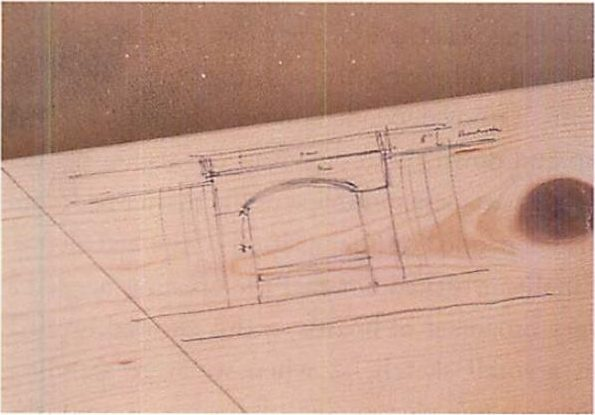

*Bed alcove as I first drew it on a plank of wood that was lying there* · p. 611

This was really a stroke — coming entirely from Chris's original idea. I called him to tell him about it. Now *he* got nervous. Couldn't we make a passage. Would it really work, to get into his study, only by crawling across the bed. I asked him, joking, if he had any women clients. He joked back that that was probably the reason why <small>p. 612</small> Jefferson built his bed at Monticello that way originally. Finally, after a lot of hemming and hawing, Chris agreed to do it: a wonderful stroke, which makes the upstairs of the house beautiful, just right, and very sensible; filled with light, it is an inspiration to be there.

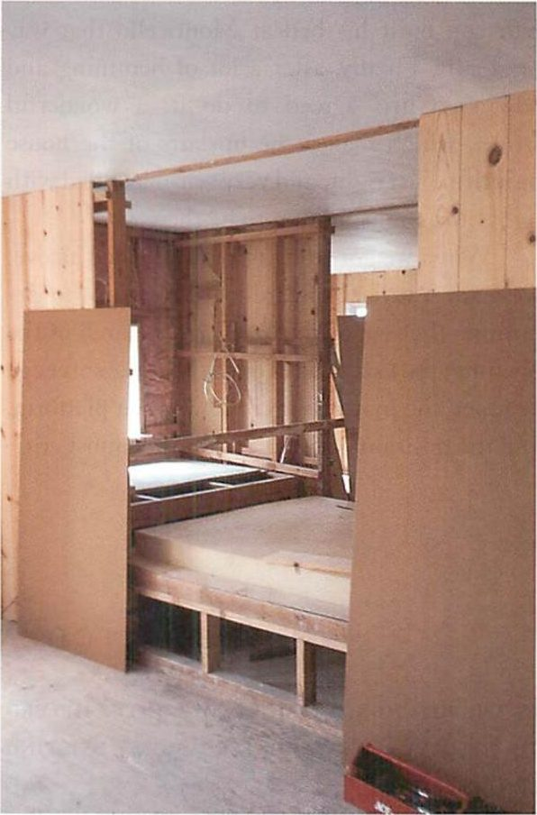

*Setting the position of the bed-alcove opening in the room* · p. 611

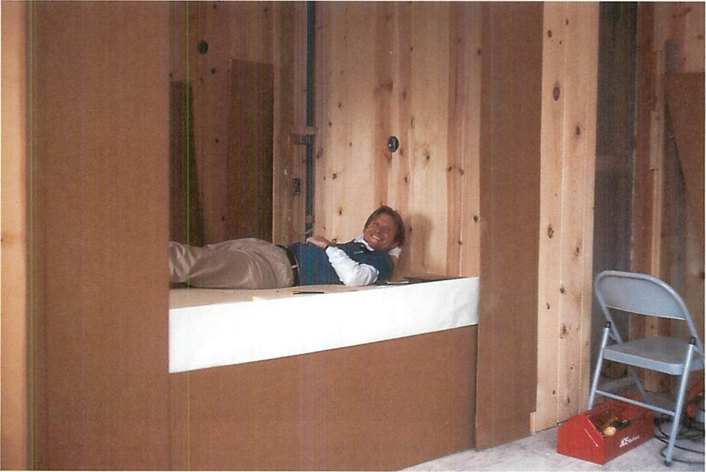

*Checking the feeling of the master bed alcove, from inside and out* · p. 611

When we got ready to build the bed alcove, we made a variety of cardboard mockups to determine the size of the opening, the arch of the opening, the exact width of the bed, the soft edge between the mattress and the wooden platform, and the position of lights inside. The most critical thing was the exact position of the alcove in the wall. The view through the bed alcove into Chris's study depended on very slight movement up and down the room. And the strengthening of the part-octagon shape of the master bedroom also depended on the position of the bed alcove. Finally, it turned out that the opening needed a very broad set of boards — this showed up first in a small sketch, as when we were standing there a too narrow set of boards around the opening looked funny. The wide boards gave the bed its proper weight.

## 34. The kitchen fireplace shape

In the kitchen, a major new center helped to resolve awkwardness among existing centers.

We came to the kitchen fireplace. The Uphams had told us they wanted to bake pizza in it, every night. That made sense. It became a kind of oven. All along, the kitchen had had a strange and awkward L-shape, already discussed earlier. I looked and looked, what to do, but couldn't make it just right. To resolve the two <small>p. 613</small> parts of the room — to keep them separate, and yet unite them — it occurred to me, after looking and looking and looking, that a single great cylinder would have a relation to both and yet would give each one a better shape by itself. This sounded crazy, but when we made a small plasticine model of a cylindrical fireplace it looked rather good.

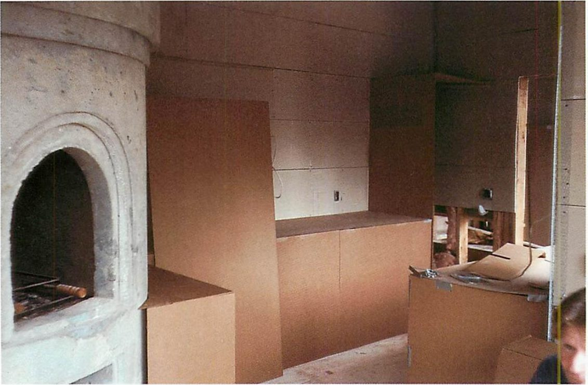

*The kitchen mocked up in its entirety in cardboard, so we could see just how to make the kitchen fireplace. The idea of a cylinder had already occurred to me from seeing the room shape and recognizing its two lines of sight. Now we had to make the cylinder work, and to do that we had to have the full three-dimensional configuration, as it was going to be. We had to make many many versions before it all sat right.* · p. 612

To check it, we built the fireplace in cardboard, in the room itself, with all the kitchen cabinets (coming later) in cardboard too, so we could judge how calm and simple it would be possible to make it.

It worked.

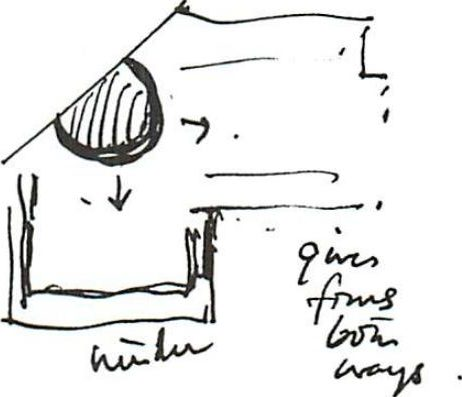

*Position of kitchen fireplace as a cylinder: It gives a focus to both parts of the room, separates them, and joins them.* · p. 613

## 35. The kitchen floor

The next centers, to support the kitchen, were centers made in the floor.

We always had intended to build one of our terrazzo floors in the kitchen. To make the cost of it feasible, we were going to do the styrofoam work (where the pattern gets set) with help from apprentices. We would place the marble dust professionally. Chris Upham himself was then going to grind the floor.

Stephanie mentioned her hope for green and red and yellow. That night, I made a small sketch of red, yellow, and green triangles. Shawn Bradbury, then one of my apprentices, made full size paintings to check the color in position. It worked very well. We settled the scale. Finding the exact colors for the green, red, and yellow wasn't so easy.

The rest was just hard work.

But after all the color effort, when it came to the actual placing of the material, we had the wrong mix for the green. The green came out too dark. It ruined the design. Randy did dozens of experiments to get a sealer which made the green lighter. He then painstakingly applied that special lightening sealer to all the green triangles (several hundred of them); this brought the balance back, and it works fairly well.

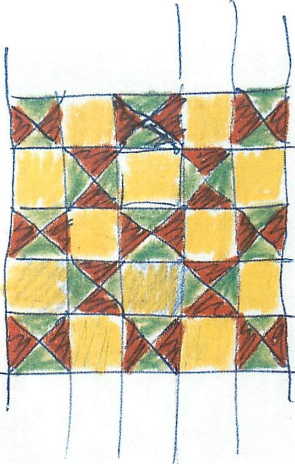

*My first colored sketch of the floor design: red, green, and yellow* · p. 613

<small>p. 614</small>

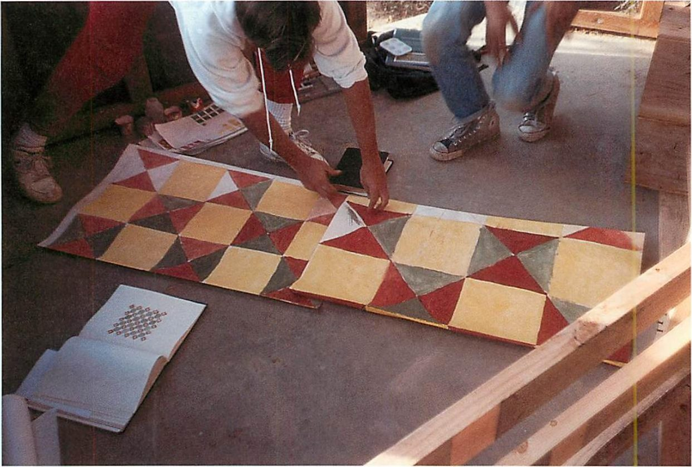

*Three colored mockups on butcher's paper, to try on the floor of the actual room in order to determine the best scale for the floor pattern* · p. 614

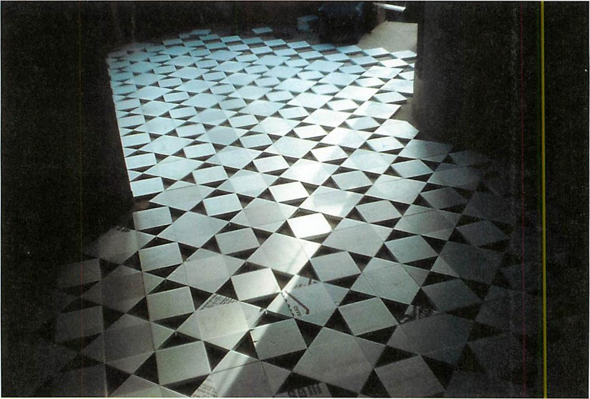

*Styrofoam forms from the making of the kitchen floor, in prepration for the first colored terrazzo to be poured into the voids between the pieces of styrofoam (white)* · p. 614

## 36. Plasterwork

<small>p. 615</small>

Now we prepared to make centers, thousands of them, in the plasterwork of the living room.

My first idea for the plasterwork panel design had been a pattern of tiny leaves. It had a comfortable organic quality. Randy made a beautiful mockup by casting plaster over a form made of relief built up from thin paper, and we then installed two or three panels in the room to look at them. Physically, they were lovely. Everyone liked the leaf design.

However, there was an uneasiness in me, a feeling that the leaf designs were pretty, but not substantial enough, too formless. Truthfully, because the space between the leaves wasn't very good, there were not many living centers in the design. I felt afraid that they did not have enough lasting power to make the room really good.

I asked Randy to make another, very geometric, pattern which was something like a basket pattern, tiny strips crisscrossing in low relief. It was colder, and more formal. It had more strong centers. But it was also less pleasant.

When I first showed the two to our clients, they chose the pretty one, the one with the leaves. But this did not make my uneasiness go away.

I asked them to spend an hour, first sitting for half an hour with the leaf design, then sitting for half an hour with the geometric design, in both cases paying attention to the life and wholesomeness they felt in themselves while sitting in the room.

Faced with that question, and the staying power of the pattern, all of us came to the same conclusion. The leaf design was the more trivial. It did not sustain a feeling of wholesomeness in any of us as strongly as the geometric basket design. We chose the basket design.

Then we had to decide the arrangement of the panels in the room. We kept going back and forth between real full-size castings, fixing them and making paper mockups, in the room, until the whole room became still and comfortable.

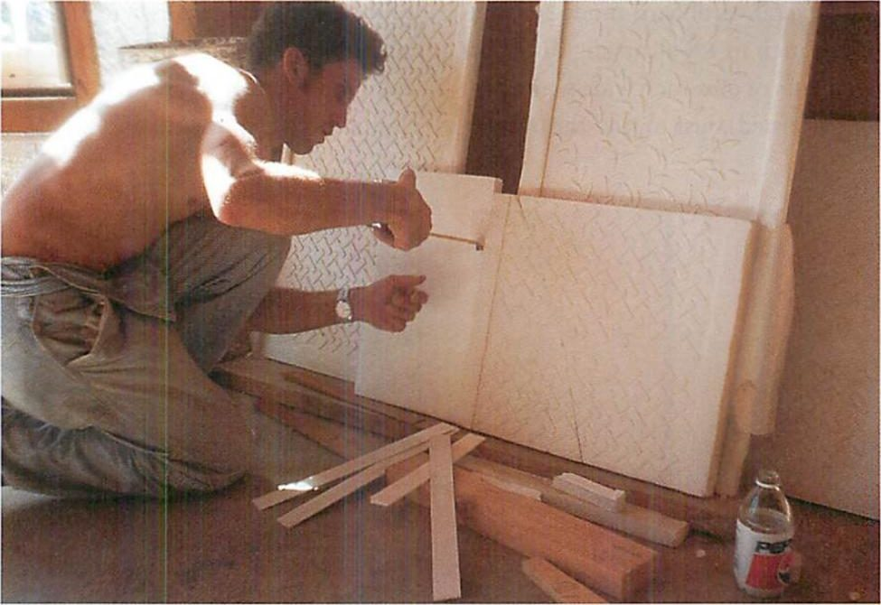

*Randy checking widths and details of the edge band on the plaster panels. On these panels, it turned out that a difference among one-eighth, one-quarter, and three-eighths of an inch was of tremendous significance.* · p. 615

<small>p. 616</small>

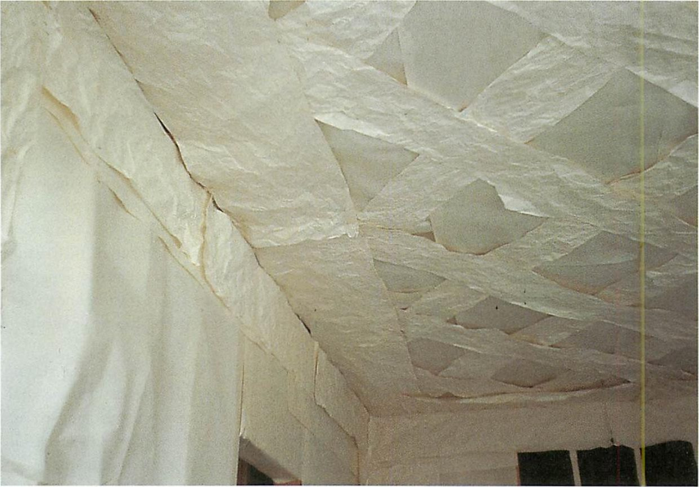

*Mockup in paper to test the overall pattern of the plaster panels on the ceiling. This part concentrates on the edge, where the width of the panels had to be chosen very carefully, to get a proper harmony.* · p. 616

During this process I found out, to my surprise, that the *overall* pattern of cast panel strips in the room was the most crucial thing of all. We therefore made several cardboard models of the room interior at 1 inch to 1 foot, trying different overall arrangements of one-inch wide white paper strips (not patterned), just to find the overall arrangement of the strips in the room that made the room most beautiful.

We ended up with wood panelling below waist height on the walls, a regular array of vertical patterned plaster strips above waist height, about 4 or 5 feet apart, with areas of smooth plaster between them, and a basketweave of <small>p. 617</small> raised patterned strips in the ceiling, with flower medallions at the intersections of the strips. All the patterned strips had the same geometric miniature basketweave design in low relief, cast from a mold that we ourselves made in balsa wood.

*Plaster panels with the basket pattern and the leaf pattern placed in the living room, so we could compare the feeling each one created in that room* · p. 616

*Trying the size and weight of one of the versions of the rosettes to go in the middle of the ceiling panels* · p. 616

*Another view, looking at the middle of the ceiling* · p. 617

All this had to be done now, before the house was closed in or windows installed, to allow us the lead-time necessary to make the plaster panels in advance.

We made them in our own workshops.

## 37. Window openings and windows

About this time, it came time to decide the detailed window designs.

At the time of framing, window openings had been made specifically for each room. Now we had to look at the actual window design itself: the arrangement of lights, mullions, and glazing bars for each window and door.

In my experience, this is always torture. It seems easy, but is actually hellishly hard. We usually do it with surveyor's tape, pinned or stapled to the window frames, so we can look at the effect of different patterns on the building, from inside and out. It takes days, sometimes even weeks.

The Upham house was no exception. We worked at it for several days, always looking at each room from the inside (that is usually the easier part), and then looking at the building as a whole from the outside. That is the hard part. Each room has its own demands, and tells you what the windows should be like, from the inside. In a complex building, it is very hard to get <small>p. 618</small> this pattern of window panes which make each room just right from the inside, yet let all the windows work together comfortably to make the building harmonious as a whole.

*Before ordering windows, we made cardboard mockups of the glazing bar and pane layout in every window in the house, and examined them from inside for their effect on the room, and from outside for their effect on the street* · p. 618

In this house, the big living room windows formed a kind of anchor point. With many, many lights in those windows, everything else had to go into the background, to fit in harmoniously.

The trick, finally, was to get things to a point where levels of scale was working as the dominant feature of the different windows, all working together as a whole.

*The combination of windows in the finished house, as some of them looked from the outside. The frieze and balustrade completed* · p. 618

<small>p. 619</small>

*Cardboard mockup to test the size and distribution of glazing bars in the windows of the living room. This was about the fifth version: it took that long to get it just right.* · p. 619

*Close-up of living room windows after installation* · p. 619

## 38. Balustrades of the upstairs balconies and the concrete frieze

<small>p. 620</small>

*Comparing the star-octagon frieze design with the lily frieze design* · p. 620

The house itself, in rather unexpected ways, defined the geometric ornament of the concrete frieze.

It came time to form and pour the frieze. Originally, I had assumed it would be a star-octagon design. That idea came from the very first mockups in our yard. So we started with a new mockup of the original frieze, on site, made in styrofoam. It didn't look quite right. I asked Randy to make it deeper, to change the size of the octagons. None of it seemed quite right.

Then we tried an entirely different frieze design, reflecting the lily tiles in the base of the house. We made long pieces of this new frieze. It looked silly, too decorative, not calm enough — pretentious, not simple.

In the end, we went back to the simple star-octagon design, but smaller, a scale which left the building alone and a deeper cut for the relief, so that the design was more definite, more blockish, more calm. In this case, good shape emerged from the unfolding process.

*A test of the lily frieze design with the balustrade design: This design didn't work at all.* · p. 620

## 39. Front door steps

<small>p. 621</small>

*Using a simple board to judge the height, width, and length of a concrete parapet which was to be built on both sides of the concrete front door steps* · p. 621

The front door step edges emerged naturally from what had gone before.

We had gradually built up an assumption in our minds that there would be a beautiful concrete stair leading up to the front door, but had never thought about the form it would take, what it needed to be like in detail.

Instead of drawing, it was easiest and most effective to hold up a board, showing the position of a wall that would contain the steps on either side. In twenty minutes I suggested a few key details. We looked at the steps in a mockup of concrete blocks and cardboard. The width of the top was an issue. The way the bottom tread worked, whether it was straight or splayed out. The information from these experiments was given to Randy, who then formed and built the steps.

They were built very quickly, with not too much thought, beyond that one day's work.

## 40. Painting windows and exterior woodwork

Originally the house was going to be yellow above and gray below. Indeed, I first made the lily tiles with this color scheme in mind, with an awareness of the yellow quality that was going to exist on the site.

However, once we had the house up, the concrete formed, the upper plaster in place, and the windows primed, the gray and white was so beautiful that painting the upper wall yellow seemed altogether wrong. Separately, Chris and Stephanie, different craftsmen on the project, <small>p. 622</small> and I all came to the conclusion that it was best as it was, and should be left alone.

But we had forgotten the lily tiles. When the tiles went in, it became clear that the house was no longer harmonious with them in that gray state. I had made a mistake and should have installed them months before, so that the house could grow around them, harmoniously. In fact, when it finally came time to put them in, I was afraid and didn't want to look at them; I felt sure that the house had grown away from them. In fact, it had. Luckily, not to a to drastic extent.

*A lily-tile in the stem wall of the foundation* · p. 622

*One of the small balconies* · p. 622

To make a correction, after the tiles had been installed, I realized that the colors of the windows had to change from the cream-white we had begun to be attached to, towards a color that reflected the tones of the lily tiles: red and yellow. Stephanie herself — a textile designer — made a big contribution here. I went to look at some window samples Stephanie had painted. There was a deep red and some very bright yellows, even two greens. I was rather shocked at this boldness and asked if I could take a little more time, to find colors that were more subdued. I began experimenting with pale yellow, bright enough to sparkle in the gray — just as the white was doing, but less cold.

Once the lily tiles were all in, however, the situation changed dramatically. Suddenly the deep red and the bright yellows seemed right, not too bright, even sensible.

I asked Bob Walsh, one of my apprentices, who was an expert professional painter, to mix some samples which were in the range of the red and yellow in the tiles — a slightly reddish yellow, and a subdued red of some kind. He quickly found just the right red, bright, but soft. I could see that it was right. I began trying to find a way of painting the windows, which might have a red *and* a yellow together, without being too bright and silly. One on the sash, and one on the frame, or a hairline of one, with the other.

## 41. Flowers in the garden

<small>p. 623</small>

Flowers and flower beds were soon planted.

Even before the house was finished, we began building flower beds. Chris and Stephanie filled them with flowers. These flowers were so lovely and so successful that when we came to build the main balustrade along the front edge of the terrace, I thought that the balustrade itself should be a long flower box, which could be filled with earth and planted. That is, indeed, how we made the base of the balustrade: a long flower box, gently curving, poured in concrete. When the carpenters first made the forms, the straight lines were distracting, too severe. I asked them to curve them gently, so that the line of the base followed the lay of the land more easily.

*Flowers in the garden* · p. 623

## 42. Use of the fundamental process

<small>p. 624</small>

In all the processes I have described in this chapter — whether in discussion with the client, during early design or later design, or during construction — the very same process was taking place. The building and its wholeness were unfolding, step by step. In one fashion or another, we were using something like the fundamental process, again and again, to try and get good results.

At each step, we asked ourselves what could be done next to have the *biggest* and most positive impact on the wholeness of the emerging site considered *as a whole*. We asked this question, did our best to arrive at the answer, and did the necessary and appropriate thing to have this effect. And at each step, our answer to that question was, in some form, "the creation of other living centers." Hundreds of times, we created new centers and tried to give them as much life as possible. The centers we created were large, small, tiny. They occurred at different scales, all over the building. But this much is common every time: We were always creating some living center which was, as far as we could manage, intense in its life. At each step, we were trying to create just those next centers which did the most, in our judgment, to make the house — indoors as well as out — together with the site and neighborhood, come to life as a whole.<a href="#note-7" aria-label="Note 7">7</a>

*On the living room table: a vase of flowers from the garden* · p. 624

<small>p. 625</small>

*The finished entrance hall* · p. 625

<small>p. 626</small>

*The kitchen in use* · p. 626

## 43. Common sense: an overview of the process

You might say that this is all just common sense. I believe you would be right. But this common sense flies in the face of many processes which 20th-century architecture and construction practice set in place.

When we try to make a building in such a way that it gets its life, what we have done here is the most natural way to do it: We get one thing right at a time. We do what we know. We get things right as we come to understand them. That gets good results.

Expressed in the formal language of this book, what has been described is not merely common sense. It is a process of unfolding, in which centers are established, modified, improved, one at a time. It respects the step-by-step unfolding of the field of centers. Each new center is born, then, as a result of the previously existing wholeness.

All this is common sense. Yet, oddly, this common-sense process, which is also a correct unfolding process according to the analysis of this book, flies in the face of current practice. Although it does leave a few features of the mainstream contemporary architectural process intact, it also requires revolutionary changes in procedure.

In practical terms, the processes for this house included a great variety of different operations, from the beginning to the end, that are different from present-day forms of architectural and construction practice. This included steps that were unusual in sequence: <small>p. 627</small> for example, the idea of making the building volume before knowing what is in the building, and the idea of placing the outdoor space before the building. Throughout, the project included a very different approach to the use of drawings, and to the relation of drawings to the permit process, and to the construction contract.<a href="#note-8" aria-label="Note 8">8</a> Differences in on-site operations, during construction, for example, cardboard mockups, full size, of various building details. Others changes of process involved combinations of jurisdiction that were entirely unfamiliar: jurisdiction over money as a basis for making decisions about the porch. Unusual for an architect, jurisdiction over tiny details of construction-procedure, as in the basis for building the formwork of the columns to make them movable. Others involved apparent idiosyncracies of scale. For example, working out the building color so early in the process, and placing such emphasis on the lily tile at an apparently early stage in the unfolding. Others involved drastic departures from conventional practice: non-adherence to the drawings, and changes of structure, even foundation structure, while construction was going on.

*The living room* · p. 627

However, what is clear is that this process is feasible. The house you see here — and many, many other similar houses built in similar fashion by my company, CES — was delivered on budget. The manipulations of money needed to get this result, in spite of enormous changes — which would in existing methods of contracting be treated as unworkably expensive change-orders with increases of price — were treated within the contract we used as normal events and were covered without increase of cost.

<small>p. 628</small>

*This house is controlled by common sense. It comes out the way it is, according to the unfolding process, not controlled by image, but by reality.* · p. 628

<small>p. 629</small>

*"I've just been to see the Upham house for the first time. Its astonishingly beautiful. I ambled through there with a ridiculous grin on my face gaping about like some rube."*

*"Approaching on foot reminded me of nothing so much as my first glimpses, down the valley, of one of those stacked-up medieval villages along the Dordogne River. And it feels just as much a part of the place you built it as the troglodyte cliff dwellings that we climbed around in up above those villages. Here's hoping though, that the Uphams don't start selling souvenir pins and color slides out the kitchen window!"*

*Letter from Steve Sullivan, Berkeley, 1993*

## 44. End of the appendix on the Upham house

The design and making of the Upham house, like the design of the Mary Rose Museum and the construction of the West Dean Visitor's Centre, is an ultra-modern example of the fundamental process at work. It uses techniques of engineering, construction, process, financing, and contract management which are nearly unknown today, and which belong to a more biologically oriented future society, where a syncopated process of this kind may become common.

In Book 3 we shall study these aspects of the fundamental process, in modern form, in more detail. I shall argue that an unfolding process in human society must meet certain necessary conditions. These conditions are surprising. They do not conform to the narrow scientific-technical conditions we have come to expect from 20th-century thought. Yet I believe that the conditions, as I state them, are necessary, and inevitable, and will be present in any successful future applications of the fundamental process. In this sense, then, I shall argue that the process of imagining, designing, planning, building, and repairing the human environment, is always — and necessarily — characterized by certain necessary features of the fundamental process, which may be seen as an invariant core of any living process in society.

Although the processes which human beings can use to create the environment are vast in number and will continue, I am sure, to be astonishing in their variety, nevertheless, I believe it is true to say that all these processes which are successful — past, present, and future — will share some of the features that I have described.

<small>pp. 630–631</small>

*The finished house* · pp. 630–631

## Notes

<small>p. 632</small>

1. This house was described and analyzed by Kenneth Baker and Mark Darley, "New American Craftsman House," American Home Style and Gardening (New York and Atlanta: 1996) April-May, pp. 42–47.

2. As it has been for most of the houses I build.

3. For 1991, a fairly modest budget of $342,000 for 2400 square feet of construction, plus $96,000 for a massive 15 foot high retaining wall and sewer reconstruction caused by an unusual hill condition.

4. Contracts of this kind are described in somewhat more detail in Book 3, and provided in full in Christopher Alexander et al., The Mary Rose Museum (New York: Oxford University Press, 1995).

5. In a normal bid contract, typical costs for the general contractor's operations vary greatly according to project size, but average about 20%, ranging from some 14% to 28%. Typical breakdown includes general conditions (4–8%), overheads (6–10%), and profit (4–10%) though the last is often supplemented by unseen profits that are not disclosed.

6. Randy Schmidt and Lizabeth Chester were two of my apprentices, both originally students at the University of California at Berkeley. Lizabeth helped to make the lily tiles. Randy undertook a great variety of specialized construction jobs on the Upham house, and it may be said that the beauty of the house is due to his craftsmanship, more than that of any other single person.

7. To remind yourself of the fundamental process and its full definition, see chapter 7, The Fundamental Differentiating Process.

8. When starting a building project, it is natural to make drawings at a certain stage — just to confirm to ourselves that the building we conceive is whole, and does work geometrically and structurally. But this drawing process has a limited role, not nearly as extensive as the one which was taken for granted in 1990.

For instance, we start the design with the site — not with a drawing, but with an experience of volume and position on the site. This is best done without drawing — because the closed eyes, or intuitive awareness of the site's wholeness works better in three-dimensional real space, than it does on a piece of tracing paper.

Once we have the general outline of the building given by the site, it does make sense to try and draw it. At this moment the correct process coincides with current practice.

But then, once the drawing reveals the overall outline of the building — its general arrangement of walls, columns, roofs — then the usefulness of drawing stops again. The detailed creation of the building is better done, under conditions where the building comes, by craft, from the general overall understanding of the thing — not from some fanatically precise set of working drawings that are only constructed for legal reasons.

In this respect the process of unfolding resembles certain ancient building practice, more than it does the legalistic system of architecture we are presently used to. For example, the San Francisco City Hall, a rather large building, was built around 1900 from five sheets of drawings — something almost unimaginable today. The drawings give the outline of the building: The builders and craftsmen filled it in according to their best judgment, as they went along. The Parthenon was also built from sketches — but as far as we know these sketches, made for the purpose of setting out the broad structure of the plan, were scratched on stone only to give the principal plan organization. Again the details of column, entasis, carving, etc., were worked out by the individual craftsmen as the building evolved in its actual substance.

The medieval cathedrals, too, were based on drawings. But once again, the drawing was often a single sheet — a broad layout, which set out the general terms of the geometry. The detailed filling in of column profile, vault shape, windows, floor, was made by the master craftsmen as they enjoyed their art.

These processes are not just historical accidents, now superceded by a wiser 20th-century America. These ancient processes were closer to the needs of an unfolding living, building — because they set just the right amount of detail in the wholeness which is established at the time of drawing — and they leave the right amount of room, for the evolution of details, as the building takes physical shape.
