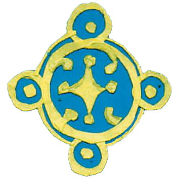

<a href="/roadmap">Roadmap</a> · a shorter trail

<h1 class="ar-title">From patterns or software</h1>

Many people meet Alexander through pattern languages, in architecture or in software, where they inspired design patterns and the first wiki. This trail starts there and follows the work on: why he came to think patterns were not enough, and what he did next.

1

Pattern language (page coming)

Shared knowledge of what works, linked from regions down to rooms, so that ordinary people can use it. Worked out with his colleagues at the Center for Environmental Structure in the 1970s, and still how most people meet the work.

<a href="/roadmap#stop-9">Stop 9 on the full roadmap</a>

2

<a href="/concepts/centers" class="ar-node__title">Centers</a>&nbsp;

The units wholeness is made of. Each center is made of other centers, and grows stronger as its neighbors do.

<a href="/roadmap#stop-3">Stop 3 on the full roadmap</a>

3

<a href="/concepts/generative-codes" class="ar-node__title">Generative codes</a>

Patterns put in order: pattern languages (from the late 1960s), then sequences (about 1990), then codes a community can follow step by step (about 2002).

<a href="/roadmap#stop-10">Stop 10 on the full roadmap</a>

4

Living process (page coming)

One process, repeated thousands of times: look at the whole, strengthen one center, check, and look again.

<a href="/roadmap#stop-8">Stop 8 on the full roadmap</a>

For the whole picture, follow <a href="/roadmap">the full roadmap</a>. Other trails: <a href="/roadmap/make-a-place">To make a place</a> · <a href="/roadmap/thesis">The thesis</a>.

