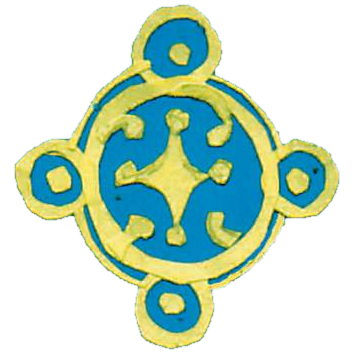

<a href="/roadmap">Roadmap</a> · a shorter trail

<h1 class="ar-title">The thesis</h1>

Alexander’s central claim in five steps: that the life we feel in some places is real, that you can test for it, what it is made of, how it is made, and what he came to think it says about the world.

1

<a href="/concepts/quality-without-a-name" class="ar-node__title">Life</a>&nbsp;

the quality without a name

Start here. What the best places share: nothing in them is at war with itself. In 1979 he said it could not be named; by 2002 he called it simply life, and said that everything has more of it or less.

<a href="/roadmap#stop-1">Stop 1 on the full roadmap</a>

2

<a href="/concepts/mirror-of-the-self" class="ar-node__title">The mirror of the self</a>

A test you can run yourself: of two things, which is the better picture of your whole self?

<a href="/roadmap#stop-5">Stop 5 on the full roadmap</a>

3

Living structure (page coming)

What a thing is like when its centers help one another densely. Nature has it everywhere; only we can make things without it.

<a href="/roadmap#stop-6">Stop 6 on the full roadmap</a>

4

<a href="/concepts/structure-preserving-transformations" class="ar-node__title">Structure-preserving transformations</a>&nbsp;

each step makes the whole more alive

The single good step: strengthen something already latent in the whole. The fifteen properties return here as fifteen kinds of step.

<a href="/roadmap#stop-7">Stop 7 on the full roadmap</a>

5

The “I”&nbsp; (page coming)

One self-like ground beneath things, which every living center opens onto.

<a href="/roadmap#stop-14">Stop 14 on the full roadmap</a>

For the whole picture, follow <a href="/roadmap">the full roadmap</a>. Other trails: <a href="/roadmap/make-a-place">To make a place</a> · <a href="/roadmap/from-patterns">From patterns or software</a>.

