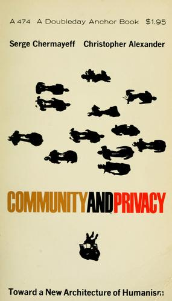

# Community and Privacy

*Toward a New Architecture of Humanism* · 1963 · Serge Chermayeff and Christopher Alexander · Doubleday

## What it is

A critique of the postwar house and suburb, written with the architect Serge Chermayeff, then a professor at Harvard, where Alexander was a graduate student. The authors argue that modern housing has lost both real privacy and real community, and propose a planned hierarchy of domains running from the fully public to the most private, with the transitions between them treated as carefully as the rooms. To organise the many requirements of a dwelling, Alexander analysed them into clusters of closely related needs, an early form of the method he set out a year later in *Notes on the Synthesis of Form*.

## Why it matters

Alexander's first book. Its concern with gradients of privacy and with how people actually live in houses runs straight through to *A Pattern Language* (compare *Intimacy Gradient*), and its requirement-clustering is the first appearance of his attempt to decompose a design problem systematically.

## Contents

_Not yet compiled._

## Materials

- **Text:** not in the project's sources repository.
- **Next:** [Notes on the Synthesis of Form](1964-notes-on-the-synthesis-of-form.md) (1964).

## Notes

_Rufus's notes will go here._
