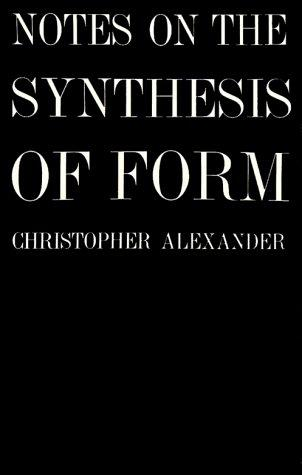

# Notes on the Synthesis of Form

1964 · Harvard University Press · ISBN 0-674-62751-2

## What it is

Alexander's doctoral work at Harvard, published as a short book. Design, he argues, is the search for "good fit" between a form and its context, and good fit is easier to recognise as the absence of misfits. Traditional, "unselfconscious" cultures reached good fit by slow correction over generations; modern designers, working selfconsciously on problems too complex to hold in mind, need a method. He proposes one: list the requirements, map which ones interact, and decompose the problem mathematically into nearly independent subsets that can each be solved with a simple diagram. An appendix works the method through for the replanning of an Indian village.

## Why it matters

The book made Alexander's name and became a founding text of the design methods movement. He soon turned away from that reading: in the preface to the 1971 paperback edition he says the valuable part was the idea of small independent diagrams, not the method for finding them, and those diagrams became the patterns of the 1970s. The contrast between unselfconscious and selfconscious making also anticipates the argument of *The Timeless Way of Building*.

## Contents

The book has an introduction on the need for rationality in design, Part One on good fit and on the unselfconscious and selfconscious processes, Part Two on the program and its realisation, an epilogue, and two appendices (a worked example and a mathematical treatment of decomposition). _(Outline not yet checked against a copy.)_

## Materials

- **Text:** not in the project's sources repository.
- **Before:** [Community and Privacy](1963-community-and-privacy.md) (1963). **After:** ["A City is Not a Tree"](1965-a-city-is-not-a-tree.md) (1965).

## Notes

_Rufus's notes will go here._
