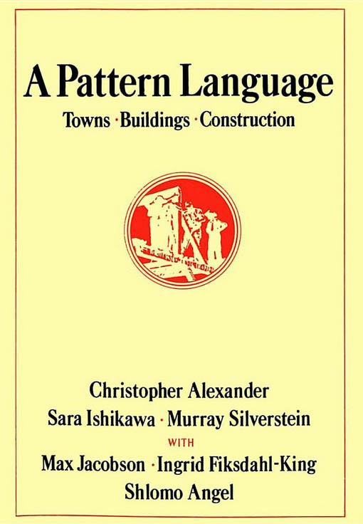

# A Pattern Language

*Towns, Buildings, Construction* · 1977 · Christopher Alexander, Sara Ishikawa and Murray Silverstein, with Max Jacobson, Ingrid Fiksdahl-King and Shlomo Angel · Oxford University Press · ISBN 978-0-19-501919-3

## What it is

A language of 253 patterns for making towns, buildings and their details. Each pattern names a problem that recurs in the environment, states the evidence for it, and gives the core of a solution, ending in a "Therefore" and links to the larger patterns it helps complete and the smaller ones that complete it. The patterns run from the scale of regions down to rooms, gardens and the things on a wall, and readers are invited to choose a sequence of them to make a language for their own project.

## Why it matters

Alexander's best-known book, and one of the most widely read books on architecture of the twentieth century. It gave non-architects a way to think about the places they live in, and its form, a network of linked problem–solution entries, was taken up far beyond building, most famously in software design. The authors marked each pattern with zero, one or two asterisks for how confident they were that it states a "true invariant", and called all 253 of them hypotheses, open to revision.

## Contents

- Using This Book
- **Towns** · patterns 1–94, from *Independent Regions* to *Sleeping in Public*
- **Buildings** · patterns 95–204, from *Building Complex* to *Secret Place*
- **Construction** · patterns 205–253, from *Structure Follows Social Spaces* to *Things from Your Life*

The full list is on this wiki's [Patterns](../patterns/index.md) page.

## Materials

- **On this wiki:** [Patterns](../patterns/index.md), the 253-pattern index, with full entries being added over time (for example [Window Place](../patterns/window-place.md) and [Positive Outdoor Space](../patterns/positive-outdoor-space.md)); and the concept page on [patterns](../concepts/patterns.md).
- **Text:** the project's private sources repository holds a searchable scan and an illustrated reading edition, one file per pattern. It is used to check quotations on this wiki and is not published.
- **Rufus's notes:** [a pattern shortlist](https://github.com/natureoforder/pattern-language/blob/main/shortlist.md) chosen for the Petit Bois Martin hamlet project, and the [pattern-language repository](https://github.com/natureoforder/pattern-language) where this project began.
- **Companion volumes:** [The Timeless Way of Building](1979-the-timeless-way-of-building.md) (the theory) and [The Oregon Experiment](1975-the-oregon-experiment.md) (a language in use).
- **External:** [PatternLanguage.com](https://www.patternlanguage.com/), the Center for Environmental Structure's site.

## Notes

_Rufus's notes will go here._
