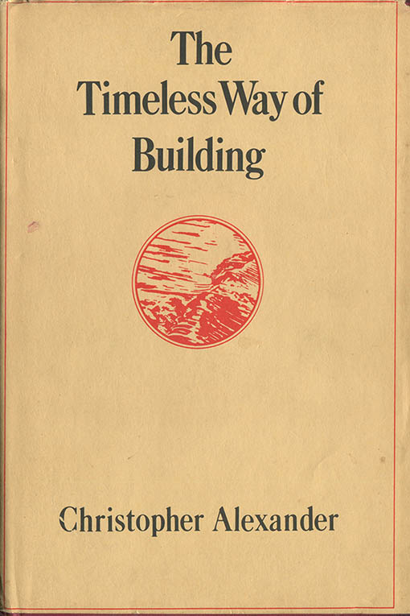

# The Timeless Way of Building

1979 · Oxford University Press · ISBN 978-0-19-502402-9 · Volume 1 of the Center for Environmental Structure series

## What it is

The philosophical companion to *A Pattern Language*. In short numbered sections, Alexander argues that the best traditional towns and buildings share a quality he can only call "the quality without a name", that this quality arises from patterns of events and the patterns of space that hold them, and that people once made such places through shared pattern languages. He then describes how a living language could again let ordinary people shape buildings and towns, one pattern at a time, through construction and repair.

## Why it matters

This is the clearest statement of the ideas behind *A Pattern Language* and the book most readers find closest to Alexander's voice. It introduces [the quality without a name](../concepts/quality-without-a-name.md) and the idea that a [pattern language](../concepts/patterns.md) is a living, shared language, not a design manual. Its closing image of the language as a "gate" that one passes through anticipates the later move to process in *The Nature of Order*.

## Contents

**The timeless way**

1. The timeless way

**The quality**

2. The quality without a name
3. Being alive
4. Patterns of events
5. Patterns of space
6. Patterns which are alive
7. The multiplicity of living patterns
8. The quality itself

**The gate**

9. The flower and the seed
10. Our pattern languages
11. Our pattern languages (continued)
12. The creative power of language
13. The breakdown of language
14. Patterns which can be shared
15. The reality of patterns
16. The structure of a language
17. The evolution of a common language for a town

**The way**

18. The genetic power of language
19. Differentiating space
20. One pattern at a time
21. Shaping one building
22. Shaping a group of buildings
23. The process of construction
24. The process of repair
25. The slow emergence of a town
26. Its ageless character

**The kernel of the way**

27. The kernel of the way

## Materials

- **Text:** the project's private sources repository holds a full scan and a machine-transcribed reading edition of all 27 chapters. It is used to check quotations on this wiki and is not published.
- **Rufus's notes:** [The Timeless Way of Building reading notes](https://github.com/natureoforder/pattern-language/blob/main/Timeless%20Way%20Notes.md) (in the natureoforder/pattern-language repository).
- **Companion volumes:** [A Pattern Language](1977-a-pattern-language.md) (1977) and [The Oregon Experiment](1975-the-oregon-experiment.md) (1975). Alexander presents the three as one work: this book states the theory, *A Pattern Language* gives a language, and *The Oregon Experiment* shows a community using one.
- **External:** [An early draft of The Timeless Way of Building](https://www.patternlanguage.com/archive/timeless.html) at PatternLanguage.com.

## Notes

_Rufus's notes will go here._
