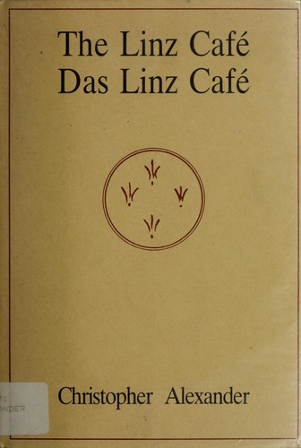

# The Linz Café / Das Linz Café

1981 · Oxford University Press and Löcker Verlag · bilingual English and German · ISBN 0-19-520263-5 (Oxford)

## What it is

A short illustrated book about a small café Alexander designed and built in Linz, Austria, for the 1980 "Forum Design" exhibition. The organisers asked him to build something that fully expressed his ideas about architecture; the café, a wooden building by the Danube, stood only for the summer of the exhibition. The book records how it was made and uses it to explain, in plain terms, what Alexander thinks makes a building feel good to be in.

## Why it matters

One of the first buildings in which Alexander's patterns were applied in full, and his first built work in Europe. Because the book is short and concrete, it is a good bridge between the patterns of the 1970s and the language of feeling and wholeness in *The Nature of Order*.

## Contents

_Not yet compiled._

## Materials

- **Text:** not in the project's sources repository.
- **External:** [The Linz Café at PatternLanguage.com](https://www.patternlanguage.com/bookstore/the-linz-cafe.html); [review in RAIN magazine, May 1982](https://www.rainmagazine.com/archive/1982/the-linz-café-rain-may-1982).

## Notes

_Rufus's notes will go here._
