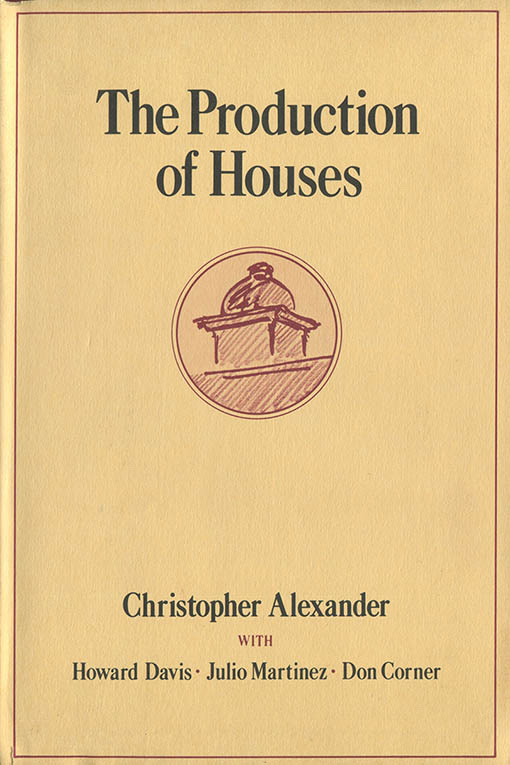

# The Production of Houses

1985 · Christopher Alexander with Howard Davis, Julio Martinez and Don Corner · Oxford University Press · ISBN 0-19-503223-3

## What it is

An account of a housing project in Mexicali, Mexico, in the mid-1970s, in which a small group of families designed and helped build their own houses on a shared site, working with Alexander's team. The book describes the system of production behind it: an architect-builder responsible for both design and construction, a local builder's yard, families laying out their own houses on the ground, construction step by step, and a strict control of cost so that each house came in at a fixed budget.

## Why it matters

It is Alexander's most direct attack on how mass housing is produced, and his argument that the quality of houses depends less on their design than on who controls money, decisions and construction. It is the main source for the architect-builder and for [design decisions made on site](../notes/on-site-design-decisions.md), ideas he developed further in *The Nature of Order*, Book 2, Part Three.

## Contents

_Not yet compiled._ The book is organised around the principles of the production system named above. _(Not yet checked against a copy.)_

## Materials

- **Text:** not in the project's sources repository.

## Notes

_Rufus's notes will go here._
