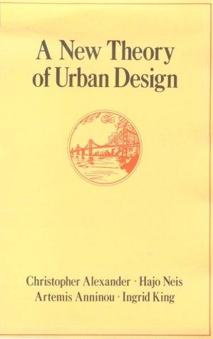

# A New Theory of Urban Design

1987 · Christopher Alexander, Hajo Neis, Artemis Anninou and Ingrid King · Oxford University Press · ISBN 0-19-503753-7

## What it is

A theory of how a city can grow as a whole, tested in a teaching experiment at Berkeley in which students simulated the development of part of the San Francisco waterfront, one project at a time. Alexander proposes a single overriding rule, that every increment of construction must help to heal the city by forming larger wholes, and seven more specific rules for applying it, covering piecemeal growth, the growth of larger wholes, visions, positive urban space, the layout of large buildings, construction, and the formation of centers.

## Why it matters

It extends the process ideas of *The Oregon Experiment* from a campus to a city, and it is the first book in which "wholeness" and "centers" become the working vocabulary, fifteen years before *The Nature of Order* set them out in full.

## Contents

_Not yet compiled._

## Materials

- **Text:** not in the project's sources repository.

## Notes

_Rufus's notes will go here._
