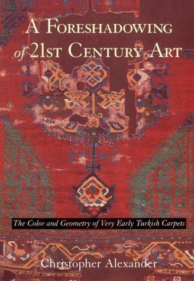

# A Foreshadowing of 21st Century Art

*The Color and Geometry of Very Early Turkish Carpets* · 1993 · Oxford University Press · ISBN 0-19-520866-8

## What it is

A large-format study of early Turkish carpets, many of them from Alexander's own collection, photographed in colour. He uses the carpets as a laboratory for the question at the heart of his later work: what geometric structure makes an object feel whole and alive? The analysis treats each carpet as a field of centers and looks closely at how its figures, borders, colours and small irregularities strengthen one another.

## Why it matters

It is the first book-length working-out of the theory of centers, published a decade before *The Nature of Order*, and the clearest place to see that Alexander's ideas about wholeness were never only about buildings. The title states his claim that the art of the coming century would have to recover this kind of order.

## Contents

_Not yet compiled._

## Materials

- **Text:** not in the project's sources repository.
- **Related:** [The Phenomenon of Life](2002-the-phenomenon-of-life.md), on centers and the fifteen properties; [The Luminous Ground](2004-the-luminous-ground.md), on colour.

## Notes

_Rufus's notes will go here._
