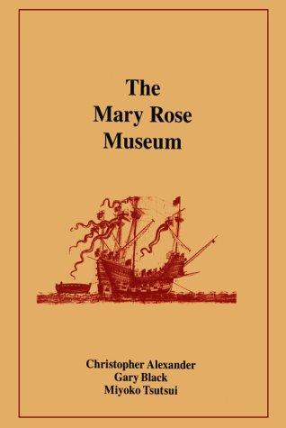

# The Mary Rose Museum

1995 · Christopher Alexander, Gary Black and Miyoko Tsutsui · Oxford University Press · ISBN 0-19-521017-4

## What it is

The design for a permanent museum in Portsmouth to house the *Mary Rose*, the Tudor warship raised from the Solent in 1982. The Mary Rose Trust commissioned Alexander in 1991. The book presents the design and the process that produced it, including its technical and practical side, as an example of how a large public building can be shaped by the same attention to feeling and wholeness as a house.

## Why it matters

It is one of the few book-length records of Alexander's approach applied to a large public building; compare the chapter "Large Public Buildings" in *The Nature of Order*, Book 3. _(We have not yet confirmed how far the design was built; the museum that opened at Portsmouth in 2013 is by other architects.)_

## Contents

_Not yet compiled._

## Materials

- **Text:** not in the project's sources repository.
- **External:** [The Mary Rose Museum at PatternLanguage.com](https://www.patternlanguage.com/bookstore/mary-rose-museum.html).

## Notes

_Rufus's notes will go here._
