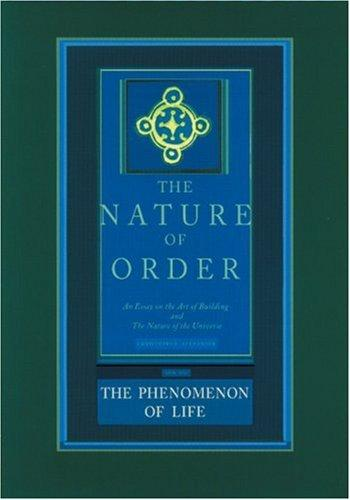

# The Phenomenon of Life

*The Nature of Order: An Essay on the Art of Building and the Nature of the Universe*, Book 1 · 2002 · The Center for Environmental Structure, Berkeley · ISBN 978-0-9726529-1-9

## What it is

The first of the four volumes of *The Nature of Order*. Alexander argues that "life" is a structural quality that any part of space can have to a greater or lesser degree, not only organisms. He describes wholeness as a field of overlapping *centers*, identifies fifteen geometric properties that recur wherever centers strengthen one another, and finds the same properties in nature. Part Two turns to the observer: degrees of life can be compared empirically by asking which of two things is the better picture of one's own self.

## Why it matters

This is where Alexander's late theory is laid down: centers, living structure and the fifteen properties are the vocabulary the other three books build on, and the [mirror-of-the-self test](../concepts/mirror-of-the-self.md) is his answer to the charge that judgments of quality are merely subjective. Start here for the [concepts](../concepts/index.md) of [wholeness and centers](../concepts/wholeness-and-centers.md) and [the fifteen properties](../concepts/fifteen-properties.md).

## Contents

- Prologue to Books 1–4
- Preface

**Part One**

1. The Phenomenon of Life
2. Degrees of Life
3. Wholeness and the Theory of Centers
4. How Life Comes from Wholeness
5. Fifteen Fundamental Properties
6. The Fifteen Properties in Nature

**Part Two**

7. The Personal Nature of Order
8. The Mirror of the Self
9. Beyond Descartes: A New Form of Scientific Observation
10. The Impact of Living Structure on Human Life
11. The Awakening of Space

- Conclusion
- Appendices: Mathematical Aspects of Wholeness and Living Structure

## Materials

- **Text:** the project's private sources repository holds a full scan and a chapter-by-chapter machine-transcribed reading edition. It is used to check quotations on this wiki and is not published.
- **Series:** [The Process of Creating Life](2002-the-process-of-creating-life.md) (Book 2) · [A Vision of a Living World](2005-a-vision-of-a-living-world.md) (Book 3) · [The Luminous Ground](2004-the-luminous-ground.md) (Book 4)
- **Way in:** [The Nature of Order in pictures](/nature-of-order), all four books in eight questions and sixty of their pictures.
- **External:** [PatternLanguage.com](https://www.patternlanguage.com/), the Center for Environmental Structure's site. Open Library also lists a 2020 reissue of the four books.

## Notes

_Rufus's notes will go here._
