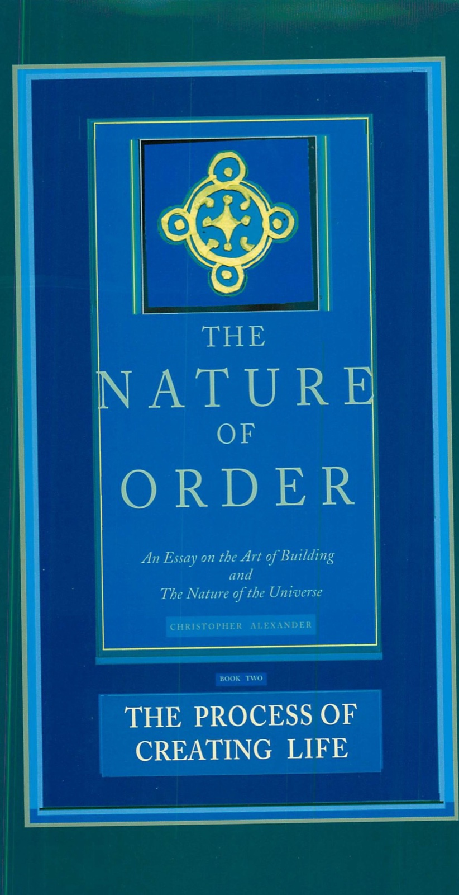

# The Process of Creating Life

*The Nature of Order*, Book 2 · 2002 · The Center for Environmental Structure, Berkeley · ISBN 0-9726529-2-2

## What it is

The second volume asks how living structure comes into being. Alexander's answer is process: a living whole is reached through a long sequence of small *structure-preserving transformations*, each of which strengthens the centers already present. He contrasts this unfolding with the planned, fabricated processes of modern building, and then describes the living process step by step: adaptation, differentiation, sequences, patterns as generic rules, deep feeling, and the emergence of form. Part Three asks what would have to change in society, money, law and the architect's role for such processes to become normal.

## Why it matters

Book 2 is where patterns are placed inside a larger theory: Alexander presents them here as one kind of rule for making centers, and the emphasis moves from a catalogue of solutions to the order in which decisions are made. It is the source for [structure-preserving transformations](../concepts/structure-preserving-transformations.md), [sequences](../concepts/sequences.md), [generative codes](../concepts/generative-codes.md) and [deep feeling](../concepts/deep-feeling.md).

## Contents

- Author's Note
- Preface: On Process

**Part One: Structure-Preserving Transformations**

1. The Principle of Unfolding Wholeness
2. Structure-Preserving Transformations
3. Structure-Preserving Transformations in Traditional Society
4. Structure-Destroying Transformations in Modern Society

- Interlude: Inspiring Modern Cases Where Unfolding Did Occur

5. Living Process in the Modern Era: Twentieth-Century Cases Where Living Process Did Occur

**Part Two: Living Processes**

6. Generated Structure
7. A Fundamental Differentiating Process
8. Step-by-Step Adaptation
9. Each Step Is Always Helping to Enhance the Whole
10. Always Making Centers
11. The Sequence of Unfolding
12. Every Part Unique
13. Patterns: Generic Rules for Making Centers
14. Deep Feeling
15. Emergence of Formal Geometry
16. Form Language and Style
17. Simplicity

**Part Three: A New Paradigm for Process in Society**

18. Encouraging Freedom
19. Massive Process Difficulties
20. The Spread of Living Processes Throughout Society: Making the Shift to the New Paradigm
21. The Role of the Architect in the Third Millennium

- Conclusion
- Appendix: A Small Example of a Living Process

## Materials

- **Text:** the project's private sources repository holds a full scan and a chapter-by-chapter machine-transcribed reading edition. It is used to check quotations on this wiki and is not published.
- **Series:** [The Phenomenon of Life](2002-the-phenomenon-of-life.md) (Book 1) · [A Vision of a Living World](2005-a-vision-of-a-living-world.md) (Book 3) · [The Luminous Ground](2004-the-luminous-ground.md) (Book 4)
- **Way in:** [The Nature of Order in pictures](/nature-of-order), all four books in eight questions and sixty of their pictures.

## Notes

_Rufus's notes will go here._
