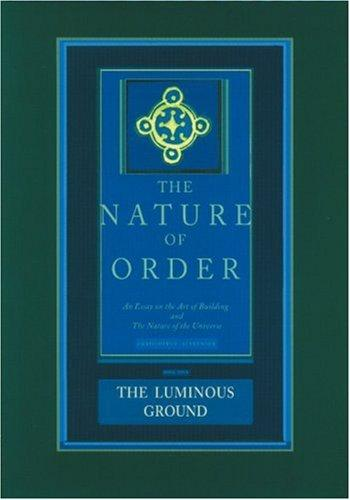

# The Luminous Ground

*The Nature of Order*, Book 4 · 2004 · The Center for Environmental Structure, Berkeley · ISBN 978-0-9726529-4-0

## What it is

The final volume of *The Nature of Order* asks what the existence of living structure implies about the nature of matter itself. Alexander proposes that every living center connects with something he calls the "I", a personal ground common to the maker, the viewer and the thing made, and that our present mechanistic picture of the universe must be modified to make room for it. The second half is about making: colour and inner light, the "goal of tears", and what the work of making wholeness does to the maker.

## Why it matters

Book 4 is the most speculative and personal of Alexander's books, and the one most often skipped. It is also where his claims about feeling, the self and objectivity reach their final form, and where he states most openly the religious and cosmological stakes he saw in architecture.

## Contents

- Author's Note
- Preface: Towards a New Conception of the Nature of Matter

**Part One**

1. Our Present Picture of the Universe
2. Clues from the History of Art
3. The Existence of an "I"
4. The Ten Thousand Beings
5. The Practical Matter of Forging a Living Center

- Mid-Book Appendix: Recapitulation of the Argument

**Part Two**

6. The Blazing One
7. Color and Inner Light
8. The Goal of Tears
9. Making Wholeness Heals the Maker
10. Pleasing Yourself
11. The Face of God

- A Modified Picture of the Universe
- Epilogue: Empirical Certainty and Enduring Doubt

## Materials

- **Text:** the project's private sources repository holds a full scan and a chapter-by-chapter machine-transcribed reading edition. It is used to check quotations on this wiki and is not published.
- **Series:** [The Phenomenon of Life](2002-the-phenomenon-of-life.md) (Book 1) · [The Process of Creating Life](2002-the-process-of-creating-life.md) (Book 2) · [A Vision of a Living World](2005-a-vision-of-a-living-world.md) (Book 3)
- **Related:** [A Foreshadowing of 21st Century Art](1993-a-foreshadowing-of-21st-century-art.md), whose study of carpets anticipates the book's chapters on colour.

## Notes

_Rufus's notes will go here._
