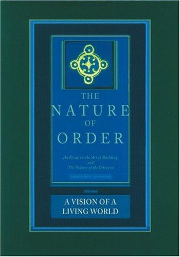

# A Vision of a Living World

*The Nature of Order*, Book 3 · 2005 · The Center for Environmental Structure, Berkeley · ISBN 0-9726529-3-0

## What it is

The third and most practical volume shows what a world made by living processes might look like, at every scale from the region to the ornament. It is built largely from the work of Alexander and his colleagues at the Center for Environmental Structure: public space and large public buildings, neighbourhoods planned with their residents, high-density housing, individual houses and rooms, construction, materials, ornament and colour. It is the longest of the four books.

## Why it matters

Books 1 and 2 state the theory; Book 3 is the evidence that it can be built. It is the best single source for Alexander's own projects and for how ideas like positive space and belonging play out on real sites, and it connects to the worked cases in [Practical guides](../practice/index.md).

## Contents

- Preface: Living Processes Repeated Ten Million Times

**Part One**

1. Belonging and Not-Belonging
2. Our Belonging to the World

**Part Two**

3. The Hulls of Public Space
4. Large Public Buildings
5. The Positive Pattern of Space and Volume in Three Dimensions on the Land
6. Positive Space in Engineering Structure and Geometry
7. The Character of Gardens

**Part Three**

8. People Forming a Collective Vision for Their Neighborhood
9. Reconstruction of an Urban Neighborhood
10. High-Density Housing
11. Necessary Further Dynamics of Any Neighborhood Which Comes to Life

**Part Four**

12. The Uniqueness of People's Individual Worlds
13. The Character of Rooms

**Part Five**

14. Construction Elements as Living Centers
15. All Building as Making
16. Continuous Invention of New Materials and Techniques
17. Production of Giant Projects

**Part Six**

18. Ornament as a Part of All Unfolding
19. Color Which Unfolds from the Configuration

- The Morphology of Living Architecture
- Conclusion: The World Created and Transformed
- Appendix on Number

## Materials

- **Text:** the project's private sources repository holds a full scan and a chapter-by-chapter machine-transcribed reading edition. It is used to check quotations on this wiki and is not published.
- **Series:** [The Phenomenon of Life](2002-the-phenomenon-of-life.md) (Book 1) · [The Process of Creating Life](2002-the-process-of-creating-life.md) (Book 2) · [The Luminous Ground](2004-the-luminous-ground.md) (Book 4)
- **Note on dates:** Book 3 was the last volume to appear (copyright 2005), after Book 4 (2004).

## Notes

_Rufus's notes will go here._
