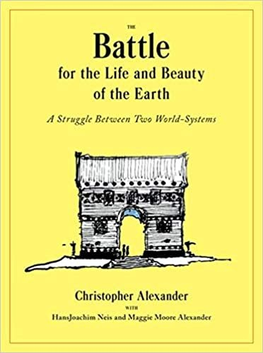

# The Battle for the Life and Beauty of the Earth

*A Struggle Between Two World-Systems* · 2012 · Christopher Alexander with HansJoachim Neis and Maggie Moore Alexander · Oxford University Press · ISBN 978-0-19-989807-7

## What it is

The story of the Eishin Gakuen campus, a high school and college that Alexander and the Center for Environmental Structure designed and built in Iruma, near Tokyo, in the 1980s. Around that story Alexander sets an argument about two ways of making the world: "System A", which lets buildings grow from the needs and feelings of the people who use them, and "System B", the dominant system of money, regulation and mass production, which he sees as working against life. The book records in detail the fights with contractors, officials and conventions that building Eishin required.

## Why it matters

Alexander's last major book and his fullest case study: a large project followed from the users' first pattern language through site layout and construction. It is also his most explicitly political book, arguing that making living places requires changing the systems that produce buildings, not only their designs.

## Purpose of architecture

The book opens, in its preface "A New Architecture, A New Civilization", with a sentence Rufus singles out in his notes as the shortest statement of Alexander's aim: architecture exists to provide opportunities for life-giving situations. _(Exact wording to be checked against the text; see [Rufus's note](https://github.com/natureoforder/pattern-language/blob/main/purpose-of-architecture.md).)_

## Contents

_Not yet compiled._

## Materials

- **On this wiki:** [Laying out the Eishin campus](../practice/eishin-campus.md) and [Laying out a hamlet or a campus: Alexander's method at Eishin](../practice/eishin-campus-reading.md), drawn from *A Vision of a Living World*.
- **Text:** not in the project's sources repository.
- **Rufus's notes:** [The purpose of architecture](https://github.com/natureoforder/pattern-language/blob/main/purpose-of-architecture.md).

## Notes

_Rufus's notes will go here._
