# Works

Christopher Alexander (1936–2022) wrote books for half a century, from 1963 to 2012. Most readers start with *A Pattern Language*, but it is one book in a long argument that runs from a search for a method of design, through patterns, to a theory of wholeness and living process. Below, the major works are grouped by period, each with its own page; a [full chronological list](#chronology) follows, including essays and talks.

**Where to start.** For the ideas in Alexander's own voice, read [The Timeless Way of Building](1979-the-timeless-way-of-building.md). To use them on a house or a street, [A Pattern Language](1977-a-pattern-language.md). For the late theory that he thought superseded the patterns, [The Phenomenon of Life](2002-the-phenomenon-of-life.md), Book 1 of *The Nature of Order*.

<a href="/works/1963-community-and-privacy" title="Community and Privacy">1963</a>
<a href="/works/1964-notes-on-the-synthesis-of-form" title="Notes on the Synthesis of Form">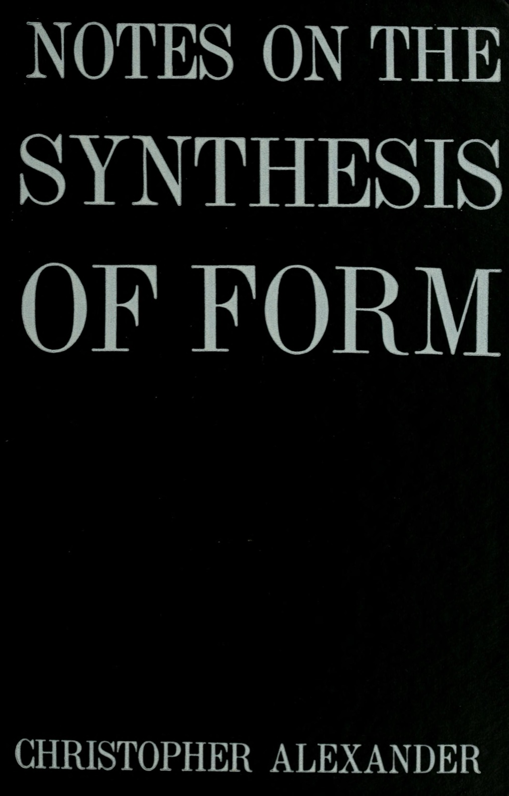1964</a>

<a href="/works/1975-the-oregon-experiment" title="The Oregon Experiment">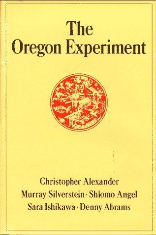1975</a>
<a href="/works/1977-a-pattern-language" title="A Pattern Language">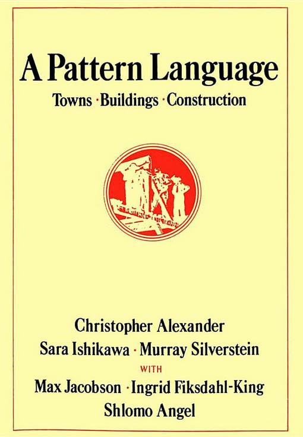1977</a>
<a href="/works/1979-the-timeless-way-of-building" title="The Timeless Way of Building">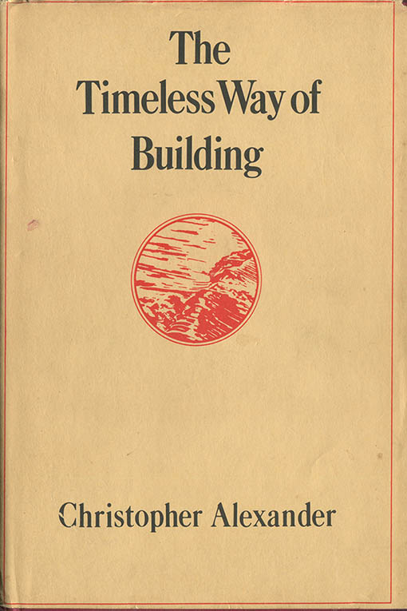1979</a>

<a href="/works/1981-the-linz-cafe" title="The Linz Café">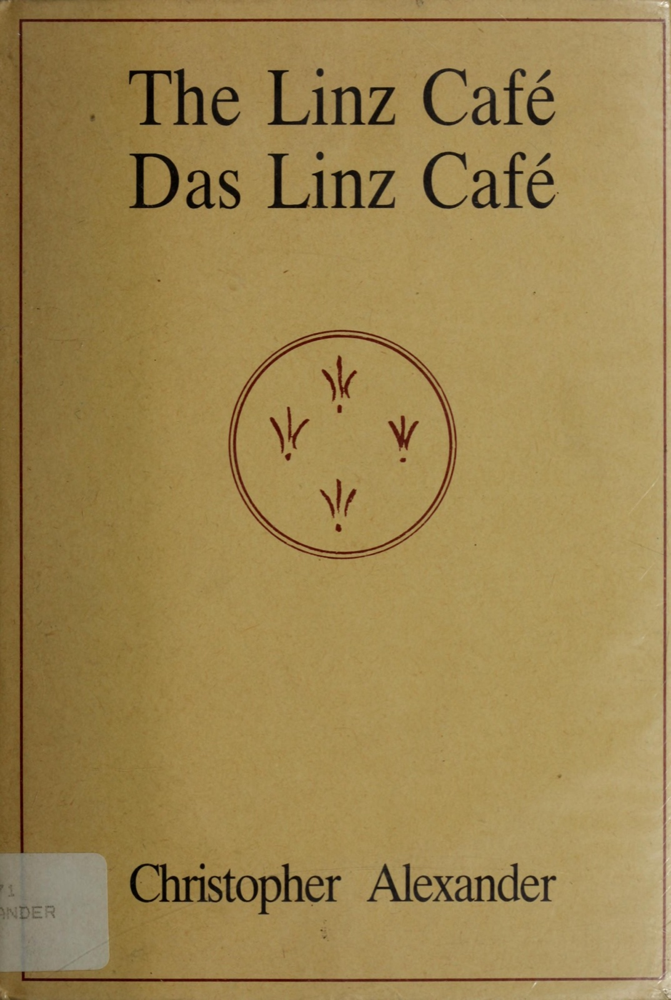1981</a>
<a href="/works/1985-the-production-of-houses" title="The Production of Houses">1985</a>
<a href="/works/1987-a-new-theory-of-urban-design" title="A New Theory of Urban Design">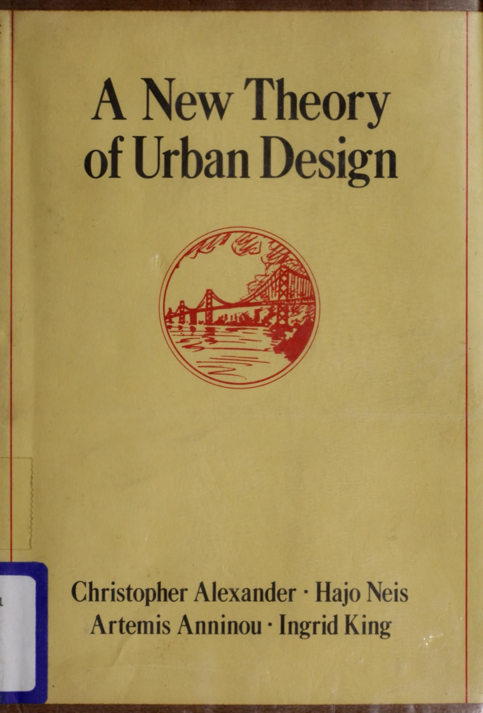1987</a>

<a href="/works/1993-a-foreshadowing-of-21st-century-art" title="A Foreshadowing of 21st Century Art">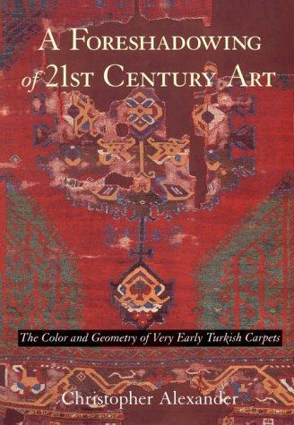1993</a>
<a href="/works/1995-the-mary-rose-museum" title="The Mary Rose Museum">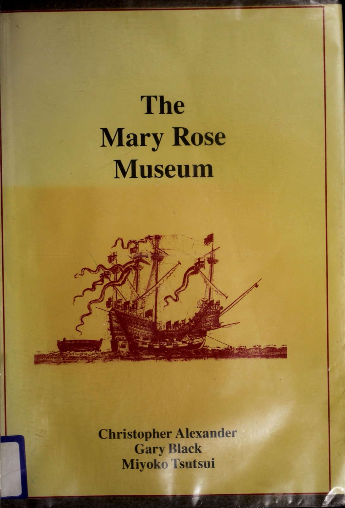1995</a>

<a href="/works/2002-the-phenomenon-of-life" title="The Phenomenon of Life">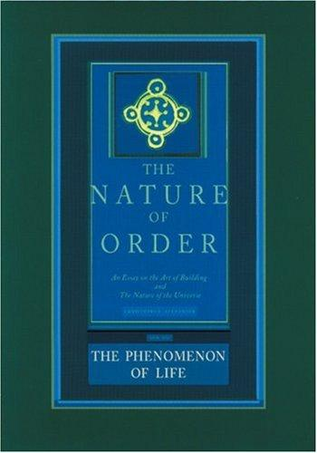2002</a>
<a href="/works/2002-the-process-of-creating-life" title="The Process of Creating Life">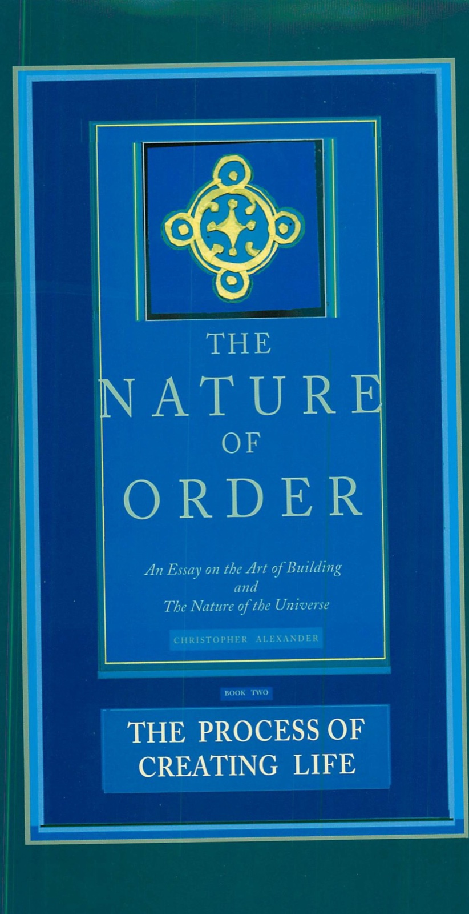2002</a>
<a href="/works/2004-the-luminous-ground" title="The Luminous Ground">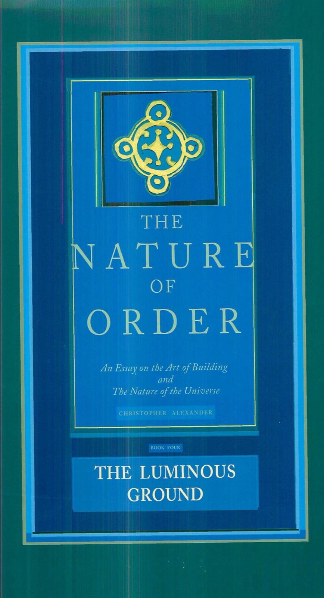2004</a>
<a href="/works/2005-a-vision-of-a-living-world" title="A Vision of a Living World">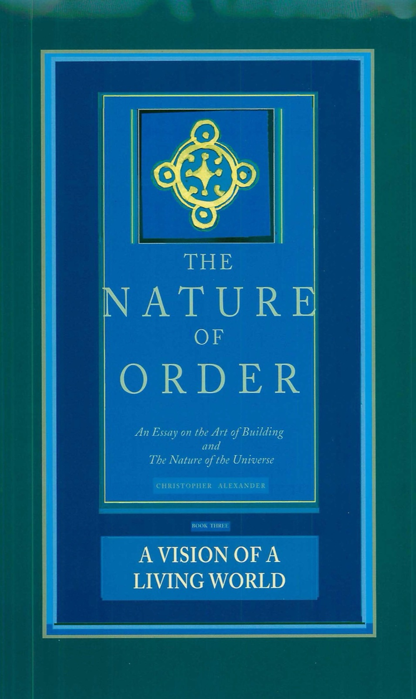2005</a>

<a href="/works/2012-the-battle-for-the-life-and-beauty-of-the-earth" title="The Battle for the Life and Beauty of the Earth">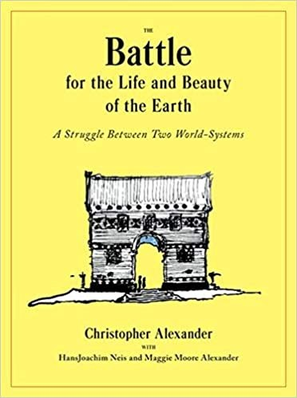2012</a>

15 books · 1963–2012 · lines mark the decades · scroll sideways

## The early work 1963–1965

Alexander trained in mathematics and architecture at Cambridge and Harvard. His first books look for a rigorous method of design; the essay that followed broke with the tree-like structure that method produced.

<a class="works-card" href="/works/1963-community-and-privacy">Community and Privacy1963</a>
<a class="works-card" href="/works/1964-notes-on-the-synthesis-of-form">Notes on the Synthesis of Form1964</a>
<a class="works-card" href="/works/1965-a-city-is-not-a-tree">A City is Not a Tree<small>Essay</small>A City is Not a Tree1965</a>

## The trilogy 1975–1979

Three books published by Oxford University Press as one work, numbered as volumes 1–3 of the Center for Environmental Structure series: the theory, the language, and a community using it.

<a class="works-card" href="/works/1979-the-timeless-way-of-building">The Timeless Way of Building1979</a>
<a class="works-card" href="/works/1977-a-pattern-language">A Pattern Language1977</a>
<a class="works-card" href="/works/1975-the-oregon-experiment">The Oregon Experiment1975</a>

## The building experiments 1981–1995

Through the 1980s and 1990s Alexander tested the ideas on the ground: a café, self-built houses in Mexico, a simulated city, a museum. Each book reports one experiment.

<a class="works-card" href="/works/1981-the-linz-cafe">The Linz Café1981</a>
<a class="works-card" href="/works/1985-the-production-of-houses">The Production of Houses1985</a>
<a class="works-card" href="/works/1987-a-new-theory-of-urban-design">A New Theory of Urban Design1987</a>
<a class="works-card" href="/works/1995-the-mary-rose-museum">The Mary Rose Museum1995</a>

## The Nature of Order 2002–2005

Alexander's four-volume summation, published by his own Center for Environmental Structure after more than twenty years of drafts: what life in buildings is, how it is made, what a world made that way would look like, and what it implies about the universe.

<a class="works-card" href="/works/2002-the-phenomenon-of-life">Book 1: The Phenomenon of Life2002</a>
<a class="works-card" href="/works/2002-the-process-of-creating-life">Book 2: The Process of Creating Life2002</a>
<a class="works-card" href="/works/2005-a-vision-of-a-living-world">Book 3: A Vision of a Living World2005</a>
<a class="works-card" href="/works/2004-the-luminous-ground">Book 4: The Luminous Ground2004</a>

## Carpets and the last battle 1993–2012

A study of carpets that first worked out the theory of centers, and the story of the Eishin campus in Japan, Alexander's largest built project and last major book.

<a class="works-card" href="/works/1993-a-foreshadowing-of-21st-century-art">A Foreshadowing of 21st Century Art1993</a>
<a class="works-card" href="/works/2012-the-battle-for-the-life-and-beauty-of-the-earth">The Battle for the Life and Beauty of the Earth2012</a>

## Talks and debates 1982–1996

Shorter pieces where Alexander states his position to an audience, with full text or recordings where we have them.

<a class="works-card" href="/works/1982-contrasting-concepts-of-harmony-in-architecture">Debate with Peter Eisenman<small>Debate · full text</small>Debate with Peter Eisenman1982</a>
<a class="works-card" href="/works/1996-oopsla-keynote-patterns-in-architecture">The OOPSLA keynote<small>Talk · video and transcript</small>The OOPSLA keynote1996</a>

## Chronology

Books, essays, talks and the debate, in order of first publication or delivery. Entries marked † are from secondary sources we have not yet checked against the publication itself.

| Year | Work | Kind | Details |
| --- | --- | --- | --- |
| 1963 | [Community and Privacy: Toward a New Architecture of Humanism](1963-community-and-privacy.md) | Book | With Serge Chermayeff. Doubleday |
| 1964 | [Notes on the Synthesis of Form](1964-notes-on-the-synthesis-of-form.md) | Book | Harvard University Press |
| 1965 | ["A City is Not a Tree"](1965-a-city-is-not-a-tree.md) | Essay | *Architectural Forum* 122(1), April, and 122(2), May 1965 |
| 1967† | "The Atoms of Environmental Structure" | Paper | With Barry Poyner. Reprinted in G. T. Moore (ed.), *Emerging Methods in Environmental Design and Planning* (MIT Press, 1970). Year of first issue unconfirmed (1966 or 1967) |
| 1968† | *A Pattern Language Which Generates Multi-Service Centers* | Report | With Sara Ishikawa and Murray Silverstein. Center for Environmental Structure |
| 1969† | *Houses Generated by Patterns* | Report | Center for Environmental Structure |
| 1975 | [The Oregon Experiment](1975-the-oregon-experiment.md) | Book | With Murray Silverstein, Shlomo Angel, Sara Ishikawa, Denny Abrams. Oxford University Press |
| 1977 | [A Pattern Language: Towns, Buildings, Construction](1977-a-pattern-language.md) | Book | With Sara Ishikawa, Murray Silverstein, Max Jacobson, Ingrid Fiksdahl-King, Shlomo Angel. Oxford University Press |
| 1979 | [The Timeless Way of Building](1979-the-timeless-way-of-building.md) | Book | Oxford University Press |
| 1981 | [The Linz Café / Das Linz Café](1981-the-linz-cafe.md) | Book | Oxford University Press and Löcker Verlag |
| 1982 | ["Contrasting Concepts of Harmony in Architecture"](1982-contrasting-concepts-of-harmony-in-architecture.md) | Debate | With Peter Eisenman, Harvard GSD, 17 November 1982. *Lotus International* 40 (1983). Full text |
| 1985 | [The Production of Houses](1985-the-production-of-houses.md) | Book | With Howard Davis, Julio Martinez, Don Corner. Oxford University Press |
| 1987 | [A New Theory of Urban Design](1987-a-new-theory-of-urban-design.md) | Book | With Hajo Neis, Artemis Anninou, Ingrid King. Oxford University Press |
| 1993 | [A Foreshadowing of 21st Century Art: The Color and Geometry of Very Early Turkish Carpets](1993-a-foreshadowing-of-21st-century-art.md) | Book | Oxford University Press |
| 1995 | [The Mary Rose Museum](1995-the-mary-rose-museum.md) | Book | With Gary Black, Miyoko Tsutsui. Oxford University Press |
| 1996 | [The OOPSLA keynote](1996-oopsla-keynote-patterns-in-architecture.md) | Talk | San Jose, October 1996. Published as "The Origins of Pattern Theory", *IEEE Software* 16(5), 1999 |
| 2002 | [The Nature of Order, Book 1: The Phenomenon of Life](2002-the-phenomenon-of-life.md) | Book | Center for Environmental Structure |
| 2002 | [The Nature of Order, Book 2: The Process of Creating Life](2002-the-process-of-creating-life.md) | Book | Center for Environmental Structure |
| 2004 | [The Nature of Order, Book 4: The Luminous Ground](2004-the-luminous-ground.md) | Book | Center for Environmental Structure |
| 2004† | "Sustainability and Morphogenesis: The Birth of a Living World" | Lecture | Schumacher Lecture, Bristol, 30 October 2004 |
| 2005 | [The Nature of Order, Book 3: A Vision of a Living World](2005-a-vision-of-a-living-world.md) | Book | Center for Environmental Structure |
| 2006 | [Building Living Neighborhoods](2006-building-living-neighborhoods.md) | Website | With Maggie Moore Alexander, Randy Schmidt, Nick Littlestone, Bev Behrman, Howard Davis. Center for Environmental Structure, livingneighborhoods.org |
| 2007† | "Empirical Findings from *The Nature of Order*" | Article | *Environmental & Architectural Phenomenology* 18(1) |
| 2009† | "Harmony-Seeking Computations" | Article | *International Journal of Unconventional Computing*; first given at a 2005 workshop on non-classical computation, York |
| 2012 | [The Battle for the Life and Beauty of the Earth: A Struggle Between Two World-Systems](2012-the-battle-for-the-life-and-beauty-of-the-earth.md) | Book | With HansJoachim Neis, Maggie Moore Alexander. Oxford University Press |

This list is not yet complete. Other reports, articles and talks will be added as they are checked. The Center for Environmental Structure's [archive](https://christopher-alexander-ces-archive.org/) and [PatternLanguage.com](https://www.patternlanguage.com/) hold much more.
