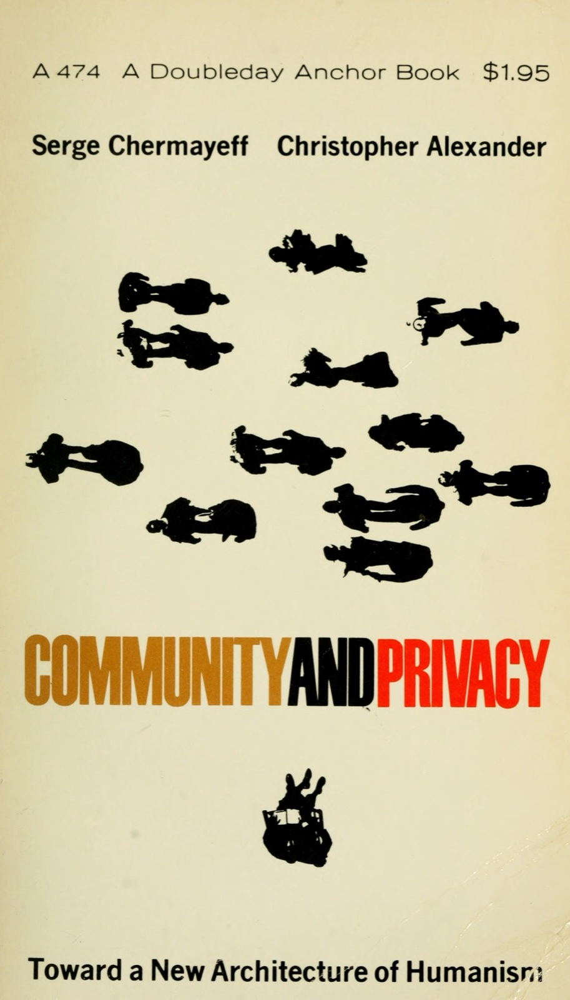
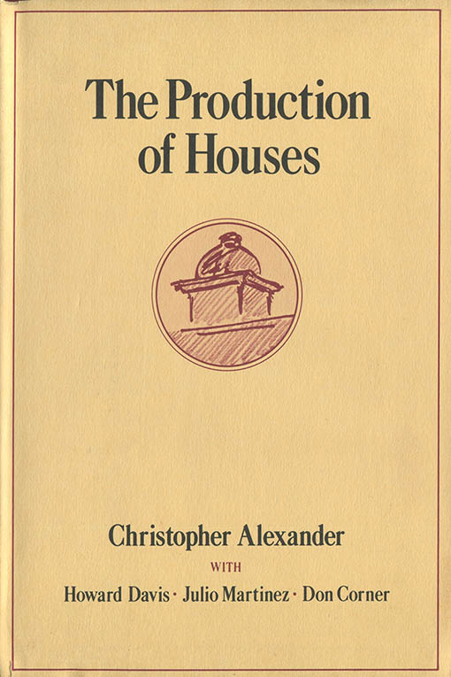
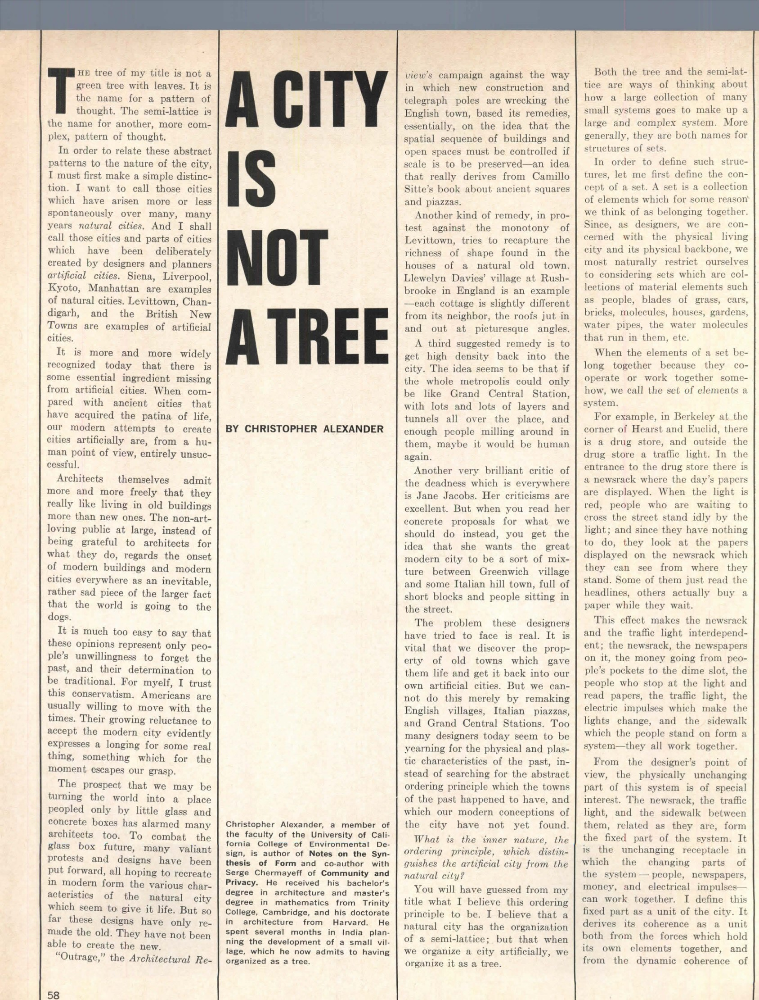

<header class="works-head">
<h1>Works</h1>

Christopher Alexander's books, essays and talks, grouped by period, with a page for each major work.

</header>

Christopher Alexander (1936–2022) wrote books for half a century, from 1963 to 2012. Most readers start with <em>A Pattern Language</em>, but it is one book in a long argument that runs from a search for a method of design, through patterns, to a theory of wholeness and living process. Below, the major works are grouped by period, each with its own page; a <a href="#chronology">full chronological list</a> follows, including essays and talks.

<strong>Where to start.</strong> For the ideas in Alexander's own voice, read <a href="/works/1979-the-timeless-way-of-building">The Timeless Way of Building</a>. To use them on a house or a street, <a href="/works/1977-a-pattern-language">A Pattern Language</a>. For the late theory that he thought superseded the patterns, <a href="/works/2002-the-phenomenon-of-life">The Phenomenon of Life</a>, Book 1 of <em>The Nature of Order</em>, or first <a href="/nature-of-order">the four books in pictures</a>.

<section class="works-timeline" aria-label="Every book in order of publication">

1960s

<a href="/works/1963-community-and-privacy">1963Community and Privacy</a>
<a href="/works/1964-notes-on-the-synthesis-of-form">1964Notes on the Synthesis of Form</a>

1970s

<a href="/works/1975-the-oregon-experiment">1975The Oregon Experiment</a>
<a href="/works/1977-a-pattern-language">1977A Pattern Language</a>
<a href="/works/1979-the-timeless-way-of-building">1979The Timeless Way of Building</a>

1980s

<a href="/works/1981-the-linz-cafe">1981The Linz Café</a>
<a href="/works/1985-the-production-of-houses">1985The Production of Houses</a>
<a href="/works/1987-a-new-theory-of-urban-design">1987A New Theory of Urban Design</a>

1990s

<a href="/works/1993-a-foreshadowing-of-21st-century-art">1993A Foreshadowing of 21st Century Art</a>
<a href="/works/1995-the-mary-rose-museum">1995The Mary Rose Museum</a>

2000s

<a href="/works/2002-the-phenomenon-of-life">2002Book 1: The Phenomenon of Life</a>
<a href="/works/2002-the-process-of-creating-life">2002Book 2: The Process of Creating Life</a>
<a href="/works/2004-the-luminous-ground">2004Book 4: The Luminous Ground</a>
<a href="/works/2005-a-vision-of-a-living-world">2005Book 3: A Vision of a Living World</a>

2010s

<a href="/works/2012-the-battle-for-the-life-and-beauty-of-the-earth">2012The Battle for the Life and Beauty of the Earth</a>

15 books · 1963–2012 · scroll sideways

</section>

<section class="works-period" id="the-early-work">

<h2>The early work</h2>

1963–1965

Alexander trained in mathematics and architecture at Cambridge and Harvard. His first books look for a rigorous method of design; the essay that followed broke with the tree-like structure that method produced.

<a class="works-card" href="/works/1963-community-and-privacy">Community and Privacy1963</a>
<a class="works-card" href="/works/1964-notes-on-the-synthesis-of-form">Notes on the Synthesis of Form1964</a>
<a class="works-card" href="/works/1965-a-city-is-not-a-tree">A City is Not a Tree1965</a>

</section>

<section class="works-period" id="the-trilogy">

<h2>The trilogy</h2>

1975–1979

Three books published by Oxford University Press as one work, numbered as volumes 1–3 of the Center for Environmental Structure series: the theory, the language, and a community using it.

<a class="works-card" href="/works/1979-the-timeless-way-of-building">The Timeless Way of Building1979</a>
<a class="works-card" href="/works/1977-a-pattern-language">A Pattern Language1977</a>
<a class="works-card" href="/works/1975-the-oregon-experiment">The Oregon Experiment1975</a>

</section>

<section class="works-period" id="the-building-experiments">

<h2>The building experiments</h2>

1981–1995

Through the 1980s and 1990s Alexander tested the ideas on the ground: a café, self-built houses in Mexico, a simulated city, a museum. Each book reports one experiment.

<a class="works-card" href="/works/1981-the-linz-cafe">The Linz Café1981</a>
<a class="works-card" href="/works/1985-the-production-of-houses">The Production of Houses1985</a>
<a class="works-card" href="/works/1987-a-new-theory-of-urban-design">A New Theory of Urban Design1987</a>
<a class="works-card" href="/works/1995-the-mary-rose-museum">The Mary Rose Museum1995</a>

</section>

<section class="works-period" id="the-nature-of-order">

<h2>The Nature of Order</h2>

2002–2005

Alexander's four-volume summation, published by his own Center for Environmental Structure after more than twenty years of drafts: what life in buildings is, how it is made, what a world made that way would look like, and what it implies about the universe.

<a class="works-card" href="/works/2002-the-phenomenon-of-life">Book 1: The Phenomenon of Life2002</a>
<a class="works-card" href="/works/2002-the-process-of-creating-life">Book 2: The Process of Creating Life2002</a>
<a class="works-card" href="/works/2005-a-vision-of-a-living-world">Book 3: A Vision of a Living World2005</a>
<a class="works-card" href="/works/2004-the-luminous-ground">Book 4: The Luminous Ground2004</a>

</section>

<section class="works-period" id="carpets-and-the-last-battle">

<h2>Carpets and the last battle</h2>

1993–2012

A study of carpets that first worked out the theory of centers, and the story of the Eishin campus in Japan, Alexander's largest built project and last major book.

<a class="works-card" href="/works/1993-a-foreshadowing-of-21st-century-art">A Foreshadowing of 21st Century Art1993</a>
<a class="works-card" href="/works/2012-the-battle-for-the-life-and-beauty-of-the-earth">The Battle for the Life and Beauty of the Earth2012</a>

</section>

<section class="works-period" id="talks-and-debates">

<h2>Talks and debates</h2>

1982–1996

Shorter pieces where Alexander states his position to an audience, with full text or recordings where we have them.

<a class="works-card" href="/works/1982-contrasting-concepts-of-harmony-in-architecture">Debate with Peter Eisenman<small>Debate · full text</small>Debate with Peter Eisenman1982</a>
<a class="works-card" href="/works/1996-oopsla-keynote-patterns-in-architecture">The OOPSLA keynote<small>Talk · video and transcript</small>The OOPSLA keynote1996</a>

</section>

<section class="works-chronology" id="chronology">
<h2>Chronology</h2>

Books, essays, talks and the debate, in order of first publication or delivery. Entries marked † are from secondary sources we have not yet checked against the publication itself.

<table>
<thead><tr><th>Year</th><th>Work</th><th>Kind</th><th>Details</th></tr></thead>
<tbody>
<tr><td>1963</td><td><a href="/works/1963-community-and-privacy">Community and Privacy: Toward a New Architecture of Humanism</a></td><td>Book</td><td>With Serge Chermayeff. Doubleday</td></tr>
<tr><td>1964</td><td><a href="/works/1964-notes-on-the-synthesis-of-form">Notes on the Synthesis of Form</a></td><td>Book</td><td>Harvard University Press</td></tr>
<tr><td>1965</td><td><a href="/works/1965-a-city-is-not-a-tree">"A City is Not a Tree"</a></td><td>Essay</td><td><em>Architectural Forum</em> 122(1), April, and 122(2), May 1965</td></tr>
<tr><td>1967†</td><td>"The Atoms of Environmental Structure"</td><td>Paper</td><td>With Barry Poyner. Reprinted in G. T. Moore (ed.), <em>Emerging Methods in Environmental Design and Planning</em> (MIT Press, 1970). Year of first issue unconfirmed (1966 or 1967)</td></tr>
<tr><td>1968†</td><td><em>A Pattern Language Which Generates Multi-Service Centers</em></td><td>Report</td><td>With Sara Ishikawa and Murray Silverstein. Center for Environmental Structure</td></tr>
<tr><td>1969†</td><td><em>Houses Generated by Patterns</em></td><td>Report</td><td>Center for Environmental Structure</td></tr>
<tr><td>1975</td><td><a href="/works/1975-the-oregon-experiment">The Oregon Experiment</a></td><td>Book</td><td>With Murray Silverstein, Shlomo Angel, Sara Ishikawa, Denny Abrams. Oxford University Press</td></tr>
<tr><td>1977</td><td><a href="/works/1977-a-pattern-language">A Pattern Language: Towns, Buildings, Construction</a></td><td>Book</td><td>With Sara Ishikawa, Murray Silverstein, Max Jacobson, Ingrid Fiksdahl-King, Shlomo Angel. Oxford University Press</td></tr>
<tr><td>1979</td><td><a href="/works/1979-the-timeless-way-of-building">The Timeless Way of Building</a></td><td>Book</td><td>Oxford University Press</td></tr>
<tr><td>1981</td><td><a href="/works/1981-the-linz-cafe">The Linz Café / Das Linz Café</a></td><td>Book</td><td>Oxford University Press and Löcker Verlag</td></tr>
<tr><td>1982</td><td><a href="/works/1982-contrasting-concepts-of-harmony-in-architecture">"Contrasting Concepts of Harmony in Architecture"</a></td><td>Debate</td><td>With Peter Eisenman, Harvard GSD, 17 November 1982. <em>Lotus International</em> 40 (1983). Full text</td></tr>
<tr><td>1985</td><td><a href="/works/1985-the-production-of-houses">The Production of Houses</a></td><td>Book</td><td>With Howard Davis, Julio Martinez, Don Corner. Oxford University Press</td></tr>
<tr><td>1987</td><td><a href="/works/1987-a-new-theory-of-urban-design">A New Theory of Urban Design</a></td><td>Book</td><td>With Hajo Neis, Artemis Anninou, Ingrid King. Oxford University Press</td></tr>
<tr><td>1993</td><td><a href="/works/1993-a-foreshadowing-of-21st-century-art">A Foreshadowing of 21st Century Art: The Color and Geometry of Very Early Turkish Carpets</a></td><td>Book</td><td>Oxford University Press</td></tr>
<tr><td>1995</td><td><a href="/works/1995-the-mary-rose-museum">The Mary Rose Museum</a></td><td>Book</td><td>With Gary Black, Miyoko Tsutsui. Oxford University Press</td></tr>
<tr><td>1996</td><td><a href="/works/1996-oopsla-keynote-patterns-in-architecture">The OOPSLA keynote</a></td><td>Talk</td><td>San Jose, October 1996. Published as "The Origins of Pattern Theory", <em>IEEE Software</em> 16(5), 1999</td></tr>
<tr><td>2002</td><td><a href="/works/2002-the-phenomenon-of-life">The Nature of Order, Book 1: The Phenomenon of Life</a></td><td>Book</td><td>Center for Environmental Structure</td></tr>
<tr><td>2002</td><td><a href="/works/2002-the-process-of-creating-life">The Nature of Order, Book 2: The Process of Creating Life</a></td><td>Book</td><td>Center for Environmental Structure</td></tr>
<tr><td>2004</td><td><a href="/works/2004-the-luminous-ground">The Nature of Order, Book 4: The Luminous Ground</a></td><td>Book</td><td>Center for Environmental Structure</td></tr>
<tr><td>2004†</td><td>"Sustainability and Morphogenesis: The Birth of a Living World"</td><td>Lecture</td><td>Schumacher Lecture, Bristol, 30 October 2004</td></tr>
<tr><td>2005</td><td><a href="/works/2005-a-vision-of-a-living-world">The Nature of Order, Book 3: A Vision of a Living World</a></td><td>Book</td><td>Center for Environmental Structure</td></tr>
<tr><td>2006</td><td><a href="/works/2006-building-living-neighborhoods">Building Living Neighborhoods</a></td><td>Website</td><td>With Maggie Moore Alexander, Randy Schmidt, Nick Littlestone, Bev Behrman, Howard Davis. Center for Environmental Structure, livingneighborhoods.org</td></tr>
<tr><td>2007†</td><td>"Empirical Findings from <em>The Nature of Order</em>"</td><td>Article</td><td><em>Environmental & Architectural Phenomenology</em> 18(1)</td></tr>
<tr><td>2009†</td><td>"Harmony-Seeking Computations"</td><td>Article</td><td><em>International Journal of Unconventional Computing</em>; first given at a 2005 workshop on non-classical computation, York</td></tr>
<tr><td>2012</td><td><a href="/works/2012-the-battle-for-the-life-and-beauty-of-the-earth">The Battle for the Life and Beauty of the Earth: A Struggle Between Two World-Systems</a></td><td>Book</td><td>With HansJoachim Neis, Maggie Moore Alexander. Oxford University Press</td></tr>
</tbody></table>

This list is not yet complete. Other reports, articles and talks will be added as they are checked. The Center for Environmental Structure's <a href="https://christopher-alexander-ces-archive.org/">archive</a> and <a href="https://www.patternlanguage.com/">PatternLanguage.com</a> hold much more.

</section>

